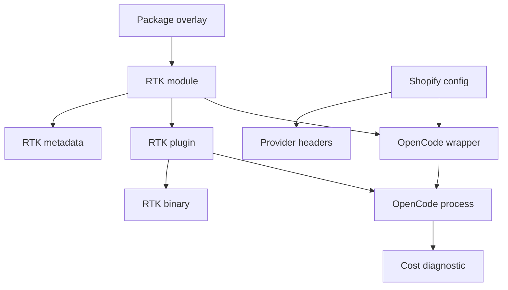
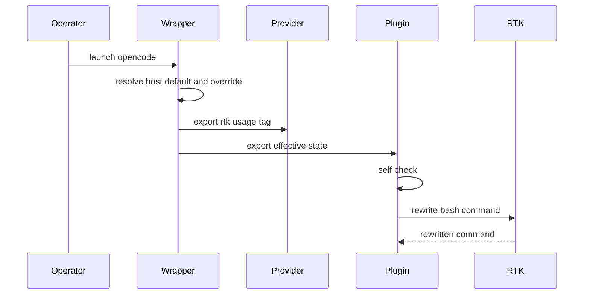
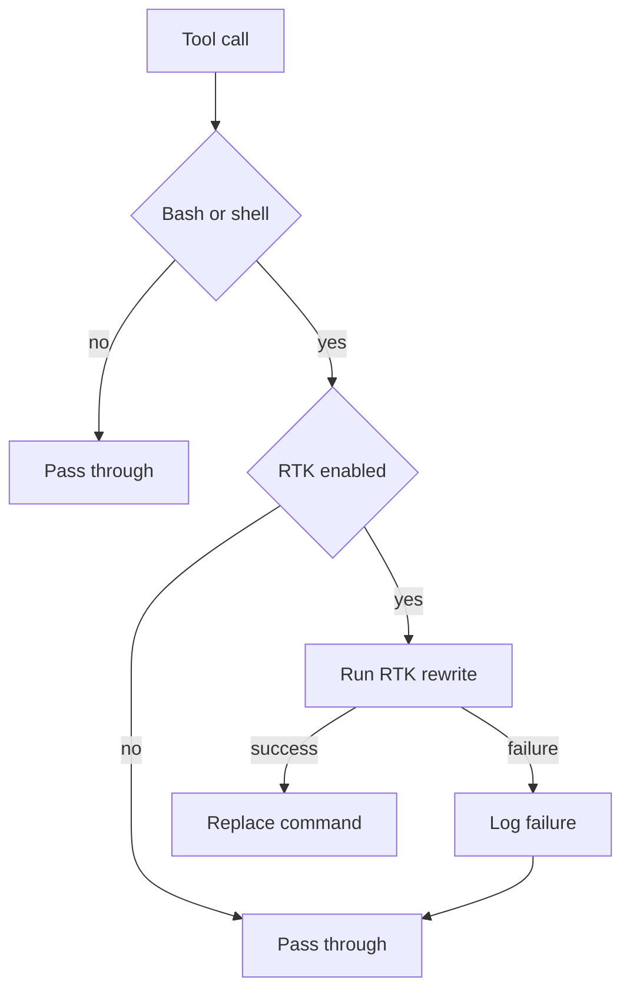
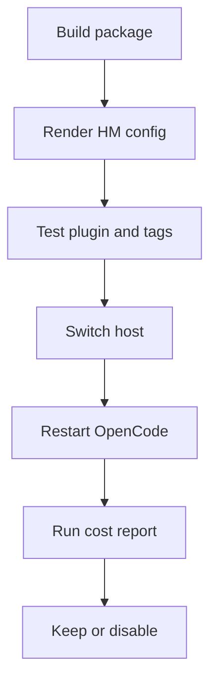

# Design Document

## Overview

`rtk-install` adds RTK to this nix-config as a declarative OpenCode
integration for the Bash/shell tool subset on both nix-darwin hosts. The
operator gets a reversible default state, a per-launch override, Shopify usage
tag attribution, and compatibility with existing cost diagnostics.

The design uses the existing Home Manager and OpenCode plugin patterns rather
than running `rtk init -g --opencode`. RTK is built from the `rtk-ai/rtk` source
tag, installed into the OpenCode wrapper environment, and controlled by a
repo-owned plugin that keeps upstream's Bash-only rewrite behavior while adding
state resolution and failure visibility.

### Goals

- Install RTK and the OpenCode integration on both target hosts through Nix and
  Home Manager.
- Route only OpenCode Bash/shell tool commands through RTK when the effective
  state is enabled.
- Keep effective RTK state visible through metadata, plugin logs, and Shopify
  usage tags.
- Preserve a fast per-launch override without rebuilding the host.
- Keep telemetry explicitly disabled and local-first.

### Non-Goals

- Native OpenCode Read, Grep, Glob, WebFetch, Task, LSP, or custom-tool output
  compression.
- Agent-instruction changes that increase Bash usage.
- Prompt caching, session compaction, subagent budgeting, MCP migration, remote
  analytics, or hosted dashboards.
- Running `rtk init` or mutating global OpenCode config imperatively.
- Extending the cost diagnostic schema in this spec.

## Boundary Commitments

### This Spec Owns

- RTK package provenance and installation from `rtk-ai/rtk`.
- A Home Manager module that makes RTK available to OpenCode, installs the
  plugin, renders metadata, and exports runtime state.
- The effective-state contract: host default plus per-launch override resolves
  to `enabled` or `disabled` before OpenCode starts.
- A repo-owned OpenCode plugin for Bash/shell command rewrite through RTK.
- Shopify usage tag integration for `rtk:enabled` and `rtk:disabled`.
- Smoke and unit tests for package, state resolution, plugin behavior, telemetry
  posture, and host evaluation.

### Out of Boundary

- The OpenCode cost diagnostic remains the measurement consumer; this spec does
  not add new DB fields or mutate session history.
- `tool-output-compressor` owns native tool-output compression.
- `session-compaction`, `subagent-context-budget`, and `mcpproxy` behavior stay
  unchanged.
- RTK upstream telemetry services are not configured or used.
- Project and global OpenCode JSON schemas are not changed.

### Allowed Dependencies

- `programs.opencode.enable` and `home.opencode.wrapperCommands` from
  `home-manager/common/opencode.nix`.
- `xdg.configFile` plugin deployment under `opencode/plugins/`.
- `pkgs.rustPlatform.buildRustPackage` and `fetchFromGitHub` in
  `overlays/misc.nix`.
- OpenCode plugin hooks `tool.execute.before` and `client.app.log`.
- Shopify provider header construction in
  `configurations/shopify/home-manager/opencode.nix`.
- `opencode-cost-report` for before/after measurement.

### Revalidation Triggers

- OpenCode changes `tool.execute.before`, plugin loading, or env substitution
  behavior.
- RTK changes `rtk rewrite`, telemetry controls, binary name, or hook contract.
- Shopify provider headers stop accepting `Shopify-Usage-Tag` arrays or env
  substitutions.
- `home.opencode.wrapperCommands` ordering or quoting changes.
- A future native tool-output compressor changes plugin ordering or ownership of
  Bash/shell tool routing.

## Architecture

### Existing Architecture Analysis

- `home-manager/common/opencode.nix` already wraps OpenCode through
  `symlinkJoin` and composes module snippets with `home.opencode.wrapperCommands`.
- Existing modules install OpenCode plugins with `xdg.configFile` and export
  runtime values through wrapper environment variables.
- Shopify provider config already builds `Shopify-Usage-Tag` from a JSON array
  and supports OpenCode env interpolation.
- The cost diagnostic already reports per-tool cost attribution and should remain
  read-only.

### Architecture Pattern & Boundary Map

Selected pattern: dedicated common Home Manager module with host integration.
The module owns RTK package/plugin/runtime state; Shopify config only consumes
the rendered usage-tag contract.



Architecture integration:
- Selected pattern: Option C from `research.md`, a dedicated module plus
  Shopify tag integration.
- Domain boundaries: package provenance, runtime state, plugin rewrite, Shopify
  attribution, and diagnostics remain separate.
- Existing patterns preserved: Nix overlay package pins, `mkEnableOption`, peer
  assertions, wrapper env exports, `xdg.configFile` plugin symlinks, plugin
  self-check logging.
- New components: the resolver exists because host defaults and per-launch
  overrides must feed both plugin behavior and Shopify usage tags from one state.

### Technology Stack

| Layer | Choice / Version | Role in Feature | Notes |
|-------|------------------|-----------------|-------|
| Package | RTK v0.40.0 from `rtk-ai/rtk` | Bash command rewrite binary | Source build avoids upstream release telemetry compile vars. |
| Nix | `rustPlatform.buildRustPackage` | Reproducible RTK package | Mirrors existing Rust CLI packages. |
| Home Manager | `programs.opencode-rtk` module | Install, state, plugin, smoke package | Imported by common HM for both hosts. |
| OpenCode | v1.15.5 pinned package | Plugin host | Local TypeScript plugin loaded at startup. |
| Runtime | Environment variables | Fast override and Shopify tag state | `OPENCODE_RTK` controls per-launch override. |

## File Structure Plan

### Directory Structure

```text
home-manager/common/
├── default.nix                         # Import and enable opencode-rtk
├── opencode-rtk.nix                    # RTK HM module, state contract, plugin install
├── opencode-plugins/
│   └── rtk.ts                          # OpenCode plugin entry and rewrite logic
└── opencode-rtk/
    └── README.md                       # Operator guide for restart and overrides

scripts/
└── rtk-opencode-smoke-test.nix         # Runtime verifier package

tests/rtk-opencode/
├── plugin.test.ts                      # Plugin state, routing, logging tests
├── hm-render.test.js                   # Rendered metadata and host state tests
└── smoke.test.js                       # Smoke-test helper assertions

overlays/
└── misc.nix                            # Add pkgs.rtk from rtk-ai/rtk

configurations/shopify/home-manager/
└── opencode.nix                        # Consume RTK usage tag contract

.kiro/steering/
└── rtk-install.md                      # Operator-facing behavior summary
```

### Modified Files

- `home-manager/common/default.nix` — import `opencode-rtk.nix` and enable the
  module for both hosts.
- `home-manager/common/opencode-rtk.nix` — define module options, install RTK and
  plugin files, export runtime env, render metadata, add assertions and smoke
  package.
- `home-manager/common/opencode-plugins/rtk.ts` — implement self-check,
  effective-state parsing, Bash/shell rewrite, pass-through, and structured logs.
- `scripts/rtk-opencode-smoke-test.nix` — verify RTK version, metadata, plugin
  file, telemetry env, and state contract.
- `overlays/misc.nix` — add `pkgs.rtk` from `rtk-ai/rtk` with source and cargo
  hashes.
- `configurations/shopify/home-manager/opencode.nix` — replace hard-coded
  `rtk:disabled` with the module's usage-tag value.
- `.kiro/steering/rtk-install.md` — document restart, host default, per-launch
  override, and measurement workflow.

## System Flows

### Effective state and Shopify tag



The wrapper is the single source of effective state. Shopify provider headers and
the plugin both consume wrapper-exported state, so per-launch overrides affect
usage tags and rewrite behavior together.

### Bash tool handling



Only command text changes before OpenCode executes the Bash tool. The plugin does
not execute the underlying user command, so command exit status and output remain
owned by OpenCode's Bash tool.

## Requirements Traceability

| Requirement | Summary | Components | Interfaces | Flows |
|-------------|---------|------------|------------|-------|
| 1.1 | Install on both hosts | RTK Module, RTK Package | HM options | Effective state |
| 1.2 | Standard rebuild activates | RTK Module, Plugin Install | HM activation | Effective state |
| 1.3 | Missing OpenCode fails eval | RTK Module | assertion | |
| 1.4 | No runtime network install | RTK Package, Plugin Install | Nix package | |
| 1.5 | Same behavior both hosts | RTK Module, Metadata | HM options | Effective state |
| 2.1 | Route Bash/shell | RTK Plugin | `tool.execute.before` | Bash handling |
| 2.2 | Preserve command result | RTK Plugin | command rewrite | Bash handling |
| 2.3 | Surface RTK processing failure | RTK Plugin | log contract | Bash handling |
| 2.4 | Native tools bypass | RTK Plugin | tool filter | Bash handling |
| 2.5 | Do not change instructions | Boundary | file exclusions | |
| 3.1 | Visible state | Metadata, Plugin Logs, Shopify Tag | metadata JSON | Effective state |
| 3.2 | Disabled mode no routing | Resolver, RTK Plugin | env state | Effective state |
| 3.3 | Restart reflects config | RTK Module, Operator Guide | env state | |
| 3.4 | Host-specific override | RTK Module | `defaultEnabled` | Effective state |
| 3.5 | Per-session override | Resolver | `OPENCODE_RTK` | Effective state |
| 3.6 | Override disables | Resolver, RTK Plugin | env state | Effective state |
| 3.7 | Override enables | Resolver, RTK Plugin | env state | Effective state |
| 3.8 | Document operator action | Operator Guide, Steering | guide | |
| 4.1 | Source from `rtk-ai/rtk` | RTK Package | package source | |
| 4.2 | Record source identity | RTK Package, Metadata | metadata JSON | |
| 4.3 | Fetch or verify failure | RTK Package | Nix fixed outputs | |
| 4.4 | Expose version | RTK Package, Smoke Test | CLI, metadata | |
| 5.1 | No telemetry data sent | RTK Package, Resolver | env state | |
| 5.2 | Telemetry controls explicit | Resolver | env state | Effective state |
| 5.3 | Prevent enabled if telemetry unclear | Resolver, Smoke Test | env state | |
| 5.4 | Logs and state stay local | RTK Plugin, Metadata | log contract | |
| 6.1 | Cost diagnostic compatibility | Boundary, Tests | no DB writes | |
| 6.2 | State distinguishable | Metadata, Shopify Tag, Logs | metadata JSON | Effective state |
| 6.3 | Provider tag reports state | Shopify Integration | provider header | Effective state |
| 6.4 | Shopify enabled tag | Shopify Integration | usage tag | Effective state |
| 6.5 | Shopify disabled tag | Shopify Integration | usage tag | Effective state |
| 6.6 | Override changes Shopify tag | Resolver, Shopify Integration | env tag | Effective state |
| 6.7 | Do not mutate history | Boundary | no DB writes | |
| 6.8 | No Bash means no RTK processed report | RTK Plugin | log contract | Bash handling |
| 7.1 | RTK unavailable visible | Resolver, RTK Plugin | log contract | Effective state |
| 7.2 | Hook surface unavailable visible | RTK Plugin, Tests | self-check | |
| 7.3 | Routed command failure preserved | RTK Plugin | command rewrite | Bash handling |
| 7.4 | Existing modules unaffected | Boundary, Tests | plugin isolation | |
| 7.5 | Disable or remove cleanly | RTK Module | HM managed files | |

## Components and Interfaces

| Component | Domain | Intent | Req Coverage | Key Dependencies | Contracts |
|-----------|--------|--------|--------------|------------------|-----------|
| RTK Package | Nix | Build upstream RTK reproducibly | 1.1, 1.4, 4.1, 4.2, 4.3, 4.4, 5.1 | GitHub source P0 | Package |
| RTK Module | Home Manager | Install package, plugin, metadata, state env | 1, 3, 5, 7.5 | OpenCode module P0 | Service, State |
| State Resolver | Runtime | Resolve host default and per-launch override | 3.2-3.7, 5.2, 5.3, 6.2-6.6, 7.1 | wrapper env P0 | State |
| RTK Plugin | OpenCode | Rewrite Bash/shell commands through RTK | 2, 5.4, 6.8, 7.1-7.4 | OpenCode hooks P0, RTK binary P0 | Service, Event |
| Shopify Integration | Host config | Attach `rtk:*` usage tag | 6.3-6.6 | State Resolver P0 | State |
| Smoke and Tests | Validation | Verify install and runtime contracts | 1, 3, 4, 5, 6, 7 | Nix, Node P1 | Batch |

### Nix and Home Manager

#### RTK Package

| Field | Detail |
|-------|--------|
| Intent | Provide a reproducible `rtk` binary from `rtk-ai/rtk`. |
| Requirements | 1.1, 1.4, 4.1, 4.2, 4.3, 4.4, 5.1 |

Responsibilities and constraints:
- Use `fetchFromGitHub` against `owner = "rtk-ai"`, `repo = "rtk"`, and a pinned tag or revision.
- Use source build rather than upstream release assets to avoid CI-injected telemetry compile variables.
- Expose `meta.mainProgram = "rtk"` and a version that smoke tests can read.
- Do not depend on crates.io package-name resolution.

Contracts: Service [ ] / API [ ] / Event [ ] / Batch [ ] / State [x]

State management:
- State model: Nix package attr `pkgs.rtk` with source hash and cargo hash.
- Persistence: Nix store only.
- Consistency: build fails if source or cargo hashes drift.

#### RTK Module

| Field | Detail |
|-------|--------|
| Intent | Make RTK available to OpenCode and render the runtime state contract. |
| Requirements | 1.1, 1.2, 1.3, 1.5, 3.1, 3.3, 3.4, 3.8, 5.2, 5.3, 7.5 |

Responsibilities and constraints:
- Define `programs.opencode-rtk.enable`, `defaultEnabled`, `package`,
  `metadataPath`, `usageTag`, and `smokeTestPackage`.
- Install `cfg.package`, the smoke test, the plugin file, metadata, and the
  operator guide when enabled.
- Assert `programs.opencode.enable` when enabled.
- Append a wrapper snippet that exports RTK PATH, telemetry controls, effective
  state, and usage tag.
- Preserve host-specific override by allowing `defaultEnabled = false` while the
  package and plugin remain available for `OPENCODE_RTK=1` launches.

Contracts: Service [x] / API [ ] / Event [ ] / Batch [ ] / State [x]

Service interface:
```nix
programs.opencode-rtk = {
  enable = true;
  defaultEnabled = true;
  package = pkgs.rtk;
  metadataPath = "opencode/rtk/metadata.json";
  usageTag = "{env:OPENCODE_RTK_USAGE_TAG}";
};
```
- Preconditions: `programs.opencode.enable = true` when enabled.
- Postconditions: `rtk`, plugin, metadata, smoke test, and wrapper env are
  present after rebuild.
- Invariants: `usageTag` resolves to `rtk:enabled` or `rtk:disabled` only.

### Runtime State

#### State Resolver

| Field | Detail |
|-------|--------|
| Intent | Resolve host default plus per-launch override into one RTK state. |
| Requirements | 3.2, 3.5, 3.6, 3.7, 5.2, 5.3, 6.2, 6.3, 6.4, 6.5, 6.6, 7.1 |

Responsibilities and constraints:
- Accept `OPENCODE_RTK` as the only per-launch override.
- Treat unset override as `defaultEnabled`.
- Accept `1`, `true`, `enabled` and `0`, `false`, `disabled`.
- Export `OPENCODE_RTK_EFFECTIVE` as `enabled` or `disabled`.
- Export `OPENCODE_RTK_USAGE_TAG` as `rtk:enabled` or `rtk:disabled`.
- Export `RTK_TELEMETRY_DISABLED=1` on every launch.
- If telemetry cannot be forced off or RTK is requested but not available, set
  effective state to `disabled`, set a disable reason, and emit an actionable
  stderr line before OpenCode starts.

Contracts: Service [ ] / API [ ] / Event [ ] / Batch [ ] / State [x]

State model:
```typescript
type RtkEffectiveState = "enabled" | "disabled"
type RtkUsageTag = "rtk:enabled" | "rtk:disabled"
type RtkDisableReason = "host-default" | "override" | "missing-binary" | "telemetry-unsafe" | "invalid-override"

interface RtkRuntimeState {
  readonly requested: boolean
  readonly effective: RtkEffectiveState
  readonly usageTag: RtkUsageTag
  readonly disableReason?: RtkDisableReason
  readonly telemetryDisabled: true
}
```

### OpenCode Plugin

#### RTK Plugin

| Field | Detail |
|-------|--------|
| Intent | Rewrite only Bash/shell command text through `rtk rewrite`. |
| Requirements | 2.1, 2.2, 2.3, 2.4, 2.5, 5.4, 6.8, 7.1, 7.2, 7.3, 7.4 |

Responsibilities and constraints:
- Load as a local TypeScript plugin under `opencode/plugins/rtk.ts`.
- Return no rewrite hook when effective state is disabled.
- Register only `tool.execute.before` when self-check passes.
- Lowercase `input.tool` and handle only `bash` and `shell`.
- Read `output.args.command` only when it is a string.
- Invoke `rtk rewrite <command>` and mutate `output.args.command` only on a
  non-empty changed rewrite.
- Never execute the underlying user command.
- Log missing binary, disabled state, invalid command shape, and rewrite failure
  with `client.app.log`; do not log full command text or command output by
  default.
- Leave native tools and non-command Bash calls unchanged.

Contracts: Service [x] / API [ ] / Event [x] / Batch [ ] / State [ ]

Service interface:
```typescript
type ToolName = "bash" | "shell" | string

interface ToolExecuteBeforeInput {
  readonly tool: ToolName
  readonly callID?: string
  readonly sessionID?: string
}

interface MutableToolOutput {
  args?: {
    command?: unknown
    readonly [key: string]: unknown
  }
}

type RewriteErrorCode = "rtk-unavailable" | "invalid-command" | "rewrite-failed"

type RewriteResult =
  | { readonly ok: true; readonly command: string; readonly changed: boolean }
  | { readonly ok: false; readonly code: RewriteErrorCode; readonly message: string }

interface RtkRewriteService {
  rewrite(command: string): Promise<RewriteResult>
}
```
- Preconditions: `OPENCODE_RTK_EFFECTIVE=enabled`, `RTK_TELEMETRY_DISABLED=1`,
  and `rtk` is discoverable on PATH.
- Postconditions: only `output.args.command` is mutated; all other tool args and
  OpenCode result handling stay untouched.
- Invariants: native tools bypass RTK; rewrite failures degrade to unchanged
  command plus log record.

Event contract:
- Subscribed events: `tool.execute.before`.
- Published events: structured OpenCode app logs with `service = "rtk-opencode"`.
- Ordering: runs in OpenCode plugin load order; it must not rely on other plugin
  state.

### Host Attribution

#### Shopify Usage Tag Integration

| Field | Detail |
|-------|--------|
| Intent | Make Shopify provider usage tags match effective RTK state. |
| Requirements | 3.1, 6.2, 6.3, 6.4, 6.5, 6.6 |

Responsibilities and constraints:
- Replace hard-coded `"rtk:disabled"` with `config.programs.opencode-rtk.usageTag`
  while the module is available.
- Fall back to static `"rtk:disabled"` if the module is not enabled on the
  Shopify host.
- Keep existing `opencode_cli` and `{env:OPENCODE_SESSION_ID}` tags unchanged.

Contracts: Service [ ] / API [ ] / Event [ ] / Batch [ ] / State [x]

State management:
- State model: provider header uses `{env:OPENCODE_RTK_USAGE_TAG}`.
- Persistence: none.
- Consistency: same wrapper resolver exports plugin state and usage tag.

### Validation

#### Smoke and Tests

| Field | Detail |
|-------|--------|
| Intent | Prove package, module, plugin, and host contracts before deployment. |
| Requirements | 1.1, 1.3, 2.1-2.4, 3.5-3.7, 4.4, 5.2, 5.3, 6.4-6.6, 7.1-7.5 |

Batch contract:
- Trigger: operator or CI runs Nix checks, package builds, host evaluations, and
  plugin tests.
- Input: rendered Home Manager config, plugin source, RTK binary, metadata JSON.
- Output: passing tests or actionable failure labels.
- Recovery: fix package hash, module render, plugin contract, or host tag wiring.

## Data Models

### Domain Model

- RTK availability: package and plugin files exist on the host.
- Host default: repo-managed default active state after rebuild.
- Per-launch override: operator-provided env var for a single OpenCode process.
- Effective state: resolved value consumed by the plugin and Shopify tag.
- Disable reason: local diagnostic text for disabled or degraded state.

### Logical Data Model

Metadata is rendered to `opencode/rtk/metadata.json` for operator visibility and
tests.

```typescript
interface RtkMetadata {
  readonly feature: "rtk-install"
  readonly packageName: "rtk"
  readonly packageVersion: string
  readonly sourceOwner: "rtk-ai"
  readonly sourceRepo: "rtk"
  readonly sourceRev: string
  readonly defaultEnabled: boolean
  readonly overrideEnv: "OPENCODE_RTK"
  readonly effectiveEnv: "OPENCODE_RTK_EFFECTIVE"
  readonly usageTagEnv: "OPENCODE_RTK_USAGE_TAG"
  readonly telemetryEnv: "RTK_TELEMETRY_DISABLED"
  readonly pluginPath: "opencode/plugins/rtk.ts"
}
```

Consistency rules:
- `usageTagEnv` is the only value Shopify config reads for RTK usage tags.
- The plugin reads `effectiveEnv` and never recomputes host defaults.
- The metadata file is descriptive; runtime state comes from wrapper env.

## Error Handling

### Error Strategy

- Build-time provenance errors fail the Nix build.
- Home Manager dependency errors fail evaluation with a message naming OpenCode.
- Invalid `OPENCODE_RTK` override fails OpenCode startup with an actionable
  stderr message to avoid ambiguous usage tags.
- Missing RTK binary or unsafe telemetry state disables RTK for the launch,
  exports `rtk:disabled`, and logs the reason.
- Rewrite failures pass through the original command and log a local error.

### Error Categories and Responses

| Category | Example | Response |
|----------|---------|----------|
| Configuration | OpenCode disabled | HM assertion failure |
| Override | `OPENCODE_RTK=maybe` | startup error before OpenCode |
| Runtime prerequisite | `rtk` missing | effective disabled, `rtk:disabled`, log error |
| Telemetry | telemetry cannot be forced off | effective disabled, `rtk:disabled`, log error |
| Rewrite | `rtk rewrite` fails | original command passes through, log error |
| Compatibility | hook args missing command | pass through, log warning |

### Monitoring

- Plugin logs use `client.app.log` with `service = "rtk-opencode"`.
- Default logs include state transitions, self-check status, rewrite failures,
  and disabled reasons.
- Logs do not include full command text or output by default.

## Testing Strategy

### Unit Tests

- State resolver accepts unset, enabled, disabled, and invalid `OPENCODE_RTK`
  values and returns expected state or startup error. Covers 3.5, 3.6, 3.7,
  6.6.
- Plugin rewrites only `bash` and `shell` tool commands when enabled. Covers
  2.1, 2.4.
- Plugin leaves Read, Grep, Glob, WebFetch, Task, LSP, and unknown tools
  unchanged. Covers 2.4, 2.5.
- Rewrite failure returns original command and logs failure without command
  output. Covers 2.3, 7.3.
- Self-check missing binary or unsafe telemetry returns no hook and logs a named
  reason. Covers 5.3, 7.1, 7.2.

### Integration Tests

- Home Manager render test confirms plugin file, metadata JSON, wrapper env, and
  smoke package render when enabled. Covers 1.1, 1.2, 3.1.
- Peer assertion test confirms enabling RTK without OpenCode fails evaluation.
  Covers 1.3.
- Shopify config render test confirms enabled, disabled, and per-launch tag
  values are `rtk:enabled` or `rtk:disabled`. Covers 6.3, 6.4, 6.5, 6.6.
- Host default test confirms one host can set `defaultEnabled = false` without
  changing the other. Covers 3.4.

### Package and Host Checks

- Build `.#darwinConfigurations.ShopifyLaptop.pkgs.rtk` and
  `.#darwinConfigurations.Brandons-MacBook-Pro.pkgs.rtk`.
- Evaluate both Darwin system derivations.
- Run `nix flake check` after adding tests.
- Run `rtk-opencode-smoke-test` on a switched host.

### Measurement Validation

- Run `opencode-cost-report` before and after an RTK-enabled Bash-heavy session.
- Compare Bash tool cost/output attribution only; do not expect native tool
  savings.

## Security Considerations

- Source build keeps upstream CI telemetry variables out of the binary.
- Runtime always exports `RTK_TELEMETRY_DISABLED=1`.
- Plugin logs omit full command text and tool output by default because Bash
  commands can contain secrets.
- No hosted dashboard or remote analytics integration is introduced.
- No OpenCode session database writes are introduced.

## Performance & Scalability

- RTK adds one `rtk rewrite` subprocess per eligible Bash/shell tool call.
- Non-Bash tools incur only a string comparison in the plugin hook.
- Rewrite failure degrades to original command execution; it does not block the
  underlying Bash tool.
- Performance validation is the before/after cost report plus operator-visible
  rewrite failure logs.

## Migration Strategy



- Phase 1: package RTK and add tests with no host switch required.
- Phase 2: enable module in common config and verify rendered host state.
- Phase 3: switch host, restart OpenCode, run smoke test.
- Rollback: set `programs.opencode-rtk.defaultEnabled = false`, launch with
  `OPENCODE_RTK=0`, or disable the module and rebuild.

## Supporting References

- RTK v0.40.0 source and hook docs are summarized in
  `.kiro/specs/rtk-install/research.md`.
- OpenCode plugin and config docs confirm local TypeScript plugins,
  `tool.execute.before`, `client.app.log`, and env substitution.
