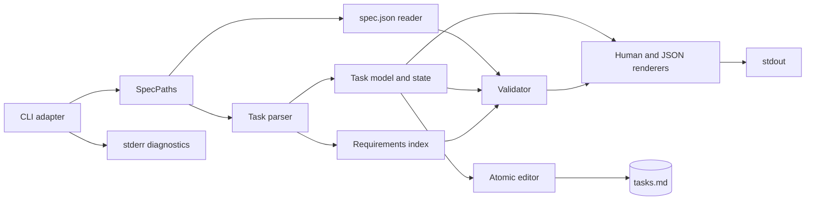
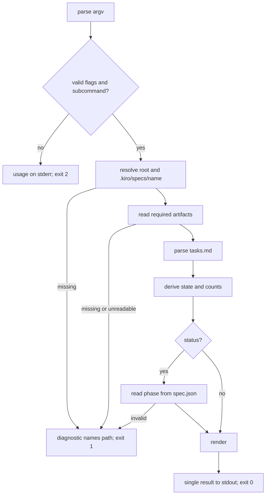
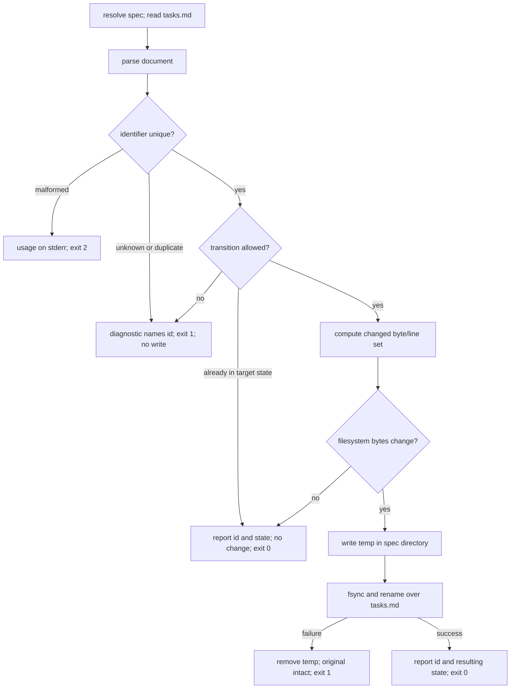
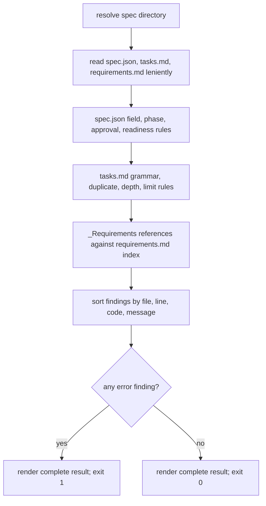

# Design: rust-based-cli-for-interacting-with-kiro-specs

## Overview

`kiro-spec` is a single Rust binary whose library core parses one Kiro spec directory, derives task state, validates the cc-sdd metadata contract, and renders the result as plain text or versioned JSON; the CLI is a thin argument adapter over that core. The behavioral contract is `requirements.md`; the problem and scope are in `brief.md`.

### Goals

- One derivation of task state and spec well-formedness shared by humans, agents, and workflow command nodes.
- Byte-preserving, atomic `tasks.md` mutations for `complete` and `block`.
- The same packaged binary on every host that imports `home-manager/common` and in the Fabro sandbox image.

### Non-Goals

- Writing `spec.json` (phase transitions, approvals, readiness), creating or deleting specs, or scanning all specs at once.
- Migrating legacy free-prose blocked notes or `_Reopened:`/`_Verified:` metadata.
- Convenience commands beyond the six required subcommands (no unblock, no edit, no init).
- Any network, GitHub, or workflow-engine integration.

## Boundary Commitments

### This Spec Owns

- `tasks.md` grammar interpretation for task entries, subtasks, optional markers, metadata bullets, and the new `[!]` blocked state with its `_Blocked:` reason bullet.
- The pure state-derivation layer shared by `next`, `tasks`, and `status`.
- The validation rule set and finding vocabulary for `spec.json`, `tasks.md`, and `_Requirements:` references.
- JSON schema version 1 for `next`, `tasks`, `status`, and `validate`, and the human renderings of those results.
- The single atomic editor used by `complete` and `block`.
- Packaging metadata (Cargo crate, overlay derivation), the Home Manager module, and the sandbox image entry.

### Out of Boundary

- cc-sdd owns the `tasks.md` and `spec.json` formats, the phase vocabulary, and the 49-entry limit definition. This design consumes `.kiro/settings/rules/task-list-limits.md`; it does not change it.
- Workflow definitions, the `kiro-spec-orchestrator` agent, `kiro-spec-status`, and the Python `tools.py` staged by this workflow keep their own behavior; adoption is downstream.
- Spec lifecycle authority stays with workflows: the CLI never advances `phase`, approves an artifact, or sets `ready_for_implementation`.
- Validation reports findings and never repairs a file.
- Concurrency control beyond atomic publish (no file locks, no merge, no retry).

### Allowed Dependencies

- Rust 2021 edition and `serde`/`serde_json` only; no async runtime, HTTP client, or other runtime crate.
- `rustPlatform.buildRustPackage` from nixpkgs stable, a checked-in `Cargo.lock`, and the existing `custom-packages` overlay composition in `overlays/default.nix`.
- Existing Home Manager composition (`home-manager/common/default.nix`), the Fabro guest's overlay set, and `fabro.sandboxImage.contents` in `configurations/fabro-vm/sandbox-image.nix`.
- The checked-in `.kiro/specs/` corpus as read-only regression input.

### Revalidation Triggers

- A changed task-line grammar, state vocabulary, metadata bullet, or `_Requirements:` reference shape.
- A changed `spec.json` field set, phase vocabulary, or approval/readiness relationship.
- A JSON field rename, removal, type change, or schema-version change.
- A changed overlay, Home Manager import list, or sandbox image `contents` contract.
- A new host configuration that stops importing `home-manager/common`.

## Architecture

### Existing Architecture Analysis

- No program in the repository reads `.kiro/specs/`; every consumer re-implements the grammar. `.kiro/settings/rules/task-list-limits.md` defines two numbering levels and a 49-entry cap, and the corpus mixes `_Requirements:`, `_Boundary:`, `_Depends:`, `_Reopened:`, `_Verified:`, and prose `_Blocked:` bullets.
- The only in-repo Rust crate is `configurations/fabro-vm/api-bridge`, built by `configurations/fabro-vm/api-bridge.nix` with `rustPlatform.buildRustPackage` and `cargoLock.lockFile`; `overlays/misc.nix` holds the other `buildRustPackage` packages. Both are the packaging precedent.
- Host wiring is a module imported by `home-manager/common/default.nix`; the darwin host imports that tree through `configurations/personal/home-manager/default.nix`. The guest and host overlay chains both include `custom-packages`.
- The Fabro sandbox image is assembled from `fabro.sandboxImage.contents` in `configurations/fabro-vm/sandbox-image.nix`; its `PATH` is `/bin`, so a package is on the command path only when added to `contents`.
- The corpus proves three edge cases the parser must accept: adjacent entries with no blank line (`.kiro/specs/opencode-nono-sandbox/tasks.md`), multi-line metadata and prose continuation lines, and checkboxes with no numeric identifier (`.kiro/specs/cc-sdd-integration/tasks.md`).

### Architecture Pattern & Boundary Map

The pattern is a library core with a single adapter at each edge: the CLI parses arguments, the filesystem readers produce raw artifacts, pure functions derive and validate, renderers serialise, and one editor writes. No command reaches into another command's logic.



**Architecture Integration**:

- Selected pattern: library core plus command adapter, with parsing, state derivation, validation, rendering, and editing as separate modules.
- Domain boundaries: `tasks.rs` owns grammar and state; `spec_json.rs` owns metadata access; `validate.rs` owns only cross-artifact rules; `render/` owns only formatting; `edit.rs` is the only writer.
- Existing patterns preserved: overlay-provided package, common Home Manager module, sandbox `contents` entry, flake `checks` gate.
- New components rationale: the CLI adapter keeps exit codes and stdout/stderr separation in one place; the requirements index is separated because reference resolution needs `requirements.md` while task state does not.
- Steering compliance: no `.kiro/steering/` document constrains this area; the design follows the repository's Nix packaging and Home Manager patterns instead.

### Technology Stack

| Layer | Choice / Version | Role in Feature | Notes |
|-------|------------------|-----------------|-------|
| CLI | Rust 2021, hand-written argument parser | Six subcommands, help, usage errors, exit codes | No CLI framework; matches the dependency minimalism of `api-bridge` |
| Core | `serde` 1 (derive), `serde_json` 1 | `spec.json` access and JSON output | Only runtime crates |
| Parsing | Line-oriented parser over UTF-8 text | Task grammar, entry blocks, metadata, requirements index | Pure functions; no filesystem access |
| Packaging | `rustPlatform.buildRustPackage`, checked-in `Cargo.lock` | Reproducible binary on darwin and linux | Built by `overlays/misc.nix`; tests run in `doCheck` |
| Host wiring | `home-manager/common/kiro-spec.nix` | Adds the package to `home.packages` | Imported from `home-manager/common/default.nix` |
| Sandbox wiring | `fabro.sandboxImage.contents` | Links `kiro-spec` into the image `/bin` | Uses the guest's `custom-packages` overlay |
| Verification | `cargo test`, flake `checks`, Node image assertion | Offline fixture, corpus, packaging, and wiring checks | No network at runtime or test time |

## File Structure Plan

### Directory Structure

```
scripts/kiro-spec/
├── Cargo.toml                 # package metadata; serde + serde_json only
├── Cargo.lock                 # checked in; consumed by cargoLock.lockFile
├── src/
│   ├── main.rs                # process entry; exits with run()'s code
│   ├── lib.rs                 # run(), module wiring, public surface for tests
│   ├── cli.rs                 # argv grammar, help text, usage errors
│   ├── error.rs               # AppError, SpecError, MutationError, exit mapping
│   ├── paths.rs               # explicit spec resolution and artifact paths
│   ├── spec_json.rs           # raw spec.json access, Phase ladder, field helpers
│   ├── tasks.rs               # line lexer, entry blocks, TaskEntry/TaskDocument
│   ├── requirements.rs        # requirements.md index and reference resolution
│   ├── validate.rs            # Finding/Severity/codes and all validation rules
│   ├── edit.rs                # complete/block planning and atomic publish
│   └── render/
│       ├── mod.rs             # Format selector and shared field access
│       ├── human.rs           # plain-text renderings
│       └── json.rs            # schema-versioned serde documents
└── tests/
    ├── cli.rs                 # subprocess contract: flags, streams, exit codes
    ├── mutations.rs           # complete/block byte and failure contracts
    ├── corpus.rs              # corpus determinism (gated by KIRO_SPEC_CORPUS)
    ├── support/mod.rs         # temp spec-tree builder and binary invocation
    └── fixtures/              # minimal spec trees per grammar/validation case
```

`tests/support/mod.rs` builds throwaway `.kiro/specs/<name>/` trees under `std::env::temp_dir()`, so no fixture test writes to the repository. Fixtures under `tests/fixtures/` are read-only inputs; mutation expectations are generated from them in temp copies.

### New Files

| Path | Responsibility |
| --- | --- |
| `scripts/kiro-spec/Cargo.toml`, `scripts/kiro-spec/Cargo.lock` | Pin the package and its two runtime crates. |
| `scripts/kiro-spec/src/*.rs`, `src/render/*.rs` | Library core and the thin CLI entry described above. |
| `scripts/kiro-spec/tests/*.rs`, `tests/support/mod.rs`, `tests/fixtures/**` | Offline unit/integration/corpus coverage. |
| `home-manager/common/kiro-spec.nix` | `programs.kiro-spec.package` option; installs the package unconditionally. |
| `docs/kiro-spec.md` | JSON schema v1, finding codes, exit codes, `[!]` encoding, examples. |

### Modified Files

| Path | Responsibility |
| --- | --- |
| `overlays/misc.nix` | Add `kiro-spec` built from `../scripts/kiro-spec` with `cargoLock.lockFile`, `doCheck = true`, and `meta.mainProgram`. |
| `home-manager/common/default.nix` | Import `./kiro-spec.nix` so every host importing the common tree installs the binary. |
| `configurations/fabro-vm/sandbox-image.nix` | Add `pkgs.kiro-spec` to the default `contents` and state the command-path invariant in the option description. |
| `flake.nix` | Add darwin `checks` for the package build, corpus determinism, and host/image wiring, plus `packages.aarch64-linux.kiro-spec` bound to the guest's package for a direct Linux build. |
| `tests/fabro-sandbox/image.test.js` | Assert `kiro-spec` is present in the evaluated image contents. |

## System Flows

### Read command flow (`next`, `tasks`, `status`)



Read commands open files read-only and never create a temporary file. `status` reads `spec.json` first because a missing phase is a hard failure (Requirement 5.5); `next` and `tasks` do not require `spec.json` at all.

### Mutation flow (`complete`, `block`)



`block` on an already blocked entry replaces the existing reason bullet in place and rewrites only if the requested reason differs; the same reason is a byte-identical no-op even when the bullet is not in canonical position. `complete` on a completed entry is a successful no-op. Temp creation and rename happen in the spec directory, so the rename never crosses filesystems.

### Validation flow



Validation never aborts on a missing artifact inside an existing spec directory and never writes. A finding is data; `valid` is true exactly when no error-severity finding exists.

## Requirements Traceability

| Requirement | Summary | Components | Interfaces | Flows |
|-------------|---------|------------|------------|-------|
| 1.1–1.6 | One binary on hosts and in the sandbox; offline; help and usage errors | `overlays/misc.nix`, `home-manager/common/kiro-spec.nix`, `sandbox-image.nix`, `cli.rs` | `programs.kiro-spec.package`, `fabro.sandboxImage.contents`, `--help`, usage exit 2 | Packaging; read flow |
| 2.1–2.8 | Explicit spec resolution and artifact errors | `paths.rs`, `error.rs`, `validate.rs` | `SpecPaths::resolve`, `AppError` | Read, mutation, validation flows |
| 3.1–3.8 | List every entry, state, optional flag, blocked reason, subtasks | `tasks.rs`, `render/human.rs`, `render/json.rs` | `TaskDocument::entries`, state derivation, `tasks` rendering | Read flow |
| 4.1–4.5 | First non-completed non-grouping entry | `tasks.rs` | `TaskDocument::next_actionable` | Read flow |
| 5.1–5.7 | Totals, counts, optional pending, current stage | `tasks.rs`, `spec_json.rs`, `render/*` | `TaskCounts`, `phase_of` | Read flow |
| 6.1–6.22 | Well-formedness findings and exit status | `spec_json.rs`, `tasks.rs`, `requirements.rs`, `validate.rs`, `render/*` | `validate()`, `Finding`, finding codes | Validation flow |
| 7.1–7.9 | Complete with byte preservation and idempotency | `edit.rs`, `tasks.rs` | `mutate(Complete)`, `write_atomic` | Mutation flow |
| 8.1–8.10 | Block with reason bullet and transition rules | `edit.rs`, `tasks.rs` | `mutate(Block { reason })` | Mutation flow |
| 9.1–9.11 | Human/JSON renderings, stderr separation, schema version | `cli.rs`, `render/human.rs`, `render/json.rs` | `Format`, JSON schema v1 | All flows |
| 10.1–10.6 | Atomic, minimal, crash-safe writes | `edit.rs` | `write_atomic`, `EditPlan` | Mutation flow |
| 11.1–11.8 | Fixture, corpus, build, wiring, and documentation coverage | Crate tests, `flake.nix` checks, `docs/kiro-spec.md` | Test binaries, flake checks | Validation flow; packaging |

## Components and Interfaces

| Component | Layer | Intent | Req Coverage | Key Dependencies |
|-----------|-------|--------|--------------|------------------|
| CLI adapter | `cli.rs`, `main.rs`, `lib.rs` | Parse argv, select command, own exit codes and streams | 1.5, 1.6, 2.4, 2.5, 9.1–9.3, 9.10 | `paths`, all commands (P0) |
| Spec paths | `paths.rs` | Resolve one spec directory and artifact paths | 2.1–2.7 | `std::path` (P0) |
| Task parser and model | `tasks.rs` | Parse task lines, blocks, metadata; derive state and counts | 3.1–3.8, 4.1–4.4, 5.1–5.3, 5.6, 6.15–6.18 | Grammar rules (P0) |
| spec.json reader | `spec_json.rs` | Read phase and field values; expose the phase ladder | 5.4, 5.5, 6.3–6.14 | `serde_json` (P0) |
| Requirements index | `requirements.rs` | Resolve requirement and acceptance-criterion IDs | 6.19, 6.20 | `tasks` metadata (P1) |
| Validator | `validate.rs` | Produce sorted findings for all artifacts | 6.1–6.22 | Paths, task model, spec.json, requirements (P0) |
| Renderers | `render/*` | One result per command in human or JSON form | 9.1–9.11 | Task model, validator (P0) |
| Editor | `edit.rs` | Plan and atomically publish `complete`/`block` | 7, 8, 10 | Task model (P0) |
| Packaging and wiring | Nix files | Build, install on hosts, enter the sandbox image | 1.1–1.3, 11.6 | Overlay, Home Manager, guest (P0) |
| Documentation | `docs/kiro-spec.md` | Publish the JSON, encoding, and exit contract | 11.7 | None |

### CLI Adapter

**Responsibilities & Constraints**

- Own argv interpretation, help text, usage diagnostics, stdout/stderr separation, and the process exit code.
- Parse all arguments before touching the filesystem, so an unknown subcommand or option can never mutate a spec.
- Accept long options as `--opt value` or `--opt=value`; the last occurrence of a value option wins.

**Contracts**: Service [x] / CLI [x] / State [ ]

```rust
pub fn run(args: impl IntoIterator<Item = std::ffi::OsString>) -> i32;

pub enum Command {
    Next, Tasks, Status, Validate,
    Complete { task: String },
    Block { task: String, reason: String },
}
```

- Usage synopsis: `kiro-spec [--root <path>] --spec <name> <next|tasks|status|validate> [--json]` and `kiro-spec [--root <path>] --spec <name> <complete <task-id>|block <task-id> --reason <text>>`.
- Exit codes: `0` success (including a validate result with no errors and a mutation no-op), `1` resolution, read, parse, validation-error, or mutation failure, `2` usage error.
- `--json` is accepted only by the four read commands; supplying it to `complete` or `block` is a usage error.
- `--help` and `-h` print the synopsis and subcommand list to stdout and exit 0; `--version` and `-V` print `kiro-spec <package version>`.
- Unknown subcommands/options, a missing `--spec`, a missing option value, or a malformed task identifier produce a `kiro-spec: ...` diagnostic on stderr and exit 2.

**Implementation Notes**

- Keep help text in one constant; tests assert it lists all six subcommands and every flag.
- No ANSI, colour, or terminal detection: output is identical when piped.
- Do not include the resolved root path in any successful result, so output is identical across checkouts.

### Spec Paths

**Responsibilities & Constraints**

- Resolve `<root>/.kiro/specs/<name>` with `--root` defaulting to `.`; never search parents and never infer a name.
- Reject empty names, `.`, `..`, absolute paths, and names containing the platform path separator (`/` on the supported unix targets) or a NUL byte before joining.
- Report the joined path verbatim in diagnostics (no canonicalisation), and require the directory to exist for every subcommand.

**Contracts**: Service [x] / State [ ]

```rust
pub struct SpecPaths { /* root, name, directory */ }

impl SpecPaths {
    pub fn resolve(root: &Path, name: &str) -> Result<Self, SpecError>;
    pub fn directory(&self) -> &Path;
    pub fn name(&self) -> &str;
    pub fn spec_json(&self) -> PathBuf;
    pub fn tasks_md(&self) -> PathBuf;
    pub fn requirements_md(&self) -> PathBuf;
}
```

- Preconditions: `name` is the raw `--spec` value.
- Postconditions: the returned directory is an existing directory beneath `<root>/.kiro/specs/`.
- Invariants: artifact paths are always `<directory>/<artifact>`; no artifact path is derived from the task ID or user input.

### Task Parser and Model

**Responsibilities & Constraints**

- Parse `tasks.md` once into source lines plus task entries; entry line indexes and block ranges point back into the original line vector.
- Classify every checkbox line deterministically and never fail parsing: grammar problems become `Finding` values, not errors.
- Derive state only from the checkbox character; ignore prose bullets, `_Reopened:`, `_Verified:`, and any `_Blocked:` bullet on a non-`[!]` entry.

**Contracts**: Service [x] / State [x]

```rust
pub enum TaskState { Pending, Completed, Blocked }
pub struct TaskId { pub text: String, pub level: u8, pub parent: Option<String> }
pub struct TaskEntry {
    pub id: TaskId,
    pub description: String,
    pub state: TaskState,
    pub optional: bool,
    pub blocked_reason: Option<String>,
    pub line: usize,          // 1-based line number
    pub has_children: bool,
}
pub struct TaskDocument { /* source lines, entries, parse findings */ }

pub fn parse_tasks(text: &str) -> TaskDocument;
impl TaskDocument {
    pub fn entries(&self) -> &[TaskEntry];
    pub fn findings(&self) -> &[Finding];
    pub fn next_actionable(&self) -> Option<&TaskEntry>;
    pub fn counts(&self) -> TaskCounts;
    pub fn find_unique(&self, id: &str) -> Result<&TaskEntry, MutationError>;
    pub fn to_bytes(&self) -> Vec<u8>;
}
```

- Entry order is document order; `next_actionable` is the first entry that is not completed and has no children.
- `TaskCounts` has `total`, `completed`, `pending`, `blocked`, and `optional_pending`; the three state counts sum to `total`.
- `find_unique` matches canonical IDs (`1`, `1.2`); a trailing `.` in the input is accepted and normalised, and duplicates make the lookup ambiguous.
- The parser tracks fenced code blocks and ignores checkbox-looking lines inside them.
- An entry block runs from the task line to the first blank line, next task candidate, or ATX heading; metadata bullets and continuation lines inside that range belong to the entry.

### spec.json Reader

**Responsibilities & Constraints**

- For `status`, require parseable JSON with a string `phase` and fail naming the file otherwise.
- For `validate`, expose raw values so missing and wrongly typed fields become findings instead of a single hard error.
- Encode the phase ladder once; no other module compares phase strings.

**Contracts**: Service [x]

```rust
pub enum Phase { Initialized, RequirementsGenerated, DesignGenerated, TasksGenerated, TasksApproved, Implemented }
impl Phase {
    pub fn parse(value: &str) -> Option<Self>;
    pub fn rank(self) -> u8;
}

pub fn read_value(path: &Path) -> Result<serde_json::Value, SpecError>;
pub fn phase_of(value: &serde_json::Value) -> Result<String, SpecError>;
```

- `phase_of` fails with the file path when the value is not an object or `phase` is not a string.
- `Phase::parse` accepts exactly the six documented phase strings; unknown strings are reported by validation, not by `status`.
- The reported stage is always the raw `phase` string; task progress never influences it (Requirement 5.4).

### Validator

**Responsibilities & Constraints**

- Produce findings only; never abort on a malformed or missing artifact inside an existing spec directory.
- Group output deterministically by `(file, line, code, message)`; `line` is `None` when no line applies and sorts before line 1 within a file.
- Treat phase as a minimum (Requirement 6.14): a flag ahead of the phase is not an error; only phase-required flags and `generated`-without-artifact relationships are checked.

**Contracts**: Service [x]

```rust
pub enum Severity { Error, Warning }
pub struct Finding {
    pub severity: Severity,
    pub code: &'static str,
    pub message: String,
    pub file: String,      // spec-relative: spec.json, tasks.md, requirements.md, ...
    pub line: Option<usize>,
}
pub struct ValidationReport { pub findings: Vec<Finding> }
impl ValidationReport { pub fn has_errors(&self) -> bool; }

pub fn validate(paths: &SpecPaths) -> ValidationReport;
```

- Findings are sorted before returning; callers never re-sort.
- A missing `requirements.md` while `_Requirements:` bullets exist yields one `requirements.artifact-missing` error and suppresses per-reference unresolved findings.
- The full rule-to-code table is in Data Models.

### Renderers

**Responsibilities & Constraints**

- Build the complete result in memory before writing, so a failed command cannot emit a partial document.
- Human and JSON renderers read the same model; neither re-derives state.
- JSON uses struct field order for stable key order and pretty-prints with a trailing newline; the schema version is a constant.

**Contracts**: Service [x] / JSON [x]

```rust
pub enum Format { Human, Json }
pub const JSON_SCHEMA_VERSION: u32 = 1;

pub fn render_tasks(doc: &TaskDocument, spec: &str, format: Format) -> String;
pub fn render_next(entry: Option<&TaskEntry>, spec: &str, format: Format) -> String;
pub fn render_status(stage: &str, counts: &TaskCounts, spec: &str, format: Format) -> String;
pub fn render_validation(report: &ValidationReport, spec: &str, format: Format) -> String;
```

**Human rendering contract**

`tasks` prints one line per entry, in document order, indenting each subtask by two spaces per level:

```
{indent}{id} {description} [{state}]
{indent}{id} {description} [{state}] (optional)
{indent}{id} {description} [{state}] - blocked: {reason}
```

`[state]` is `[pending]`, `[completed]`, or `[blocked]`. An empty task list prints `No tasks.`

`next` prints the same single-line form for the selected entry, or `No incomplete task.`

`status` prints exactly these six lines:

```
spec: {name}
stage: {phase}
total: {n}
completed: {n}
pending: {n} (optional: {m})
blocked: {n}
```

`validate` prints each finding on one line, using the finding's sorted order, and then a summary:

```
{file}:{line}: {severity} [{code}] {message}
{file}: {severity} [{code}] {message}        # when line is null
{n} errors, {m} warnings
```

`severity` is `error` or `warning`; the nouns are singular when the count is one. No ANSI escapes or terminal-dependent formatting are emitted.

### Editor

**Responsibilities & Constraints**

- Own every write; `next`, `tasks`, `status`, and `validate` never call it.
- Change only the state character inside the target checkbox and the target's reason-bullet lines; all other source lines are re-emitted unchanged, including their original line endings.
- Refuse ambiguous or unsupported mutations before opening a temporary file.
- Publish by writing a unique temporary file in the spec directory, flushing it, and renaming it over `tasks.md`; remove the temporary file on any failure.

**Contracts**: Service [x] / State [x]

```rust
pub enum Change { Complete, Block { reason: String } }
pub struct EditPlan {
    pub id: String,
    pub state: TaskState,
    pub bytes: Option<Vec<u8>>,   // None = byte-identical no-op
    pub reason: Option<String>,
}
pub fn mutate(document: &TaskDocument, id: &str, change: Change) -> Result<EditPlan, MutationError>;
pub fn write_atomic(path: &Path, bytes: &[u8]) -> Result<(), MutationError>;
```

- Preconditions: the document was parsed from the current `tasks.md`; `reason` is non-empty, whitespace-trimmed, and contains no line break (checked by the CLI before `mutate`).
- Postconditions: on success, `tasks.md` is either unchanged (`bytes = None`) or contains exactly the planned change; on failure, it is unchanged.
- Invariants: at most one `_Blocked:` bullet per entry after `block`; no `_Blocked:` bullet remains after `complete`.

### Packaging and Host Wiring

**Responsibilities & Constraints**

- Build the crate through the custom-packages overlay so both the darwin home configuration and the linux sandbox image consume one source.
- Install it unconditionally from `home-manager/common` so a new host importing that tree inherits the command.
- Add it to the sandbox image contents; `/bin` is the image's only `PATH` entry.

```nix
# overlays/misc.nix (interface sketch)
kiro-spec = final.rustPlatform.buildRustPackage {
  pname = "kiro-spec";
  version = "0.1.0";
  src = final.lib.cleanSource ../scripts/kiro-spec;
  cargoLock.lockFile = ../scripts/kiro-spec/Cargo.lock;
  doCheck = true;
  meta = { mainProgram = "kiro-spec"; platforms = final.lib.platforms.unix; };
};
```

```nix
# home-manager/common/kiro-spec.nix (interface sketch)
options.programs.kiro-spec.package = lib.mkOption {
  type = lib.types.package;
  default = pkgs.kiro-spec;
};
config.home.packages = [ config.programs.kiro-spec.package ];
```

- `home-manager/common/default.nix` imports the module; `configurations/personal/home-manager/default.nix` already imports the common tree, so no host file changes.
- `configurations/fabro-vm/sandbox-image.nix` adds `pkgs.kiro-spec` to the default `contents` list and to its description so the command-path invariant is documented where it is enforced.

## Data Models

### Domain Model

- **Spec**: identified by its directory name; owns `spec.json`, `brief.md`, `requirements.md`, `design.md`, `tasks.md`.
- **Task entry**: identified by canonical dotted number; attributes are description, state, optional flag, blocked reason, level, parent, and document position.
- **Finding**: a validation observation with severity, stable code, message, file, and optional line.
- **Edit plan**: the only mutable unit; contains the target ID, resulting state, optional reason, and replacement bytes.

State derivation is total and mutually exclusive:

| Marker | State | Optional |
| --- | --- | --- |
| `[ ]` | pending | no |
| `[ ]*` | pending | yes |
| `[x]` | completed | no |
| `[x]*` | completed | yes |
| `[!]` | blocked | no |
| `[!]*` | blocked | yes |

### Logical Data Model: tasks.md Grammar

A candidate task line is an unindented Markdown checkbox followed by a space:

```
^\s*$                                  blank line: ends the current block
^- \[[ x!]\]\*? .*$                    candidate only at column 0
^- (\d+)\.\s+(\S.*)$                   major entry, canonical id "<n>"
^- (\d+)\.(\d+)\s+(\S.*)$              subtask, canonical id "<n>.<m>"
^\s+- _Requirements:\s*(.*)$           metadata bullet (may continue)
^\s+- _Boundary:\s*(.*)$               metadata bullet (preserved, not interpreted)
^\s+- _Depends:\s*(.*)$                metadata bullet (preserved, not interpreted)
^\s+- _Blocked:\s*(.*)$                reason bullet, canonical for blocked entries
^#{1,6}\s                              heading: ends the current block
```

- The parser tries the subtask form before the major form, so `1.2` is never read as major `1` with description `2 ...`.
- The optional marker is the `*` immediately after `]`; it is preserved in every state, including `[x]*` and `[!]*`.
- A checkbox line whose text does not begin with a digit is a warning and is not an entry. A line that begins with digits/dots but fails the two forms is classified as depth, non-numeric, or malformed (see finding codes).
- The description is the trimmed text after the identifier on the task line; continuation prose below it stays in the source and out of the reported description.
- Metadata bullets and continuation lines are associated with the entry block; the parser does not interpret `_Boundary:` or `_Depends:`.
- A `_Blocked:` bullet's body is the bullet text plus continuation lines, joined with single spaces and with one optional trailing `_` removed. For a `[!]` entry it becomes `blocked_reason`; for any other state it is ignored by state derivation.
- Fenced code blocks are skipped for checkbox, metadata, and heading detection.

### Logical Data Model: JSON Schema Version 1

Every document is a single JSON object with `schema_version: 1`, `spec` (the spec name), and the command payload. Keys are emitted in the order shown. Additive fields do not change the version; removing a field or changing its meaning/type requires a new version.

`next`:

```json
{
  "schema_version": 1,
  "spec": "example",
  "task": {
    "id": "1.2",
    "description": "Implement the parser",
    "state": "pending",
    "optional": false,
    "blocked_reason": null
  }
}
```

`task` is `null` when no incomplete non-grouping entry remains.

`tasks`:

```json
{
  "schema_version": 1,
  "spec": "example",
  "tasks": [
    { "id": "1", "description": "Foundation", "state": "pending", "optional": false, "blocked_reason": null },
    { "id": "1.1", "description": "Pin inputs", "state": "completed", "optional": false, "blocked_reason": null },
    { "id": "1.2", "description": "Blocked work", "state": "blocked", "optional": true, "blocked_reason": "Waiting on credentials" }
  ]
}
```

The array is flat and in document order; subtask relationship is encoded by the dotted ID.

`status`:

```json
{
  "schema_version": 1,
  "spec": "example",
  "stage": "tasks-generated",
  "total": 3,
  "counts": { "completed": 1, "pending": 1, "blocked": 1 },
  "optional_pending": 0
}
```

`validate`:

```json
{
  "schema_version": 1,
  "spec": "example",
  "valid": false,
  "findings": [
    {
      "severity": "error",
      "code": "spec.field.missing",
      "message": "required field `language` is missing",
      "file": "spec.json",
      "line": null
    }
  ]
}
```

`valid` is true exactly when no `severity: "error"` finding exists. `line` is `null` when no line applies.

### Logical Data Model: Finding Codes

| Code | Severity | Condition | File / line |
| --- | --- | --- | --- |
| `spec.json.missing` | error | `spec.json` is absent | `spec.json` / none |
| `spec.json.unreadable` | error | `spec.json` exists but cannot be read as UTF-8 | `spec.json` / none |
| `spec.json.parse` | error | `spec.json` is not valid JSON or not an object | `spec.json` / none |
| `spec.field.missing` | error | A required field or nested field is absent | `spec.json` / none |
| `spec.field.type` | error | A required field has the wrong JSON type | `spec.json` / none |
| `spec.feature-name.mismatch` | error | `feature_name` differs from the spec directory name | `spec.json` / none |
| `spec.phase.unknown` | error | `phase` is not one of the six documented values | `spec.json` / none |
| `spec.phase.generated-false` | error | Phase requires a stage whose `generated` flag is false | `spec.json` / none |
| `spec.phase.approved-false` | error | Phase is `tasks-approved` or later while an `approved` flag is false | `spec.json` / none |
| `spec.generated.artifact-missing` | error | A `generated` flag is true or a phase requires an artifact, and the artifact is absent | Artifact name / none |
| `spec.approval.without-generated` | error | An `approved` flag is true while its `generated` flag is false | `spec.json` / none |
| `spec.ready.without-tasks-approval` | error | `ready_for_implementation` is true while `approvals.tasks.approved` is false | `spec.json` / none |
| `tasks.unreadable` | error | `tasks.md` exists but cannot be read as UTF-8 | `tasks.md` / none |
| `tasks.line.unnumbered` | warning | Checkbox line has no numeric identifier | `tasks.md` / line |
| `tasks.id.depth` | error | Identifier has more than two numeric levels | `tasks.md` / line |
| `tasks.id.non-numeric` | error | Identifier begins with a digit but is not numeric | `tasks.md` / line |
| `tasks.id.duplicate` | error | Canonical identifier appears more than once | `tasks.md` / duplicate line |
| `tasks.line.malformed` | error | Checkbox with a numeric start does not match the supported grammar | `tasks.md` / line |
| `tasks.limit.exceeded` | error | More than 49 entries, counting majors and subtasks | `tasks.md` / 50th entry line |
| `requirements.artifact-missing` | error | `_Requirements:` references exist but `requirements.md` is absent | `requirements.md` / none |
| `requirements.unreadable` | error | `requirements.md` exists but cannot be read as UTF-8 | `requirements.md` / none |
| `requirements.ref.malformed` | error | A reference token is not `N` or `N.M` | `tasks.md` / bullet line |
| `requirements.ref.unresolved` | error | A well-formed reference names a missing requirement or acceptance criterion | `tasks.md` / bullet line |

Validation rules that apply when both artifacts are present:

- Required `spec.json` fields: `feature_name`, `created_at`, `updated_at`, `language`, `phase`, `approvals.requirements.generated`, `approvals.requirements.approved`, `approvals.design.generated`, `approvals.design.approved`, `approvals.tasks.generated`, `approvals.tasks.approved`, `ready_for_implementation`. Strings, booleans, and nested objects are type-checked.
- Phase ladder: `initialized` < `requirements-generated` < `design-generated` < `tasks-generated` < `tasks-approved` < `implemented`.
- For each stage at or below the phase, report `spec.phase.generated-false` when the flag is false, and one `spec.generated.artifact-missing` per missing artifact. For `tasks-approved` or later, report `spec.phase.approved-false` when any `approved` flag is false.
- Artifact presence means a regular file that can be opened for reading; a directory or unreadable path counts as missing.
- Report `spec.generated.artifact-missing` once per missing artifact even when both a phase rule and a `generated` flag point at it.
- Cross-field rules run only when the fields they read are present with the required type, and phase-dependent rules are skipped when `phase` is missing or unknown; the field/phase finding already covers the defect.
- A flag ahead of the phase is valid; only the phase-to-flag direction and approval-to-generation direction are enforced.
- `spec.field.missing` and `spec.field.type` messages name the field path (for example `approvals.design.generated`). The `tasks.limit.exceeded` message states both the observed count and the limit (`"<n> task entries exceed the limit of 49"`); duplicate, malformed, non-numeric, depth, unresolved-reference, and malformed-reference messages name the offending identifier or token.
- `tasks.id.duplicate` names the canonical identifier and the first occurrence's line; `requirements.ref.*` findings carry the `_Requirements:` bullet's line, not the referenced line in `requirements.md`.

### Physical Data Model: Atomic Writer

- `tasks.md` is read as UTF-8 text, split into lines retaining each line's original terminator (`\n`, `\r\n`, or none).
- The target task line is identified by its line index; the checkbox state character is at a recorded byte offset within that line, so the edit replaces exactly one character.
- `block` on a pending entry inserts a reason bullet immediately after the task line, using two leading spaces and the task line's terminator for the new line (`  - _Blocked: <reason>_`), and removes any pre-existing `_Blocked:` bullets in the block so exactly one remains. `block` on an already blocked entry leaves the bullet in place and replaces only its text and continuation lines; a same-reason request is a no-op. Continuation lines of a replaced or removed reason bullet are removed with it.
- `complete` removes every `_Blocked:` bullet (with continuation lines) in the entry block, then changes the state character to `x`.
- No-op detection compares the reassembled bytes with the original bytes; equal bytes produce `EditPlan { bytes: None }` and no filesystem write. A same-state and same-reason request is classified as a no-op before any line is moved.
- Write sequence: create `<spec-dir>/.tasks.md.kiro-spec.<pid>.tmp` with `create_new`, copy the original file's permissions onto it, write all bytes, `sync_all`, rename over `tasks.md`, then remove the temporary path if any step fails before the rename. The original file is never opened for writing, and a stale temporary file from an interrupted run is ignored by every reader.

## Error Handling

### Error Strategy

| Category | Detection | Response | Exit |
| --- | --- | --- | --- |
| Usage | Unknown command/option, missing `--spec`/value, malformed task ID, invalid reason | `kiro-spec: ...` on stderr; no filesystem access | 2 |
| Resolution | Spec name invalid or spec directory absent | Diagnostic names the resolved path | 1 |
| Artifact read | Required artifact missing, unreadable, or invalid for the command | Diagnostic names the path or the JSON problem; no writes | 1 |
| Validation | Error-severity findings | Complete result on stdout; warnings also remain result data | 1 |
| Mutation conflict | Unknown/ambiguous ID, completed-to-blocked transition | Diagnostic names the identifier or transition; no temp file | 1 |
| Mutation write | Temp create/write/sync/rename failure | Diagnostic; temporary file removed; `tasks.md` intact | 1 |
| Success | Command completed, including no-op mutations | Result on stdout | 0 |

- `validate` findings are result payload, not diagnostics: they are rendered on stdout in both formats (Requirement 9.1 requires the JSON result; Requirement 9.11 requires a complete result even with errors). stderr is reserved for operational diagnostics and usage errors.
- A command that cannot produce a result writes nothing to stdout; renderers build the full string first.
- Error messages use `kiro-spec: <context>: <detail>` and never include a backtrace, environment dump, or terminal colour.

### Error Categories and Responses

**User errors** — malformed names, flags, IDs, and reasons are rejected before any read or write; the diagnostic names the offending value and the correct form (`--spec <name>` requires a relative single path component; task IDs are `N` or `N.M`; reasons are non-empty single lines).

**Business-rule errors** — unknown IDs, duplicate IDs, and completed-to-blocked transitions are refused without writing. No automatic retry or repair exists.

**System errors** — unreadable files, invalid UTF-8, failed temp creation, and failed rename leave all spec files unchanged and exit 1. The editor removes only the temporary file it created.

### Monitoring

No telemetry, logging framework, or health endpoint. Workflow consumers observe the exit code, stdout document, and stderr diagnostic; the corpus check verifies repeated output.

## Testing Strategy

### Unit Tests

- `tasks.rs`: grammar table for majors, subtasks, optional markers in all states, blocked reasons, adjacent entries, multi-line metadata, fenced code blocks, and the malformed/depth/non-numeric/unnumbered classification; state matrix and counts; `next_actionable` grouping rules; duplicate and canonical-ID lookup.
- `spec_json.rs`: phase parsing and ordering; strict `phase_of` failures; raw value access for missing and wrongly typed fields.
- `requirements.rs`: requirement/acceptance-criterion index; reference tokenisation for `N`, `N.M`, malformed ranges and prose; resolved and unresolved lookup.
- `validate.rs`: one focused case per finding code; phase-as-minimum; approval-without-generation; generated-without-artifact deduplication; deterministic sort across files and lines.
- `render/human.rs` and `render/json.rs`: golden output for empty, pending, optional, completed, blocked, and grouping entries; JSON key order, schema version, `null` task, and `line: null`.
- `edit.rs`: one-character checkbox replacement in every transition, optional-marker preservation, reason insert/replace/remove, no-op byte equality, and no-write failure using a read-only spec directory (skipped if the test process can still write, e.g. as root).

### Integration Tests

`scripts/kiro-spec/tests/cli.rs` spawns the built binary against temp spec trees and verifies:

- `--help` lists all six subcommands and flags; unknown commands, unknown options, missing `--spec`, missing values, and malformed IDs exit 2 with stderr output and unchanged files.
- `--root` default, explicit root, spec-name rejection (`/`, `..`, absolute), missing spec directory, and missing artifact diagnostics.
- `--json` produces exactly one parseable document; human mode produces the documented text; stdout and stderr are separated; exit status is identical with and without `--json`.
- `tasks`, `next`, and `status` leave the file tree byte-identical (hash before/after), including for a spec with no entries and a spec with every non-grouping entry completed.
- `validate` exits 0 for warnings/no findings and 1 for errors, in both formats.

### Mutation Tests

`scripts/kiro-spec/tests/mutations.rs` covers:

- `complete` pending → completed and blocked → completed with reason removed, preserving description, ID, optional marker, metadata bullets, indentation, and line endings.
- `complete` completed → exit 0, byte-identical file, "no change" report.
- `block` pending → `[!]` plus one reason bullet; `block` blocked with a new reason → bullet replaced; same reason → byte-identical.
- `block` completed → exit 1, no write; unknown/duplicate/malformed ID → exit 1 or 2 as specified, no write.
- `tasks`, `next`, and `status` after each mutation report the new state.
- CRLF and missing-final-newline fixtures round-trip without normalisation.

### Fixture and Corpus Tests

- `tests/fixtures/basic/.kiro/specs/demo/` contains pending, optional, completed, blocked, grouping, adjacent, multi-line, and legacy `_Blocked:` cases.
- `tests/fixtures/malformed/` contains depth, non-numeric, duplicate, malformed, unnumbered, and 50-entry cases.
- `tests/fixtures/spec-json-cases/` contains one tree per required-field and phase/approval rule; the spec.json rule matrix is also generated in temp trees by `tests/support/mod.rs`.
- `tests/corpus.rs` iterates every directory under `.kiro/specs/` when `KIRO_SPEC_CORPUS` is set, runs `tasks`, `next`, and `status` twice, asserts success and byte-identical repeated output, runs `validate` twice, asserts identical output, and hashes the corpus before/after to prove no writes. The test is skipped when the variable is absent so the crate still builds outside the repository.

### Packaging and Nix Checks

| Check | What it proves | Requirement |
| --- | --- | --- |
| `checks.<darwin-system>.kiro-spec` = `pkgs.kiro-spec` | Package builds and `cargo test` passes on `aarch64-darwin` (and the flake's `x86_64-darwin` system) | 1.1, 11.6 |
| `checks.<darwin-system>.kiro-spec-corpus` | Packaged binary parses the checked-in corpus offline, repeated output is identical, corpus hash is unchanged | 11.5, 11.8 |
| `checks.aarch64-darwin.kiro-spec-wiring` | Every `darwinConfigurations` host has `pkgs.kiro-spec` in `home.packages`; the guest image `contents` contains the linux package; both resolve to the crate's `pname`/version | 1.1, 1.2, 1.3 |
| `packages.aarch64-linux.kiro-spec` = guest `pkgs.kiro-spec` | The linux build (and its `cargo test`) is directly addressable with `nix build .#packages.aarch64-linux.kiro-spec` on a Linux builder | 11.6 |
| `tests/fabro-sandbox/image.test.js` | The evaluated image contents include `kiro-spec` | 1.2 |

The flake's `systems` list is darwin-only, so requirement 11.6's Linux half is proved by the explicit `packages.aarch64-linux.kiro-spec` output bound to the guest's package, not by a `checks` entry. Building the sandbox image (`packages.aarch64-linux.fabro-sandbox-image`) also builds it. The corpus check runs the packaged binary against a copied `.kiro` tree under `$TMPDIR`, not against the store path, so read commands and hash comparison exercise a writable checkout without mutating the repository. No check contacts the network.

## Supporting References

- `.kiro/settings/rules/task-list-limits.md` — two-level numbering and the 49-entry cap.
- `.kiro/settings/templates/specs/design.md` — required section set and ordering.
- `brief.md` — problem statement, scope, and boundary candidates.
- `requirements.md` — the behavioral contract this design satisfies.
- `docs/kiro-spec.md` — the shipped JSON, encoding, and exit-code reference produced by this feature.
