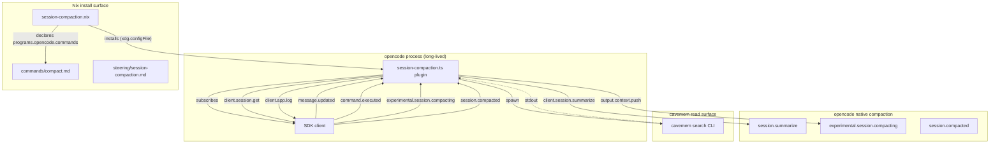
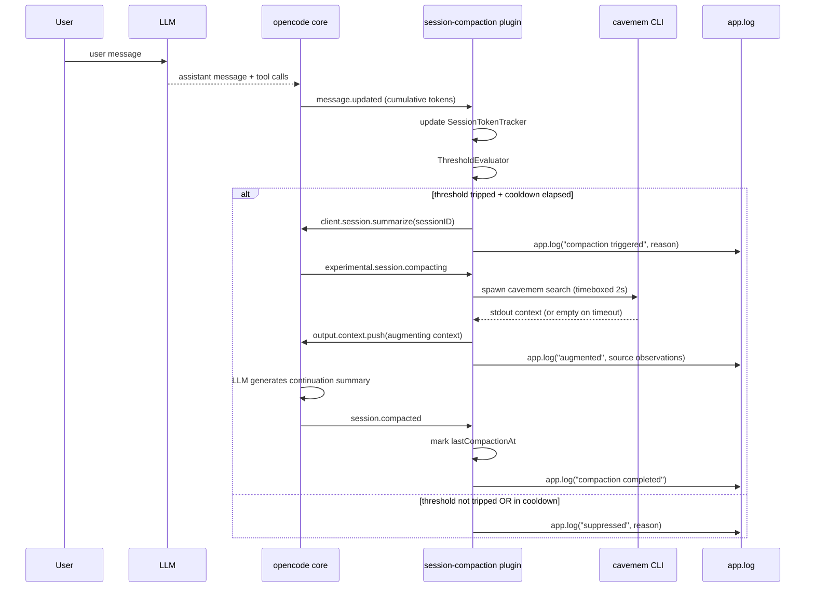
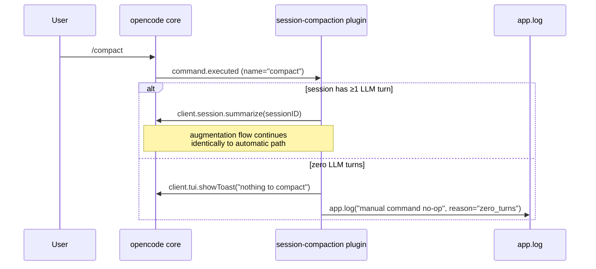
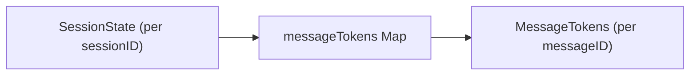

# Technical Design: session-compaction

## Overview

**Purpose**: This feature reduces LLM API spend on long-running
opencode sessions by automatically triggering opencode's native
compaction (`session.summarize`) when configurable token / wall-time
thresholds trip, and by augmenting opencode's continuation prompt
with cavemem-derived context via the `experimental.session.compacting`
hook. The 2026-05-19 cost diagnostic showed 27 sessions ran >24h and
accounted for 67% of post-exclusion spend; this feature bounds that
pattern structurally.

**Users**: The single operator of this nix-config (Shopify and
personal nix-darwin hosts) plus every opencode agent (main-thread
and, opt-in, subagent) running on those hosts. The plugin is global
to opencode sessions; thresholds are per-host configurable.

**Impact**: Adds one new opencode plugin, one new HM module, one new
slash command, and one new steering doc. Does NOT modify opencode
source, cavemem source, or any existing opencode-managed
configuration. The cost-diagnostic remains the validation harness.

### Goals

- Reduce `accumulatedToolOutputsCached` per long-running session by
  ≥40% on a representative replay workload (R9.1).
- Prevent any new session from reaching the cost profile of the
  30-day outlier (~$1,567 v1 cost) without at least one compaction
  event (R9.3).
- Provide a manual `/compact` slash command that triggers the same
  augmentation behavior as automatic compaction (R4).
- Ship the entire feature declaratively, host-parity, reversibly
  (R1, R7.6).

### Non-Goals

- Rewriting or replacing opencode's compaction machinery; we trigger
  and augment, never re-implement.
- Per-tool output compression at the source (separate spec
  `tool-output-compressor`).
- Subagent prompt slimming / per-agent tool allowlists (separate
  in-flight brief `subagent-context-budget`).
- Any cavemem upstream change; cavemem stays read-only.
- Cross-session forking / resume orchestration (operator continues
  to manage `--continue --fork` themselves).
- Cost dashboards, web UIs, hosted services, or external SaaS
  observability.

## Boundary Commitments

### This Spec Owns

- Per-session token accounting for opencode sessions on this host,
  in plugin memory (transient, per-process).
- The decision to invoke `client.session.summarize` based on
  configurable thresholds.
- The `experimental.session.compacting` hook handler that augments
  the continuation prompt with cavemem-derived context.
- The `/compact` slash command artifact (`commands/compact.md`) and
  its `command.executed` event handler.
- The `home-manager/common/session-compaction.nix` HM module
  (options, install, peer-module assertion).
- The `.kiro/steering/session-compaction.md` steering document.

### Out of Boundary

- opencode's native compaction implementation (LLM summary
  generation, `part.type == "compaction"` persistence, session
  resume semantics). We consume the existing surface.
- The cost-diagnostic's report generation. We do not extend
  `opencode-cost-report` for this spec; observability rides on
  `client.app.log` and on opencode's existing `CompactionPart` rows
  the diagnostic already sees.
- cavemem's schema, CLI subcommand set, or MCP tool set. We use
  only `cavemem search` (read-only) and the four existing MCP
  read tools.
- Subagent prompt content, tool allowlists, AGENTS.md modularity.
  These belong to other specs.
- The opencode wrapper, MCP server registration, or any
  modification to `home-manager/common/opencode.nix` beyond a
  single `programs.opencode.commands.compact` entry (added by the
  new module via attrset merge).

### Allowed Dependencies

- **opencode plugin runtime** (`@opencode-ai/plugin` types + the SDK
  client passed into the plugin context). Pinned via
  `pkgs.opencode-pinned` in the existing opencode HM module.
- **opencode SDK methods**: `session.summarize`, `session.get`,
  `app.log`, `tui.showToast`. All documented at
  https://opencode.ai/docs/sdk.
- **opencode events**: `session.created`, `message.updated`,
  `experimental.session.compacting`, `session.compacted`,
  `command.executed`. All confirmed in `types.gen.ts`.
- **cavemem CLI** (`cavemem search`, invoked via subprocess). Same
  pattern as the existing `cavemem.js` plugin.
- **Bun runtime** for the plugin's TS execution and the `$` shell
  API. Provided by opencode itself; no new install.
- **HM-managed `xdg.configFile`** for plugin install. Same pattern
  as the two existing plugins.

### Revalidation Triggers

These changes force dependent specs or downstream consumers to
re-check integration:

- `experimental.session.compacting` hook signature changes (input/
  output shape, hook removal, prefix-promotion to non-experimental).
- `Message.tokens` shape changes in `types.gen.ts`.
- `Session.parentID` semantics or field-name changes.
- cavemem `search` CLI output format changes.
- The HM `programs.opencode.commands` attrset shape changes.
- `pkgs.opencode-pinned` version bump that may invalidate any of
  the above.

## Architecture

### Existing Architecture Analysis

This is an extension of the existing opencode + HM + cavemem stack:

- **opencode** runs as a long-lived TUI process; plugins load
  on startup from `~/.config/opencode/plugins/`. Two plugins
  precede this work and define the install pattern:
  `cavemem.js` (lifecycle + tool hooks) and `zellij-attention.ts`
  (status events). Both are vendored TS/JS source symlinked
  via `xdg.configFile`.
- **cavemem** runs as an out-of-process MCP server plus a local
  CLI; it captures every opencode prompt, response, and tool call
  into its own SQLite DB. The `cavemem.js` plugin keys cavemem's
  records by opencode's `sessionID`.
- **opencode-cost-diagnosis** ships an HM module
  (`opencode-cost-diagnosis.nix`) that this spec mirrors verbatim
  for module shape, peer-module assertion pattern, and
  `home.packages` install.

### Architecture Pattern & Boundary Map



**Architecture integration**:

- **Selected pattern**: event-driven plugin pattern (matches
  cavemem.js and zellij-attention.ts). No new architectural primitive.
- **Domain boundaries**: the plugin is the only new code-bearing
  artifact; HM module is install plumbing. Slash command and
  steering doc are content-only artifacts.
- **Existing patterns preserved**: `xdg.configFile` plugin install,
  HM module with `enable` + `assertions`, `programs.opencode.commands`
  attrset merge, declarative-only install.
- **New components rationale**:
  - Plugin: necessary — opencode events are only consumable from a
    plugin process; no out-of-process alternative.
  - HM module: necessary — host-parity install requires declarative
    Nix wiring.
  - Slash command: required by R4.1.
  - Steering doc: required by R4.6.
- **Steering compliance**: no upstream cavemem changes (consistent
  with the roadmap's diagnose-first → no-cavemem-rewrites
  posture); no opencode source mods (consistent with R7.6).

### Technology Stack

| Layer | Choice / Version | Role in Feature | Notes |
|-------|------------------|-----------------|-------|
| Plugin runtime | opencode-pinned (existing) + Bun (bundled with opencode) | Loads `session-compaction.ts` at opencode startup | Same runtime as existing plugins; no new dep |
| Plugin language | TypeScript with `@opencode-ai/plugin` types | Per-event handlers, threshold logic, hook injection | `Plugin` type for type-safety; never `any` |
| Plugin context | `cavemem` CLI (existing, `pkgs.cavemem`) | Read-only context augmentation via subprocess `cavemem search` | Already on PATH for both hosts |
| Install | Home Manager `xdg.configFile` symlink | Symlinks plugin + slash command into opencode plugin dir | Same pattern as cavemem.js, zellij-attention.ts |
| Config | HM module options `programs.session-compaction.{...}` | Operator-configurable thresholds, cooldown, augmentation toggle, subagent watch | New module mirroring `opencode-cost-diagnosis.nix` |
| Steering | Plain markdown under `.kiro/steering/` | Operator documentation | Same shape as `roadmap.md` |

## File Structure Plan

### New Files

```
home-manager/
├── common/
│   ├── session-compaction.nix          # HM module: options, install, assertions
│   ├── opencode-plugins/
│   │   └── session-compaction.ts       # Plugin: trigger logic + hook handlers
│   └── commands/
│       └── compact.md                  # Slash command body (LLM-readable)
└── ...

.kiro/
└── steering/
    └── session-compaction.md           # Operator protocol documentation

tests/
└── session-compaction/                 # Unit tests for plugin internal seams
    ├── threshold-evaluator.test.ts     # Pure threshold logic
    ├── session-token-tracker.test.ts   # Per-session state aggregation
    ├── cavemem-context-source.test.ts  # Subprocess wrapper with timeout
    └── plugin-self-check.test.ts       # Startup API probe
```

### Modified Files

- `home-manager/common/default.nix` — add `./session-compaction.nix`
  to `imports`; enable `programs.session-compaction.enable = true;`
  alongside the existing common-module enables (peer pattern matches
  `opencode-cost-diagnosis.nix` enable at line 190).
- `home-manager/common/opencode.nix` — extend
  `programs.opencode.commands` with `compact = ../commands/compact.md;`
  (alternatively, the new HM module declares this via attrset merge
  to avoid touching the common opencode module; design-phase
  decision recorded below in §Components / SlashCommand).

### File Responsibility Notes

- `session-compaction.ts` is a single file containing six internal
  seams (D.8 in research.md) presented as one plugin export. Each
  seam is internally testable; tests live under
  `tests/session-compaction/` and import the seams via named exports.
- `compact.md` is content-only (LLM-readable description of the
  command and what the plugin does). No imperative behavior;
  the plugin handles `command.executed` events.
- `session-compaction.nix` is the **only** Nix file that imports
  the plugin source path. The plugin path is `./opencode-plugins/
  session-compaction.ts` relative to the HM module file.

## System Flows

### Automatic Compaction Flow



### Manual Compaction Flow



Key flow decisions:

- The augmentation step is invariant across automatic and manual
  triggers (R4.3). Both call `client.session.summarize`, and
  opencode fires `experimental.session.compacting` regardless of
  caller.
- The cavemem context query is **timeboxed** to a configurable
  budget (default 2s). Timeout → empty augmentation, opencode's
  native summary proceeds unaugmented. This protects the user's
  per-turn latency when cavemem is slow or unreachable.
- `lastCompactionAt` is updated on `session.compacted` (post), not
  on `session.summarize` (pre), so cooldown measures from actual
  completion (D.7 in research.md).

## Requirements Traceability

| Requirement | Summary | Components | Interfaces | Flows |
|-------------|---------|------------|------------|-------|
| 1.1 | Install on both hosts | SessionCompactionModule | HM `enable` option | (module evaluation) |
| 1.2 | Active on next opencode invocation | SessionCompactionModule | `xdg.configFile` symlink | (plugin discovery on opencode startup) |
| 1.3 | Peer-module assertion | SessionCompactionModule | `assertion = config.programs.opencode.enable` | (HM-eval) |
| 1.4 | No imperative install | SessionCompactionModule | Vendored TS source via `xdg.configFile.source` | (HM-eval) |
| 1.5, 1.6 | Disable removes plugin, zero residual | SessionCompactionModule | `lib.mkIf cfg.enable` | (HM-eval) |
| 2.1, 2.2, 2.3 | Token threshold + trigger | SessionCompactionPlugin (SessionTokenTracker + ThresholdEvaluator) | `message.updated` → `client.session.summarize` | Automatic Compaction Flow |
| 2.4, 2.5 | Wall-time threshold + trigger | SessionCompactionPlugin (ThresholdEvaluator) | `message.updated` + session-start timestamp | Automatic Compaction Flow |
| 2.6, 2.7 | Cooldown | SessionCompactionPlugin (CompactionInvoker) | `Session.time.compacting` read via `client.session.get` | Automatic Compaction Flow |
| 2.8 | Disabled threshold value | SessionCompactionPlugin (ThresholdEvaluator) | HM option validation | (module) |
| 2.9 | Compaction failure does not block | SessionCompactionPlugin (CompactionInvoker) | try/catch on SDK call + `app.log` | Automatic Compaction Flow |
| 2.10 | Zero-turn no-op | SessionCompactionPlugin (ThresholdEvaluator) | turnCount check | Automatic Compaction Flow |
| 3.1, 3.2 | Pre-compaction query + augment | SessionCompactionPlugin (CavememContextSource) | `experimental.session.compacting` → `output.context.push` | Automatic Compaction Flow |
| 3.3 | Cavemem failure graceful | SessionCompactionPlugin (CavememContextSource) | timeout + try/catch | Automatic Compaction Flow |
| 3.4 | Cavemem read-only | SessionCompactionPlugin (CavememContextSource) | `cavemem search` only | (by construction) |
| 3.5 | Augment-not-replace | SessionCompactionPlugin (compacting handler) | `output.context.push`, never `output.prompt` | Automatic Compaction Flow |
| 3.6 | Augmentation-disable option | SessionCompactionPlugin (compacting handler) + SessionCompactionModule | HM `augmentationEnabled` option | Automatic Compaction Flow (branch) |
| 4.1, 4.2 | Slash command + native compaction | SlashCommand + SessionCompactionPlugin (`command.executed` handler) | `programs.opencode.commands.compact` + `command.executed` event | Manual Compaction Flow |
| 4.3 | Manual = automatic augmentation | SessionCompactionPlugin | Same handler chain | Manual Compaction Flow |
| 4.4 | Zero-turn no-op on manual | SessionCompactionPlugin (`command.executed` handler) | turnCount check + `tui.showToast` | Manual Compaction Flow |
| 4.5 | Manual failure surfaced | SessionCompactionPlugin | `client.tui.showToast` on error | Manual Compaction Flow |
| 4.6 | Steering doc | SteeringDoc | `.kiro/steering/session-compaction.md` | n/a |
| 5.1, 5.2 | Subagent-watch opt-in default off | SessionCompactionModule + SessionCompactionPlugin | HM `watchSubagents` option + `session.created` handler | Automatic Compaction Flow (gating) |
| 5.3 | Apply thresholds to subagents | SessionCompactionPlugin | `client.session.get` reads `parentID` | Automatic Compaction Flow |
| 5.4, 5.5 | Subagent-type allowlist | SessionCompactionModule + SessionCompactionPlugin | HM `subagentAllowlist` option + agent-name match | Automatic Compaction Flow |
| 5.6 | Subagent events graceful | SessionCompactionPlugin (PluginSelfCheck) | startup probe + warn-once | (startup) |
| 6.1 | Diagnostic-recoverable compaction events | (opencode native) | `CompactionPart` row + plugin `app.log` event | (by construction; no plugin code) |
| 6.2 | Augmentation events logged | SessionCompactionPlugin (SessionCompactionLogger) | `app.log({service: "session-compaction", level: "info", ...})` | Automatic Compaction Flow |
| 6.3 | Operational log path documented | SessionCompactionModule | Module docstring / steering doc | n/a |
| 6.4 | Suppression reasons logged | SessionCompactionPlugin (SessionCompactionLogger) | `app.log` on every short-circuit | Automatic Compaction Flow |
| 6.5 | Startup/shutdown/config logged | SessionCompactionPlugin (SessionCompactionLogger) | `app.log` on `session.created` / `session.idle` | (startup/lifecycle) |
| 7.1 | Declared opencode version range | SessionCompactionModule | Module docstring + assertion | (HM-eval) |
| 7.2, 7.3 | Startup self-check + self-disable | SessionCompactionPlugin (PluginSelfCheck) | First-event probe sets module-scoped `disabled` flag | (startup) |
| 7.4 | Disabled plugin inert | SessionCompactionPlugin | All handlers check `disabled` first | (every handler) |
| 7.5 | Runtime errors logged, no retry in cooldown | SessionCompactionPlugin (CompactionInvoker) | try/catch + `lastErrorAt` per session | Automatic Compaction Flow |
| 7.6 | No opencode source mods | SessionCompactionModule | Pure HM `xdg.configFile` + `programs.opencode.commands` | (by construction) |
| 8.1, 8.2 | Coexistence with cost-diagnostic | (by construction) | Disjoint state; cost-diagnostic already handles `CompactionPart` rows | n/a |
| 8.3 | No conflict with subagent-context-budget | (by construction) | Orthogonal scope; HM attrset merge for any shared options | n/a |
| 8.4 | No cavemem upstream changes | SessionCompactionPlugin (CavememContextSource) | Uses only `cavemem search` (existing CLI) | (by construction) |
| 8.5 | Future tool-output-compressor compatible | SessionCompactionPlugin (SessionTokenTracker) | Reads opencode's authoritative `tokens` field; byte-content-agnostic | (by construction) |
| 9.1 | Measurable reduction on replay | (validation methodology) | Re-run `opencode-cost-report` | (post-implementation) |
| 9.2 | Validation methodology documented | SteeringDoc + SessionCompactionModule docstring | Markdown + module comment | n/a |
| 9.3 | No new 30-day-pattern session | SessionCompactionPlugin (defaults) | Default thresholds chosen empirically | Automatic Compaction Flow |
| 9.4 | Retune-or-revisit on negative result | SteeringDoc | Documented validation gate | n/a |

## Components and Interfaces

### Component Summary

| Component | Domain/Layer | Intent | Req Coverage | Key Dependencies (P0/P1) | Contracts |
|-----------|--------------|--------|--------------|--------------------------|-----------|
| SessionCompactionPlugin | opencode plugin runtime | Watches token growth, triggers + augments compaction, observes events | 2.*, 3.*, 4.2–4.5, 5.*, 6.1–6.5, 7.2–7.5, 8.5 | opencode SDK (P0), cavemem CLI (P1) | Service, Event, State |
| SessionCompactionModule | Nix HM module | Declarative install + options + peer assertion | 1.*, 5.1, 5.4, 6.3, 7.1, 7.6 | `programs.opencode` (P0) | (module options) |
| SlashCommand | opencode command surface | Operator-visible manual trigger | 4.1, 4.6 (partial) | `programs.opencode.commands` attrset (P0) | — |
| SteeringDoc | Documentation | Operator protocol + validation methodology | 4.6, 6.3, 9.2, 9.4 | — | — |

### Opencode Plugin Layer

#### SessionCompactionPlugin

| Field | Detail |
|-------|--------|
| Intent | Single-file TS plugin owning all event subscriptions, token accounting, threshold evaluation, augmentation, and observability |
| Requirements | 2.1, 2.2, 2.3, 2.4, 2.5, 2.6, 2.7, 2.8, 2.9, 2.10, 3.1, 3.2, 3.3, 3.4, 3.5, 3.6, 4.2, 4.3, 4.4, 4.5, 5.2, 5.3, 5.5, 5.6, 6.1, 6.2, 6.4, 6.5, 7.2, 7.3, 7.4, 7.5, 8.5 |

**Responsibilities & Constraints**

- Subscribes to `session.created`, `message.updated`,
  `command.executed`, `experimental.session.compacting`,
  `session.compacted`, `session.idle`.
- Owns six internal seams (see D.8 in research.md):
  `SessionTokenTracker`, `ThresholdEvaluator`,
  `CavememContextSource`, `CompactionInvoker`, `PluginSelfCheck`,
  `SessionCompactionLogger`.
- Per-session state lives in process memory; transient and not
  persisted across plugin reloads. Acceptable because compaction
  decisions are turn-driven and don't need history.
- Never modifies opencode state directly; all mutations go through
  the SDK or hook output objects.

**Dependencies**

- Inbound: opencode event system (events listed above) — P0
- Outbound: `client.session.summarize` (P0), `client.session.get`
  (P0 for parentID lookup), `client.app.log` (P1 for observability),
  `client.tui.showToast` (P1 for manual-error surfacing)
- External: `cavemem search` subprocess via Bun `$` shell (P1)
- External: opencode-pinned plugin runtime types (`@opencode-ai/plugin`)

**Contracts**: Service [x] / API [ ] / Event [x] / Batch [ ] / State [x]

##### Service Interface

```typescript
import type { Plugin } from "@opencode-ai/plugin"

export const SessionCompactionPlugin: Plugin = async (ctx) => {
  return {
    "session.created": async (input) => void,
    "message.updated": async (input) => void,
    "command.executed": async (input) => void,
    "experimental.session.compacting": async (input, output) => void,
    "session.compacted": async (input) => void,
    "session.idle": async (input) => void,
  }
}

// Internal seam interfaces (all type-safe, no `any`):

interface SessionState {
  readonly sessionID: string
  readonly parentID: string | null
  readonly agentName: string | null
  readonly startedAt: number  // ms epoch
  messageTokens: Map<string, MessageTokens>  // messageID → tokens
  turnCount: number
  lastSelfCheckResult: "ok" | "failed" | null
}

interface MessageTokens {
  readonly input: number
  readonly output: number
  readonly reasoning: number
  readonly cacheRead: number
  readonly cacheWrite: number
}

interface ThresholdConfig {
  readonly thresholdTokens: number | null         // null = disabled
  readonly thresholdWallTimeHours: number | null
  readonly cooldownMinutes: number
  readonly augmentationEnabled: boolean
  readonly watchSubagents: boolean
  readonly subagentAllowlist: SubagentAllowlist   // trichotomy below
  readonly cavememContextTimeoutMillis: number
}

// Subagent allowlist trichotomy preserved across the Nix → env-var
// → TS boundary. Parser maps env-var absence / sentinel / list to
// the three variants. Conflating any of these is a known
// silent-misconfiguration class.
type SubagentAllowlist =
  | { kind: "match-any" }                          // env var unset
  | { kind: "match-none" }                         // env var == "__MATCH_NONE__"
  | { kind: "match-listed"; agents: ReadonlyArray<string> }  // env var == "a,b,c"

interface ThresholdDecision {
  readonly shouldCompact: boolean
  readonly reason: string  // e.g. "tokens_exceeded:520000", "in_cooldown:380s_remaining", "zero_turns"
}

interface CavememContextResult {
  readonly text: string         // empty on failure or timeout
  readonly source: string       // identifier for logging; "" if empty
  readonly elapsedMillis: number
}

interface CompactionAttempt {
  readonly sessionID: string
  readonly trigger: CompactionTrigger
  readonly reason: string
  readonly timestamp: number
}

// Three trigger sources are observable; the plugin must attribute
// every session.compacted event to exactly one of them for the R6
// observability story to be complete.
type CompactionTrigger =
  | "automatic"   // our threshold-trip path
  | "manual"      // /compact slash-command path (command.executed)
  | "external"    // opencode-native trigger (TUI session.compact
                  //   keybind, or any opencode internal auto-trigger
                  //   we did not initiate). Inferred by the
                  //   session.compacted handler when no in-flight
                  //   CompactionAttempt is tracked for the session.

interface CompactionResult {
  readonly attempt: CompactionAttempt
  readonly succeeded: boolean
  readonly error: string | null
}
```

- **Preconditions**: opencode SDK client is initialized; plugin
  context (`{ client, $, ... }`) is passed by opencode at plugin
  load.
- **Postconditions**: per-session state is populated incrementally
  via `message.updated`; compaction trigger emits an
  `app.log` event and a `client.session.summarize` call (or a
  documented suppression path).
- **Invariants**: every handler short-circuits on
  `selfCheckResult === "failed"` (R7.4); cavemem invocations are
  read-only and time-boxed; thresholds set to null/zero are
  treated as disabled (R2.8).

##### Event Contract

Subscribed events (consumed):

| Event | Payload (relevant fields) | Action |
|-------|---------------------------|--------|
| `session.created` | `{ info: Session }` | Initialize SessionState; query `client.session.get` for `parentID` and ignore-list filtering when `watchSubagents = false`. Self-check probe runs on first ever event. |
| `message.updated` | `{ info: Message }` (cumulative `tokens`) | Update SessionTokenTracker; run ThresholdEvaluator; on trip, call CompactionInvoker. |
| `command.executed` | `{ name, sessionID, arguments, messageID }` | If `name === "compact"`, invoke CompactionInvoker (manual trigger). |
| `experimental.session.compacting` | `(input, output)` — output has `context: string[]` and `prompt: string` | Query CavememContextSource; push result onto `output.context` (never set `output.prompt`). |
| `session.compacted` | `{ sessionID }` | Mark `lastCompactionAt` in state. Emit `app.log` with `trigger` attribution: if the plugin has an in-flight `CompactionAttempt` for this `sessionID` (set by the threshold-trip path or by `command.executed`), attribute the event to that attempt's `trigger`; otherwise attribute to `"external"` (opencode-native TUI keybind or internal auto-trigger). This is the only path that can attribute the third trigger source — `experimental.session.compacting` fires before the trigger source is knowable from inside the plugin. |
| `session.idle` | `{ sessionID }` | Emit session-summary `app.log`; do NOT remove session state (it may resume). |

Published events: NONE. The plugin emits structured logs via
`client.app.log` (see Logger Contract below) but does not publish
opencode events.

##### State Management

- **State model**: `Map<sessionID, SessionState>` lives in plugin-
  module scope (one map per plugin process). Per-session state is
  populated on `session.created`, mutated on `message.updated` /
  `session.compacted`, and never cleaned up (sessions are bounded
  per plugin lifetime; opencode itself manages session count).
- **Persistence & consistency**: no disk persistence. State loss
  on plugin reload is acceptable — thresholds reset, cooldown
  reads from `Session.time.compacting` (authoritative via
  `client.session.get`), and the next `message.updated` rebuilds
  per-session totals from opencode's own message store if needed.
- **Concurrency strategy**: opencode dispatches plugin handlers
  serially per session within the plugin's event loop. No
  cross-session contention. Within-session ordering is preserved
  by the event-loop semantics.

##### Logger Contract

All `client.app.log` invocations from this plugin use:

```typescript
client.app.log({
  body: {
    service: "session-compaction",
    level: "info" | "warn" | "error" | "debug",
    message: string,
    extra: {
      sessionID: string,
      parentID?: string,
      agentName?: string,
      trigger?: "automatic" | "manual" | "external",
      reason?: string,
      thresholdTokens?: number,
      thresholdWallTimeHours?: number,
      currentTokens?: number,
      wallTimeHours?: number,
      augmentationSource?: string,
      augmentationLengthChars?: number,
      compactionSucceeded?: boolean,
      errorMessage?: string,
    },
  },
})
```

Operational log surface is whatever opencode persists `app.log`
to (typically `~/.local/share/opencode/logs/`). The HM module's
docstring documents the resolved path (R6.3).

**Implementation Notes**

- Integration: plugin file is loaded by opencode on startup via
  `xdg.configFile` symlink; no `bun install` step needed because
  the plugin uses only `@opencode-ai/plugin` types (provided by
  opencode itself) and `node:child_process` / Bun `$` (both built-
  in to the runtime).
- Validation: `PluginSelfCheck` runs on the first received event,
  probes for `client.session.summarize` and `client.session.get`
  type-shape, and sets `selfCheckResult` accordingly. On
  `"failed"`, all handlers short-circuit, an `app.log` error is
  emitted naming the missing API, and the plugin self-disables
  for the session (R7.2 / R7.3 / R7.4).
- Risks: `experimental.session.compacting` API drift (mitigated
  by self-check); cavemem CLI latency on the critical pre-
  compaction path (mitigated by 2s timeout default, R3.3);
  prompt-cache regression from over-aggressive compaction
  (mitigated by R9 validation methodology).

### Nix Install Layer

#### SessionCompactionModule

| Field | Detail |
|-------|--------|
| Intent | HM module exposing `programs.session-compaction.{enable, thresholdTokens, thresholdWallTimeHours, cooldownMinutes, augmentationEnabled, watchSubagents, subagentAllowlist, cavememContextTimeoutMillis}`; installs the plugin and slash command; asserts `programs.opencode.enable` |
| Requirements | 1.1, 1.2, 1.3, 1.4, 1.5, 1.6, 2.2, 2.4, 2.6, 2.8, 3.6, 5.1, 5.4, 6.3, 7.1, 7.6, 8.3 |

**Responsibilities & Constraints**

- Mirrors `home-manager/common/opencode-cost-diagnosis.nix`
  structure exactly (peer-module assertion pattern, `lib.mkIf
  cfg.enable`, `home.packages` not used because no binaries are
  shipped — only symlinked source files).
- Declares one new attribute on `programs.opencode.commands` via
  HM attrset merge (no conflict with the Shopify host's existing
  three commands).
- Common-wide enable: imported in `home-manager/common/default.nix`
  and enabled there, matching the
  `programs.opencode-cost-diagnosis.enable = true;` precedent.

**Dependencies**

- Inbound: imported by `home-manager/common/default.nix` (P0)
- Outbound: `programs.opencode.enable` (asserted; P0);
  `xdg.configFile`, `programs.opencode.commands` (P0)
- External: none

**Contracts**: Service [ ] / API [ ] / Event [ ] / Batch [ ] /
State [ ] (this is a build-time module; no runtime contract)

##### Module Options

```nix
options.programs.session-compaction = {
  enable = lib.mkEnableOption "opencode session compaction plugin";
  thresholdTokens = lib.mkOption {
    type = lib.types.nullOr lib.types.ints.positive;
    default = 500000;  # design-phase default; tune per R9.3
    description = "Cumulative input tokens per session above which compaction triggers. Null or zero disables.";
  };
  thresholdWallTimeHours = lib.mkOption {
    type = lib.types.nullOr lib.types.numbers.positive;
    default = 24;
    description = "Wall-clock hours since session start (or last compaction) above which compaction triggers. Null or zero disables.";
  };
  cooldownMinutes = lib.mkOption {
    type = lib.types.ints.unsigned;
    default = 30;
    description = "Minimum minutes between successive automatic compactions on the same session.";
  };
  augmentationEnabled = lib.mkOption {
    type = lib.types.bool;
    default = true;
    description = "Whether to augment opencode's continuation prompt with cavemem context. When false, compaction still fires on threshold but no cavemem query is made (R3.6).";
  };
  watchSubagents = lib.mkOption {
    type = lib.types.bool;
    default = false;
    description = "Apply threshold logic to subagent sessions in addition to main-thread (R5.1, R5.2).";
  };
  subagentAllowlist = lib.mkOption {
    type = lib.types.nullOr (lib.types.listOf lib.types.str);
    default = null;
    description = ''
      When watchSubagents = true, limit threshold logic to subagent
      sessions whose agent name matches an entry. Three distinct
      states are honored (R5.4, R5.5):
        - null    → "match any" (option not supplied; default).
        - []      → "match none" (operator explicitly suppressed all subagents).
        - [...]   → "match listed agents only".
      The install step encodes these three states into the env var
      surface using sentinel values; the plugin's parser MUST honor
      the same trichotomy. Conflating null with [] (silent
      misconfiguration) is the documented failure mode this option
      shape exists to avoid.
    '';
  };
  cavememContextTimeoutMillis = lib.mkOption {
    type = lib.types.ints.positive;
    default = 2000;
    description = "Maximum time the cavemem context query is allowed to take during pre-compaction augmentation. On timeout, augmentation is skipped (R3.3).";
  };
};
```

##### Assertion

```nix
assertions = [{
  assertion = config.programs.opencode.enable;
  message = ''
    programs.session-compaction.enable requires programs.opencode.enable.
    The plugin loads into the opencode TUI process via xdg.configFile.
    Without programs.opencode.enable = true, opencode itself is not
    installed and the plugin file is dangling.

    To fix: set programs.opencode.enable = true; alongside
    programs.session-compaction.enable = true; in the same home-manager
    configuration.
  '';
}];
```

##### Install Steps

```nix
config = lib.mkIf cfg.enable {
  xdg.configFile."opencode/plugins/session-compaction.ts".source =
    ./opencode-plugins/session-compaction.ts;
  programs.opencode.commands.compact = ./commands/compact.md;
  # Threshold values exported as env vars for the plugin to read,
  # via the home.opencode.wrapperCommands surface, to avoid hard-coding
  # config-file lookup paths in the plugin source.
  #
  # subagentAllowlist sentinel scheme (preserves the null vs [] vs
  # [...] trichotomy across the Nix → env-var → TS boundary):
  #   - cfg.subagentAllowlist == null → unset the env var entirely
  #     (plugin treats absence as "match any").
  #   - cfg.subagentAllowlist == []   → export "__MATCH_NONE__"
  #     (plugin treats this sentinel as "match no subagent").
  #   - cfg.subagentAllowlist == [a,b]→ export "a,b" (plugin parses
  #     comma-list and matches only those agent names).
  # Plugin parser MUST distinguish all three. Conflating null with []
  # was the failure mode (silent misconfig) that motivated this scheme.
  home.opencode.wrapperCommands = [
    (''
      export SESSION_COMPACTION_THRESHOLD_TOKENS="${toString (cfg.thresholdTokens or 0)}"
      export SESSION_COMPACTION_THRESHOLD_WALL_HOURS="${toString (cfg.thresholdWallTimeHours or 0)}"
      export SESSION_COMPACTION_COOLDOWN_MINUTES="${toString cfg.cooldownMinutes}"
      export SESSION_COMPACTION_AUGMENTATION_ENABLED="${if cfg.augmentationEnabled then "1" else "0"}"
      export SESSION_COMPACTION_WATCH_SUBAGENTS="${if cfg.watchSubagents then "1" else "0"}"
      export SESSION_COMPACTION_CAVEMEM_TIMEOUT_MS="${toString cfg.cavememContextTimeoutMillis}"
    ''
    + (
      if cfg.subagentAllowlist == null then ""
      else if cfg.subagentAllowlist == [] then ''
        export SESSION_COMPACTION_SUBAGENT_ALLOWLIST="__MATCH_NONE__"
      ''
      else ''
        export SESSION_COMPACTION_SUBAGENT_ALLOWLIST="${lib.concatStringsSep "," cfg.subagentAllowlist}"
      ''
    ))
  ];
};
```

**Implementation Notes**

- Integration: imports cleanly into the existing
  `home-manager/common/default.nix` `imports` list; enables via the
  same convention as `opencode-cost-diagnosis.nix`.
- Validation: assertion is build-time; misconfiguration fails
  `nix-darwin switch` cleanly with the documented message.
- Risks: env-var-based config is brittle if many options are added
  later. For v1 (8 options), it's adequate; if option count grows
  past ~15, refactor to a JSON config file written by the module.

### Supporting Artifacts (summary-only)

#### SlashCommand (`commands/compact.md`)

| Field | Detail |
|-------|--------|
| Intent | Operator-visible `/compact` slash command that triggers a `command.executed` event the plugin handles |
| Requirements | 4.1 |

**Implementation Notes**

- Content is LLM-readable markdown: "Compaction has been requested
  for this session. The session-compaction plugin will execute it
  automatically; no further action is needed from you." Short
  description in frontmatter (`description: Trigger session
  compaction`). The body is informational only; the plugin is the
  actual mechanism.
- Wired via `programs.opencode.commands.compact = ./commands/
  compact.md;` (declared by SessionCompactionModule, not by the
  common opencode module — avoids a cross-module edit).
- The slash command does NOT use `subtask: true`; we want the
  event in the current session.

#### SteeringDoc (`.kiro/steering/session-compaction.md`)

| Field | Detail |
|-------|--------|
| Intent | Operator-facing documentation: when to manually compact, what context is preserved, how to debug carry-over, where the operational log lives, validation methodology |
| Requirements | 4.6, 6.3, 9.2, 9.4 |

**Implementation Notes**

- Content sections (per R4.6, R6.3, R9.2, R9.4):
  - When to use `/compact` manually (before a known-expensive
    phase; after the plugin missed a trigger because of a stale
    cooldown; etc.).
  - What context the plugin tries to preserve via cavemem
    augmentation.
  - How to inspect a past compaction event (cavemem timeline +
    opencode `app.log` lookup paths). Includes guidance for
    interpreting the three `trigger` attribution values
    (`automatic`, `manual`, `external`) — in particular, how
    to recognize that a compaction came from opencode's native
    `session.compact` keybind rather than from this plugin.
  - How to retune `programs.session-compaction.thresholdTokens`
    and `thresholdWallTimeHours` based on `opencode-cost-report`
    output.
  - The validation methodology for R9.1 (which workload to replay,
    what comparison to make, what counts as a passing result —
    written up from the concrete procedure already specified in
    §Testing Strategy / Validation Tests of this design).
- No code; pure markdown.

## Data Models

### Domain Model

The plugin's only persistent abstraction is `SessionState` (defined
in §Service Interface above). It is per-process, per-session, and
contains:

- `sessionID` (key from opencode)
- `parentID` (from `client.session.get`, optional)
- `agentName` (read once on first `message.updated` or via
  `session.get`, optional)
- `startedAt` (ms epoch when the plugin first observed the session)
- `messageTokens` (Map keyed by messageID; value is the latest
  cumulative tokens snapshot from that message — overwritten on each
  `message.updated`)
- `turnCount` (incremented on each new messageID seen)
- `lastSelfCheckResult` (set once on first event)

Cooldown is read from `Session.time.compacting` via
`client.session.get` rather than stored in `SessionState`, so it
survives plugin reloads.

### Logical Data Model



- `messageTokens` is keyed by string `messageID`; value is a
  `MessageTokens` record with five numeric fields.
- Total session input tokens (used for threshold) =
  `Σ messageTokens[*].input + Σ messageTokens[*].cacheRead`
  (we count cached reads because they're the cost driver per the
  diagnostic).
- Total wall time = `Date.now() - startedAt`. Resets after a
  `session.compacted` event by re-initializing `startedAt` so the
  wall-clock threshold measures from the most recent compaction.

### Data Contracts & Integration

- **Opencode events**: see Event Contract table in §Components /
  SessionCompactionPlugin / Event Contract above. Payload shapes
  are fixed by opencode's `types.gen.ts`.
- **Cavemem CLI output**: `cavemem search <query>` returns
  newline-separated observation records on stdout. The plugin
  treats the output as opaque text and inlines a bounded prefix
  (configurable, default 4KB) into `output.context`. No schema
  parsing; this keeps the plugin resilient to cavemem output
  format changes.
- **HM module options**: serialized to env vars (see Install
  Steps); plugin reads and parses them on startup. Type-safe
  parsing with bounds-checking happens in the plugin's
  initialization seam.

## Error Handling

### Error Strategy

- **opencode SDK errors** (`session.summarize` throws,
  `session.get` returns 404, etc.): logged via `app.log` at `error`
  level; plugin continues. The current handler returns without
  modifying state (R2.9, R7.5).
- **Cavemem subprocess errors** (spawn failure, non-zero exit,
  timeout): logged at `warn`; augmentation produces empty string;
  opencode's native compaction proceeds (R3.3).
- **Self-check failures** (missing SDK method, unexpected payload
  shape): logged at `error` with the specific gap named; plugin
  flips its internal `disabled` flag for the rest of the session
  (R7.2, R7.3).
- **Bad configuration** (negative threshold, non-numeric env var):
  logged at `warn` once at startup; the bad value falls back to
  the module-documented default; plugin continues.

### Error Categories and Responses

- **User errors** (4.x equivalents): manual `/compact` on a
  zero-turn session → `tui.showToast` with "Nothing to compact" +
  `app.log` info-level (R4.4). Manual `/compact` failure → toast
  with the SDK error message (R4.5).
- **System errors** (5.x equivalents): cavemem unreachable →
  warn-level log + empty augmentation. opencode
  `session.summarize` failure → error-level log + no retry within
  cooldown (R7.5).
- **Business logic errors**: subagent observability failure on
  startup (`session.get` returns no `parentID` field as expected) →
  warn-level once + `watchSubagents` effectively no-ops for that
  session (R5.6).

### Monitoring

- All structured logs via `client.app.log({ service:
  "session-compaction", ... })`.
- The operational log path is documented in the steering doc
  (R6.3); typically `~/.local/share/opencode/logs/` (confirmed at
  implementation time).
- Cost-diagnostic re-runs (R9.1) are the primary success metric;
  no separate monitoring dashboard.

## Testing Strategy

### Unit Tests

(All under `tests/session-compaction/`, runnable via the same Node
test wrapper that `opencode-cost-diagnosis` uses —
`opencode-cost-diagnosis-node` is already on PATH.)

1. **ThresholdEvaluator: token threshold trips at configured
   value** — drive synthetic per-message `tokens` events through
   `SessionTokenTracker`, assert `ThresholdEvaluator` returns
   `{ shouldCompact: true, reason: "tokens_exceeded:..." }` at
   the boundary and not before. Covers R2.2, R2.3, R2.10.
2. **ThresholdEvaluator: wall-time threshold trips** — fake
   `Date.now` source, advance past `thresholdWallTimeHours`,
   assert trip. Cover both `Date.now() - startedAt` and
   `Date.now() - lastCompactionAt`. Covers R2.4, R2.5.
3. **ThresholdEvaluator: cooldown short-circuits trips** — set
   `lastCompactionAt` recently, assert
   `{ shouldCompact: false, reason: "in_cooldown:..." }` even with
   thresholds exceeded. Covers R2.7.
4. **ThresholdEvaluator: disabled threshold (null/0) is inert** —
   assert no trip regardless of token count. Covers R2.8.
5. **SessionTokenTracker: dedupes by messageID** — feed the same
   messageID with two different `tokens` snapshots, assert the
   latest wins and aggregation reflects it (R2.1).
6. **CavememContextSource: timeout produces empty result** — mock
   subprocess that sleeps past timeout, assert
   `{ text: "", source: "", elapsedMillis >= timeout }`. Covers
   R3.3.
7. **CavememContextSource: never writes** — mock subprocess
   factory, assert the only command invoked is `cavemem search`
   with read-only flags (R3.4).
8. **PluginSelfCheck: missing SDK method flips disabled flag** —
   inject a partial mock client, assert handlers short-circuit
   thereafter (R7.2, R7.4).

### Integration Tests

(Driven by a harness that loads the plugin source into a stub
opencode runtime; these live under `tests/session-compaction/
integration/`.)

1. **Automatic flow end-to-end** — synthetic `message.updated`
   sequence drives threshold trip; assert
   `client.session.summarize` is called once and the subsequent
   `experimental.session.compacting` handler pushes the cavemem
   stub's output into `output.context` (R2.3, R3.1, R3.2).
2. **Manual `/compact` flow end-to-end** — synthetic
   `command.executed` with `name: "compact"`; assert
   `session.summarize` is called and the augmentation handler
   fires identically to the automatic path (R4.2, R4.3).
3. **Augmentation-disabled branch** — same as #1 but with
   `augmentationEnabled = false`; assert compaction fires, cavemem
   is NOT invoked, `output.context` is unchanged (R3.6).
4. **Subagent gating: watchSubagents = false** — feed
   `session.created` for a subagent (parentID set); subsequent
   `message.updated` events should NOT cause compaction even past
   threshold (R5.2).
5. **Subagent gating: watchSubagents = true + allowlist match** —
   same as #4 but with `watchSubagents = true` and
   `subagentAllowlist = ["yb-sleuth"]`; assert compaction fires
   for a `yb-sleuth` subagent and does not fire for an `explore`
   subagent (R5.3, R5.5).

### Validation Tests (post-implementation, manual)

The validation procedure is fully defined here. The steering doc
(R9.2) writes this up for the operator audience; design tasks should
not rediscover what counts as a passing run.

#### Procedure 1 — Baseline-and-replay reduction test (R9.1, R9.4)

1. **Workload selection**. From the most recent `opencode-cost-report`
   output, identify the top-3 sessions meeting all of:
   - `cost.total > $100`
   - wall-clock duration > 24 hours
   - resides in a still-active project directory
   These represent the cost shape the spec is designed to bound.
2. **Baseline capture**. Before enabling
   `programs.session-compaction.enable`, record the per-session
   bucket values for each selected session from
   `opencode-cost-report --session <id>`:
   - `accumulatedToolOutputsCached`
   - `accumulatedHistoryCached`
   - `cachedWrite`
   - `cost.total`
3. **Enable + replay**. Enable the plugin at default thresholds;
   re-run the same workload (or a deterministic replay if the
   replay harness has been built — see R9.2 follow-up below).
4. **Post-enablement capture**. Re-run `opencode-cost-report
   --session <id>` for the same session IDs (or the replay-
   produced sessions) and capture the same four buckets.
5. **Pass/fail criteria** — **all three** must hold to pass R9.1:
   - `accumulatedToolOutputsCached` reduced by ≥40% on **at least
     2 of 3** replay sessions.
   - `cachedWrite` did NOT increase by more than +20% on any of
     the 3 replay sessions (guards against the prompt-cache
     regression risk in research.md §D.11).
   - At least one `session.compacted` event with
     `trigger ∈ {automatic, manual}` is present in the plugin's
     `app.log` for each replay session that exceeded thresholds.
6. **On failure** (R9.4): record the per-session deltas in the
   steering doc's "tuning log" section, then either retune
   `thresholdTokens` / `thresholdWallTimeHours` and repeat from
   step 3, or escalate the design via a follow-up spec / brief
   revision. No more than 2 retune iterations before escalation.

#### Procedure 2 — Outlier-cap test (R9.3)

1. **Synthetic stress**. Drive a single opencode session past
   `thresholdTokens` (default 500K) via repeated tool-output-heavy
   turns, OR replay an archived long-running session of the
   30-day-outlier shape, with the plugin enabled at default
   thresholds.
2. **Assertion**. The plugin's `app.log` shall record at least
   one `session.compacted` event with
   `trigger ∈ {automatic, manual, external}` BEFORE the session's
   `cost.total` (read from opencode's session table) crosses
   $500 v1-equivalent.
3. **Pass/fail**. Crossing the $500 threshold without any
   compaction event is a fail. Multiple compaction events during
   the run are expected (each threshold trip fires one).

#### Replay harness (R9.2 follow-up)

Building a deterministic replay harness (a Node CLI that re-emits
recorded opencode events at a given session's pace, with the
plugin in the loop) is out of scope for this spec's first
implementation pass. The initial validation runs use live re-
execution against representative real workloads. The steering
doc records this as a follow-up improvement for future iteration
on threshold defaults.

## Optional Sections

### Performance & Scalability

The only performance-sensitive path is **pre-compaction
augmentation**: cavemem query latency is on the user's per-turn
critical path during compaction. Mitigations:

- Configurable timeout (default 2000ms via
  `cavememContextTimeoutMillis`).
- Empty-result fallback on timeout (R3.3) so opencode's native
  compaction proceeds unblocked.
- Bounded context-string length (4KB default, hard cap) so the
  injected text doesn't itself become a token-cost driver.

All other paths (token accumulation, threshold evaluation) are
in-process arithmetic and run in microseconds per event.

### Security Considerations

- The plugin does not handle credentials, write to opencode source,
  or modify cavemem state. The cavemem CLI invocation reads only
  the data the user already owns (cavemem's own SQLite DB).
- The augmentation context is whatever `cavemem search` returns
  for the current session. Cavemem already captures every tool
  output and every assistant message, including any secrets that
  may have leaked into tool outputs. The plugin does not
  re-amplify this risk; it inlines what cavemem already stores into
  a prompt that opencode would have sent anyway (just with more
  context). No new exfiltration surface.

### Migration Strategy

No migration needed. This is a net-new feature. Rollback path:
disable the HM option (`programs.session-compaction.enable =
false;`) and rebuild; the plugin file disappears, opencode resumes
without it, no state cleanup needed.
