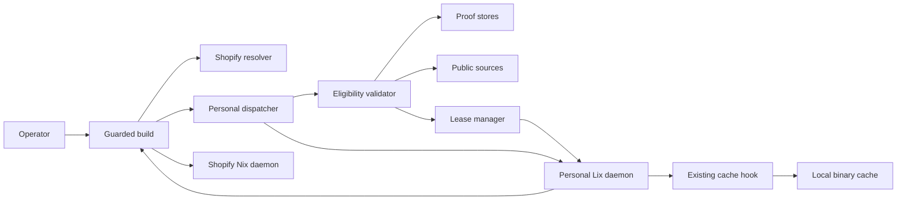
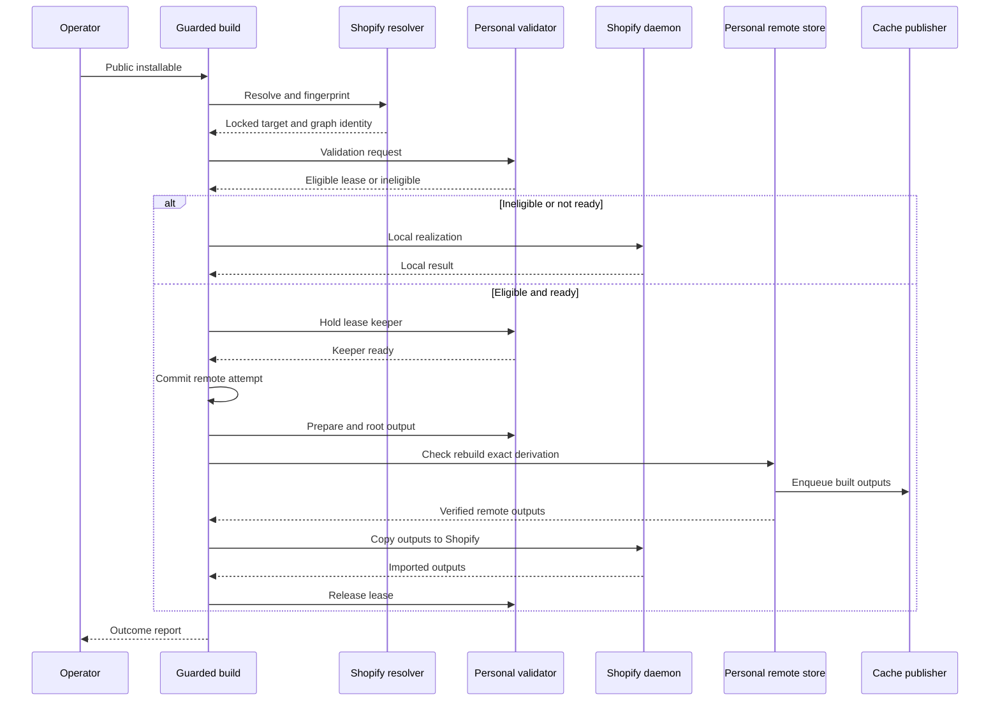
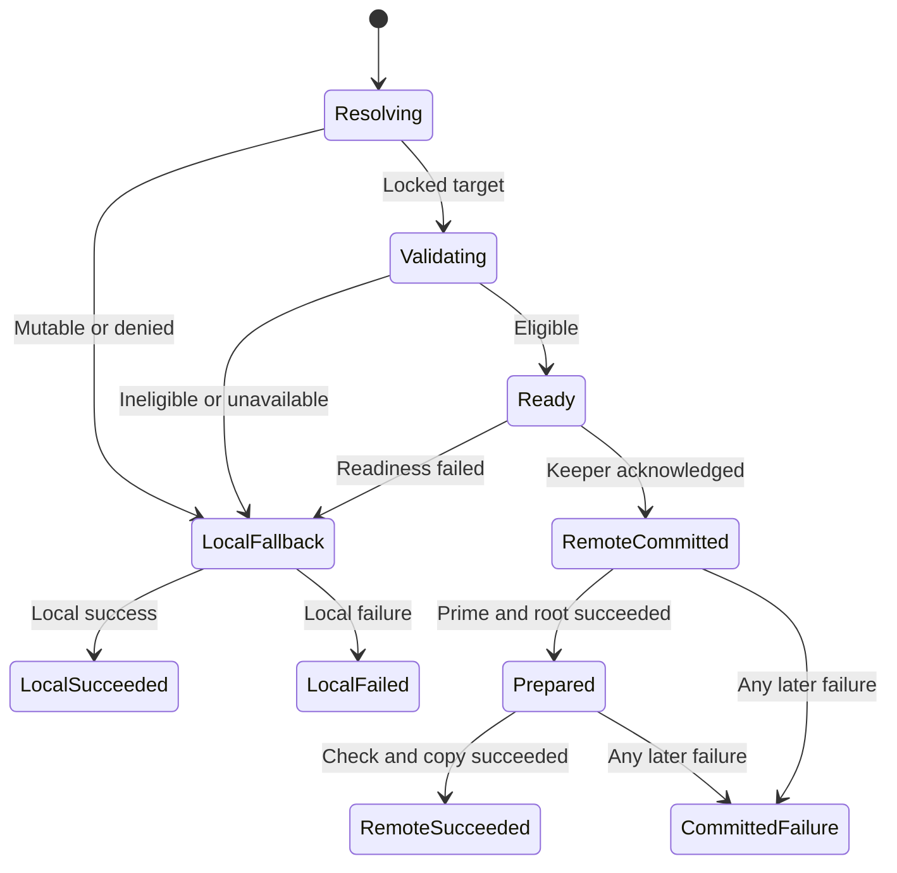

# Design Document

## Overview

The feature adds an explicit Shopify-side command that proves a selected
installable has anonymously refetchable sources before forcing its output to
rebuild on the personal host. Native Nix remote execution hands successful
personal builds to the existing asynchronous cache publisher.

### Goals

- Keep the personal host absent from ordinary Shopify build scheduling.
- Fail closed to local Shopify execution when source eligibility is unknown.
- Rebuild eligible outputs through the conservative cross-version protocol.
- Preserve cache publication, secret isolation, and actionable diagnostics.

### Non-Goals

- Classifying a mixed `darwin-rebuild` graph or enabling a global builder.
- Evaluating arbitrary public repositories or Shopify-private sources.
- Providing an adversarial broker, VM boundary, or reusable approval token.
- Changing Attic serving, authentication, filtering, retention, or retry logic.

## Boundary Commitments

### This Spec Owns

- Typed personal and Shopify remote-builder roles.
- Immutable installable resolution, graph identity, source proof, and fallback.
- A restricted SSH dispatcher and personal Nix builder account.
- Invocation-scoped personal GC-root leases for the independently evaluated
  graph and attested dependency closures.
- The pre-commit fallback boundary and post-commit no-retry policy.
- Remote-builder diagnostics, render tests, behavior tests, and smoke scripts.

### Out of Boundary

- `local-binary-cache` queue, publisher, server, TLS, and storage internals.
- Shopify's externally managed Nix include and credentials.
- General interactive SSH access to the personal host.
- Tailscale, public ingress, persistent approvals, or remote job recovery.
- Source mechanisms not covered by the initial fail-closed policy profiles.

### Allowed Dependencies

- Pinned nix-darwin, Tecnix/Nix 2.34, Lix 2.95.2 or newer, OpenSSH, and Dante.
- Existing SOPS system secrets and public certificate-artifact conventions.
- Existing cache hooks, publisher queues, diagnostics, and Attic endpoint.
- `writeShellApplication`, `jq`, `curl`, OpenSSH, and coreutils from nixpkgs.
- Explicit anonymous public caches and their committed trusted signing keys for
  dependency-closure attestations.

### Revalidation Triggers

- Tecnix/Lix worker protocol, Check mode, remote-store URI, copy, or local-store
  semantics change.
- The post-build-hook contract or cache publisher readiness contract changes.
- The builder account, SSH command, host key, endpoint, or source CIDRs change.
- A fetcher profile, repository allowlist, graph schema, or validation bound
  changes.
- Shopify's external include gains the personal builder or another SSH consumer
  needs the personal OpenSSH service.

## Architecture

### Existing Architecture Analysis

- Both hosts share typed nix-darwin modules and host-specific role wiring.
- The local cache already owns post-build enqueue and asynchronous publication.
- Shopify's login user is trusted by its Nix daemon; no builder is configured.
- The personal host has no managed SSH daemon or dedicated remote-build user.
- Secrets are decrypted to runtime paths and never embedded in generated Nix
  artifacts.
- Node, Nix, shell, and manual two-host fixtures cover comparable integrations.

### Architecture Pattern & Boundary Map

Pattern: a guarded orchestration pipeline with a fail-closed validation gate and
native-protocol execution adapter.



Dependency direction is: public configuration → immutable identity → source
proof → readiness → native execution → existing publication. Cache state never
feeds eligibility evidence.

Key decisions:

- Use a standalone module with a narrow assertion against cache readiness; do
  not modify `local-binary-cache.nix`.
- Keep `nix.distributedBuilds = false` and `nix.buildMachines = []`; do not use
  Tecnix's remote-build hook.
- Use a direct `ssh-ng://` store so worker protocol 1.35 carries Normal and
  Check modes to Lix.
- Launch resolver, validation, readiness, remote-store, and return-copy clients
  from a minimal environment that cannot forward Shopify Nix settings.
- Treat a successful validation and readiness handshake as the remote commit
  point. Every later error returns without local retry.
- Prime a missing approved output in Normal mode, always finish with Check mode,
  then copy the verified outputs to the Shopify daemon store.
- Build only the independently evaluated personal graph. Shopify sends identity
  data before validation and receives outputs after Check; it never uploads the
  derivation or input-source closure.

### Technology Stack

| Layer | Choice / Version | Role | Notes |
|---|---|---|---|
| CLI | nixpkgs shell applications | Orchestration, dispatch, diagnostics | Dependency-injected for tests |
| Policy | `jq`, Dante, and Nix derivation JSON | Normalize graphs and constrain source replay | Versioned JSON contracts |
| Transport | OpenSSH and direct Nix `ssh-ng://` store | Validation RPC, remote Check, and return copy | Forced command; LAN source ranges |
| Runtime | Tecnix/Nix 2.34 and Lix 2.95.2+ | Client and builder daemons | Actual-host smoke gate required |
| Secrets | system sops-nix | Shopify client private key | Runtime path only |
| Publication | existing post-build hook and Attic publisher | Queue remote outputs | Existing module remains authoritative |

## File Structure Plan

### Directory Structure

```text
configurations/common-darwin/
└── shopify-remote-builder.nix       # Typed roles, assertions, SSH and package wiring
scripts/
├── shopify-public-build.nix         # Resolve, validate, commit, rebuild, or fall back
├── shopify-remote-builder-dispatch.nix # Forced SSH command router
├── shopify-remote-builder-validator.nix # Graph proof and source replay
├── shopify-remote-builder-lease.nix # Root, prepare, keepalive, release, and cleanup
└── shopify-remote-builder-status.nix    # Local and cross-host readiness report
certificates/shopify-remote-builder/
├── shopify-client.pub               # Public half of the remote-store client key
└── personal-host-key.txt            # Pinned key-type and key-data host record
secrets/
└── shopify-remote-builder.shopify.yaml # Encrypted Shopify client private key
tests/shopify-remote-builder/
├── helpers.js                       # Isolated module and script fixtures
├── module.test.nix                  # Option and assertion contracts
├── orchestrator.test.js             # State, fallback, commit, and reporting behavior
├── validator.test.js                # Graph, source, cache-cut, and limit policy
├── lease.test.js                    # Root coverage, keeper, release, and expiry
├── system-render.test.js            # Both-host SSH, secret, and package rendering
├── fixtures/                        # Derivation graphs and executable stubs
├── 01-personal-readiness.sh         # Personal role and forced-command preflight
├── 02-public-remote-rebuild.sh      # Actual cross-version remote rebuild
└── 03-cache-reuse.sh                # Personal enqueue and Shopify cache reuse
```

### Modified Files

- `configurations/common-darwin/default.nix` — import the new module.
- `configurations/personal/default.nix` — enable the personal role, service
  account, public client key, and host trust artifact.
- `configurations/shopify/default.nix` — enable the Shopify role and declare
  the SOPS client-key path.
- `.sops.yaml` — add the Shopify-only secret creation rule.
- `secrets/README.md` — document key generation, pinning, rotation, rollout,
  rollback, and smoke-target selection.
- `flake.nix` — add remote-builder render and behavior checks.

### Referenced Existing Files

- `configurations/common-darwin/local-binary-cache.nix` — unchanged publisher,
  hook, queue, and readiness authority used by Cache Integration.
- `scripts/local-binary-cache-enqueue.nix` — unchanged post-build event target.
- `scripts/local-binary-cache-status.nix` — existing cache diagnostics consumed
  by remote-builder readiness checks.

## System Flows

### Guarded rebuild



### Invocation state



No state after `RemoteCommitted` transitions to `LocalFallback`. Validation
workspaces and nonce state are removed on every pre-commit exit.

## Requirements Traceability

| Requirements | Summary | Components | Contracts / Flows |
|---|---|---|---|
| 1.1, 1.2, 1.3, 1.4, 1.5, 1.6 | Explicit immutable requests and no global scheduling | Configuration Module, Guarded Build | CLI, graph identity, guarded rebuild |
| 2.1, 2.2, 2.3, 2.4, 2.5, 2.6, 2.7, 2.8, 2.9 | Anonymous source proof or signed public-cache cut | Eligibility Validator, Dispatcher | Validation JSON, proof pipeline |
| 3.1, 3.2, 3.3, 3.4, 3.5, 3.6 | Forced remote rebuild and bounded fallback | Guarded Build, Remote Store Service | Invocation state, direct store flow |
| 4.1, 4.2, 4.3, 4.4, 4.5, 4.6 | Existing asynchronous publication | Cache Integration | Post-build event, guarded rebuild |
| 5.1, 5.2, 5.3, 5.4, 5.5, 5.6, 5.7 | LAN trust and secret isolation | Configuration Module, Dispatcher | SSH key and forced-command contracts |
| 6.1, 6.2, 6.3, 6.4, 6.5, 6.6, 6.7, 6.8 | Outcomes, failures, cleanup, readiness | Guarded Build, Validator, Diagnostics | Result JSON, invocation state |
| 7.1, 7.2, 7.3, 7.4, 7.5, 7.6 | Render, behavior, and actual-host proof | Test Harness, Diagnostics | Fixtures and three-phase smoke flow |

## Components and Interfaces

| Component | Layer | Intent | Requirements | Dependencies | Contracts |
|---|---|---|---|---|---|
| Configuration Module | Declarative | Render two safe host roles | 1.4, 1.6, 4.1–4.6, 5.1–5.7, 7.1, 7.2 | nix-darwin P0, SOPS P0, cache module P0 | State |
| Guarded Build | Shopify CLI | Own one invocation and its commit boundary | 1.1–1.6, 2.7–2.9, 3.1–3.6, 6.1–6.6 | Tecnix P0, Validator P0 | Batch, State |
| Eligibility Validator | Personal policy | Prove one exact graph's source class | 2.1–2.9, 6.2, 6.4, 6.5, 7.3 | Lix P0, public network P0 | Batch, State |
| Invocation Lease Manager | Personal state | Hold approved personal graph paths through return copy | 2.9, 3.1–3.2, 6.5–6.6, 7.4 | Validator P0, Lix store P0 | Batch, State |
| Dispatcher and Remote Store Service | Personal transport | Expose only validation, readiness, and Lix stdio | 3.1–3.6, 5.1–5.7, 6.3, 6.7, 6.8 | OpenSSH P0, Lix daemon P0 | Service |
| Cache Integration | Existing integration | Publish actual personal outputs | 4.1–4.6, 7.5, 7.6 | local-binary-cache P0 | Event |
| Diagnostics | Operations | Report prerequisites without mutation | 5.6, 5.7, 6.1–6.8, 7.6 | both roles P0 | Batch |
| Test Harness | Verification | Prove policy, rendering, execution, and cache handoff | 7.1–7.6 | all feature components P0 | Batch |

### Declarative Configuration

#### Configuration Module

| Field | Detail |
|---|---|
| Intent | Define shared policy and mutually exclusive personal/Shopify roles. |
| Requirements | 1.4, 1.6, 4.1–4.6, 5.1–5.7, 7.1, 7.2 |

**Option contract**

```text
services.shopifyRemoteBuilder = {
  enable: bool;
  role: personal | shopify;
  endpoint: LAN hostname;
  system: Nix system;
  allowedRepositories: list of exact provider owner repository triples;
  ssh: { user, uid, port, clientPublicKey, privateKeyFile,
         publicHostKey, sourceCidrs };
  validation: { timeoutSeconds, maxDerivations, maxInputSources,
                maxFixedOutputs, maxWorkspaceBytes,
                 publicInterface, maxRedirects,
                stateDirectory, leaseIdleTtlSeconds, heartbeatSeconds,
                publicCaches: list of endpoint and trusted-key sets };
};
```

Invariants:

- The personal role requires the existing personal cache publisher and Lix
  2.95.2 or newer. The Shopify role requires its cache publisher, a non-store
  private-key path, and Tecnix/Nix 2.34.
- Neither role declares `nix.buildMachines`; the Shopify role requires
  `nix.distributedBuilds = false` and rejects an effective global builder entry
  containing the personal endpoint. Remote work uses a direct store URI only.
- The endpoint is one `.local` hostname. Authorized source ranges default to
  RFC1918 IPv4 ranges and exclude Tailscale's CGNAT range.
- The builder account defaults to hidden UID 502 and fails activation on a UID
  collision; the typed option permits an explicit host-local override.
- Repository entries are exact; wildcard owners and arbitrary URLs are
  invalid. `NixOS/nixpkgs` is the initial declared repository.
- Approved public caches initially contain `cache.nixos.org` and
  `nix-community.cachix.org` with their committed signing keys. Local Attic and
  Shopify-managed caches are invalid entries.
- Validation requires one declared non-VPN outbound interface and an
  unprivileged policy-proxy listener port, and rejects an unexpected default/VPN
  route rather than weakening destination policy. The listener defaults to
  `1080`; outbound source fetches remain limited to HTTPS port `443`. The
  personal host initially declares `en0`; the typed option permits correction.
- Validation defaults are 30 minutes, 10,000 derivations, 1,000 input sources,
  256 fixed-output derivations, and 20 GiB of temporary workspace. Exceeding a
  bound returns ineligible.
- Lease state is personal-only under `/var/db/shopify-remote-builder/requests`,
  contains no credential, and expires after one hour of inactivity. A 30-second
  keeper heartbeat and active lock suspend expiry for work of any duration.
- The Shopify client key is owned by the primary user with mode `0400`; the
  direct CLI and root can read it, but rendered store artifacts cannot.

### Shopify Orchestration

#### Guarded Build

| Field | Detail |
|---|---|
| Intent | Resolve one installable and choose local fallback or committed remote rebuild. |
| Requirements | 1.1–1.6, 2.7–2.9, 3.1–3.6, 6.1–6.6 |

**Batch contract**

- Trigger: `shopify-public-build [--json] <flake-installable>`.
- Input: exactly one flake reference plus attribute/output selector. Arbitrary
  Nix option passthrough, paths, expressions, and registry-only references are
  rejected from remote eligibility.
- Resolution: produce a locked direct reference, exact output names, top
  derivation path, normalized recursive graph digest, system, and random nonce.
- Local fallback: invoke the original or locked installable with an explicitly
  empty builder list and normal Shopify configuration. Fallback runs outside
  the sanitized remote-client environment.
- Remote process environment: use `env -i`, absolute executables, fresh
  `HOME`/XDG paths, an isolated `NIX_CONF_DIR`,
  `NIX_USER_CONF_FILES=/dev/null`, and a minimal `NIX_CONFIG` containing only
  the experimental features required by the command. Do not load Shopify's
  system or user Nix settings, AWS/proxy/token variables, registries, or SSH config.
  Apply this environment to resolution, validation/readiness SSH, remote-store
  calls, validity queries, Check, and return copy.
- Remote URI: construct one `ssh-ng://` store with the user-readable runtime
  key, fixed Lix daemon program, daemon remote store, and ambient SSH
  configuration disabled. Base64-encode the pinned `key-type key-data` record,
  then RFC3986-encode that value for `base64-ssh-public-host-key`.
- Validation output: require a personal lease that already roots the matching
  top derivation, recursive derivation/input-source closure, replayed sources,
  and every attested public-cache-cut path.
- Lease keeper: before commit, open a long-lived restricted SSH keeper, wait for
  its active-lock acknowledgment, and monitor it through prepare, Check, and
  return copy. Keeper loss terminates the active client operation; any resulting
  failure is post-commit.
- Remote preparation: after commit, invoke the lease-bound personal `prepare`
  operation. It runs Normal mode only when an expected output is absent, creates
  personal out-link/indirect roots atomically, and extends the lease to the
  complete selected input/output closure.
- Remote Check: invoke the exact `topDrv^namedOutputs` against the direct remote
  store, omit `--eval-store`, always use `--rebuild`, and compare the returned
  output set exactly. Because primary and evaluation stores are the same remote
  store, Tecnix does not upload any Shopify derivation or input-source closure.
  Successful Check is the sole proof of personal compilation and hook
  completion.
- Return copy: copy only the checked outputs from the host-key-pinned remote
  store to the local daemon store with explicit signature checking disabled for
  that copy. The trusted Shopify user and pinned SSH host identity authorize
  this unsigned import; no global signature setting changes.
- Commit: emit `remote-committed` only after validation, readiness, and keeper
  acknowledgment succeed and before `prepare`. No later keeper, prepare, Check,
  protocol, hook, output-set, or copy failure triggers local execution.
- Release: retain the lease through return copy, then call the strict release
  RPC from success and failure traps and close the keeper. Periodic cleanup
  acquires the lease lock nonblocking, skips active keepers, and removes only
  inactive leases whose last heartbeat exceeds the idle TTL.
- Output: store paths plus a human report or versioned JSON result. No approval
  data persists after process exit.

### Personal Eligibility

#### Eligibility Validator

| Field | Detail |
|---|---|
| Intent | Prove anonymous refetchability for the bounded source-policy class. |
| Requirements | 2.1–2.9, 6.2, 6.4, 6.5, 7.3 |

**Validation pipeline**

- Recheck the direct repository allowlist, immutable revision, system, nonce,
  and limits on the personal host.
- Start a transient Dante SOCKS5h policy proxy on unprivileged port `1080`,
  bound to loopback and the declared non-VPN outbound interface. Permit only
  outbound TCP port 443 and reject all IANA non-global IPv4 and IPv6
  destinations before each connection.
- Evaluate with a fresh credential-free HOME/XDG/Nix state and a diverted
  canonical `/nix/store`; disable registries, flake config, tokens, netrc,
  ambient proxies, plugins, substituters, IFD, and unsafe native evaluation.
  Supported evaluator fetches use the policy proxy.
- Normalize the recursive derivation JSON and require its `GraphIdentity` to
  match the Shopify result.
- Starting below the requested top output, query each approved public cache
  through fresh state and the policy proxy. A dependency becomes a
  `PublicCacheCut` only when fresh narinfos cover its complete reference closure
  and every path validates against that cache's declared signing key.
- Never cut the requested output, never consult local Attic or Shopify caches,
  and never use normal-store validity or persistent narinfo state. A missing,
  partial, unsigned, or unavailable public-cache closure remains in traversal;
  only branches without a valid cut continue to source classification/replay.
- Treat input sources created by that empty proof store as anonymously fetched
  evaluator inputs. Reject local paths, private/reserved endpoints, credential
  syntax, unsupported experimental features, and unknown source forms.
- Recognize exact pinned nixpkgs `fetchurl` and `fetchzip` shapes with one HTTPS
  URL and static hash. Recognize pinned HTTPS `fetchgit` only with a full
  revision, static recursive hash, and no submodules, LFS, tags, custom Git
  configuration, mirrors, hooks, or custom curl options.
- Re-evaluate the same graph in the personal daemon store and require the same
  identity. For each recognized FOD, create a validator-owned replay derivation
  that preserves the expected fixed-output identity while injecting the proxy,
  pinned CA bundle, and constrained standard fetcher.
- Prime an absent replay output in Normal mode, then always run Check mode with
  refresh, sandboxing, an empty post-build hook, no remote builders, and no
  substitution. Proxy and fetcher shape, not the normal store, provide source
  evidence.
- Ask the Lease Manager to create a provisional invocation lease before
  public-cache prefetch. Fetch an absent cut
  path only from its approved cache, root it, require fresh narinfo `StorePath`,
  `NarHash`, `NarSize`, and `References`, verify a signature from that cache's
  exact approved key, and recompute the local NAR hash. Generic copy success or
  content-addressing never substitutes for the explicit checks.
- Root the personal top `.drv`, its recursive `.drv`/`inputSrc` closure, every
  replayed source path, every valid selected input output, and every cut closure
  path. Return the exact selected input/output paths and lease token with the
  eligibility result.
- Remove proof stores and stop the proxy on every exit. Replayed public source
  outputs may remain in the normal store but never count as evidence on a later
  invocation. Lease state survives only an eligible result and is released or
  expired separately.

**Validation result**

| Field | Type | Constraint |
|---|---|---|
| `schemaVersion` | integer | Exact supported version |
| `nonce` | string | Must equal request nonce |
| `decision` | `eligible` or `ineligible` or `error` | Closed set |
| `reason` | reason enum | Required unless eligible |
| `lockedRef` | string | Sanitized immutable reference |
| `attribute` | string | Exact requested attribute/output |
| `system` | string | `aarch64-darwin` initially |
| `topDrv` | store path | Present only when identities match |
| `graphDigest` | SHA-256 | Canonical graph identity |
| `publicCacheCuts` | array | Sorted signed closure attestations |
| `selectedInputOutputs` | store-path array | Exact graph outputs required by Check |
| `expectedOutputs` | store-path array | Exact named top outputs |
| `leaseToken` | string | Opaque nonce bound to this result |
| `detail` | string | Redacted bounded diagnostic |

Reason values cover mutable reference, repository denial, graph mismatch,
local input, private endpoint, credential syntax, unknown fetcher, anonymous
fetch failure, resource limit, incompatible runtime, and internal validation
failure.

### Personal State

#### Invocation Lease Manager

| Field | Detail |
|---|---|
| Intent | Keep only the approved personal graph paths live through remote Check and return copy. |
| Requirements | 2.9, 3.1, 3.2, 6.5, 6.6, 7.4 |

**Batch and state contract**

- `create` accepts a graph-validated provisional manifest through a private local pipe,
  validates every path against the graph/cut records, creates the mode-`0700`
  request directory, and returns an opaque token. Validation failure releases
  the provisional lease before returning ineligible.
- `prepare` realizes and roots only manifest-listed input/output paths and
  primes/root-links absent top outputs before Check.
- `keepalive` holds the active lock and heartbeat until its SSH stream closes.
  `release` removes roots after copy; local `cleanup` reaps only inactive leases
  older than the idle TTL.
- Every operation validates the token grammar, canonical request parent, graph
  digest, ownership, and symlink targets before mutation.

### Personal Transport

#### Dispatcher and Remote Store Service

| Field | Detail |
|---|---|
| Intent | Restrict one SSH identity to validation, lease, readiness, and Lix stdio operations. |
| Requirements | 3.1–3.6, 5.1–5.7, 6.3, 6.7, 6.8 |

**Service contract**

- nix-darwin creates hidden non-admin user `_nixremote` with an explicit UID,
  `/var/empty` home, and a shell used only by OpenSSH forced commands. The user
  is trusted by the personal Nix daemon.
- Apple's OpenSSH daemon permits public-key authentication only for this user;
  password, keyboard-interactive, root, forwarding, PTY, X11, and environment
  forwarding are disabled.
- The committed client public key is rendered with `restrict`, RFC1918 `from`
  ranges, and one forced dispatcher command. The private half exists only in
  the user-readable Shopify SOPS runtime path.
- The dispatcher accepts `validate`, lease-bound `ready`, `keepalive`, `prepare`,
  and `release`, plus the exact
  `/run/current-system/sw/bin/nix-daemon --stdio --store daemon` command. Lease
  commands accept only the validator-issued token grammar and manifest; every
  other command or argument exits nonzero.
- `prepare` realizes and roots every selected input-derivation output before
  priming/rooting the expected top outputs. It cannot select a path absent from
  the lease manifest. A personal interval job invokes local lease cleanup for
  expired manifests; cleanup is not exposed as an SSH command.
- `keepalive` acquires the personal lease lock, acknowledges ownership, refreshes
  the heartbeat while its SSH stream remains open, and removes the active marker
  on exit. Cleanup cannot acquire or remove a lease held by a live keeper.
- The direct remote URI pins an encoded `key-type key-data` personal host-key
  record without hostname or comment, ignores ambient SSH configuration, uses
  port 22, and fixes the remote program/store. Worker protocol negotiation must
  settle at a version supporting `BuildPathsWithResults` and Check mode,
  currently 1.35.
- Controlled SSH options require an empty config file, batch mode, identities
  only, strict host-key checking, and no global known-hosts file. The URI-provided
  temporary known-hosts file remains authoritative.
- The remote client forwards no overridden `post-build-hook`, substituter,
  trusted-key, netrc, access-token, proxy, or credential settings. The personal
  daemon's configured hook and stores remain authoritative.

### Existing Publication

#### Cache Integration

| Field | Detail |
|---|---|
| Intent | Reuse the current hook without sharing eligibility ownership. |
| Requirements | 4.1–4.6, 7.5, 7.6 |

**Event contract**

- A successful final Check executes the approved output on personal, emits the
  existing Nix `post-build-hook` event, and creates deterministic pending roots
  before the checked result returns to the client.
- Validator fixed-output replays explicitly disable the hook and never enter
  the publication queue.
- The explicit return copy is an import, not a Shopify build, and does not
  invoke the Shopify hook. If a later local Shopify build records the same
  output, host-local roots and Attic pushes remain idempotent.
- Queue creation failure is a post-commit build failure. Cache endpoint or
  upload failure after durable enqueue does not change build success.

### Operations

#### Diagnostics

| Field | Detail |
|---|---|
| Intent | Explain readiness without changing configuration or state. |
| Requirements | 5.6, 5.7, 6.1–6.8, 7.6 |

`shopify-remote-builder-status [--json]` checks the local role, effective
global builders, secret-path metadata, pinned keys, SSH dispatcher, source
address family, outbound validation interface, policy-proxy package, Nix/Lix
versions, worker-protocol handshake, personal daemon, post-build hook, pending
queue, publisher service, and active/stale lease counts. Cache endpoint health
is reported but does not block remote commitment when durable enqueue remains
ready.

## Data Models

| Model | Fields | Invariants |
|---|---|---|
| `LockedInstallable` | provider, owner, repository, revision, nar hash, attribute, outputs, system | Direct allowlisted repository and immutable revision |
| `GraphIdentity` | schema, top derivation, sorted graph digest, evaluator config digest | Equal on Shopify clean evaluation and both personal evaluations |
| `PublicCacheCut` | root path, sorted closure digest, endpoint, signing-key identity | Complete fresh trusted closure; never the top output |
| `EligibilityDecision` | nonce, identity, cache cuts, decision, reason, redacted detail | One invocation; no durable approval |
| `InvocationLease` | token, graph digest, rooted paths, selected inputs, expected outputs, heartbeat, keeper state | Personal-only runtime state; inactivity expiry; no authorization beyond the restricted SSH key |
| `BuildRun` | target, state, fallback reason, output paths, exit status | State transitions follow the commit boundary |

`GraphIdentity` schema v1 is canonical JSON sorted by derivation path. Each
record retains system, builder, arguments, complete environment, output names
and hash metadata, input derivations/output names, and input sources. Only
explicitly enumerated presentation fields may be discarded; an unknown field
fails normalization. The digest is SHA-256 over the complete canonical record
set plus evaluator-policy version.

No database or persistent approval state is introduced. Lease manifests and
GC-root symlinks use one invocation nonce, mode `0700`, and strict path
validation. Explicit release removes them after return copy; periodic cleanup
uses the active lock plus heartbeat age and removes only inactive expired leases.

## Error Handling

| Category | Examples | Response |
|---|---|---|
| Input | Missing attribute, mutable path, denied repository | Report reason; local realization |
| Eligibility | Unknown fetcher, private URL, graph mismatch, bound exceeded | Report redacted source; local realization |
| Pre-commit readiness | Missing key, host mismatch, incompatible version, SSH unavailable | Report prerequisite; local realization |
| Committed execution | Build failure, transport loss, import failure, enqueue failure | Return failure; never retry locally |
| Lease keeper | Keeper loss or heartbeat failure after commit | Terminate active client operation; report failure; retain roots through idle grace |
| Lease cleanup | Release RPC failure after commit | Report failure and retained token; inactive cleanup expires roots |
| Publication after enqueue | Attic or LAN outage | Preserve queue; keep build success |
| Interruption | Signal during proof or after commit | Clean proof state; report committed state as unknown until verified |

Logs never print private-key contents, environment values, URL userinfo, query
strings classified as credentials, or unredacted derivation environment data.

## Testing Strategy

### Unit and Fixture Tests

- Evaluate role options, version bounds, non-store secret paths, exact
  repository entries, no global builder, and cache publisher prerequisites.
- Exercise resolver and graph normalization with mutable, local, private,
  credential-bearing, unknown, oversized, and cross-version mismatch fixtures.
- Exercise complete, partial, unsigned, stale, unavailable, local-Attic, and
  Shopify-cache closure attestations; only a complete approved signed public
  closure with matching recomputed local NAR content may cut traversal.
- Stub fixed-output replays to verify sandbox, rebuild, hook suppression,
  proxy injection, destination policy, timeout, and cleanup arguments.
- Exercise mixed public/private DNS answers, private CNAMEs, HTTPS redirects,
  unexpected VPN routes, unsupported fetcher shapes, and direct-proxy bypass
  fixtures.
- Exercise every invocation-state transition, including local fallback before
  commit and no retry for every failure after commit.
- Reject forged/expired lease tokens, paths outside the request root, manifest
  graph mismatches, unlisted prepare paths, and interrupted-release leaks.
- Exercise cleanup at and beyond the idle TTL during validation, prepare, Check,
  copy, keeper loss, normal release, and stale inactive state. A live lock must
  always win over wall-clock age.
- Reject every unrecognized forced SSH command and poisoned key/path value.
- Poison Shopify system/user Nix settings, hooks, private substituters, AWS and
  proxy variables, tokens, and SSH options; verify no remote subprocess or
  worker-protocol setting contains them.

### Render and Integration Tests

- Render both hosts and inspect SSH account restrictions, SOPS paths, pinned
  trust, installed packages, effective global builders, and secret absence.
- Run the validator against disposable stores with stub public/private sources;
  seed the normal store/cache fixture and prove it does not satisfy eligibility.
- Verify the direct remote-store flow primes an absent output, skips Normal when
  valid, always runs final Check, compares exact outputs, and copies only after
  successful Check. Assert the remote store is also the evaluation store and no
  Shopify `.drv` or input-source closure is uploaded.
- Exercise GC between validation, prepare, Check, and copy; verify roots cover
  every selected input output, replayed source, cut closure, top derivation, and
  final output until release, then verify stale cleanup.
- Seed a same-path personal/Attic object with content differing from an approved
  narinfo and require the public-cache cut to fail before remote commitment.
- Simulate personal hook enqueue plus a later Shopify local-build enqueue and
  verify one conflict-free cache result; verify return copy alone does not
  invoke either publisher hook.
- Verify missing cache endpoint preserves remote success after durable enqueue,
  while an unwritable queue produces a post-commit failure.

### Actual-Host Verification

- `01-personal-readiness.sh` verifies the account, forced commands, Lix
  version, daemon, hook, queue, and publisher.
- `02-public-remote-rebuild.sh` targets
  `github:NixOS/nixpkgs/329c3d2af6d1b618705150ea39f72c15eb4e613e#cxx-prettyprint`
  and proves worker negotiation, matching identities, Normal priming when
  needed, an actual remote Check build, output copy, and no local retry.
- `03-cache-reuse.sh` waits for personal publication, removes only the
  disposable Shopify test output, and verifies signed local-cache substitution.
- The smoke preflight requires current narinfo misses from both configured
  public caches. A future nixpkgs pin or cache hit requires selecting another
  lightweight supported installable before rollout.

## Security Considerations

- The safeguard prevents normal-workflow accidents; a trusted Shopify user or
  root can bypass it and remains outside the threat model.
- Every remote client runs with a fresh minimal configuration. Shopify-private
  hooks, caches, credentials, proxies, and SSH options are neither forwarded to
  Lix nor used during eligibility.
- Only exact allowlisted repositories are evaluated. Evaluation is pure,
  restricted, credential-free, bounded, and isolated from normal proof state.
- Dependency traversal may stop at a freshly queried, complete, signed closure
  from an approved anonymous public cache. The top output, local Attic,
  Shopify caches, normal stores, and persistent narinfo state never qualify;
  existing personal paths must match the approved narinfo's recomputed NAR.
- Source replays use exact pinned fetcher shapes through a proxy that rejects
  non-global destinations. They run sandboxed with substitutes and the cache
  hook disabled. Normal store contents never provide source-proof evidence.
- One restricted SSH key exposes no general shell and accepts only private-LAN
  source addresses. No Tailscale or public route is configured.
- `ssh-ng` grants broad store operations to the trusted Shopify user. The forced
  command and workflow prevent accidents but are not an adversarial capability
  boundary.
- Remote Check addresses a `.drv` already rooted on personal and omits a local
  evaluation store, so Shopify derivations and input sources are not uploaded.

## Performance and Limits

- Validation is intentionally more expensive than fallback: every recognized
  source FOD is rebuilt before remote commitment.
- The default graph, source, workspace, and time bounds prevent unbounded
  validation. Any limit breach falls back locally.
- Each command handles one installable. The personal daemon retains its normal
  internal job limit; this feature adds no independent scheduler.
- Request roots may temporarily retain full dependency closures; explicit
  release and one-hour inactivity expiry bound abandoned lease storage. Active
  keeper locks support long builds without extending the configured TTL.

## Migration Strategy

- Land the disabled module, scripts, artifacts, and tests first.
- Generate the Shopify client key, encrypt its user-owned private half, commit
  its public half, and pin the existing personal SSH host key.
- Enable and validate the personal role before enabling the Shopify role.
- Run readiness, remote rebuild, and cache reuse phases in order.
- Rollback disables both roles and removes the dedicated SSH authorization;
  it also releases feature lease roots. The independent local cache remains
  enabled and unchanged.
