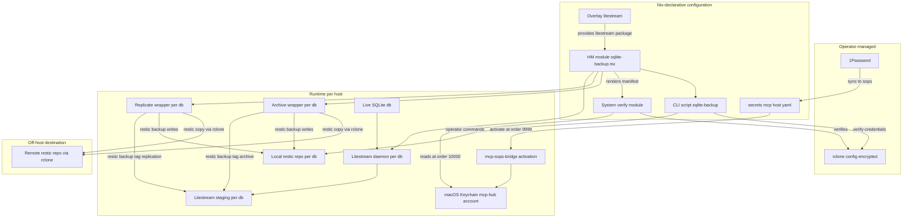
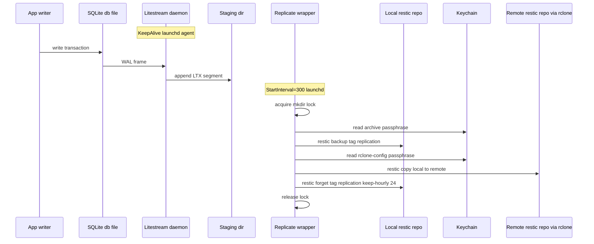
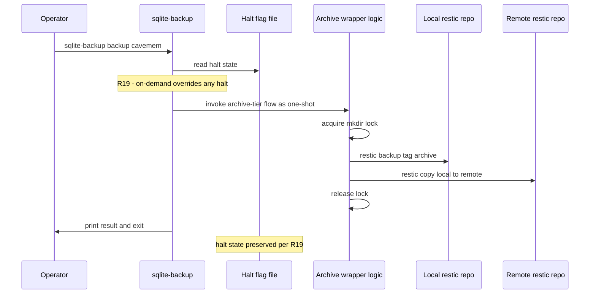
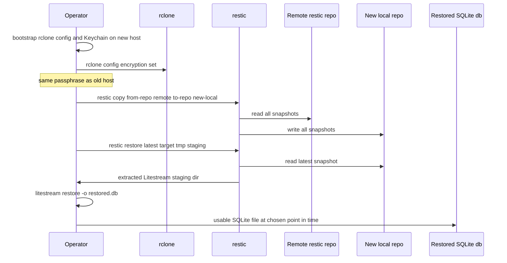
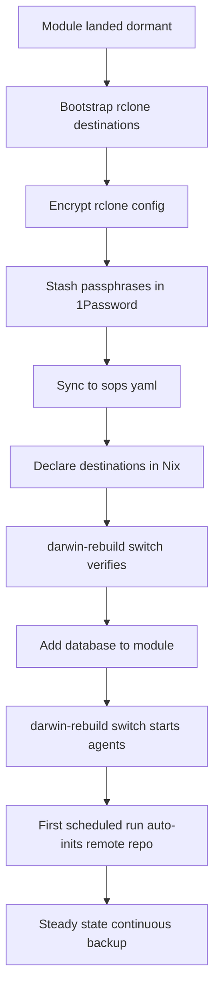

# Design Document: sqlite-backup

## Overview

**Purpose**: Deliver durable, encrypted, off-host backups of WAL-mode
SQLite databases to the operator of this nix-config across the two
darwin hosts (`Brandons-MacBook-Pro` / Personal and `ShopifyLaptop` /
Shopify), with sub-second on-host RPO via continuous Litestream
replication and approximately five-minute off-host RPO via continuous
shipment of an encrypted restic repository to any rclone-supported
destination (cloud or local).

**Users**: One operator (the repo author) interacting with the
pipeline declaratively (Nix module configuration in
`home-manager/common/sqlite-backup.nix` and per-host scaffolds) and
imperatively (a single `sqlite-backup` CLI binary on `PATH`
exposing `list`, `status`, `backup`, `restore`, `start`, `stop`,
`clear-pressure`, and `verify-credentials` subcommands).

**Impact**: Adds three new artifacts to the repo (one HM module, one
system-tier activation module, one operator-CLI script), one overlay,
two per-host scaffolds, and two new Keychain-managed secrets. Module
ships dormant on both hosts (`databases = [ ]`) at landing; first
real database is wired in a follow-up PR. Establishes three
first-of-their-kind patterns in the repo: `home.activation.<name>`
consumer, `attrsOf (submodule {…})` module options, and launchd
`StartInterval`-driven agents.

### Goals

- Land a dormant, idempotent, evaluation-passing module on both hosts.
- Once a database is wired, deliver continuous on-host replication
  (~1 s RPO), continuous off-host shipment (~5 min RPO), encrypted
  end-to-end, with an offline-resilient local pipeline that converges
  with the off-host destination automatically when connectivity
  returns.
- Provide an operator CLI that supports all routine pipeline
  operations without invoking Nix or learning the underlying tools.
- Surface misconfiguration at `darwin-rebuild` time, not at the next
  scheduled backup.
- Single per-database backup repository (R16) that is restic-format,
  inspectable end-to-end with stock `restic` commands.

### Non-Goals

- Wiring any specific database (cavemem and others are follow-up PRs
  per spec scope).
- NixOS support (darwin-only per R10).
- Multiple destinations per database (defense-in-depth comes from the
  pipeline tiers, not from cross-provider redundancy).
- Live integrity-check / dead-man-switch / external monitoring
  (deferred to a future spec).
- Wholesale revision of `mcp-secrets-sops-nix` (this spec extends its
  Keychain bridge with two new secret entries; it does not replace
  it).
- Per-database rclone destination override of the host-shared rclone
  configuration (per-database `remote` references the host's named
  destination set; the destination set is host-scope).

## Boundary Commitments

### This Spec Owns

- `home-manager/common/sqlite-backup.nix` — the HM module: option
  surface (`enable`, `rcloneDestinations`, `databases`, secret-name
  references, retention defaults), launchd agent declarations
  (Litestream daemon, replicate-tier wrapper, archive-tier wrapper, pressure
  guard: four agents per configured DB), `home.mcp.keychainSecrets` entries
  for the two passphrases, manifest rendering, eval-time assertions
  (R1.AC5 missing-destination, R10 platform, R11 tool versions),
  `home.activation` hook that clears manual halt flags on rebuild (R13.AC15)
  while preserving emergency pressure markers (R18.3).
- `overlays/litestream.nix` — single-line lift from
  `pkgs.unstable.litestream` (v0.5.11) into the active package set,
  so `pkgs.litestream` resolves to a v0.5.x build.
- `configurations/common-darwin/sqlite-backup-verify.nix` — the
  system-tier activation module that runs at `lib.mkOrder 10000`
  (after `mcp-secrets-activate`) and performs R17 verification.
- `scripts/sqlite-backup-cli.nix` — single `pkgs.writeShellApplication`
  derivation producing the `sqlite-backup` binary, dispatching on
  `$1` to public subcommands (`list`, `status`, `backup`, `restore`,
  `start`, `stop`, `clear-pressure`, `verify-credentials`) and internal
  subcommands
  (`__replicate-trigger`, `__archive-trigger`, `__pressure-guard`) used by
  launchd.
- `configurations/personal/home-manager/sqlite-backup.nix` and
  `configurations/shopify/home-manager/sqlite-backup.nix` — per-host
  scaffolds: `enable = true; rcloneDestinations = { }; databases = [
  ]` (dormant on landing).
- The runbook at `.kiro/specs/sqlite-backup/runbook.md` (created
  during implementation) covering operator bootstrap and end-to-end
  recovery procedures.
- The single-restic-repo-per-database invariant (R16): one repo holds
  both replication-tier snapshots (tag `replication`) and
  archival-tier snapshots (tag `archive`).
- The `restic copy` shipment mechanism: local repo → remote restic
  repo via rclone backend (selected over `rclone sync` per
  research.md §3.B, structurally race-safe).
- The mkdir-based per-database mutex around restic operations
  (selected over `flock` per research.md §3.C, no new runtime dep).

### Out of Boundary

- The `mcp-sops-bridge` machinery itself: this spec adds
  `keychainSecrets` entries declaratively; it does not edit the
  bridge module, the activation script, or the verifier. Account
  remains `mcp-hub` per gap-analysis Option B.
- The operator's `~/.config/rclone/rclone.conf`: operator-managed
  outside Nix per Mechanism A. The HM module never writes to it,
  never reads its plaintext form, and never owns its lifecycle. The
  module verifies its presence, encryption, and structural alignment
  with declared destinations (R17), but does not generate it.
- Provider-side (Google Drive, B2, OneDrive, etc.) configuration —
  bucket creation, OAuth client IDs, IAM policies, lifecycle rules —
  is the operator's responsibility and is documented in the runbook,
  not in module code.
- The Litestream WAL replication semantics themselves — this design
  consumes Litestream's `replicate` command unchanged, with the
  `file://` backend writing to a local staging directory.
- Implementation of any Cavemem MCP server (the imminent first
  consumer of this module is a separate spec).
- Backup of non-SQLite data.
- `flake.nix` build surface beyond the existing overlay import and the focused
  `sqlite-backup-tests` regression check; no formatter or hook changes.

### Allowed Dependencies

- `pkgs.unstable.litestream` (v0.5.11) via the new overlay; rationale
  in research.md §1 of refresh.
- `pkgs.restic` (v0.18.1, nixpkgs-25.11).
- `pkgs.rclone` (v1.72.1, already installed at
  `home-manager/common/default.nix:101`).
- `pkgs.jq` (for activation-time JSON parsing of the manifest).
- `pkgs.writeShellApplication` for all bash entry points (precedent:
  `home-manager/common/cc-sdd.nix:58-62`).
- `home.mcp.keychainSecrets` aggregator
  (`configurations/common-darwin/mcp-sops-bridge.nix:74`) for new
  secret materialization. Account remains `mcp-hub`.
- `/usr/bin/security find-generic-password` (Apple's CLI, accessible
  by absolute path inside HM activation per research.md §1).
- HM 25.11's `launchd.agents.<name>.config.{KeepAlive,
  StartInterval, StartCalendarInterval, StandardOutPath,
  StandardErrorPath}` surface.
- HM 25.11's `home.activation.<name>` hook (DAG-ordered Bash strings
  via `lib.hm.dag.entryAfter ["writeBoundary"]`).
- nix-darwin's `system.activationScripts.postActivation` with
  `lib.mkOrder` ordering primitive.
- `lib.hm.assertions.assertPlatform` for darwin-only platform gate.

### Revalidation Triggers

The following changes should force re-validation of any downstream
spec or consumer that integrates with this design:

- A change in the manifest schema (the JSON file passed from the HM
  module to the system-tier verification script and to the CLI binary)
  — consumers reading the manifest must re-validate.
- A change in the per-database launchd agent label scheme
  (`dev.dwsr.sqlite-backup.{litestream,replicate,archive,guard}.<db>`) —
  any external monitoring or status tooling that lists agents must
  update.
- A change in the on-disk path conventions for the staging directory
  (`${xdg.dataHome}/sqlite-backup/<db>/litestream-staging/`) or the
  restic repo (`${xdg.dataHome}/sqlite-backup/<db>/restic/`) or Litestream
  metadata (`${xdg.dataHome}/sqlite-backup/<db>/litestream-metadata/`) — any
  recovery procedure or runbook must update.
- A change in the Keychain account name from `mcp-hub` to a
  `sqlite-backup`-specific account — the bridge module's account
  hardcoding would have to be generalized first.
- A change in the choice between `restic copy` and `rclone sync` for
  shipment — affects the off-host repo format and the recovery path.
- A bump to a Litestream major version with breaking changes to the
  LTX format or `replicate` CLI surface.

## Architecture

### Existing Architecture Analysis

The repo is a darwin-only nix-darwin + home-manager monorepo with two
hosts (Personal, Shopify). It already has:

- A canonical launchd-agent pattern at
  `home-manager/mcp/default.nix:124-147` (always-on `KeepAlive`
  agent, `StandardOutPath` / `StandardErrorPath` under
  `~/Library/Logs/`).
- A canonical secret-bridge pattern at
  `configurations/common-darwin/mcp-sops-bridge.nix` and
  `scripts/mcp-secrets-activate.nix` — sops → `/run/secrets/*` →
  `mcp-hub`-account Keychain entries via system-tier activation at
  `lib.mkOrder 9999`.
- Pre-commit hooks (`flake.nix:228-271`) that ban `/tmp/` literals,
  literal `/Users/...` paths outside string interpolations, and
  `builtins.fetch*` outside `flake.nix`.
- An explicit-import HM module convention at
  `home-manager/common/default.nix:8-21` (no auto-import).

This spec adds new components without modifying any of the above. The
HM module joins the explicit-import list; the launchd agents follow
the existing pattern; secrets ride the existing bridge.

### Architecture Pattern & Boundary Map



**Architecture Integration**:

- **Selected pattern**: Layered chained-pipeline. Foundation
  (overlay) → declarative config (HM module + system verify) →
  runtime (launchd-managed agents) → off-host (rclone-bridged restic
  repo).
- **Domain/feature boundaries**: Three concurrent agents per
  database, each with a single responsibility — Litestream owns
  WAL→staging replication; the replicate wrapper owns
  staging→local-repo→remote-repo at 5-min cadence with `replication`
  tag; the archive wrapper owns the same flow at daily cadence with
  `archive` tag and longer retention. Per-DB mkdir mutex prevents
  the two wrappers from racing each other on a single DB.
- **Existing patterns preserved**: launchd agent shape; sops bridge;
  explicit module imports; pre-commit lint compliance.
- **New components rationale**: HM module (only place to express
  per-DB declarative config); overlay (Litestream version pin);
  system verify (R17 needs to run after the bridge populates
  Keychain); CLI (R13's seven public subcommands plus the two
  internal triggers).
- **Steering compliance**: Steering directory empty; design honors
  the implicit conventions captured in the gap-analysis (lint hooks,
  account hardcoding, activation ordering, no `/tmp/` literals).

### Technology Stack

| Layer | Choice / Version | Role in Feature | Notes |
|-------|------------------|-----------------|-------|
| CLI / operator surface | `pkgs.writeShellApplication` (bash) | `sqlite-backup` binary with subcommand dispatch | Single binary; precedent at `home-manager/common/cc-sdd.nix:58-62` |
| Continuous replication | `litestream` v0.5.11 (via `pkgs.unstable.litestream` overlay) | Per-DB WAL → local LTX-segments staging directory | Native `file://` backend; no remote connection from Litestream itself |
| Local backup repo | `restic` v0.18.1 (nixpkgs-25.11) | Single per-DB encrypted repo holding both replication-tier and archive-tier snapshots distinguished by `--tag` | Two `restic forget --tag <tier> --keep-*` calls, one per tier |
| Off-host shipment | `restic copy` over `rclone:` backend (rclone v1.72.1) | Mirror local restic repo to remote restic repo | Restic-native, structurally race-safe (research.md §3.B) |
| Operator-managed remote definitions | `~/.config/rclone/rclone.conf`, encrypted via `RCLONE_ENCRYPT_V0` | Holds OAuth tokens, API keys, backend types | Operator-bootstrapped via `rclone config`; not Nix-rendered |
| Secret materialization | `mcp-sops-bridge` (existing) → macOS Keychain (`mcp-hub` account) | Two new entries: rclone-config passphrase and restic archive passphrase | Reuses existing pipeline; no bridge changes |
| Per-host scheduling | nix-darwin / HM 25.11 `launchd.agents.<name>` | Per-DB agents: guarded Litestream daemon (`KeepAlive=true`), replicate wrapper (`StartInterval=300`), archive wrapper (`StartCalendarInterval={Hour=3;Minute=0;}`), pressure guard (`RunAtLoad=true`, `StartInterval=60`) | Four isolated agents per database |
| Activation-time verification | `system.activationScripts.postActivation.text` at `lib.mkOrder 10000` (system-tier) | Runs after `mcp-secrets-activate` (order 9999); reads manifest and verifies rclone.conf | First `home.activation` consumer is the much smaller halt-clearing script (the heavyweight verification lives system-tier per research.md §3.A) |
| Pipeline mutex | `mkdir`-based atomic lockfile in bash wrapper | Prevents replicate + archive wrappers from racing per-DB | `flock(1)` not on macOS; `mkdir` is POSIX-atomic |

## File Structure Plan

### Directory Structure

```
overlays/
└── litestream.nix                                # New: pkgs.litestream <- pkgs.unstable.litestream

home-manager/common/
├── default.nix                                   # MODIFY: add ./sqlite-backup.nix to imports
└── sqlite-backup.nix                             # New: HM module (options, agents, manifest, halt-clear activation)

configurations/common-darwin/
├── default.nix                                   # MODIFY: import ./sqlite-backup-verify.nix
└── sqlite-backup-verify.nix                      # New: system-tier R17 verification activation

configurations/personal/home-manager/
├── default.nix                                   # MODIFY: import ../../../home-manager/common already covers sqlite-backup.nix; this file re-asserts dormant config in a per-host file
└── sqlite-backup.nix                             # New: per-host scaffold (enable=true, dormant)

configurations/shopify/home-manager/
├── default.nix                                   # MODIFY: same as personal
└── sqlite-backup.nix                             # New: per-host scaffold (enable=true, dormant)

scripts/
└── sqlite-backup-cli.nix                         # New: writeShellApplication producing the sqlite-backup binary

flake.nix                                        # MODIFY: register the new overlay

.kiro/specs/sqlite-backup/
└── runbook.md                                    # New (during implementation): operator bootstrap + recovery procedures

tests/sqlite-backup/                              # Hermetic CLI + activation safety regressions
```

### File-Level Responsibilities

- **`overlays/litestream.nix`**: Single-purpose overlay. Sets
  `final: prev: { litestream = prev.unstable.litestream; }` to lift
  v0.5.11 into the active package set. ~10 LoC.
- **`home-manager/common/sqlite-backup.nix`**: Defines option
  surface (`home.sqliteBackup.{enable, rcloneDestinations,
  databases, archivePassphraseSecret, rcloneConfigPassphraseSecret}`);
  renders the JSON manifest via `pkgs.writeText`; exposes the
  manifest path as `home.sqliteBackup._manifestPath`; declares per-DB
  launchd agents (4 per DB); declares `home.mcp.keychainSecrets`
  additions; declares `home.packages` addition for the CLI binary;
  declares `home.activation.sqlite-backup-clear-halts` (small bash
  fragment that removes manual halt flag files but preserves pressure markers);
  eval-time `assertions`
  for R1.AC5 / R10 / R11. ~300–400 LoC.
- **`configurations/common-darwin/sqlite-backup-verify.nix`**:
  System-tier activation module. Reads the HM-rendered manifest path
  via `config.home-manager.users.${username}.home.sqliteBackup._manifestPath`.
  Defines a `pkgs.writeShellApplication` for the verification logic;
  invokes it from `system.activationScripts.postActivation.text` at
  `lib.mkOrder 10000` via `sudo -u $username`. Skips when
  `databases = [ ]`. ~120–160 LoC.
- **`configurations/{personal,shopify}/home-manager/sqlite-backup.nix`**:
  Per-host dormant scaffold. Sets
  `home.sqliteBackup.enable = true; home.sqliteBackup.rcloneDestinations = { }; home.sqliteBackup.databases = [ ];`.
  ~10 LoC each.
- **`scripts/sqlite-backup-cli.nix`**: `pkgs.writeShellApplication`
  function. Takes the manifest path at script-build time via Nix
  string interpolation (so the CLI knows where to find its
  configuration without a runtime arg). Implements case-on-`$1`
  dispatch for: `list`, `status`, `backup`, `restore`, `start`,
  `stop`, `verify-credentials`, `__replicate-trigger`,
  `__archive-trigger`, `--help`. ~400–500 LoC.
- **`runbook.md`**: Created during implementation. Sections:
  one-time host bootstrap, adding a database, recovery scenarios
  (latest, point-in-time, host-loss, remote-only, on-host-only).

### Modified Files

- `flake.nix`: register `overlays/litestream.nix` in the existing
  overlay composition (sibling to `overlays/unstable-packages/`).
- `home-manager/common/default.nix:8-21`: append `./sqlite-backup.nix`
  to the explicit imports list.
- `configurations/common-darwin/default.nix`: append
  `./sqlite-backup-verify.nix` to the imports list.
- `configurations/{personal,shopify}/home-manager/default.nix`:
  append `./sqlite-backup.nix` (the per-host scaffold) to the
  imports list.

## System Flows

### Continuous-Cycle Pipeline (per database)



The replicate wrapper acquires the per-DB mutex before any restic
operation; the archive wrapper acquires the same mutex. Both are
instrumented to skip cleanly if the mutex is already held (early
exit, log entry, exit 0). The Litestream daemon does not touch the
restic repo; it writes only to staging.

### On-Demand Operator Backup (R13.AC3 + R19)



The on-demand backup invokes the same internal `__archive-trigger`
codepath as the launchd agent; the only difference is the trigger
source. Halt flag is consulted but not modified.

### Recovery from Off-Host Destination Only (R9.AC4 host-loss case)



## Requirements Traceability

| Requirement | Summary | Components | Interfaces / Mechanisms |
|-------------|---------|------------|-------------------------|
| 1.1 | Configuration surface | HM module | `home.sqliteBackup.{enable, rcloneDestinations, databases, archivePassphraseSecret, rcloneConfigPassphraseSecret}` option set |
| 1.2 | Dormant default safe | HM module | When `databases = [ ]`, no agents declared; module evaluates with empty rclone secrets |
| 1.3 | Dormant passes `nix flake check` | HM module | Pure Nix eval check; no IFD; assertions only fire when active |
| 1.4 | Adding a DB doesn't disturb others | HM module | Each DB gets its own four-agent set; no shared state per-DB |
| 1.5 | Eval-time failure on missing destination ref | HM module | `assertions` block scans `databases[*].remote` against `rcloneDestinations` keys |
| 2.1 | Continuous replication | Per-DB Litestream daemon | Guarded `__litestream-trigger` execs `litestream replicate -config <generated-yaml>` in a KeepAlive agent |
| 2.2 | ~1 s on-host RPO | Per-DB Litestream daemon | Litestream native behavior under low-write profile |
| 2.3 | Live-DB writer never blocked | Per-DB Litestream daemon | Litestream uses SQLite shared-mode reads; no exclusive locks |
| 2.4 | Auto-restart on agent exit | Per-DB Litestream daemon | `KeepAlive = true` |
| 2.5 | Sleep/wake handling | Per-DB Litestream daemon | launchd suspends and resumes; Litestream resumes from current WAL position |
| 2.6 | On-host replica strictly local | Per-DB Litestream daemon | `file://` backend, staging path under `${xdg.dataHome}` |
| 3.1 | Per-DB schedule + retention for archive | HM module + archive wrapper | `databases[*].archiveTier.{schedule, retention}` options; `restic forget --tag archive` per-DB |
| 3.2 | Capture archival snapshot on schedule | Archive wrapper (CLI `__archive-trigger`) | `restic backup --tag archive --exclude='*.tmp' ${stagingDir}/${db}` |
| 3.3 | Apply retention after capture | Archive wrapper | `restic forget --tag archive --keep-daily 7 --keep-weekly 4 --keep-monthly 6 --prune` |
| 3.4 | Preserve repo before first archival fires | Archive wrapper + retention contract | Replicate-tier retention does not touch archive-tier snapshots; tag scoping enforces this |
| 3.5 | Timing-independent restorability | Litestream + restic + Litestream-restore semantics | Each LTX file self-contained; `restic backup --exclude='*.tmp'` excludes Litestream's transient atomic-rename intermediates; Litestream restore tolerates incomplete tail |
| 4.1 | Off-host shipment after archival | Archive wrapper | `restic copy` invoked inline after each archival snapshot (subsumed under 14.1's continuous mechanism) |
| 4.2 | Live DB never transmitted off-host | Replicate wrapper + archive wrapper | Only restic-encrypted snapshots leave disk; Litestream's `file://` backend never reaches network |
| 4.3 | Failed shipment preserves local repo | Replicate wrapper + archive wrapper | restic operations are local-first; rclone failure leaves local repo intact |
| 4.4 | Failed shipment recorded with non-zero exit | Replicate wrapper + archive wrapper | `set -euo pipefail`; exit propagates to launchd-visible exit status |
| 5.1 | Any rclone-supported backend | Operator's rclone.conf + verify | rclone's backend universe; no module restriction |
| 5.2 | Different destinations per DB | HM module | `databases[*].remote` is per-DB; references the host's named destination set |
| 5.3 | Same destination shape for cloud + local | HM module | `rcloneDestinations` submodule has only `type` field; works for any rclone backend including `local` |
| 5.4 | Local FS destination uses same shipment | Replicate wrapper + archive wrapper | `restic copy` over `rclone::local:<absolute-path>` uses rclone's synthetic local backend without a configured remote |
| 5.5 | Named-set + reference-by-name | HM module | `attrsOf (submodule {…})` for destinations; `databases[*].remote` is a string |
| 6.1 | Encryption before leaving disk | Replicate wrapper + archive wrapper | restic native client-side AES-256 |
| 6.2 | Operator passphrase, never embedded | HM module + bridge | `archivePassphraseSecret` references a Keychain service; passphrase value never in Nix |
| 6.3 | Fail snapshot on missing passphrase | Replicate wrapper + archive wrapper | Wrapper checks `security find-generic-password` exit; fails with cause if absent |
| 6.4 | No interactive prompt for passphrase | Replicate wrapper + archive wrapper | `RESTIC_PASSWORD_COMMAND="security ..."` env var; restic non-interactive |
| 7.1 | Consume sops bridge unchanged | HM module | Adds two entries to `home.mcp.keychainSecrets`; nothing else |
| 7.2 | No plaintext credential in Nix store / repo / eval | HM module + verify module | Secrets only referenced by Keychain service name; never inlined |
| 7.3 | No per-destination credentials inline | HM module | `rcloneDestinations` submodule has only `type` and non-credential attributes; credentials live in operator's rclone config |
| 7.4 | Missing secret fails activation with named cause | mcp-sops-bridge (existing) + verify module | Bridge's verifier (`scripts/mcp-verify-secrets.nix`) plus verify module's passphrase-not-found case |
| 7.5 | No plaintext at rest in any rendered config; rclone config encrypted with secret-store passphrase | Verify module | R17 verification confirms encryption at rest |
| 8.1 | No second concurrent run for same DB | Replicate wrapper + archive wrapper | mkdir-lockfile mutex per DB; second invocation early-exits cleanly |
| 8.2 | Off-host shipment doesn't corrupt under concurrent writes | Choice of `restic copy` over `rclone sync` | restic's append-only repo design + restic-native copy semantics; no race window |
| 8.3 | Skip-and-log if previous run not complete | Replicate wrapper + archive wrapper | Lock-acquisition failure logs to wrapper log and exits 0 |
| 9.1 | End-to-end recovery procedure documented | runbook.md | Sections covering each restore scenario |
| 9.2 | Procedure uses operator commands or stock CLIs | runbook.md | `sqlite-backup restore`, `restic`, `rclone`, `litestream`; nothing proprietary |
| 9.3 | Recovery to latest or specific PIT | CLI `restore` subcommand + runbook | `--time` flag delegates to `restic restore` snapshot selection + `litestream restore -timestamp` |
| 9.4 | Recovery from off-host-only or on-host-only | CLI `restore` subcommand + runbook | `--from-remote` flag (uses `restic -r rclone:...` directly when local repo is absent) |
| 10.1 | Module is darwin-only | HM module | `lib.hm.assertions.assertPlatform pkgs lib.platforms.darwin` |
| 10.2 | Eval failure on non-darwin | HM module | Same assertion; failure message names the constraint |
| 10.3 | Builds on aarch64-darwin and x86_64-darwin | HM module + CI | `nix flake check` exercises both arches per `flake.nix` |
| 11.1 | Litestream version requirement | HM module | `assertions` checks `lib.versionAtLeast pkgs.litestream.version "0.5.7"` |
| 11.2 | Eval failure on too-old version | HM module | Same assertion; failure names available + required versions |
| 11.3 | Single declaration site for required versions | HM module | A single `let toolMinima = { litestream = "0.5.7"; restic = "0.18.0"; rclone = "1.72.0"; }; in` block |
| 12.1 | Log entry per run start/end | Replicate wrapper + archive wrapper | Wrappers explicitly log start/end with DB name + destination |
| 12.2 | Failure step + cause in log | All wrappers | `set -euo pipefail` + explicit `trap` handler logs the failing line |
| 12.3 | Stable, documented log location | All wrappers | `~/Library/Logs/sqlite-backup-<db>-{replicate,archive,cli}.{log,error.log}` per launchd convention |
| 12.4 | Non-zero exit propagated to launchd | All wrappers | `set -e` + explicit `exit $?` after key steps |
| 13.1 | Commands installed on PATH | HM module | `home.packages = [ (import scripts/sqlite-backup-cli.nix { ... }) ];` |
| 13.2 | No Nix wrapper invocation needed | CLI script | Standalone bash binary; runtime deps via `pkgs.writeShellApplication`'s `runtimeInputs` |
| 13.3 | On-demand backup uses scheduled flow | CLI `backup` → `__archive-trigger` | Same internal function as scheduled |
| 13.4 | On-demand backup obeys mutex | CLI `backup` → mkdir lock | Same lock as scheduled |
| 13.5 | On-demand backup propagates exit + cause | CLI `backup` | `set -e` + explicit error stream to operator's terminal |
| 13.6 | Restore produces usable file at chosen path | CLI `restore` | Wrapper for `restic restore` + `litestream restore` |
| 13.7 | Restore: latest or specific PIT | CLI `restore --time <ts>` | Maps to restic snapshot selection + `litestream restore -timestamp` |
| 13.8 | Restore from off-host alone | CLI `restore --from-remote` | Uses `restic -r rclone:<remote>:<path>/<db>` directly |
| 13.9 | Restore refuses overwrite of non-empty file | CLI `restore` | Pre-flight check; explicit `--force` flag to override |
| 13.10 | Missing/unrecognized DB lists configured names | CLI dispatcher | Common error path used by all subcommands needing a DB arg |
| 13.11 | `stop replication` halts continuous capture | CLI `stop` | Removes per-DB Litestream agent via `launchctl bootout`; sets halt flag |
| 13.12 | `start replication` resumes pipeline | CLI `start` | Removes halt flag; `launchctl bootstrap`s Litestream agent |
| 13.13 | Default `stop` is replication-only | CLI `stop` | Halt flag content = `replication-only`; archive wrapper still runs |
| 13.14 | `stop --include-archive` halts whole pipeline | CLI `stop` | Halt flag content = `whole-pipeline`; archive wrapper checks and skips |
| 13.15 | Halts ephemeral; rebuild restores declared state | HM module's `home.activation` hook | `home.activation.sqlite-backup-clear-halts` removes all halt files; HM auto-bootstraps all declared agents |
| 13.16 | Idempotent on already-in-state | CLI `start`/`stop` | Pre-checks current state; reports without error or change |
| 13.17 | `list` command | CLI `list` | Reads manifest, prints database names |
| 13.18 | `status` command | CLI `status` | Reads manifest + halt files + `launchctl list` for per-DB agent state |
| 13.19 | On-demand backup overrides halt; halt preserved | CLI `backup` | Skips halt-flag check at backup time; never modifies the flag |
| 13.20 | `verify-credentials` access check per destination | CLI `verify-credentials` | Iterates configured destinations; runs `rclone lsd <remote>:` per destination |
| 13.21 | Optional DB-name scopes verify | CLI `verify-credentials <db>` | Filters to one destination |
| 13.22 | `verify-credentials` is read-only | CLI `verify-credentials` | Only `rclone lsd` (a read op); no restic/rclone-write/launchctl calls |
| 13.23 | Non-zero exit on any verify failure | CLI `verify-credentials` | Aggregates per-destination exit codes |
| 13.24 | Decryption failure reported as global error | CLI `verify-credentials` | Pre-flight `rclone listremotes` check distinguishes decryption failure from per-destination failure |
| 14.1 | Continuous off-host shipment of replication state | Replicate wrapper | Inline `restic copy` after every replicate-tier snapshot |
| 14.2 | ~5 min off-host RPO under healthy network | Per-DB replicate launchd agent | `StartInterval = databases[*].replicationTier.cadenceSeconds` (default 300) |
| 14.3 | Operator-configurable cadence per DB | HM module | `databases[*].replicationTier.cadenceSeconds` option |
| 14.4 | Same encryption + secrets as archival | Replicate wrapper + archive wrapper | Both use the same restic repo and the same Keychain-supplied passphrase |
| 14.5 | Replication + archival to same per-DB repo | Replicate wrapper + archive wrapper | Both write to `${xdg.dataHome}/sqlite-backup/<db>/restic/` |
| 15.1 | Replication continues offline | Per-DB Litestream daemon | Pure local file:// backend; no network dependency |
| 15.2 | Archival continues offline | Archive wrapper | Local restic backup + forget; remote restic copy may fail (logged) but local repo state advances |
| 15.3 | Off-host shipment queues, no loss | Replicate wrapper + archive wrapper | restic repo is the queue; pending state persists in local repo until next successful copy |
| 15.4 | Auto-resume on reconnect, converge | Replicate wrapper + archive wrapper | Each invocation runs `restic copy` regardless of last-attempt outcome; restic's incremental copy semantics catch up |
| 15.5 | Live writes never blocked by network | Per-DB Litestream daemon | No network in the live-write path |
| 16.1 | Single repo holds both tiers | All wrappers | Same `${xdg.dataHome}/sqlite-backup/<db>/restic/` for replication + archive backups |
| 16.2 | Per-tier retention applied coherently | Replicate wrapper + archive wrapper | Two separate `restic forget --tag <tier> --keep-*` calls per tier |
| 16.3 | Repo inspectable as one unit | Operator + restic | `restic snapshots --tag <any>` lists across both tiers; standard `restic` CLI |
| 16.4 | No divergent on-host or off-host repos | All wrappers | Single local repo; single remote restic repo via `restic copy` |
| 16.5 | Off-host = on-host post-shipment | Replicate wrapper + archive wrapper | `restic copy` propagates new snapshots; mirrored `restic forget --tag <tier>` against remote (step 9) propagates deletions; both ends share chunker polynomial via `restic init --copy-chunker-params`, so snapshots are byte-equivalent |
| 17.1 | Verify rclone config exists | Verify module | `[ -f ~/.config/rclone/rclone.conf ]` |
| 17.2 | Verify rclone config encrypted | Verify module | `rclone config encryption check` |
| 17.3 | Verify each configured remote present | Verify module | `rclone listremotes --long --json` parsed via jq; intersect with manifest `rcloneConfigDestinations`, which excludes synthetic `:local` |
| 17.4 | Verify backend type matches | Verify module | Same JSON; compare `type` field per remote |
| 17.5 | Distinguished failure modes | Verify module | Branched error reporting: missing-passphrase, mismatched-passphrase, missing-config, plaintext-config, missing-remote, type-mismatch |
| 17.6 | Dormant exemption | Verify module | Conditional on `databases ≠ [ ]`; otherwise no-op |
| 18.1-18.3 | Separate persistent emergency halt state | HM module + CLI | `pressure-<db>.json` is distinct from activation-cleared `halt-<db>.flag` |
| 18.4-18.6 | Pressure-halt enforcement and visibility | CLI | `start` refuses; all tier entry points skip before locking; `status` emits `halt-reason: disk-pressure` |
| 18.7-18.9 | Guarded explicit recovery | CLI | `clear-pressure` remeasures recorded thresholds, removes only healthy markers, and never invokes launchctl |
| 19.1-19.5 | Guard configuration and managed paths | HM module | Global floor/interval plus per-DB ceiling; manifest lists staging, restic, explicit Litestream metadata, and synthetic-local destination paths |
| 19.6-19.8 | Boundary measurement and halt | CLI pressure guard | Locale-independent `df -Pk` and `du -skH`; strict `<` floor and `>` ceiling checks write the marker and boot out one Litestream label |
| 19.9-19.12 | Synchronous preflight, failures, and Shopify policy | CLI + Shopify scaffold | Tier helper preflights before locking; errors fail closed; Shopify uses 128 GiB/60 s/96 GiB |

## Components and Interfaces

### Summary Table

| Component | Domain/Layer | Intent | Req Coverage | Key Dependencies | Contracts |
|-----------|--------------|--------|--------------|------------------|-----------|
| Litestream Overlay | Foundation | Pin Litestream v0.5.x for the active package set | 11.1 | `pkgs.unstable.litestream` (P0) | None |
| HM Module | Declarative config | Define option surface, render manifest, declare agents and secrets | 1.x, 5.x, 7.1, 7.2, 7.3, 10.x, 11.x, 13.15, 14.3, 16.x | `mcp-sops-bridge` (P0), Litestream Overlay (P0), CLI script (P0) | Service (Nix options), State (manifest JSON) |
| System Verify Module | Activation-time guard | R17 verification at `mkOrder 10000` after sops bridge | 17.x, 7.4 (partial) | HM Module's manifest path (P0), `mcp-sops-bridge` (P0), `pkgs.rclone` (P0), `pkgs.jq` (P0) | Batch / Job |
| CLI Script | Operator surface + internal triggers | Single `sqlite-backup` binary; public + internal subcommands | 13.x, 14.1, 14.4, 14.5, 15.x, 16.x, 6.x, 8.x, 12.x, 4.x, 3.x, 2.x (via internal triggers) | `pkgs.litestream` (P0), `pkgs.restic` (P0), `pkgs.rclone` (P0), `pkgs.jq` (P0), `/usr/bin/security` (P0) | Service (CLI), Batch (internal triggers) |
| Per-host Scaffolds | Wiring | Dormant per-host `home.sqliteBackup` declarations | 1.2, 1.3 | HM Module (P0) | None |

### Foundation

#### Litestream Overlay

| Field | Detail |
|-------|--------|
| Intent | Lift `pkgs.litestream` to v0.5.11 from `pkgs.unstable` so the LTX file backend (required by the chained pipeline) is available. |
| Requirements | 11.1, 11.3 |
| File | `overlays/litestream.nix` |

**Responsibilities & Constraints**

- Provides `pkgs.litestream` v0.5.x to the HM module.
- No other side effects; no rebuild of Litestream from source.

**Dependencies**

- Inbound: HM Module (uses `pkgs.litestream`) — Outbound criticality
  P0.
- Outbound: `pkgs.unstable.litestream` (External, P0).

**Contracts**: Service [ ] / API [ ] / Event [ ] / Batch [ ] / State [ ]

No contracts; just a Nix overlay.

**Implementation Notes**

- Integration: Registered in `flake.nix`'s overlay composition,
  sibling to `overlays/unstable-packages/`.
- Validation: `nix eval '.#packages.aarch64-darwin.litestream.version'`
  returns `0.5.11` (or higher) post-integration.
- Risks: nixpkgs-unstable bump could move the Litestream package
  forward in a way that breaks the LTX format; mitigated by R11.1
  assertion which would then fail eval and surface the issue.

### Declarative Configuration

#### HM Module (`home-manager/common/sqlite-backup.nix`)

| Field | Detail |
|-------|--------|
| Intent | Express the entire user-facing declarative configuration; render runtime artifacts (launchd agents, manifest JSON, halt-clearing activation, secret references). |
| Requirements | 1.1, 1.2, 1.3, 1.4, 1.5, 5.5, 7.1, 7.2, 7.3, 10.1, 10.2, 11.1, 11.2, 11.3, 13.15, 14.3, 16.2 (option surface), all per-DB and per-host wiring |
| File | `home-manager/common/sqlite-backup.nix` |

**Responsibilities & Constraints**

- Owns the option surface: `home.sqliteBackup.{enable,
  rcloneDestinations, databases, archivePassphraseSecret,
  rcloneConfigPassphraseSecret}`.
- Owns the manifest schema (rendered via `pkgs.writeText`; exposed
  as `home.sqliteBackup._manifestPath`).
- Owns the per-DB launchd agent declarations (4 per DB).
- Owns the `home.activation.sqlite-backup-clear-halts` hook for
  R13.AC15 ephemeral persistence.
- Owns the eval-time `assertions` block (R1.AC5, R10, R11).
- Adds entries to `home.packages` (CLI binary), `home.mcp.keychainSecrets`
  (two secret references).
- Does NOT own the operator's rclone config, the system-tier
  verification, or the actual operator-command implementation logic.
- Does NOT touch `~/.config/rclone/rclone.conf` directly under any
  circumstance.

**Dependencies**

- Inbound: Per-host scaffolds (`configurations/{personal,shopify}/home-manager/sqlite-backup.nix`)
  set the declarative values — Inbound criticality P0.
- Outbound: Litestream Overlay (P0), `pkgs.restic` (External, P0),
  `pkgs.rclone` (External, P0), CLI Script (P0), `mcp-sops-bridge`
  (P0).
- External: `mcp-sops-bridge.nix`'s `home.mcp.keychainSecrets`
  aggregator (P0).

**Contracts**: Service [x] / API [ ] / Event [ ] / Batch [ ] / State [x]

##### Service Interface (Nix option type signature)

```nix
home.sqliteBackup = {
  enable :: bool;

  pressureGuard = {
    minimumFilesystemAvailableBytes :: unsigned int; # default 0
    checkIntervalSeconds :: positive int;            # default 60
  };

  rcloneDestinations :: attrsOf (submodule {
    options = {
      type :: str;        # rclone backend type (e.g. "drive", "b2", "local")
    };
  });

  databases :: listOf (submodule {
    options = {
      name :: str;
      path :: path;
      remote :: str;       # must be a key of rcloneDestinations
      remotePath :: str;   # default "sqlite-backup"

      replicationTier = {
        cadenceSeconds :: int;             # default 300 (5 min, R14.AC2)
        retention :: listOf str;           # default [ "--keep-hourly" "24" ]
      };

      archiveTier = {
        schedule :: attrs;                 # default { Hour = 3; Minute = 0; }
        retention :: listOf str;           # default [ "--keep-daily" "7" "--keep-weekly" "4" "--keep-monthly" "6" ]
      };

      pressureGuard.maximumManagedLocalBytes :: unsigned int; # default 2^53-1
    };
  });

  archivePassphraseSecret :: str;            # default "sqlite-backup-archive-passphrase"
  rcloneConfigPassphraseSecret :: str;       # default "sqlite-backup-rclone-config-passphrase"

  _manifestPath :: path;                     # READ-ONLY; rendered store path
};
```

- **Preconditions**: When `enable = true && databases ≠ [ ]`, every
  `databases[*].remote` must reference a key in
  `rcloneDestinations`. Platform must be darwin.
  `pkgs.litestream.version >= "0.5.7"`.
- **Postconditions**: Per host: 4·N launchd agents declared (where
  N = number of configured databases); 2 entries added to
  `home.mcp.keychainSecrets`; 1 entry added to `home.packages`; 1
  manifest JSON file written to `${pkgs.writeText}` store path; 1
  activation script declared.
- **Invariants**: When `databases = [ ]`, no agents, no manifest
  consumed by the verify module, no halt-flag activation work.

##### State Management

- The manifest JSON (rendered via `pkgs.writeText`) is the single
  state-shape exported to other components. Its path is exposed via
  `home.sqliteBackup._manifestPath` for the System Verify Module
  (which reads it via `config.home-manager.users.${username}.home.sqliteBackup._manifestPath`)
  and baked into the CLI script via Nix string interpolation at
  derivation time.
- Manifest shape (illustrative — not all fields required by every
  consumer):

  ```json
  {
    "rcloneConfigPath": "/Users/<user>/.config/rclone/rclone.conf",
    "rcloneConfigPassphraseSecret": "sqlite-backup-rclone-config-passphrase",
    "archivePassphraseSecret": "sqlite-backup-archive-passphrase",
    "keychainAccount": "mcp-hub",
    "rcloneDestinations": {
      "gdrive": { "type": "drive" }
    },
    "databases": [
      {
        "name": "cavemem",
        "path": "/Users/<user>/.cavemem/data.db",
        "remote": "gdrive",
        "remotePath": "sqlite-backup",
        "stagingDir": "/Users/<user>/Library/Application Support/sqlite-backup/cavemem/litestream-staging",
        "repoDir": "/Users/<user>/Library/Application Support/sqlite-backup/cavemem/restic",
        "litestreamMetadataDir": "/Users/<user>/Library/Application Support/sqlite-backup/cavemem/litestream-metadata",
        "pressureGuard": {
          "filesystemPath": "/",
          "minimumFilesystemAvailableBytes": 137438953472,
          "maximumManagedLocalBytes": 103079215104,
          "checkIntervalSeconds": 60,
          "managedPaths": ["<stagingDir>", "<repoDir>", "<litestreamMetadataDir>"]
        },
        "replicationTier": { "cadenceSeconds": 300, "retention": ["--keep-hourly","24"] },
        "archiveTier": { "schedule": { "Hour": 3, "Minute": 0 }, "retention": ["--keep-daily","7","--keep-weekly","4","--keep-monthly","6"] }
      }
    ]
  }
  ```

**Implementation Notes**

- **Integration**: HM module imports cleanly via the existing
  explicit-import list at `home-manager/common/default.nix:8-21`.
  Adds neighbours; doesn't touch them.
- **Validation**: `nix flake check` for both arches with dormant
  config; assertions exercised by feeding a deliberate
  missing-destination configuration in a unit test (mirrors the
  nixvim tier's `pkgs.runCommand` style at smaller scope).
- **Risks**:
  - HM activation runs BEFORE `mcp-secrets-activate` (research.md
    §3.A). The HM-module-owned activation hook (halt-flag clearing)
    has no Keychain dependency, so this is safe. The Keychain-dependent
    verification is in the System Verify Module, not here.
  - `attrsOf (submodule {…})` is new for this repo. Verified pattern
    in HM 25.11's own modules (`programs/sftpman.nix:95`).

#### System Verify Module (`configurations/common-darwin/sqlite-backup-verify.nix`)

| Field | Detail |
|-------|--------|
| Intent | At each `darwin-rebuild switch`, verify the operator's encrypted rclone configuration is present, decryptable, and structurally aligned with the Nix-declared destinations. |
| Requirements | 17.1, 17.2, 17.3, 17.4, 17.5, 17.6 |
| File | `configurations/common-darwin/sqlite-backup-verify.nix` |

**Responsibilities & Constraints**

- Reads the manifest path exposed by the HM module via
  `config.home-manager.users.${username}.home.sqliteBackup._manifestPath`.
- Defines a `pkgs.writeShellApplication` for the verification logic.
- Hooks into `system.activationScripts.postActivation.text` at
  `lib.mkOrder 10000` (strictly after `mcp-secrets-activate` at
  9999), invoking the script via `sudo -u $username` so it runs as
  the operator (Keychain entries are user-scoped).
- Skips entirely when `databases = [ ]` (R17.AC6 dormant exemption)
  — the activation snippet checks `length databases > 0`.
- Does NOT modify any state; pure verification.
- Fails activation with a categorized error message naming the
  failure mode and the corrective operator action.

**Dependencies**

- Inbound: `system.activationScripts.postActivation` ordering — Inbound
  criticality P0.
- Outbound: HM Module manifest (P0), `pkgs.rclone` (P0), `pkgs.jq`
  (P0), `/usr/bin/security` (External P0), `mcp-sops-bridge`
  populating Keychain entries first (P0 ordering).

**Contracts**: Service [ ] / API [ ] / Event [ ] / Batch [x] / State [ ]

##### Batch / Job Contract

- **Trigger**: `darwin-rebuild switch` (system activation).
- **Input**: Manifest JSON file at `home.sqliteBackup._manifestPath`,
  passed as `argv[1]` to the verification script.
- **Output / destination**: stderr (categorized error message on
  failure); exit status 0 (pass) or non-zero (fail). Failure aborts
  the entire activation.
- **Idempotency & recovery**: Verification has no side effects; safe
  to re-run. Recovery requires operator action (run `rclone config`,
  `rclone config encryption set`, `security add-generic-password`,
  etc.) followed by another `darwin-rebuild switch`.

**Verification Steps (in order, with distinguished failure modes per R17.AC5)**:

1. Resolve `archivePassphraseSecret` and `rcloneConfigPassphraseSecret`
   service names from the manifest. Look each up via
   `security find-generic-password -s <name> -a mcp-hub -w`. If
   either is missing → fail with "missing passphrase in Keychain;
   ensure secrets are present in `secrets/mcp.<host>.yaml` and
   declared in `home.mcp.keychainSecrets`".
2. Check rclone config file exists at `${HOME}/.config/rclone/rclone.conf`.
   If missing → fail with "rclone config not found; run `rclone
   config` to create it and add destinations: <list>".
3. Run `rclone config encryption check` with `RCLONE_PASSWORD_COMMAND`
   set to read the rclone-config passphrase from Keychain. Possible
   results:
   - Exit 0: encrypted and passphrase matches; proceed.
   - Exit non-zero with "no encryption" indication: fail with
     "rclone config is plaintext; run `rclone config encryption
     set` and use the passphrase stored in Keychain".
   - Exit non-zero with "decryption failure" indication: fail with
     "rclone config encrypted but Keychain passphrase does not
     match; either re-encrypt with the Keychain value or update
     1Password to match the rclone passphrase".
4. Run `rclone listremotes --long --json` (with the passphrase env)
   and parse via jq. For each `databases[*].remote`, verify the
   destination exists in the rclone config; if missing → fail with
   "destination `<name>` referenced by database `<db>` is not in
   the rclone config; run `rclone config` to add it as type
   `<expected-type>`".
5. For each declared destination, verify the actual `type` field
   from `listremotes` matches the declared `rcloneDestinations.<name>.type`;
   if mismatched → fail with "destination `<name>` is type
   `<actual>` in rclone but declared as `<expected>` in
   `home.sqliteBackup.rcloneDestinations`; reconcile by editing
   either side".

**Implementation Notes**

- **Integration**: Imported by `configurations/common-darwin/default.nix`
  alongside `mcp-sops-bridge.nix`. Zero changes to the bridge module
  itself.
- **Validation**: Dormant case (databases = []) verified by `nix
  flake check`; active cases verified manually during operator
  bootstrap.
- **Risks**:
  - Activation ordering depends on the HM activation completing
    before system-tier `mkOrder 10000` runs. In nix-darwin, HM
    activation is appended to `system.activationScripts.postActivation`
    at default priority (~1000); `mkOrder 9999` (sops bridge) and
    `mkOrder 10000` (this) run after. Confirmed in research.md §1.
  - `sudo -u $username` works because activation runs as root; the
    user's Keychain is unlocked for `security` reads under their own
    `launchctl` context — but `sudo -u` bypasses the user session.
    Mitigation: invoke via `launchctl asuser $(id -u $username)
    sudo -u $username` to ensure the user's launchd domain is
    targeted, mirroring HM's own pattern at `nix-darwin/default.nix:27-37`.

### Operator Surface + Runtime Triggers

#### CLI Script (`scripts/sqlite-backup-cli.nix`)

| Field | Detail |
|-------|--------|
| Intent | Single `pkgs.writeShellApplication` deriving the `sqlite-backup` binary that owns all user-facing commands AND the launchd-triggered tier wrappers. Subcommand dispatch on `$1`. |
| Requirements | 13.x (all 24 ACs), 14.1, 14.4, 14.5, 15.x, 16.x, 6.x, 8.x, 12.x, 4.x, 3.x, 2.x (R2 covered by Litestream agent invocation specified in this script's `__litestream-args` helper if needed) |
| File | `scripts/sqlite-backup-cli.nix` |

**Responsibilities & Constraints**

- Single binary, ~400–500 LoC bash.
- Implements public subcommands: `list`, `status`, `backup <db>`,
  `restore <db> [--target <path>] [--time <ts>] [--from-remote]
  [--force]`, `start <db>`, `stop <db> [--include-archive]`,
  `clear-pressure <db>`,
  `verify-credentials [<db>]`, `--help`.
- Implements internal subcommands (prefixed `__`, hidden from
  `--help`): `__replicate-trigger <db>`, `__archive-trigger <db>`, and
  `__pressure-guard <db>`.
  These are invoked by launchd agents.
- All subcommands consume the manifest JSON (path baked in at
  derivation time via Nix string interpolation).
- All restic operations use `RESTIC_PASSWORD_COMMAND` to source the
  archive passphrase from Keychain; all rclone operations use
  `RCLONE_PASSWORD_COMMAND` to source the rclone-config passphrase
  from Keychain.
- mkdir-based per-DB mutex around restic operations
  (`${TMPDIR:-/var/tmp}/sqlite-backup-<db>.lock`); failure to
  acquire = early exit 0 with log line.
- Pressure-marker check before every tier lock and before `start`; manual
  halt-flag checks retain their tier-specific behavior.

**Dependencies**

- Inbound: launchd agents (per-DB Litestream daemon, replicate
  wrapper, archive wrapper) invoke this script via launchd
  `ProgramArguments` (P0). Operator invokes from shell (P0).
- Outbound: `pkgs.litestream` (P0; for `__litestream-args` helper
  if used; primarily Litestream is invoked directly by launchd, so
  this script's dependency on Litestream is for `restore` only),
  `pkgs.restic` (P0), `pkgs.rclone` (P0), `pkgs.jq` (P0),
  `/usr/bin/security` (External P0).

**Contracts**: Service [x] / API [ ] / Event [ ] / Batch [x] / State [x]

##### Service Interface (CLI surface)

```text
sqlite-backup list
  Output: one configured database name per line; exit 0; no error
  when databases = [].

sqlite-backup status [<db>]
  Output: per-database table with columns: name, replication-state
  (running | not-running | halted-replication-only |
  halted-whole-pipeline | halted-disk-pressure), halt-reason
  (none | replication-only | whole-pipeline | disk-pressure),
  last-archival-snapshot-timestamp (or never), last-replicate-
  shipment-timestamp (or never).
  With <db>: scoped to one database.
  Exit 0 always (status is informational).

sqlite-backup backup <db>
  Behavior: invokes __archive-trigger as a one-shot, bypassing manual
  halt state (R19) but not an emergency pressure halt. Halt state preserved.
  Exit: 0 on success; non-zero on any pipeline failure with cause
  on stderr.

sqlite-backup restore <db> [--target <path>] [--time <ts>] [--from-remote] [--force]
  Behavior: extracts staging dir from the chosen restic snapshot,
  then runs `litestream restore -o <out>` to materialize the SQLite
  file at <target>.
  Defaults: --target = `${PWD}/<db>-restored.db`; --time = "latest";
  --from-remote = false (uses local repo).
  Refuses to overwrite a non-empty file unless --force.
  Exit: 0 on success; non-zero with cause on failure.

sqlite-backup start <db>
  Behavior: refuses while a pressure marker exists; otherwise removes a
  manual halt flag and bootstraps the per-DB Litestream agent if unloaded.
  Idempotent: reports "already running" when launchctl confirms the agent.

sqlite-backup stop <db> [--include-archive]
  Behavior: writes halt flag (content: "replication-only" by
  default; "whole-pipeline" with --include-archive); unloads the
  per-DB Litestream agent via launchctl bootout.
  Idempotent: reports "already halted" without error if a matching
  halt was already set.

sqlite-backup clear-pressure <db>
  Behavior: validates the marker schema, remeasures filesystem available
  bytes and physical allocated bytes for every recorded managed path, and
  removes the marker only when available >= minimum and managed <= maximum.
  Missing managed paths count as zero; malformed state, unreadable paths, and
  failed measurements preserve the marker and return non-zero.
  Never invokes launchctl. A subsequent `sqlite-backup start <db>` is required.

sqlite-backup verify-credentials [<db>]
  Behavior: runs `rclone lsd <remote>:<remotePath>/<db>` for each
  destination (or just <db>'s destination); reports per-destination
  outcome.
  Pre-flight: rclone config decryption check; if fails, reports as
  global error, exits non-zero without per-destination work.
  Exit: 0 on all-success; non-zero on any failure.

sqlite-backup --help
  Output: usage and subcommand summary.
```

##### Batch / Job Contract (internal triggers)

- `sqlite-backup __replicate-trigger <db>`:
  - Trigger: launchd `StartInterval = N` agent
    `dev.dwsr.sqlite-backup.replicate.<db>`.
  - Input: `<db>` argument; reads manifest for per-DB config.
  - Steps:
    1. Check the pressure marker, then the tier-specific manual halt flag;
       exit 0 when either blocks the invocation (logged).
    2. Acquire mkdir lock; exit 0 if held (logged).
    3. Read archive passphrase from Keychain (export
       `RESTIC_PASSWORD` and `RESTIC_FROM_PASSWORD_COMMAND` for
       `restic copy` invocations); read rclone-config passphrase
       (export `RCLONE_PASSWORD_COMMAND`).
    4. `restic -r <local-repo> snapshots >/dev/null 2>&1 || restic init`
       to ensure local repo exists (idempotent).
    5. `restic -r rclone:<remote>:<remotePath>/<db> snapshots
       >/dev/null 2>&1 || restic init --copy-chunker-params
       --from-repo <local-repo> --from-password-command
       "$RESTIC_PASSWORD_COMMAND" --repo rclone:<remote>:<remotePath>/<db>`
       to ensure the remote repo exists with a chunker polynomial
       matching the local repo (preserves dedup; idempotent).
    6. `restic backup --tag replication --host <hostname>
       --exclude='*.tmp' ${stagingDir}` — exclude the transient
       `.tmp` files Litestream creates during atomic LTX rotation,
       so the snapshot remains restorable regardless of when in the
       rotation cycle the backup fires (R3.AC5).
    7. `restic copy --from-repo <local-repo> --repo rclone:<remote>:<remotePath>/<db>`
       — copies any new snapshots to the remote.
    8. `restic forget --tag replication --keep-hourly 24 --prune`
       (or operator-customized retention) against the LOCAL repo.
    9. `restic -r rclone:<remote>:<remotePath>/<db> forget --tag
       replication --keep-hourly 24 --prune` (same retention
       arguments) against the REMOTE repo, mirroring the local
       prune so that the off-host repo remains a complete and
       consistent copy of the on-host repo (R16.AC5). Adds one
       network round-trip per cycle.
    10. Release lock; exit 0 on success, non-zero on any step
        failure with cause logged to stderr (which launchd captures
        to the per-agent error log).
  - Output: `~/Library/Logs/sqlite-backup-<db>-replicate.log` and
    `-replicate-error.log` (StandardOutPath / StandardErrorPath).
  - Idempotency: each run starts from current local restic state;
    safe to re-run after partial failure.

- `sqlite-backup __archive-trigger <db>`:
  - Trigger: launchd `StartCalendarInterval = { Hour=3; Minute=0; }`
    agent `dev.dwsr.sqlite-backup.archive.<db>`.
  - Steps: same as `__replicate-trigger` but `--tag archive` and
    archive-tier retention. Specifically: step 6 is `restic backup
    --tag archive --host <hostname> --exclude='*.tmp' ${stagingDir}`;
    steps 8 and 9 use archive-tier retention (e.g., `--keep-daily 7
    --keep-weekly 4 --keep-monthly 6`) and run against local then
    remote respectively. The `*.tmp` exclude and the chunker-params
    init from step 5 are inherited unchanged.
  - Output: `~/Library/Logs/sqlite-backup-<db>-archive.{log,error.log}`.
  - Halt behavior: skip if `whole-pipeline` halt is set; run if
    `replication-only` halt or no halt.

##### State Management

- **Halt flags**: per-DB files at
  `${XDG_STATE_HOME:-$HOME/.local/state}/sqlite-backup/halt-<db>.flag`,
  content `replication-only` or `whole-pipeline`. Cleared on every
  HM activation (R13.AC15) by the HM module's
  `home.activation.sqlite-backup-clear-halts` hook.
- **Pressure markers**: per-DB JSON records at
  `${XDG_STATE_HOME:-$HOME/.local/state}/sqlite-backup/pressure-<db>.json`.
  They are authoritative by existence, survive HM activation, and are removed
  only by a healthy `clear-pressure` transition.
- **Locks**: per-DB mkdir lockfiles at
  `${TMPDIR:-/var/tmp}/sqlite-backup-<db>.lock`. Created by the
  first wrapper to claim the mutex; removed via `trap` on EXIT.

##### Disk-Pressure Guard Contract

- Each configured database has `dev.dwsr.sqlite-backup.guard.<db>` with
  `RunAtLoad = true` and `StartInterval = checkIntervalSeconds`.
- A guard holds the pressure transition lock and per-database backup mutex from
  before measurement through the healthy/marker decision. While it waits for
  an active backup, the pressure lock prevents another backup or start from
  overtaking it.
- The guard measures root available bytes with `LC_ALL=C df -Pk` and sums
  physical allocation for staging, restic, and Litestream metadata with
  `LC_ALL=C du -skH`. `-H` follows a managed root that is itself a symlink
  without following nested symlinks. Missing paths are zero; inaccessible paths
  fail closed.
- Equality is healthy. Available bytes below the floor or managed bytes above
  the ceiling atomically write the Requirement 18 marker under the shared
  pressure transition lock, then boot out only
  `dev.dwsr.sqlite-backup.litestream.<db>`.
- `tier_trigger` runs the same guard before CLI log writes and manual-halt
  handling. Before the per-database backup mutex, it holds the pressure lock
  across the
  final marker check and backup-mutex acquisition, preventing a marker from
  appearing in that gap. Measurement failures persist a marker with the
  unavailable observation as `null`, unload Litestream, and return non-zero.
- The Litestream launchd job invokes `__litestream-trigger`, not Litestream
  directly. Startup runs the guard and a final serialized marker check before
  executing `litestream replicate -config <generated-yaml>`.
- If atomic JSON persistence fails, the pressure lock is atomically renamed to
  `${XDG_STATE_HOME}/sqlite-backup/pressure-<db>.failed`. The next guard or
  `clear-pressure` remeasures and converts that sentinel into a normal marker.
  Ambiguous launchctl failures are errors; only exit 113 proves an
  already-unloaded label.

**Implementation Notes**

- **Integration**: Imported into the HM module via
  `home.packages = [ (import ../../scripts/sqlite-backup-cli.nix
  { inherit pkgs lib; manifestPath = config.home.sqliteBackup._manifestPath; }) ];`.
  Manifest path baked at derivation time so the binary is
  self-contained.
- **Validation**: Subcommand dispatch tested via `bats`-style
  per-subcommand smoke (deferred to follow-up; not blocking
  dormant-landing).
- **Risks**:
  - `restic copy` to a remote restic repo via rclone backend
    requires the remote repo to be initialized. First-run
    auto-init handles this; subsequent runs see the existing repo.
    If the operator deletes the remote repo manually, next run
    re-inits — this is recoverable but worth noting in the runbook.
  - Local-repo restic operations and remote-repo restic copy use
    the SAME passphrase (the archive passphrase). Documented in
    runbook.
  - `rclone lsd <remote>:<path>` for `verify-credentials` may hit
    the destination's listing quota / rate-limit if invoked
    aggressively. Acceptable for an interactive operator command.
  - Restore from off-host alone (R13.AC8 / R9.AC4) uses
    `restic -r rclone:<remote>:<path>/<db>` directly, skipping the
    local repo. Requires the same archive passphrase.

### Wiring

#### Per-host Scaffolds

| Field | Detail |
|-------|--------|
| Intent | Activate `home.sqliteBackup` dormantly on each host so the module evaluates and the verify activation runs as a no-op at landing. |
| Requirements | 1.2, 1.3 |
| Files | `configurations/personal/home-manager/sqlite-backup.nix`, `configurations/shopify/home-manager/sqlite-backup.nix` |

**Responsibilities & Constraints**

- Each scaffold is ~10 LoC: imports nothing extra, sets
  `home.sqliteBackup = { enable = true; rcloneDestinations = { };
  databases = [ ]; }`.
- Per-host divergence (different rclone destinations, different
  databases) lives in this file in follow-up PRs; the module itself
  stays host-agnostic.

**Dependencies**

- Inbound: per-host `home-manager/default.nix` imports lists
  (`configurations/{personal,shopify}/home-manager/default.nix`) —
  Inbound P0.
- Outbound: HM Module (P0).

**Contracts**: None. Pure config wiring.

**Implementation Notes**

- **Integration**: Each host's `home-manager/default.nix` appends
  `./sqlite-backup.nix` to its imports list.
- **Validation**: `nix flake check` passes with this dormant config
  on both hosts.

## Data Models

### Domain Model

The data domain has four persistent on-host artifact classes per
database:

- **Live SQLite database** (`database.path`): operator-owned, written
  by the application. SQLite WAL mode required.
- **Litestream staging directory** (`${xdg.dataHome}/sqlite-backup/<db>/litestream-staging/`):
  module-owned, holds LTX segments produced by the per-DB Litestream
  daemon. Treated as transient working data; no operator-facing
  guarantees about its contents beyond "Litestream restore reads it".
- **Litestream metadata directory** (`${xdg.dataHome}/sqlite-backup/<db>/litestream-metadata/`):
  module-owned local LTX working state selected through Litestream's
  `meta-path` configuration and included in managed-byte accounting.
- **Restic repository** (`${xdg.dataHome}/sqlite-backup/<db>/restic/`):
  module-owned, encrypted, holds both `replication`-tagged and
  `archive`-tagged snapshots. The single backup repository per
  database (R16). Inspectable end-to-end with stock `restic`
  commands.
- **Pressure halt marker** (`${xdg.stateHome}/sqlite-backup/pressure-<db>.json`):
  persistent structured safety state retained across activation.

And three transient state artifacts:

- **Halt flag** (`${xdg.stateHome}/sqlite-backup/halt-<db>.flag`):
  text file, ephemeral (cleared on every HM activation), contains
  `replication-only` or `whole-pipeline`.
- **Mutex lockfile** (`${TMPDIR}/sqlite-backup-<db>.lock`): mkdir-based,
  created and removed within a single wrapper invocation.
- **Per-agent log files** (`~/Library/Logs/sqlite-backup-<db>-{replicate,archive,cli}.{log,error.log}`):
  rolling, append-only, written by launchd per the agent's
  `Standard{Out,Error}Path`.

And one off-host artifact:

- **Remote restic repository** (`<remote>:<remotePath>/<db>/`):
  byte-equivalent mirror of the on-host restic repo (R16.AC5),
  written via `restic copy` from each replicate-tier and archive-tier
  wrapper invocation.

### Logical Data Model — Pressure Marker JSON

```typescript
interface PressureMarker {
  schemaVersion: 1;
  database: string;
  haltReason: "disk-pressure";
  trigger: string;
  observedBytes: {
    filesystemAvailable: number | null;
    managedLocal: number | null;
  };
  configuredLimits: {
    minimumFilesystemAvailableBytes: number;
    maximumManagedLocalBytes: number;
  };
  measurement: {
    filesystemPath: string;
    managedPaths: string[];
  };
  timestamp: string;
}
```

The pressure guard writes this record atomically. `clear-pressure`
uses its recorded limits and paths for current measurements; equality is
healthy at both the free-space floor and managed-byte ceiling.
All byte values are unsigned JSON-safe integers (`0..9007199254740991`) and
all measurement paths are absolute. Any filesystem object at the marker path
blocks start and backup work; only a regular, non-symlink marker with a valid
schema can be cleared.

Pressure-marker writers and `clear-pressure` serialize through
`${XDG_STATE_HOME}/sqlite-backup/pressure-<db>.lock`. The lock itself blocks
pipeline work. `clear-pressure` validates and measures an immutable snapshot,
then compares the live marker version before removal; a concurrent replacement
is preserved. The guard uses the same lock when it writes or replaces a marker.

### Logical Data Model — Manifest JSON

The Nix-rendered manifest is the single cross-component data
contract. Schema (TypeScript-style for clarity):

```typescript
interface Manifest {
  rcloneConfigPath: string;             // absolute path
  rcloneConfigPassphraseSecret: string; // Keychain service name
  archivePassphraseSecret: string;      // Keychain service name
  keychainAccount: string;              // always "mcp-hub"
  rcloneDestinations: {
    [name: string]: {
      type: string;                     // rclone backend type
    };
  };
  rcloneConfigDestinations: {
    [name: string]: {
      type: string;
    };
  };                                      // configured remotes; excludes :local
  databases: Array<{
    name: string;                       // unique within manifest
    path: string;                       // absolute SQLite db path
    remote: string;                     // key of rcloneDestinations
    remotePath: string;                  // absolute for remote == ":local"
    stagingDir: string;                 // absolute path
    repoDir: string;                    // absolute path
    litestreamMetadataDir: string;      // absolute path
    litestreamConfigPath: string;       // generated YAML store path
    pressureGuard: {
      filesystemPath: string;           // "/"
      minimumFilesystemAvailableBytes: number;
      maximumManagedLocalBytes: number;
      checkIntervalSeconds: number;
      managedPaths: string[];           // staging, repo, metadata, optional local destination
    };
    replicationTier: {
      cadenceSeconds: number;           // launchd StartInterval value
      retention: string[];              // restic forget args
    };
    archiveTier: {
      schedule: {
        Hour?: number;
        Minute?: number;
        Day?: number;
        Weekday?: number;
        Month?: number;
      };
      retention: string[];              // restic forget args
    };
  }>;
}
```

### Physical Data Model — restic repo layout

restic's repo layout is opaque to the module (we use stock restic).
Snapshots are distinguished by `--tag <tier>` at backup time;
retrieved via `restic snapshots --tag <tier>`. `restic forget --tag
<tier>` scopes its retention policy to that tag without affecting the
other tier.

## Error Handling

### Error Strategy

- **Eval-time errors** (Nix module): use `assertions = [...]`
  (R1.AC5, R10, R11). Failure aborts `nix build` with a named error
  before any agent is bootstrapped.
- **Activation-time errors** (R17 verification): hard-fail
  `darwin-rebuild switch` with a categorized message naming the
  failure mode and corrective action. Operator fixes (run `rclone
  config`, stash secret, etc.) and re-runs `darwin-rebuild switch`.
- **Runtime errors** (wrappers): `set -euo pipefail` + a `trap` that
  logs the failing command line + exit code to stderr (captured by
  launchd to the per-agent error log). Local restic state is
  preserved on rclone failure (restic operates on local first).
- **Runtime errors** (operator commands): print human-readable cause
  to operator's terminal, exit non-zero, never modify halt state on
  failure.

### Error Categories and Responses

- **Configuration errors** (eval-time): missing destination
  reference; non-darwin platform; too-old Litestream version. All
  three caught by `assertions`; `nix build` aborts with a named
  cause.
- **Verification errors** (activation-time): rclone config missing,
  unencrypted, mismatched passphrase, missing destination,
  type-mismatched destination. R17 distinguishes each via a separate
  branch in the verification script.
- **Runtime pipeline errors** (per-DB wrappers): Litestream daemon
  exit (auto-restarted by launchd KeepAlive); `restic backup`
  failure (logged, exit non-zero, local repo intact); `restic copy`
  to remote failure (logged, local repo intact, retry next cycle —
  R15.AC4 convergence).
- **Operator command errors** (CLI): unknown subcommand; missing
  required argument; database name not in manifest. All handled by
  the dispatch shell function; helpful error + suggested correction
  printed.
- **Pressure recovery errors**: malformed marker, measurement failure, free
  space below the floor, or managed bytes above the ceiling. All preserve the
  marker and leave launchd untouched.

### Monitoring

Per-agent log files are the primary observability surface
(R12.AC3). Operator inspects via `tail -f
~/Library/Logs/sqlite-backup-<db>-replicate.log`. No external
monitoring (cronitor, healthchecks.io) — explicitly out of scope.
The `sqlite-backup status <db>` command surfaces last-snapshot and
last-shipment timestamps from the restic repo as a baseline health
check.

## Testing Strategy

### Unit Tests (Nix evaluation)

- **U1**: Module eval with `enable = false` produces no agents, no
  secrets, no manifest. Smoke test via `nix eval`.
- **U2**: Module eval with `enable = true; databases = [ ]; rcloneDestinations = { }`
  passes assertions (dormant-default case, R1.AC2/AC3).
- **U3**: Module eval with one database referencing a missing
  destination triggers the R1.AC5 assertion failure with a named
  destination + database in the error message.
- **U4**: Module eval on a non-darwin platform (synthetic
  `lib.platforms.linux`) triggers the R10.AC2 platform assertion
  failure.
- **U5**: Module eval with a synthetically downgraded `pkgs.litestream`
  (version `0.3.13`) triggers the R11.AC2 version assertion failure.

### Integration Tests (launchd + filesystem, manual)

- **I1**: After active config + operator bootstrap, the per-DB
  Litestream daemon starts on `darwin-rebuild switch` and writes
  LTX segments to staging within ~5 seconds of a SQLite write.
- **I2**: After an active replicate-tier wrapper run, the local
  restic repo contains a `replication`-tagged snapshot AND the
  remote restic repo contains the same snapshot (verified via
  `restic snapshots` against both).
- **I3**: `sqlite-backup stop cavemem` halts the per-DB Litestream
  agent (verified via `launchctl print system/<label>`); the
  next archive-tier run still fires; the next replicate-tier run
  skips with a halt-logged line.
- **I4**: `sqlite-backup start cavemem` re-bootstraps the agent and
  removes the halt flag; subsequent replicate runs succeed.
- **I5**: `darwin-rebuild switch` after a `stop` command clears the
  halt flag and re-bootstraps the agent (R13.AC15 ephemeral
  persistence).
- **I6**: `tests/sqlite-backup/persistent-emergency-halts.test.sh` executes
  the rendered HM activation fragment and CLI against temporary state plus
  stubbed launchctl/df/du; it covers pressure persistence, threshold
  boundaries, trigger skips, explicit restart, and existing manual lifecycle.

### E2E Tests (operator path, manual)

- **E1**: One-time host bootstrap from zero state to first successful
  scheduled archive-tier run, following the runbook step-by-step.
  Validates that R7.AC4 (missing-secret error) and R17 verifications
  fire when expected during the multi-step bootstrap.
- **E2**: Recovery from off-host destination only — simulate
  host-loss by deleting the local restic repo, run `sqlite-backup
  restore cavemem --target /tmp/restored.db --from-remote`,
  validate the resulting SQLite file is queryable. Verifies R9.AC4
  + R13.AC8.
- **E3**: Recovery to specific point-in-time — operator picks an
  earlier replicate-tier snapshot via `sqlite-backup restore cavemem
  --time <ts>`, validate the resulting SQLite file reflects state
  at that timestamp.

### Lint / Compliance Tests

- **L1**: `nix flake check` on both arches passes pre-commit hooks
  (no `/tmp/` literals, no `/Users/...` literals outside string
  interpolations, no `builtins.fetch*` outside `flake.nix`).
- **L2**: `statix` and `deadnix --fail` pass on the new files.

## Optional Sections

### Security Considerations

- **Secret storage**: All secrets (rclone-config passphrase, restic
  archive passphrase) flow through the existing sops → Keychain
  bridge. No new secret storage mechanism. No plaintext credentials
  in the Nix store, in repo-committed configs, in evaluation
  artifacts, or at rest in any rendered configuration file (R7.AC2,
  R7.AC5).
- **Encryption layers**: (1) restic native client-side AES-256 for
  every snapshot; (2) rclone config encrypted at rest using
  `RCLONE_ENCRYPT_V0`; (3) optional bucket-side encryption (provider
  responsibility, not module responsibility).
- **Key escape risk**: If both Keychain entries (archive passphrase +
  rclone-config passphrase) are compromised, an attacker can decrypt
  both the rclone destinations (and use them) and the restic
  archives (and read their contents). Mitigated by macOS Keychain
  ACLs and the operator's 1Password as the canonical source.
- **Live-DB exposure**: The live SQLite file never traverses the
  network in plaintext. Litestream writes only to local
  `${xdg.dataHome}/sqlite-backup/<db>/litestream-staging/`; restic
  encrypts before the data leaves disk; rclone (via `restic copy`)
  only ever sees encrypted restic pack files.
- **Halt-state race**: An attacker with write access to
  `${xdg.stateHome}/sqlite-backup/` could create halt flags to
  silently disable backups or forge pressure-marker measurements. Mitigation:
  macOS file permissions
  (operator's home directory is mode 0700 by default); risk is
  comparable to any other operator-controlled state file.

### Performance & Scalability

- **Targets**: ~1 s on-host RPO (R2.AC2); ~5 min off-host RPO under
  healthy network (R14.AC2); cavemem-style append-only personal
  databases.
- **Scaling**: Per-host capacity is operator-bounded (single
  operator, expected 1–3 databases per host). 4·N launchd agents
  per host scales linearly with database count; no design concern.
- **Disk usage**: Local restic repo grows with retention policy;
  `--keep-hourly 24` (replication tier) + `--keep-daily 7
  --keep-weekly 4 --keep-monthly 6` (archive tier) ≈ 41 snapshots
  retained per database, dedup-shared. For a 100MB cavemem-style
  database, expected steady-state local-repo size: <2GB.
- **Network usage**: `restic copy` only transfers new pack files
  (incremental). For a 100MB database with hourly replication-tier
  cycles, expected per-cycle transfer: <10MB after warm-up.

### Migration Strategy

This is an operator-bootstrap workflow, not a data migration in the
schema sense. Phases:



**Phase breakdown**:

1. **Bootstrap rclone destinations** (one-time per host per remote):
   `rclone config` interactively for each backend (Google Drive,
   B2, etc.), completing OAuth or supplying API keys. Tokens land
   in plaintext `~/.config/rclone/rclone.conf` initially.

2. **Encrypt rclone config**: `rclone config encryption set` with a
   chosen passphrase.

3. **Stash passphrases**: store both the rclone-config passphrase
   and a freshly-generated archive passphrase in 1Password (e.g.
   `op://Private/sqlite-backup-rclone-config/passphrase`,
   `op://Private/sqlite-backup-archive/passphrase`).

4. **Sync to sops yaml**: add entries to `secrets/mcp.<host>.yaml`
   for both passphrases (using the existing sops workflow / the
   `mcp-sync-from-1password` script extended to know about the new
   keys).

5. **Declare destinations in Nix**: in the per-host scaffold, add
   `home.sqliteBackup.rcloneDestinations.<name> = { type = "..."; }`
   for each rclone destination. Also add the Keychain references to
   `home.mcp.keychainSecrets`.

6. **`darwin-rebuild switch`**: System-tier verification runs after
   the sops bridge populates Keychain. Verifies rclone config is
   present, encrypted, decrypts cleanly, and contains the declared
   destinations with matching types. Module is still dormant
   (databases = [ ]); no agents created yet.

7. **Add a database**: declare a `databases = [ { name; path;
   remote; ... } ];` entry in the per-host scaffold.

8. **`darwin-rebuild switch`**: HM module creates the 4 launchd
   agents (guarded Litestream daemon, replicate wrapper, archive wrapper,
   pressure guard)
   for the new database.

9. **First scheduled replicate-tier run**: wrapper auto-inits the
   remote restic repo on first successful copy attempt.

10. **Steady state**: continuous replication every 5 min; daily
    archival at 03:00; per-tier retention applied; off-host repo
    converged.

**Rollback triggers**: any failed phase reverts to the previous
phase. R17 verification failure reverts `darwin-rebuild switch`
itself, leaving the host in its prior state. After step 8, removing
the database entry and re-running `darwin-rebuild switch` removes
the agents — local restic repo and remote restic repo are NOT
automatically deleted (operator can clean up manually if desired).

**Validation checkpoints**: after step 6, the operator runs
`sqlite-backup verify-credentials` to confirm round-trip access to
each declared destination. After step 9, the operator inspects
`~/Library/Logs/sqlite-backup-<db>-replicate.log` for the first
successful cycle.

## Supporting References

Background research and option comparisons live in
`research.md` (857 lines, two passes covering the original and
revised architectures). Key sections:

- §3.A in the May-13 refresh — activation ordering rationale (HM
  before sops bridge); chose system-tier verification.
- §3.B in the May-13 refresh — `rclone sync` vs `rclone copy --update`
  vs `restic copy`; chose `restic copy` for race-safety.
- §3.C in the May-13 refresh — mutex primitive options; chose mkdir
  lockfile.
- §6 of both passes — recommendations carried forward.
