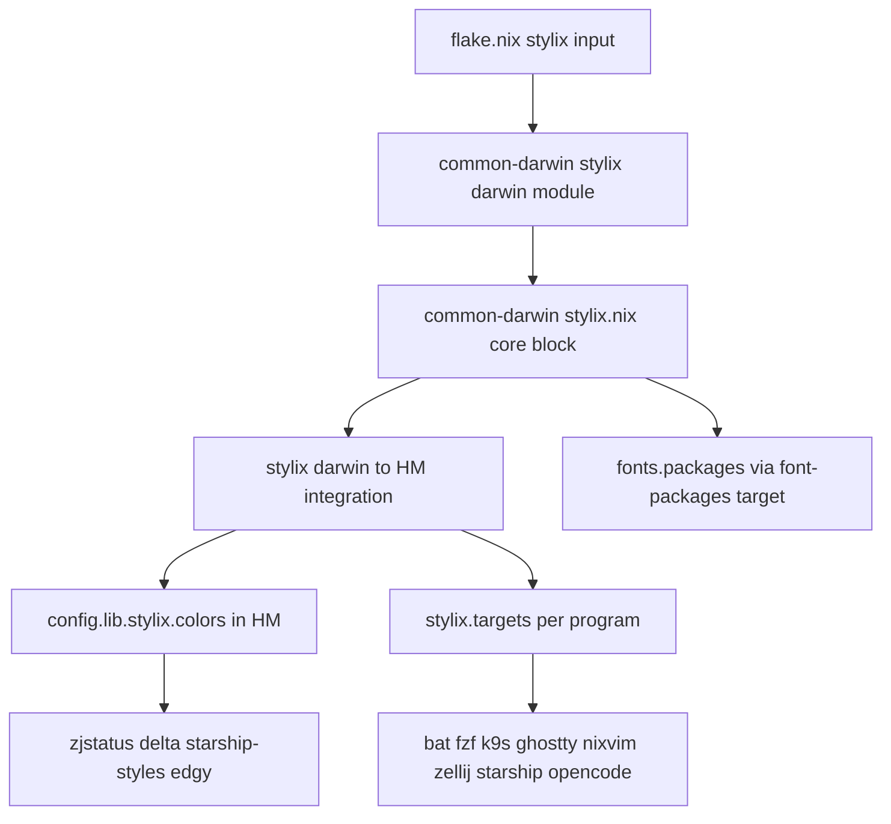

# Design Document: stylix-theming

## Overview
This feature integrates Stylix into the nix-darwin + Home Manager config so a
single system-level block defines the Nord scheme and Monaspace font, and each
supported program is themed through its Stylix target. Custom-colored surfaces
that are not Stylix targets derive their colors from `config.lib.stylix.colors`.
The migration is like-for-like: the resolved look stays Nord and Monaspace.

**Users**: the config maintainer, on both the personal and shopify hosts.
**Impact**: replaces hand-written per-program Nord/font settings and the
`color-schemes` flake input with Stylix-driven configuration.

### Goals
- One source of truth (`stylix.*`) for colors and fonts on both hosts.
- Every in-use Stylix-target program themed by Stylix.
- Non-target surfaces unified via `config.lib.stylix.colors`.
- Each step independently buildable and reviewable.

### Non-Goals
- Changing the scheme away from Nord; light/dark auto-switching; wallpaper
  palettes.
- Theming programs with neither current theming nor a Stylix target.
- macOS system-appearance / boot / login theming.

## Boundary Commitments

### This Spec Owns
- The Stylix flake input and its darwin-module wiring.
- The system-level `stylix` core block (enable, autoEnable, polarity,
  base16Scheme, fonts).
- The per-target `stylix.targets.<t>.enable` toggles for in-use programs.
- The Nord→base16 slot mapping and the rewrite of non-target custom hex
  (zjstatus, delta, Starship layout styles, Nixvim Edgy overrides) to use it.
- Removal of theming superseded by Stylix and the `color-schemes` input.

### Out of Boundary
- Nixvim plugin architecture beyond the colorscheme seam and the Edgy/lualine
  highlight overrides named here.
- OpenCode behavior beyond the TUI theme + `scroll_acceleration` reconciliation.
- The unrelated opencode-cost roadmap and its specs.
- Any program not enumerated in the File Structure Plan.

### Allowed Dependencies
- `nix-community/stylix` `release-26.05` (follows this repo's nixpkgs).
- `pkgs.base16-schemes` (Nord) and `pkgs.nerd-fonts.monaspace`.
- Existing Home Manager program modules already imported in minimal mode.
- Stylix's darwin→Home Manager integration to expose `stylix.targets.*` and
  `config.lib.stylix.colors` in HM scope. This integration autoloads HM target
  modules for all ~95 Stylix programs; under `home-manager.minimal = true` the
  un-imported targets reference undeclared `programs.<name>` options, so the HM
  user sets `_module.check = lib.mkForce false` to sink those inert definitions
  (see Migration Strategy "Integration gate").

### Revalidation Triggers
- Stylix release line or target option-shape changes (e.g. a target renames
  `programs.<t>` keys).
- The HM `programs.opencode` `tui`/`themes` contract changing.
- The chosen Nixvim colorscheme plugin changing palette application.
- Adding a new themed program (must enable its target explicitly under
  `autoEnable = false`).

## Architecture

### Existing Architecture Analysis
- `configurations/common-darwin/` is imported by both host configs; it is the
  single place to set system-level options for both hosts.
- `home-manager/common/` is imported by both hosts' HM configs; HM runs in
  `minimal = true`, `useGlobalPkgs = true`, with program modules imported
  explicitly.
- Theming today is per-program literal Nord/Monaspace, plus a vendored
  `iTerm2-Color-Schemes` input used only by Ghostty.
- Constraint preserved: explicit-import philosophy and per-program module files
  remain the edit surface; this spec adds Stylix rather than restructuring.

### Architecture Pattern & Boundary Map
Selected pattern: central system core + Stylix darwin→HM integration + per-
program target enables and palette-derived overrides.



Key decisions:
- Core lives at system scope so both hosts inherit it with no duplication.
- `autoEnable = false`: every target is enabled explicitly; no implicit theming.
- Per-app fonts arrive through each app target reading `fonts.monospace.name`;
  fontconfig is not relied on (inert on macOS).
- Dependency direction: flake input → system core → HM integration →
  (targets, `config.lib.stylix.colors`) → program modules. Program modules
  never feed back into the core.

### Technology Stack
| Layer | Choice / Version | Role in Feature | Notes |
|-------|------------------|-----------------|-------|
| Theming framework | stylix `release-26.05` | colors + fonts source of truth | follows repo nixpkgs |
| Color scheme | `base16-schemes` Nord | `base16Scheme` value | `share/themes/nord.yaml` |
| Font | `nerd-fonts.monaspace` | monospace package/name | "MonaspiceNe Nerd Font Mono" |
| Runtime | nix-darwin + Home Manager 26.05 | module hosts | both hosts via common-darwin |

## File Structure Plan

### New Files
```
configurations/common-darwin/stylix.nix   # System core: stylix.enable, autoEnable=false,
                                           # polarity, base16Scheme (Nord), fonts.monospace,
                                           # font-packages target enable.
home-manager/common/stylix.nix             # HM scope: per-target enables (bat, fzf, k9s,
                                           # ghostty, nixvim, zellij, starship, opencode),
                                           # nixvim plugin + transparentBackground choice,
                                           # and the documented Nord->base16 slot mapping note.
```

### Modified Files
- `flake.nix` — add `stylix` input (`release-26.05`, `follows nixpkgs`); later
  remove the `color-schemes` input.
- `configurations/common-darwin/default.nix` — import the Stylix darwin module
  and `./stylix.nix`; remove the manual `fonts.packages` block.
- `home-manager/common/default.nix` — import `./stylix.nix`; remove bat
  `theme = "Nord"` (keep `style`).
- `home-manager/common/ghostty.nix` — remove the two `xdg.configFile`
  theme-file entries and `theme`/`font-family`/`font-size`; keep keybinds,
  font styles, and font features.
- `home-manager/common/git.nix` — rewrite `programs.delta.options` colors to
  `config.lib.stylix.colors` values.
- `home-manager/common/starship.nix` — remove the `nord` palette; rewrite
  `nord*` style references to the Stylix base16 palette color names.
- `home-manager/common/zellij.nix` — set `settings.theme = "stylix"`; rewrite
  the zjstatus KDL hex to palette-derived values via `let` bindings.
- `home-manager/nixvim/default.nix` — remove `colorschemes.nord`; rewrite the
  Edgy `highlightOverride` to `config.lib.stylix.colors`.
- `configurations/shopify/home-manager/opencode.nix` — remove the raw
  `xdg.configFile."opencode/tui.json"`; set
  `programs.opencode.tui.scroll_acceleration.enabled = true` (theme now from
  the Stylix opencode target).

> Each file keeps one responsibility. The two new files concentrate Stylix
> wiring; every other edit is local to a program's existing module.

## Nord → base16 slot mapping (canonical)

All non-target conversions reference this mapping (verified from `nord.yaml`).
`config.lib.stylix.colors.withHashtag.base0X` yields the `#`-prefixed value.

| Named (current) | base16 | Hex |
|---|---|---|
| nord0 | base00 | #2E3440 |
| nord1 | base01 | #3B4252 |
| nord2 | base02 | #434C5E |
| nord3 | base03 | #4C566A |
| nord4 | base04 | #D8DEE9 |
| nord8 | base0C | #88C0D0 |
| nord11 | base08 | #BF616A |
| nord13 | base0A | #EBCB8B |
| nord14 | base0B | #A3BE8C |

Off-palette colors (no exact base16 slot) snap to the nearest slot; this is the
documented, intentional shade shift (satisfies 2.4, 4.5):
- `#616E88` (zjstatus `tab_normal` fg) → `base03`.
- `#000000` (Edgy `EdgyWinSeparator` fg) → `base00`.
- `#067a00` (delta `hunk-header-line-number-style`) → `base0B`.

## Requirements Traceability

| Requirement | Summary | Components |
|---|---|---|
| 1.1 | stylix input pinned release-26.05 | flake.nix |
| 1.2 | darwin module imported both hosts | common-darwin/default.nix |
| 1.3 | enable=true, autoEnable=false | common-darwin/stylix.nix |
| 1.4 | base16Scheme=Nord, polarity=dark | common-darwin/stylix.nix |
| 1.5 | explicit per-target enable | home-manager/common/stylix.nix |
| 1.6 | colors available in HM | Stylix integration |
| 2.1 | Nord appearance preserved | slot mapping + all targets |
| 2.2 | Monaspace preserved | common-darwin/stylix.nix fonts |
| 2.3 | non-theme settings preserved | ghostty/zellij/opencode/bat edits |
| 2.4 | correct deviations within mapping | slot mapping |
| 3.1 | enable each in-use target | home-manager/common/stylix.nix |
| 3.2 | remove bat theme=Nord | home-manager/common/default.nix |
| 3.3 | remove ghostty theme/files/font | home-manager/common/ghostty.nix |
| 3.4 | remove nixvim colorschemes.nord | home-manager/nixvim/default.nix |
| 3.5 | zellij select stylix theme | home-manager/common/zellij.nix |
| 3.6 | reconcile opencode tui.json | shopify opencode.nix |
| 3.7 | no dangling theme/palette refs | starship/zellij/opencode edits |
| 4.1 | zjstatus from palette | home-manager/common/zellij.nix |
| 4.2 | delta from palette | home-manager/common/git.nix |
| 4.3 | starship styles to base16 names | home-manager/common/starship.nix |
| 4.4 | Edgy overrides from palette | home-manager/nixvim/default.nix |
| 4.5 | documented slot mapping | this design |
| 5.1 | monospace=Monaspace | common-darwin/stylix.nix |
| 5.2 | defaults for serif/sans/emoji | common-darwin/stylix.nix |
| 5.3 | remove superseded font wiring | common-darwin/default.nix, ghostty.nix |
| 5.4 | Monaspace still installed | font-packages target |
| 6.1 | remove color-schemes input | flake.nix, ghostty.nix |
| 6.2 | remove superseded theming | all migrated modules |
| 6.3 | no dangling input/file refs | flake.nix, ghostty.nix |
| 7.1 | bootstrap before targets before cleanup | task ordering |
| 7.2 | nix flake check passes per step | verification |
| 7.3 | both hosts build per step | verification |
| 7.4 | each step independently buildable | task boundaries |
| 7.5 | nixvim suite stays green | nixvim verification |

## Components and Interfaces

| Component | Scope | Intent | Req Coverage | Contracts |
|---|---|---|---|---|
| Stylix core | darwin | enable + scheme + fonts, autoEnable=false | 1.3,1.4,2.2,5.1,5.2 | State |
| Flake input | flake | pin stylix; later drop color-schemes | 1.1,6.1,6.3 | State |
| Darwin module wiring | darwin | import module + core; install fonts | 1.2,5.3,5.4 | State |
| Target enables | HM | enable each in-use target | 1.5,3.1 | State |
| bat/fzf/k9s migration | HM | enable targets; strip bat theme | 3.1,3.2 | State |
| ghostty migration | HM | enable target; strip theme/files/font | 3.3,5.3,6.1 | State |
| nixvim migration | HM | enable target; strip nord; Edgy derive | 3.4,4.4,7.5 | State |
| zellij migration | HM | theme=stylix; zjstatus from palette | 3.5,4.1 | State |
| starship migration | HM | base16 palette; rewrite styles | 4.3,3.7 | State |
| opencode migration | HM | enable target; reconcile tui.json | 3.6,2.3 | State |
| delta derivation | HM | colors from palette | 4.2 | State |

### Core / darwin

#### Stylix core (`configurations/common-darwin/stylix.nix`)
| Field | Detail |
|---|---|
| Intent | Single system block defining scheme + fonts for both hosts |
| Requirements | 1.3, 1.4, 2.2, 5.1, 5.2, 5.4 |

**Responsibilities & Constraints**
- Set `stylix.enable = true`, `stylix.autoEnable = false`,
  `stylix.polarity = "dark"`,
  `stylix.base16Scheme = "${pkgs.base16-schemes}/share/themes/nord.yaml"`.
- Set `stylix.fonts.monospace = { package = pkgs.nerd-fonts.monaspace; name =
  "MonaspiceNe Nerd Font Mono"; }`; leave serif/sansSerif/emoji default.
- Enable `stylix.targets.font-packages` (darwin/system scope) so
  `stylix.fonts.packages` is installed via `fonts.packages` (replaces the
  manual font list).

**Dependencies**
- Inbound: `configurations/common-darwin/default.nix` imports it (P0).
- External: `pkgs.base16-schemes`, `pkgs.nerd-fonts.monaspace` (P0).

**Implementation Notes**
- Integration: relies on Stylix's darwin→HM integration to propagate
  enable/scheme/fonts/autoEnable to both HM instances and expose
  `config.lib.stylix.colors`.
- Risks: Stylix's HM integration autoloads all ~95 target modules; under
  `minimal = true` evaluation fails on undeclared `programs.<name>` options
  until the HM user sets `_module.check = lib.mkForce false` (see Migration
  Strategy "Integration gate"). Importing `inputs.stylix.homeModules.stylix`
  does not help — it re-runs the same autoload.

### Home Manager targets

#### Target enables (`home-manager/common/stylix.nix`)
| Field | Detail |
|---|---|
| Intent | Explicitly enable each in-use target; set nixvim plugin choice |
| Requirements | 1.5, 3.1, 3.4 |

**Responsibilities & Constraints**
- Set `stylix.targets.<t>.enable = true` for: bat, fzf, k9s, ghostty, nixvim,
  zellij, starship, opencode.
- Set `stylix.targets.nixvim.plugin = "base16-nvim"` and
  `stylix.targets.nixvim.transparentBackground.main = true` to reproduce the
  current `disable_background` look without pulling the mini.nvim suite.
- Set `_module.check = lib.mkForce false` for the HM user so Stylix's autoloaded
  targets for programs not imported under `minimal = true` are sunk rather than
  erroring (see Migration Strategy "Integration gate").
- Hold the canonical slot-mapping comment for non-target conversions.

**Implementation Notes**
- Validation: `nix flake check` and both-host builds after each target is
  enabled (targets can be enabled in separate steps).
- Risks: nixvim plugin/highlight interplay — verified by the nixvim flake-check
  suite (7.5). If `base16-nvim` mis-renders, the documented alternative is
  `mini.base16`.

#### opencode migration (`configurations/shopify/home-manager/opencode.nix`)
| Field | Detail |
|---|---|
| Intent | Let the Stylix opencode target own the TUI theme; keep scroll setting |
| Requirements | 3.6, 2.3 |

**Responsibilities & Constraints**
- Remove `xdg.configFile."opencode/tui.json"` (collides with the HM-generated
  `tui.json` from `programs.opencode.tui`).
- Set `programs.opencode.tui.scroll_acceleration.enabled = true`.
- The Stylix opencode target (enabled in `home-manager/common/stylix.nix`)
  sets `programs.opencode.tui.theme = "stylix"` + `themes.stylix` on both hosts.

**Implementation Notes**
- Integration: HM 26.05 `programs.opencode` exposes `tui` and `themes`;
  pinned fork (v1.17.7 ≥ 1.2.15) uses the split `tui.json`.
- Risks: personal host gains an opencode theme it lacked; acceptable per scope.

### Non-target derivations

#### zjstatus + zellij (`home-manager/common/zellij.nix`)
- Set `programs.zellij.settings.theme = "stylix"` (replaces `"nord"`).
- Replace zjstatus `#[fg=…]`/`#[bg=…]` hex with `let` bindings bound to
  `config.lib.stylix.colors.withHashtag.base0X` per the slot mapping
  (`#616E88` → base03). Requirements 3.5, 4.1.

#### delta (`home-manager/common/git.nix`)
- Rewrite `programs.delta.options` colors to `config.lib.stylix.colors`
  values; `#067a00` → base0B. Keep non-color delta options. Requirement 4.2.

#### starship (`home-manager/common/starship.nix`)
- Remove `palettes.nord` and `palette = "nord"`; the Stylix starship target
  provides `palette = "base16"` + `palettes.base16`.
- Rewrite every `nord*` token in `format` and per-module styles to base16
  palette color names (e.g. `bg:nord1` → `bg:base01`, `fg:nord13` → `fg:base0A`).
  Requirements 4.3, 3.7.

#### nixvim Edgy (`home-manager/nixvim/default.nix`)
- Remove `colorschemes.nord` (target provides the colorscheme).
- Rewrite `highlightOverride.EdgyWinBar` to base0C fg / base01 bg and
  `EdgyWinSeparator` fg to base00 via `config.lib.stylix.colors.withHashtag`.
  Requirements 3.4, 4.4.

## System Flows
Not applicable (declarative config; no runtime control flow). Migration
ordering is covered under Migration Strategy.

## Error Handling
- Build-time only. `nix flake check` and host builds are the failure detector.
- Fail-fast: a dangling palette/theme reference (e.g. `palette = "nord"` after
  removing the palette) fails evaluation; that is the intended signal per 3.7.
- The nixvim flake-check suite catches colorscheme/highlight regressions (7.5).

## Testing Strategy
- Build verification: `nix flake check` passes after each step (7.2);
  `darwinConfigurations.<personal>` and `<shopify>` both build (7.3).
- Nixvim suite: existing nixvim flake checks (smoke + keymaps) stay green after
  the colorscheme swap (7.5).
- Appearance spot-check (manual, per migrated program): Ghostty, bat, k9s,
  Zellij/zjstatus, Starship prompt, OpenCode TUI, Nixvim render Nord and use
  Monaspace (2.1, 2.2).
- Reference scan: no remaining `nord`-named palette/theme references in
  migrated modules and no `inputs.color-schemes` usage after cleanup (3.7, 6.3).

## Migration Strategy
Ordered so bootstrap precedes targets and targets precede cleanup (7.1, 7.4):

```mermaid
graph LR
    Bootstrap[1 input plus darwin module] --> CoreEnable[2 core enable scheme fonts]
    CoreEnable --> CLI[3 bat fzf k9s]
    CLI --> Ghostty[4 ghostty]
    Ghostty --> Nixvim[5 nixvim]
    Nixvim --> Zellij[6 zellij plus zjstatus]
    Zellij --> Starship[7 starship plus styles]
    Starship --> Opencode[8 opencode]
    Opencode --> Fonts[9 fonts consolidation]
    Fonts --> NonTarget[10 delta plus remaining derivations]
    NonTarget --> Cleanup[11 remove color-schemes plus dead theming]
```



- Each node is independently buildable; a step that breaks a build or the
  nixvim suite is fixed within that step before the next (7.5).
- **Integration gate (step 2)**: Stylix's darwin→HM auto-import fires under
  `minimal = true`, but its autoload imports HM target modules for all ~95
  Stylix programs, and the targets for programs not imported in minimal mode
  reference undeclared `programs.<name>` options. A `mkIf false` definition of
  an undeclared option still trips the module system's unmatched-definition
  check, so `config.lib.stylix.colors` cannot resolve in HM until those defs
  are sunk. Resolution: set `home-manager.users.<user>._module.check =
  lib.mkForce false` from `home-manager/common/stylix.nix`. Importing
  `inputs.stylix.homeModules.stylix` does not help — it re-runs the same
  autoload. This decision is made once at step 2 and unblocks steps 3–10.
- **Fonts gate (step 9)**: confirm `nerd-fonts.monaspace` resolves
  "MonaspiceNe Nerd Font Mono", and decide explicitly whether the non-nerd
  `monaspace` package is still required before removing it from the manual
  `fonts.packages` list (5.4).
- Rollback: each step is a small, revertible change to one or two files.
