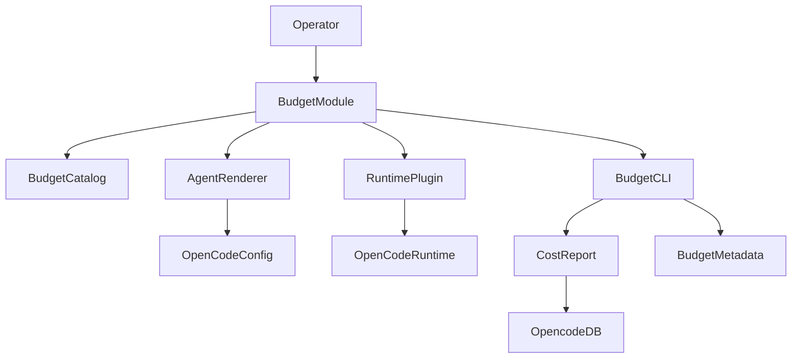
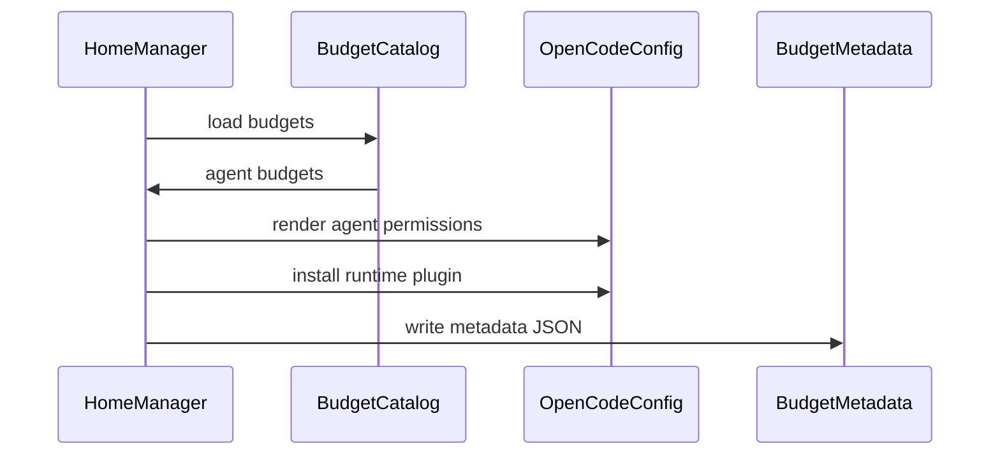
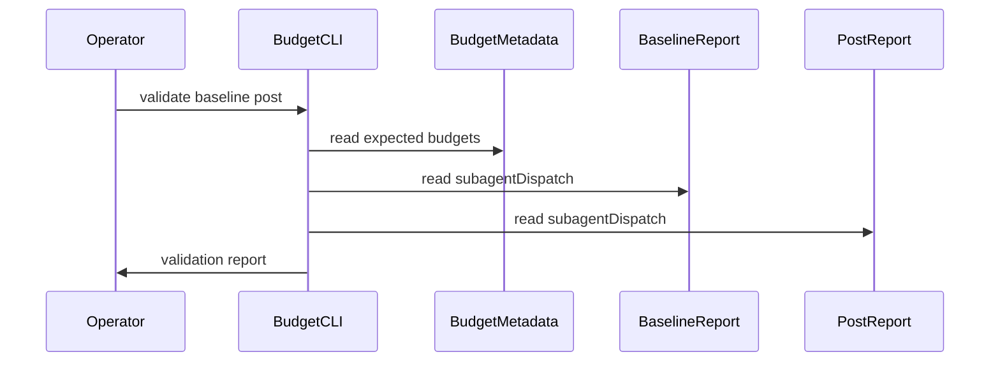
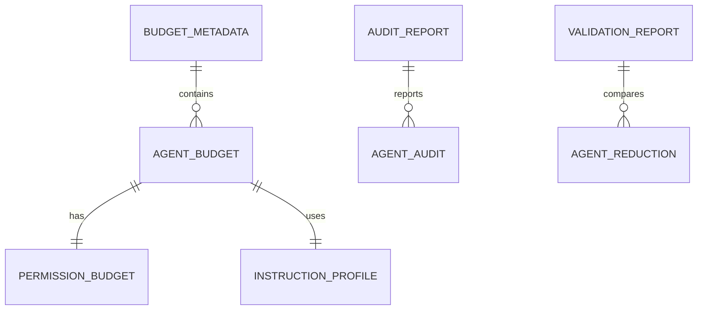
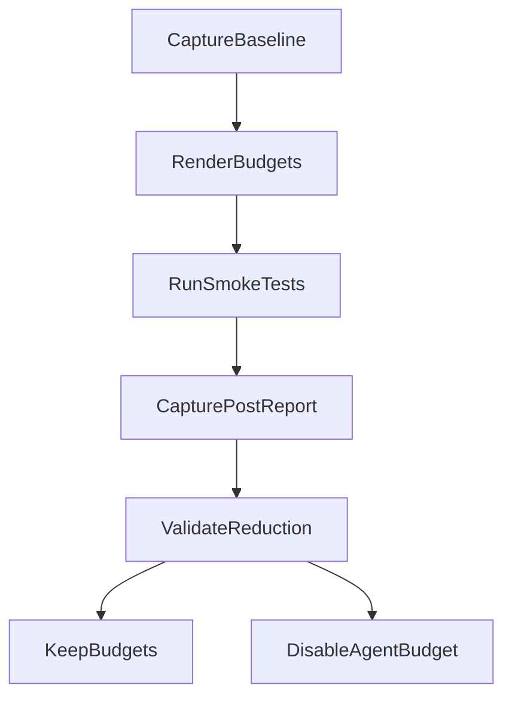

# Design Document

## Overview

The subagent-context-budget feature reduces opencode Task-dispatch input cost for the operator of this nix-config by enforcing per-agent permission budgets, filtering subagent instruction context, and validating the result against `opencode-cost-report` reports.

The design extends existing Home Manager opencode wiring, mcpproxy routing, and cost-diagnostic patterns. It preserves the existing subagent roster and direct invocation workflows while adding audit, validation, smoke-test, and rollback surfaces.

### Goals

- Measure each configured subagent's budget state and observed usage.
- Enforce per-agent permission budgets without using deprecated `tools` config.
- Filter subagent-only instruction context while leaving main-thread rules unchanged.
- Prove a ≥40% `subagentDispatch` token reduction on representative workloads.
- Keep each budget reversible per agent type.

### Non-Goals

- No opencode source changes.
- No Task API changes.
- No new subagent types and no agent removals or renames.
- No dispatch caps, routing changes, fan-out limits, or circuit breakers.
- No main-thread context budget, session compaction, tool-output compression, or SaaS observability.

## Boundary Commitments

### This Spec Owns

- The `programs.subagent-context-budget` Home Manager module.
- Per-agent budget metadata and rendered budget state.
- Permission budgets for built-in and custom subagents.
- Runtime subagent instruction filtering through an opencode plugin.
- Audit and validation CLIs for budget state and report comparison.
- A minimal read-only subagent baseline artifact.
- Smoke tests for the existing subagent roster.
- Operator runbook for enabling, disabling, auditing, and validating budgets.

### Out of Boundary

- `opencode` internals and the Task tool API.
- mcpproxy upstream server registration and routing mode.
- Cost attribution math inside `opencode-cost-report`.
- Session-compaction thresholds or subagent-watch behavior.
- Tool-output compression and native tool output truncation.
- Agent selection policy: when the main agent should dispatch a subagent.

### Allowed Dependencies

- OpenCode pinned package and public config schema.
- OpenCode agent, permission, rules, and plugin extension surfaces.
- Existing `programs.opencode` Home Manager module.
- Existing `opencode-cost-report` Markdown/JSON diagnostic output.
- Existing mcpproxy retrieve-tools MCP entrypoint.
- Existing nix-config Node test and Home Manager module patterns.

### Revalidation Triggers

- OpenCode schema changes to `agent`, `permission`, `plugin`, `instructions`, or plugin hooks.
- `opencode-cost-report` JSON shape changes for `subagentDispatch`, `subagentDispatchByAgent`, or per-session selection.
- Agent roster changes on common, personal, or Shopify host configuration.
- mcpproxy routing mode changes away from `retrieve_tools`.
- New mandatory global memory or safety rules that subagents must inherit.

## Architecture

### Existing Architecture Analysis

- `home-manager/common/opencode.nix` owns global opencode enablement, wrapper composition, global rules, and common agent registration.
- Host configs extend the common opencode setup through attrset merges and `mkForce` for host-specific rules.
- Custom agents are Markdown files with frontmatter and body text; built-ins are overridden through `programs.opencode.settings.agent.<name>`.
- `opencode-cost-report` already reports per-agent subagent dispatch data from child-session relationships.
- mcpproxy already reduces upstream MCP schema exposure through retrieve-tools mode; this spec does not change that routing.

### Architecture Pattern & Boundary Map

Selected pattern: hybrid Home Manager module plus runtime plugin and validation CLI.



**Architecture Integration**:
- The module owns budget configuration and rendered metadata.
- The renderer applies per-agent permission budgets through supported OpenCode agent configuration.
- The plugin filters subagent system prompt content and leaves primary sessions unchanged.
- The CLI parses diagnostic reports and budget metadata; it does not recompute cost attribution.

### Technology Stack

| Layer | Choice / Version | Role in Feature | Notes |
|-------|------------------|-----------------|-------|
| Configuration | Nix Home Manager | Declarative install and per-host budget configuration | Matches opencode and cost-diagnosis modules |
| Runtime extension | OpenCode plugin API in pinned OpenCode 1.15.5 | Subagent system prompt filtering and self-check | Hook availability is validated |
| CLI | Node script with JSDoc type checking | Audit and validation commands | Reuses existing Node script pattern |
| Data | JSON files and opencode-cost-report JSON | Budget metadata, baseline, validation input | No new database |
| Tests | Node test runner and Nix checks | Unit, integration, rendered config, smoke tests | Mirrors existing diagnostic tests |

## File Structure Plan

### Directory Structure

```text
home-manager/common/
├── default.nix                              # Import and enable the budget module
├── opencode.nix                             # Expose small agent rendering helper only
├── subagent-context-budget.nix              # HM module, options, metadata rendering, package install
└── subagent-context-budget/
    ├── budgets.nix                          # Canonical per-agent budget catalog
    ├── instructions/
    │   ├── universal.md                     # Minimal universal subagent instructions
    │   ├── memory-mcpproxy.md               # Mandatory memory and mcpproxy rules
    │   ├── cc-sdd-minimal.md                # Minimal SDD rules for agents that need them
    │   ├── graphite-minimal.md              # Shopify-only Graphite trigger summary
    │   └── role-fragments/*.md              # Role-specific instruction fragments
    ├── minimal-readonly-baseline.json       # Operator-readable baseline artifact template
    └── plugin.ts                            # Runtime prompt filtering plugin

scripts/
├── subagent-context-budget.js               # Audit and validation CLI
├── subagent-context-budget.nix              # CLI wrapper derivation
└── subagent-context-budget-smoke-test.nix   # Runtime smoke verifier

tests/subagent-context-budget/
├── README.md                                # Test fixture and command documentation
├── package.json                             # Node test command metadata
├── run.js                                   # Test runner wrapper
├── fixtures/
│   ├── budget-metadata.json                 # Rendered budget fixture
│   ├── report-baseline.json                 # Diagnostic baseline fixture
│   └── report-post.json                     # Diagnostic post-change fixture
├── unit/
│   ├── budget-catalog.test.js               # Metadata and permission validation
│   ├── report-comparator.test.js            # Reduction and residual handling
│   └── instruction-profile.test.js          # Profile composition rules
└── integration/
    ├── hm-render.test.js                    # Rendered config and metadata contract
    └── plugin-self-check.test.js            # Prompt filtering self-check behavior

.kiro/specs/subagent-context-budget/
└── runbook.md                               # Operator audit validation and rollback guide
```

### Modified Files

- `home-manager/common/default.nix` — imports and enables `programs.subagent-context-budget`.
- `home-manager/common/opencode.nix` — exposes only the minimal helper needed for budgeted agent rendering; main-thread `rules` stays unchanged.
- `configurations/shopify/home-manager/opencode.nix` — applies the shared helper to Shopify-specific agents and keeps Shopify global rules unchanged.
- `flake.nix` — adds test/check wiring for the new CLI and rendered metadata tests.
- Existing agent Markdown files — no direct requirement to edit; the module applies permission and instruction profiles through generated config/metadata. If implementation finds a frontmatter-only path safer, tasks may update agent files within the same budget boundary.

## System Flows

### Budget render flow



### Validation flow



## Requirements Traceability

| Requirement | Summary | Components | Interfaces | Flows |
|-------------|---------|------------|------------|-------|
| 1.1 | Enumerate configured subagents | BudgetCatalog, BudgetCLI | BudgetMetadata | Budget render |
| 1.2 | Report first-turn token count | BudgetCLI, CostReportAdapter | AuditReport | Validation |
| 1.3 | Report observed tools | BudgetCLI, CostReportAdapter | AuditReport | Validation |
| 1.4 | Mark absent usage | BudgetCLI | AuditReport | Validation |
| 1.5 | Separate context dimensions | BudgetCatalog, BudgetCLI | BudgetMetadata, AuditReport | Budget render |
| 2.1 | Assign allowed tool set | BudgetCatalog, AgentRenderer | AgentBudget | Budget render |
| 2.2 | Include required tools only | BudgetCatalog | AgentBudget | Budget render |
| 2.3 | Name write or destructive capability | BudgetCatalog, BudgetCLI | AgentBudget, AuditReport | Budget render |
| 2.4 | Mark full-tool escape hatch | BudgetCatalog, BudgetCLI | AgentBudgetState | Budget render |
| 2.5 | Keep budgets per agent | BudgetCatalog | BudgetMetadata | Budget render |
| 3.1 | Provide universal plus role context | InstructionProfileRuntime | InstructionProfile | Budget render |
| 3.2 | Omit unrelated workflows | InstructionProfileRuntime | InstructionProfile | Budget render |
| 3.3 | Preserve memory and mcpproxy rules | InstructionProfileRuntime | InstructionProfile | Budget render |
| 3.4 | Widen one agent only | BudgetCatalog, InstructionProfileRuntime | AgentBudget | Budget render |
| 3.5 | Leave main-thread instructions unchanged | InstructionProfileRuntime | PluginSelfCheck | Budget render |
| 4.1 | Define minimal read-only baseline | BudgetCatalog | MinimalBaseline | Budget render |
| 4.2 | Include token count and categories | BudgetCLI | MinimalBaseline | Validation |
| 4.3 | Report delta from baseline | BudgetCLI | AuditReport | Validation |
| 4.4 | Exclude host/project-specific context | BudgetCatalog | MinimalBaseline | Budget render |
| 4.5 | Expose baseline artifact | BudgetModule | MinimalBaseline | Budget render |
| 5.1 | Use baseline cost report | ValidationComparator | ValidationInput | Validation |
| 5.2 | Use post-change cost report | ValidationComparator | ValidationInput | Validation |
| 5.3 | Compare subagentDispatch tokens | ValidationComparator | ValidationReport | Validation |
| 5.4 | Require 40 percent reduction | ValidationComparator | ValidationReport | Validation |
| 5.5 | Report contributing agents | ValidationComparator | ValidationReport | Validation |
| 5.6 | Fail on unusable fields | CostReportAdapter | ValidationError | Validation |
| 5.7 | Preserve privacy posture | CostReportAdapter | DiagnosticInput | Validation |
| 6.1 | Provide smoke test per agent | SmokeTestRunner | SmokePlan | Validation |
| 6.2 | Complete representative tasks | SmokeTestRunner | SmokeResult | Validation |
| 6.3 | Mark insufficient budgets | SmokeTestRunner, BudgetCLI | SmokeResult | Validation |
| 6.4 | Fail validation on smoke failures | ValidationComparator | ValidationReport | Validation |
| 6.5 | Preserve direct invocation | SmokeTestRunner | SmokePlan | Validation |
| 7.1 | Available on both hosts | BudgetModule | HM Options | Budget render |
| 7.2 | Budget host-specific agents | BudgetCatalog | HostBudgetOverlay | Budget render |
| 7.3 | Account for host tool surfaces | BudgetCLI | AuditReport | Validation |
| 7.4 | Disable per agent | BudgetCatalog | AgentBudgetState | Budget render |
| 7.5 | Leave disabled agent unchanged | AgentRenderer | AgentBudgetState | Budget render |
| 8.1 | Do not change Task invocation | BudgetModule | Boundary invariant | Budget render |
| 8.2 | No dispatch caps | BudgetModule | Boundary invariant | Budget render |
| 8.3 | No compaction or compression | BudgetModule | Boundary invariant | Budget render |
| 8.4 | No external SaaS | BudgetCLI | Boundary invariant | Validation |
| 8.5 | No opencode source changes | RuntimePlugin, AgentRenderer | Boundary invariant | Budget render |

## Components and Interfaces

| Component | Domain | Intent | Req Coverage | Key Dependencies | Contracts |
|-----------|--------|--------|--------------|------------------|-----------|
| BudgetModule | Nix HM | Install and render budget feature | 4.5, 7.1, 8.* | programs.opencode P0 | Config |
| BudgetCatalog | Config | Canonical per-agent budget data | 1.*, 2.*, 4.*, 7.* | Agent roster P0 | State |
| AgentRenderer | Config | Apply permission budgets and escape hatches | 2.*, 7.5, 8.1, 8.5 | OpenCode agent config P0 | Service |
| InstructionProfileRuntime | Runtime | Filter subagent instruction context | 3.*, 8.5 | OpenCode plugin P0 | Service |
| BudgetCLI | CLI | Audit budget metadata and validation inputs | 1.*, 4.*, 5.*, 7.3 | Metadata P0, Cost reports P0 | Batch |
| CostReportAdapter | CLI | Parse diagnostic JSON defensively | 1.3, 5.* | opencode-cost-report P0 | Service |
| ValidationComparator | CLI | Compare baseline and post reports | 5.*, 6.4 | CostReportAdapter P0 | Service |
| SmokeTestRunner | CLI | Define and run agent smoke checks | 6.* | opencode run P1 | Batch |
| OperatorRunbook | Docs | Document operator workflow | 4.5, 5.*, 7.* | BudgetCLI P1 | Document |

### Configuration Layer

#### BudgetModule

| Field | Detail |
|-------|--------|
| Intent | Declarative install, metadata rendering, and opencode integration |
| Requirements | 4.5, 7.1, 8.1, 8.2, 8.3, 8.4, 8.5 |

**Responsibilities & Constraints**
- Exposes `programs.subagent-context-budget` options.
- Installs CLI, smoke test, plugin, and metadata artifacts.
- Asserts `programs.opencode.enable`.
- Does not change Task invocation or opencode source.

**Contracts**: Service [ ] / API [ ] / Event [ ] / Batch [ ] / State [x]

##### State Management
- Options:
  - `enable: boolean`
  - `enforce: boolean`
  - `baselineAgent: string`
  - `agents.<name>.disableBudget: boolean`
  - `agents.<name>.instructionProfile: string`
  - `agents.<name>.permissionBudget: PermissionBudget`
- Persistence: rendered JSON under opencode config/state paths.
- Invariant: disabling one agent budget does not alter any other agent budget.

**Implementation Notes**
- Integration: follows `programs.opencode-cost-diagnosis` module shape.
- Validation: HM eval tests confirm peer assertion and metadata rendering.
- Risks: option merge order with host-specific config; test with Shopify and personal configurations.

#### BudgetCatalog

| Field | Detail |
|-------|--------|
| Intent | Single source of truth for expected budgets and rationale |
| Requirements | 1.1, 1.5, 2.1, 2.2, 2.3, 2.5, 4.1, 4.4, 7.2, 7.4 |

**Responsibilities & Constraints**
- Lists all common and host-specific agents known to the configuration.
- Records permission budgets, instruction profiles, capability rationale, and smoke-test class.
- Marks built-in agents distinctly from Markdown-defined agents.

**Contracts**: State [x]

##### State Management
```typescript
type PermissionAction = "allow" | "ask" | "deny";
type PermissionRule = PermissionAction | Record<string, PermissionAction>;

interface PermissionBudget {
  read?: PermissionRule;
  edit?: PermissionRule;
  glob?: PermissionRule;
  grep?: PermissionRule;
  list?: PermissionRule;
  bash?: PermissionRule;
  task?: PermissionRule;
  external_directory?: PermissionRule;
  todowrite?: PermissionAction;
  question?: PermissionAction;
  webfetch?: PermissionRule;
  websearch?: PermissionAction;
  lsp?: PermissionRule;
  skill?: PermissionRule;
  doom_loop?: PermissionAction;
}

type AgentBudgetState =
  | { kind: "enforced"; reason: "default" | "host-override" }
  | { kind: "unbudgeted"; reason: "operator-escape-hatch" };

interface AgentBudget {
  name: string;
  source: "builtin" | "common-markdown" | "host-markdown";
  hostScope: "all" | "shopify" | "personal";
  state: AgentBudgetState;
  permissionBudget: PermissionBudget;
  instructionProfile: string;
  capabilityRationale: string[];
  smokeClass: string;
}

type Result<T, E> =
  | { ok: true; value: T }
  | { ok: false; error: E };
```

**Implementation Notes**
- Integration: generated metadata should be readable by both CLI and tests.
- Validation: unit tests reject missing rationale for write, edit, webfetch, or broad bash allowances.
- Risks: docs list `edit` as the mutation permission; avoid adding undocumented `write` keys to new budgets.

#### AgentRenderer

| Field | Detail |
|-------|--------|
| Intent | Apply permission budgets while preserving existing agent names |
| Requirements | 2.1, 2.2, 2.4, 2.5, 7.5, 8.1, 8.5 |

**Responsibilities & Constraints**
- Applies permissions through supported OpenCode `agent.<name>.permission` settings.
- Handles built-ins (`general`, `explore`) through built-in override keys.
- Leaves unbudgeted agents unchanged when escape hatch is active.

**Dependencies**
- Outbound: OpenCode agent config — permission merge (P0)
- Outbound: BudgetCatalog — agent budget state (P0)

**Contracts**: Service [x]

##### Service Interface
```typescript
interface AgentRendererService {
  renderAgentOverride(agent: AgentBudget): AgentOverride;
}

interface AgentOverride {
  name: string;
  permission?: PermissionBudget;
  promptProfile?: string;
  disabledBudget: boolean;
}
```
- Preconditions: agent name exists in catalog.
- Postconditions: built-in agent names remain unchanged.
- Invariants: escape-hatch state never tightens or widens other agents.

**Implementation Notes**
- Integration: if same-agent Markdown and JSON override merge behavior differs from expectation, tasks must choose generated Markdown as fallback.
- Validation: rendered config validates against OpenCode schema.
- Risks: permission budgets may gate behavior without reducing schemas; measurement decides success.

### Runtime Layer

#### InstructionProfileRuntime

| Field | Detail |
|-------|--------|
| Intent | Replace subagent system instruction context with profile-specific content |
| Requirements | 3.1, 3.2, 3.3, 3.4, 3.5, 8.5 |

**Responsibilities & Constraints**
- Filters only subagent sessions.
- Leaves main-thread sessions unchanged.
- Always preserves universal, memory, cavemem, and mcpproxy safety requirements.
- Fails closed when plugin hook or agent detection is unavailable.

**Dependencies**
- Inbound: OpenCode plugin runtime — system transform hook (P0)
- Outbound: BudgetMetadata — agent profile lookup (P0)

**Contracts**: Service [x] / Event [x]

##### Service Interface
```typescript
type ProfileDecision =
  | { kind: "apply"; agentName: string; profileName: string; systemText: string }
  | { kind: "skip"; reason: "primary-session" | "agent-unknown" | "profile-missing" };

interface InstructionProfileService {
  decide(input: SystemTransformInput): Promise<ProfileDecision>;
}

interface SystemTransformInput {
  sessionID: string;
  currentSystemText: string;
}
```

##### Event Contract
- Subscribed hook: OpenCode system prompt transform hook.
- Published events: none required.
- Observability: plugin writes a startup self-check result and per-session skip/apply counts to opencode app log.

**Implementation Notes**
- Integration: startup self-check verifies hook availability and session-agent lookup before budget enforcement claims can pass.
- Validation: plugin self-check test covers primary skip, subagent apply, unknown-agent fail path.
- Risks: hook API is experimental; revalidate on OpenCode upgrades.

### CLI Layer

#### BudgetCLI

| Field | Detail |
|-------|--------|
| Intent | Operator-facing audit and validation command |
| Requirements | 1.1, 1.2, 1.3, 1.4, 1.5, 4.2, 4.3, 5.*, 7.3 |

**Responsibilities & Constraints**
- Reads budget metadata and diagnostic JSON.
- Emits audit and validation reports as deterministic JSON and Markdown.
- Does not read prompt or tool-output bodies unless the diagnostic input already includes them.

**Contracts**: Batch [x]

##### Batch / Job Contract
- Commands:
  - `subagent-context-budget audit --metadata <path> --diagnostic <report.json>`
  - `subagent-context-budget validate --metadata <path> --baseline <report.json> --post <report.json>`
  - `subagent-context-budget smoke-plan --metadata <path>`
- Output: JSON by default, Markdown with `--format markdown`.
- Idempotency: report generation is read-only.

**Implementation Notes**
- Integration: uses existing `opencode-cost-report --format json` output.
- Validation: fixtures cover missing data, residuals, and successful reduction.
- Risks: first-turn token counts may require a measurement run before audit; absent values are explicit.

#### CostReportAdapter

| Field | Detail |
|-------|--------|
| Intent | Defensive parser for `opencode-cost-report` JSON |
| Requirements | 1.3, 5.1, 5.2, 5.3, 5.5, 5.6, 5.7 |

**Responsibilities & Constraints**
- Extracts `subagentDispatch` token totals and per-agent maps when present.
- Distinguishes unknown/residual buckets from named agents.
- Rejects reports missing required fields for the requested operation.

**Contracts**: Service [x]

##### Service Interface
```typescript
interface CostReportAdapter {
  parseReport(input: unknown): Result<CostReportSummary, CostReportError>;
}

interface CostReportSummary {
  sessions: SessionCostSummary[];
  global: DispatchCostSummary;
}

interface DispatchCostSummary {
  subagentDispatchTokens: number;
  subagentDispatchByAgent: Record<string, number> | null;
  residualAgentTokens: number;
}

interface SessionCostSummary {
  sessionID: string;
  project: string | null;
  subagentDispatchTokens: number;
  subagentDispatchByAgent: Record<string, number> | null;
  residualAgentTokens: number;
}

type CostReportError =
  | { kind: "missing-field"; field: string }
  | { kind: "invalid-shape"; field: string }
  | { kind: "pricing-drift"; detail: string };
```

**Implementation Notes**
- Integration: does not import private internals from `opencode-cost-report`.
- Validation: adapter tests pin only the public JSON fields used by this feature.
- Risks: v2 report residual labels may change; keep label matching configurable.

#### ValidationComparator

| Field | Detail |
|-------|--------|
| Intent | Enforce the before/after success contract |
| Requirements | 5.1, 5.2, 5.3, 5.4, 5.5, 5.6, 6.4 |

**Responsibilities & Constraints**
- Compares baseline and post-change per-parent-session `subagentDispatch` tokens.
- Requires ≥40% reduction on the representative workload.
- Includes smoke-test state before reporting pass.

**Contracts**: Service [x]

##### Service Interface
```typescript
type ValidationStatus = "pass" | "fail";

interface ValidationReport {
  status: ValidationStatus;
  reductionPct: number;
  baselineTokensPerParent: number;
  postTokensPerParent: number;
  byAgent: Record<string, AgentReduction>;
  residualAgentTokens: number;
  failures: ValidationFailure[];
}

interface AgentReduction {
  baselineTokens: number;
  postTokens: number;
  reductionPct: number;
}

type ValidationFailure =
  | { kind: "threshold-not-met"; actualPct: number; requiredPct: number }
  | { kind: "missing-diagnostic-field"; field: string }
  | { kind: "smoke-failure"; agentName: string }
  | { kind: "plugin-self-check-failed"; detail: string };
```

**Implementation Notes**
- Integration: residual buckets are reported but not credited to named-agent reductions.
- Validation: fail cases are as important as pass fixture.
- Risks: workload comparability is operator-managed; runbook must document capture steps.

#### SmokeTestRunner

| Field | Detail |
|-------|--------|
| Intent | Verify budgeted agents still complete representative tasks |
| Requirements | 6.1, 6.2, 6.3, 6.4, 6.5 |

**Responsibilities & Constraints**
- Produces one smoke test per budgeted agent type.
- Supports direct invocation workflows.
- Flags missing tool or instruction regressions.

**Contracts**: Batch [x]

##### Batch / Job Contract
- Trigger: operator or Nix smoke-test wrapper.
- Input: metadata JSON and host identifier.
- Output: per-agent smoke result with `pass`, `fail`, or `skipped-unbudgeted`.
- Recovery: failed agents name missing permission/profile evidence when available.

**Implementation Notes**
- Integration: non-interactive runs must avoid indefinite permission prompts.
- Validation: tests use synthetic smoke results; live smoke test is operator-run.
- Risks: LLM nondeterminism; smoke tasks must be small and assertions coarse.

## Data Models

### Domain Model

- **Agent budget**: one named subagent's permission budget, instruction profile, rationale, and state.
- **Instruction profile**: ordered set of instruction fragments for subagent system context.
- **Audit report**: rendered budget metadata plus observed diagnostic usage.
- **Validation report**: baseline/post comparison plus smoke-test state.

### Logical Data Model



**Structure Definition**
- `BudgetMetadata.version`: integer schema version.
- `BudgetMetadata.host`: `all`, `shopify`, or `personal`.
- `AgentBudget.name`: stable opencode agent name.
- `AgentBudget.state`: enforced or unbudgeted.
- `AgentBudget.permissionBudget`: OpenCode permission keys and actions.
- `InstructionProfile.fragments`: ordered fragment names.
- `ValidationReport.reductionPct`: aggregate `subagentDispatch` reduction.

**Consistency & Integrity**
- Agent names are natural keys.
- Every enforced agent must have exactly one instruction profile.
- Every broad permission must have a rationale.
- Metadata version changes require CLI compatibility checks.

### Data Contracts & Integration

- Metadata serialization: JSON rendered by Home Manager.
- CLI report serialization: deterministic JSON; Markdown is derived from the same object.
- Diagnostic input: existing `opencode-cost-report --format json` output.

## Error Handling

### Error Strategy

- Configuration errors fail during Home Manager evaluation where possible.
- Runtime plugin incompatibility fails the plugin self-check and blocks validation pass.
- Diagnostic shape errors fail audit or validation with the missing field name.
- Smoke failures mark the agent budget insufficient.

### Error Categories and Responses

- **Configuration errors**: unknown agent, missing profile, invalid permission key → Home Manager assertion or CLI metadata validation failure.
- **Runtime errors**: plugin hook unavailable, session-agent lookup unavailable → self-check failure and validation failure.
- **Diagnostic errors**: missing `subagentDispatch`, missing per-agent map, pricing drift → operator-facing validation failure.
- **Smoke errors**: denied required tool, missing instruction, non-zero command → failed smoke result.

### Monitoring

- Plugin writes startup self-check status and per-session apply/skip counters to opencode app logs.
- CLI writes machine-readable validation failures.
- Runbook documents how to inspect logs and compare reports.

## Testing Strategy

### Unit Tests

- Budget catalog rejects enforced agents without instruction profiles or permission budgets (1.1, 2.1, 2.5).
- Permission budget validator rejects undocumented mutation keys and requires rationale for broad write/webfetch/bash allowances (2.2, 2.3).
- Instruction profile composer always includes memory and mcpproxy fragments (3.1, 3.3).
- CostReportAdapter fails on missing required fields and preserves privacy by not requiring content fields (5.6, 5.7).
- ValidationComparator enforces ≥40% reduction and excludes residual buckets from named-agent credit (5.4, 5.5).

### Integration Tests

- Home Manager render test proves metadata, plugin registration, and agent permission overrides appear in rendered config (7.1, 7.2).
- Built-in override test proves `general` and `explore` budgets render without changing agent names (2.5, 6.5).
- Plugin self-check test covers subagent apply, primary skip, unknown-agent fail, and missing-hook fail paths (3.2, 3.5).
- CLI fixture test validates baseline/post diagnostic comparison from committed JSON fixtures (5.1, 5.2, 5.3).
- Escape-hatch render test proves disabling one agent budget leaves that agent unchanged and reports `unbudgeted` (2.4, 7.4, 7.5).

### Operator Smoke Tests

- `explore`: read-only codebase question.
- `general`: bounded multi-step research task without edits.
- `nix-pkg`: package-evaluation dry run that reaches planning output before mutation.
- `nvim-tailor`: read/config-inspection task.
- `security-auditor`: read-only audit on fixture paths.
- `vault-curator`: vault read/dedup plan without bulk writes.
- `vault-synthesizer`: cavemem-read to draft-memory path.
- `yb-sleuth`: read-only source trace on Shopify host.

### Performance and Validation Tests

- First-turn measurement compares current vs budgeted profile for every enforced agent (1.2, 4.2, 4.3).
- Representative workload validation compares baseline/post reports and requires ≥40% `subagentDispatch` reduction (5.4).
- Host parity validation runs metadata audit on both nix-darwin hosts and reports host-specific tool surfaces (7.1, 7.3).

## Security Considerations

- Permission budgets reduce capability exposure; they must not widen an agent unless explicitly marked with a rationale or escape hatch.
- Memory and mcpproxy safety rules remain mandatory for subagents that need those workflows.
- The audit and validation CLI consumes default-private diagnostic output and does not require prompt or tool-output body content.
- The plugin must fail closed when it cannot identify the session type.

## Performance & Scalability

- Target: ≥40% reduction in `subagentDispatch` tokens per parent session on representative workload.
- Metadata and profile lookup are local file reads and should be cached by the plugin after startup.
- Audit and validation are offline CLI operations; they do not run on the per-turn critical path.
- Runtime plugin work per subagent session is bounded to profile selection and string replacement.

## Migration Strategy



- Phase 1: render metadata and audit without enforcing instruction filtering.
- Phase 2: enforce permission budgets and run smoke tests.
- Phase 3: enable runtime instruction filtering and self-check.
- Phase 4: capture post-change report and validate the reduction.
- Rollback: set per-agent escape hatch or disable module; rendered metadata records disabled state.

## Supporting References

- `.kiro/specs/subagent-context-budget/research.md` — gap analysis and discovery log.
- OpenCode agents docs — built-in override and permission behavior.
- OpenCode permissions docs — current permission surface and deprecated `tools` status.
- `.kiro/specs/v2-diagnosis/requirements.md` — per-agent subagent-dispatch decomposition contract.
