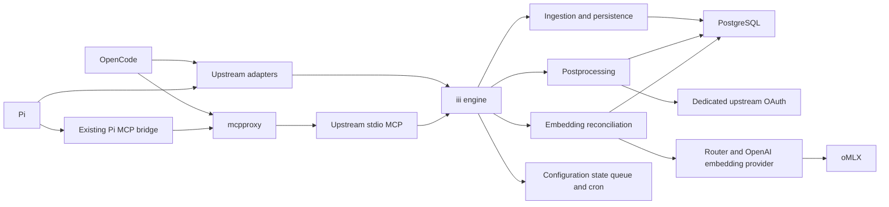
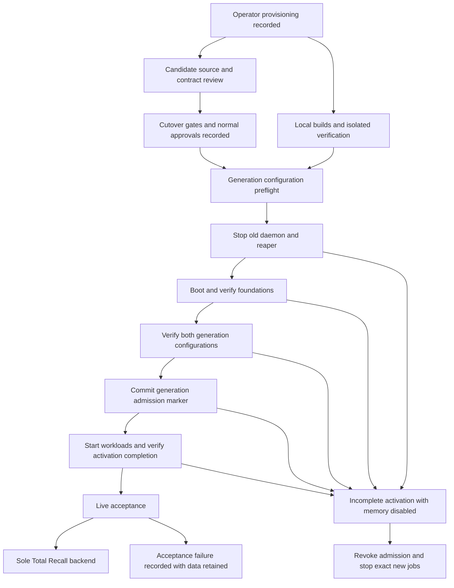

# Design Document: total-recall-cutover

## Overview
Deploy the native Total Recall stack and switch both managed harnesses in one personal-host generation. [brief.md](brief.md) is authoritative for intent; this design defines deployment ownership conditional on the external gates.

### Goals
- Reproducible service assembly, preserved new data, and traceable two-harness acceptance.
- Bounded prerequisite review before candidate-dependent implementation and cutover authorization.

### Non-Goals
The exclusions in brief.md, Scope and Out of Boundary, apply unchanged.

## Boundary Commitments

### This Spec Owns
- Immutable packaging, host-scoped Home Manager configuration, runtime directories, PostgreSQL initialization/migrations/grants, launchd lifecycle and redacted status.
- Upstream adapter installation, mcpproxy stdio registration, existing Pi bridge result rendering, managed guidance and active legacy retirement.
- Candidate contract inventory and local cutover verification; it owns no upstream feature development.

### Out of Boundary
Upstream capture/delivery semantics, MCP, startup-context and dedicated OAuth implementations; imports/backfill, graph workers, remote iii bridges, historical data deletion and generic networking/secrets redesign.

### Allowed Dependencies
Adopt compatible immutable Total Recall packages/sources, iii engine and standalone iii-hq/workers artifacts; PostgreSQL 17 extensions; existing oMLX, mcpproxy, harness modules, generic Keychain bridge and launchd activation conventions. Dependencies flow from selected upstream contracts to packages to service module to harness wiring/guidance; no upstream module depends on nix-config consumers.

### Revalidation Triggers
Changing a pin, managed harness/runtime, tool schema/result, adapter injection/retry behavior, OAuth transport/storage/model, worker registration/persistence, SQL/vector shape, credentials or local listener allocation invalidates affected gate evidence and design approval. Scope changes return to requirements review.

## Architecture

### Existing Architecture Analysis
`home-manager/common/agentmemory.nix` owns current services and MCP registration; Pi and OpenCode have separate bearer/capture wiring. Generic `setupLaunchAgents` starts new jobs before removing old ones and continues after failures, allowing partial bootstrap. The cutover requires memory-specific admission/completion barriers, strict pre-stop/post-verification and exact-job failure containment without rewriting shared machinery.

### Architecture Pattern & Boundary Map
Hybrid adoption: package upstream workers and adapters, build only missing native packaging and deployment lifecycle locally.

Startup context is adapter-owned upstream behavior; the diagram's adapter connection is not a new local context relay.

### Technology Stack
| Layer | Selection | Deployment constraint |
|---|---|---|
| Harnesses | Current OpenCode flake selection `1.18.35`; researched Pi `0.85.1`, Node `24.21.0` | Gate inventory verifies actual lock/package versions; prior OpenCode `1.18.32` evidence is stale |
| Memory | Total Recall compatible candidate, not baseline `7f9ac6628c33e0fa5212e818cec56495e4d51038` | Exact revision, source hash, dependency locks and adapters required |
| Bus | iii; researched `0.24.0` is an inventory candidate | Engine compatibility must cover standalone queue/cron/state/configuration, not legacy `0.11.5` |
| Supporting workers | Separate state, queue, cron, database, llm-router, provider-openai processes; configuration owner pending U5 | Each standalone artifact has source revision, version, Darwin target, immutable URL/hash or locked source build; no runtime registry install or `latest` |
| Storage | PostgreSQL 17 with pg_textsearch, pgvector, pg_uuidv7 | One pinned package set/ABI; pg_textsearch preload; versions recorded at gate revisit |
| Inference | Existing oMLX model from brief.md; dedicated OAuth model deferred U4 | Local embedding API key never becomes processing auth |
| Supervision | Home Manager launchd user agents | Native only; stdout MCP protocol remains separate from diagnostics |

## File Structure Plan
Paths below are planned implementation boundaries, not files created by this document.

| Action / path | Component and single responsibility |
|---|---|
| Create `overlays/total-recall/default.nix` | Packages: adopt candidate workers/adapters, package upstream harness-events CLI, expose SQL assets and PostgreSQL extension package |
| Create `overlays/total-recall/iii.nix` | Packages: immutable engine artifact |
| Create `overlays/total-recall/workers.nix` | Packages: separately pinned standalone supporting artifacts and their dependency assets |
| Create `home-manager/common/total-recall.nix` | Runtime: typed options, public config, launchd jobs, activation ordering and mcpproxy entry |
| Create `home-manager/common/total-recall/database.nix` | Database: cluster config, bootstrap roles and least-privilege grants |
| Create `scripts/total-recall-migrate.nix` | Database: serialized checksum-tracked SQL application |
| Create `scripts/total-recall-runtime.nix` | Runtime: generation-admission startup wrappers, bounded dependency waits and runtime-only credential resolution |
| Create `scripts/total-recall-cutover.nix` | Cutover: generation barrier/completion state, exact-job failure cleanup, old-job retirement and limited bearer cleanup |
| Create `scripts/total-recall-status.nix` | Runtime: redacted service/schema/queue/index/auth capability report |
| Create `home-manager/common/agents-total-recall.md` | Harness wiring: shared policy using candidate's discovered tools |
| Create `tests/total-recall/{default.nix,module.test.mjs,database.test.mjs,lifecycle.test.mjs,compatibility.test.mjs,fixtures/}` | Acceptance: isolated module/database/lifecycle/contract fixtures and check |
| Create `docs/total-recall.md` | Acceptance: operator login/re-login, lifecycle and persistence limits, acceptance runbook |
| Modify `flake.nix`, `flake.lock`, `overlays/default.nix` | Packages: candidate pins, package exports and `total-recall` check; remove reachable AgentMemory input/overlay/check references |
| Modify `home-manager/common/default.nix`, `configurations/personal/home-manager/default.nix` | Runtime: import new module, enable only personal host, retire old enablement and bearer provisioning consumer |
| Modify `home-manager/common/{opencode.nix,pi.nix,opencode-nono.nix}`, `configurations/personal/home-manager/opencode.nix` | Harness wiring: both upstream adapters, launch env/config and narrowly scoped sandbox seams |
| Modify `home-manager/common/extensions/pi-mcpproxy-go/index.ts`, `tests/pi-agent/mcpproxy-adapter.test.mjs` | Pi bridge: meaningful structured result rendering and errors |
| Modify `home-manager/common/agents/*.md`, `home-manager/common/pi-agent/instructions.md`, `home-manager/common/subagent-context-budget/{instructions/memory-mcpproxy.md,plugin.ts}`, `home-manager/common/session-compaction.nix` if it has active memory references | Harness wiring: policy and mirrored/context-consumer consistency; preserve native compaction |
| Retire `home-manager/common/{agentmemory.nix,agents-agentmemory.md}`, `overlays/{agentmemory.nix,agentmemory-patches/,agentmemory-deps/,obsidian-importer-deps/}`, `scripts/agentmemory-{status,restart,reap-sessions,import-obsidian}.nix`, `scripts/agentmemory-import-obsidian.ts`, `scripts/opencode-cache-validate.nix`, `tests/agentmemory-opencode/` | Cutover: remove exclusive old runtime surfaces after caller inventory |
| Modify `overlays/mcp-servers.nix`, reachable Pi guidance/status tests and AgentMemory-only script/check exports in `flake.nix` | Cutover: remove importer/exclusive dependencies and stale runtime assumptions |
| Maintain `.kiro/specs/total-recall-cutover/{research.md,design.md,spec.json}`; later create `candidate-contracts.md`, `acceptance.md` here | Candidate review and Acceptance: selected external contract record and separately classified evidence |

Historical specs, stores/vaults and the Obsidian cask are preserved. Do not change generic MCP/secrets modules, oMLX supervision or shared launchd activation merely to assemble this service.

## Components and Interfaces

| Component | Intent | Contracts / critical dependencies |
|---|---|---|
| Candidate review | Freeze external contracts before implementation | State; upstream gates P0 |
| Packages | Immutable native artifacts and SQL | Artifact inventory; candidate P0 |
| Database | Canonical/capture/processing persistence | SQL/state; extension ABI P0 |
| Runtime | Supervise bus/workers and resolve runtime credentials | Service/batch/state; Database and worker registrations P0, inference P1 |
| Harness wiring | Upstream capture/context and discover-then-invoke tools | Event/MCP; candidate adapters/MCP P0 |
| Pi bridge | Expose meaningful existing MCP results | Typed MCP result; mcpproxy P0 |
| Cutover | Strict sole-backend generation transition | Activation/state; Runtime and both harness configurations P0 |
| Acceptance | Record source, automated and live evidence separately | Test/runbook state; all components P0 |

### Candidate review: external selected contracts
No deployment candidate is selected. U1–U5 in research.md remain unsatisfied operator provisioning; approval of this document or future tasks cannot clear them. Candidate-independent packaging skeleton, database, Pi bridge and fixture work can proceed once the operator records the candidate inventory.

Before task 1 clearance, the spec owner performs one bounded revisit for a proposed immutable candidate:
1. Read candidate source/config/CLI/schema definitions and actual nix-config lock/runtime versions. Inventory every executable and transitive registration dependency, including configuration service ownership and supporting-worker assets.
2. Populate `candidate-contracts.md` with exact exported artifact names/hashes, engine listener/config flags, worker args/env/target mappings, queue/cron/config/state paths and interfaces, migrations/grants, vector shape and timeout/retry semantics. Record source references and compatibility evidence, not guessed interfaces.
3. Record U1 conventional worker→managed mcpproxy initialize/notifications/list/call and discover/save/recall/error payload preservation; U2 event matrix, documented delivery semantics and both first-response context contracts; U3 dedicated login, storage location flags, refresh/account/Responses parsing; U4 operator-selected model/output; U5 immutable inventory. Include 3.3 capture/processing retries, duplicate possibility, acknowledgement/crash-loss windows and recovery limits, without demanding additional deduplication.
4. Replace the pending external-contract entries in this design with selected contracts, assess their fit against the local commitments below, and re-run design validation. Clear mechanical deltas are documented; incompatible boundaries/unknown operator choices return for review, not implementer redesign.
5. Obtain renewed design approval and later normal tasks approval. Metadata readiness follows those normal approvals; task 1 begins against the operator-recorded candidate contract. A changed candidate or missing ledger field resets the candidate record; task approval alone clears no cutover gate.

Local derivation builds, migration execution and local runtime/deployment tests occur in implementation, after contract inventory. Gate evidence may use supplied upstream compatible-artifact tests/transcripts; it does not require this repo's unimplemented deployment. This separation avoids a circular U5 gate.

U1 ends at the proxy's preserved structured payloads/errors; local model-facing Pi rendering and both harnesses' end-to-end rendering evidence are tasks 9/14/15 after implementation. Adapter contracts stay U2. This separation avoids making the blocked Pi fix its own prerequisite.

The spec owner must record U2/U5 admission/completion compatibility for every adapter path, including direct in-process capture/context calls that could bypass the managed CLI. Select source-supported startup configuration/entrypoint admission and fail-open disablement on absent/revoked admission or missing matching completion; record executable selection, config keys and lifecycle behavior before task 1. CLI/MCP/processing startup wrappers may enforce local admission but do not proxy events, context or protocol. If a candidate bypasses the barriers or requires adapter changes, the spec owner returns it to upstream/review; implementers may not invent flags or redesign this contract.

### Packages and Runtime: local commitments
Use typed Nix options for enable/package/path/port/positive timeout values, reject enabled modules without reviewed candidate provenance, and assert both adapter packages and processing-model selection exist. Serialize JSON/YAML through Nix generators; validate candidate schemas at package/config boundaries. No TypeScript `any` in the Pi rendering change; preserve `CallToolResult` and `AgentToolResult<unknown>` types.

| Constant | Local commitment |
|---|---|
| State root | `${config.xdg.dataHome}/total-recall` with `postgres/`, `queue/`, `state/`, `configuration/`, migration/cutover records; no symlink to historical roots |
| Private runtime root | `${config.xdg.stateHome}/total-recall` with `auth/`, `secrets/`, `socket/`; owning personal user, directories 0700, credential files 0600 |
| Logs | `${homeDirectory}/Library/Logs/total-recall`, private and redacted |
| Database | `total_recall`, TCP `127.0.0.1:55432`; private Unix socket for administrative peer connections |
| Engine | `ws://127.0.0.1:49135`; no viewer/remote REST bridge required; any candidate-required additional listener must be inventoried and collision-reviewed before task 1 |
| Namespace | `default` for engine/worker functions and triggers; do not invent a project namespace |
| Database targets | `tr-memory`, `tr-capture`, `tr-processing`: target names, not DSNs |
| Queue storage | Native standalone queue builtin adapter with `store_method: file_based`, persistent `queue/`; separate capture and embedding topics inventoried against candidate |
| Reconciliation | `memory::reconcile_embeddings` via six-field cron `0 * * * * *` UTC; current-version scan including explicit saves and postprocessing commits |
| Jobs | `dev.dwsr.total-recall.postgres`, `.engine`, `.worker.<artifact>`; RunAtLoad/KeepAlive with throttled restarts; migrations finish before data workers |

Runtime scripts own generation admission, environment construction and registration waits, not memory semantics or inference transport. Jobs use absolute Nix-store executables; no compose registry resolution or runtime package download. Every standalone worker has its own pinned artifact and supervised process. Never load legacy builtins alongside standalone queue/cron/state providers. Configuration's actual owning artifact/API remains a U5 inventory blocker.

Foundation startup order: initialize PostgreSQL/extensions and migrate; engine/configuration; persistent state/queue/cron and database target registration; router/provider declaration. Verify their schema/function/trigger registrations before admission. Total Recall ingestion/persistence/processing/embedding workloads and CLI/MCP entrypoints remain withheld until the generation marker commits; their registrations are verified at activation completion, not used as a circular pre-admission prerequisite. Wrappers use bounded deadlines and redacted capability diagnostics under launchd; launchd has no assumed dependency ordering.

Readiness includes `database::query/execute`, `durable:subscriber`, `cron`, configuration read/registration, state operations, `router::embed`, provider registration and worker-owned trigger bindings. Use candidate introspection/registration contracts; a socket being open is insufficient. Dependencies re-register after engine/router restarts; verify no duplicate subscriptions and preserve provider tokens/state. oMLX or OAuth liveness is reported separately and cannot block harness launch. Background inference failures retain eligible work under upstream retry/lease policy.

Standalone queue research specifies persistence on mutation, unlike the old builtin's five-second flush. This is not proof of fsync-backed acknowledgement: candidate source and tests determine crash-loss limits. Stop producers/consumers, drain or retain in-flight work under upstream rules, stop queue/state cleanly before engine, and PostgreSQL last. Persist all queue/config/provider-registration/processing state across login/restarts/activations. Cron skips missed fires; subsequent reconciliation/processing scans recover eligible work, not a promise of cron catch-up.

The runtime script owns coordinated clean restart/stop using exact managed job labels and bounded waits. Independent launchd logout/forced termination does not guarantee this order and is assessed against documented crash-loss limits. EOF-sensitive upstream workers require candidate-compatible noninteractive launchd stdin handling; never package a fake engine or pipe an ad hoc protocol relay to keep them alive.

### Database: ownership and least privilege
PostgreSQL 17 is the local major selection because baseline exposes a compatible search package; gate source review must confirm Darwin extension availability and vector/schema compatibility. Do not silently switch major or substitute extensions. Package all three extensions against the same PostgreSQL build and preload `pg_textsearch` before SQL application; initialize `vector`, `pg_textsearch` and `pg_uuidv7` as the bootstrap administrator.

Cluster admin is the owning OS user via a private Unix socket and explicit peer rule/identity mapping. Reject other socket identities and non-loopback network access. Workers connect over TCP using generated runtime-only SCRAM passwords/DSNs, not assumed peer support in the iii database driver. Set database-worker local TLS mode explicitly to `disable`; HBA permits only the named database/application roles from `127.0.0.1/32`, then rejects other access. Administrator/migration credentials are never configured as iii targets.

Bootstrap creates NOLOGIN owners `memory_migrator`, `harness_event_migrator`, `session_post_processing_migrator`; application LOGIN roles `memory_application`, `harness_event_application`, `session_post_processing_application` have no superuser, role/database creation or migration-role membership. Admin migration sessions explicitly set the relevant owner. Revoke PUBLIC database connect/schema create and broad default privileges; grant CONNECT and schema USAGE only to required applications/owners, and temporary schema CREATE to owners during migration. These SQL privileges limit application operations, not other processes running as the same OS user.

| Target / role | Runtime grants |
|---|---|
| `tr-memory` / `memory_application` | SELECT, INSERT memories/embeddings; SELECT search heads; no UPDATE/DELETE/DDL; security-definer head trigger remains owner-only |
| `tr-capture` / `harness_event_application` | SELECT, INSERT session events/raw observations/session embeddings, required UUID function execution; no DDL/DELETE |
| `tr-processing` / `session_post_processing_application` | SELECT capture ledger; SELECT, INSERT, UPDATE processing records/attempts/candidates; canonical writes use separate `tr-memory` target |

Reconcile these role names/grants with candidate SQL at the gate, including required function/sequence grants; do not give blanket ALL to fix migration failures. Generate application passwords once into private `secrets/`, synchronize roles on initialization and reuse on later activations. Application DSNs reach only the configuration resolver and database worker; candidate-verified environment references expand at runtime, with no literal DSN persisted in the public configuration entry. Generated public config contains references/target names only. Disable database query-history persistence for this deployment; never log credential-bearing pool config. Configuration expansion/export must be verified at U5 rather than assuming the database seed-file flag alone prevents secret persistence.

Migration runner holds a PostgreSQL advisory lock, applies ordered candidate SQL under correct owners with stop-on-error and checksum/version ledger, and publishes schema readiness only on success. Transactions surround compatible migrations; nontransactional steps are separately tracked. Capture schema precedes processing schema; canonical schema precedes canonical use. Repeated activation verifies checksums rather than replaying raw CREATE TABLE SQL. Unknown schema, checksum drift or interrupted migration blocks dependent workers without deleting data.

### Harness wiring and Pi bridge
Install upstream OpenCode plugin and Pi extension from the selected packages with their packaged CLI/runtime dependencies. Exact capture/context configuration keys, startup selection/injection timing, snapshot behavior and bounded request deadlines are pending U2 contracts; do not invent flags or a local adapter. Captured events include supported session/harness identity and explicit unavailable-event limitations.

`home.mcp.extraServers.total-recall` runs the candidate's conventional stdio MCP executable with candidate arguments through mcpproxy. Only mcpproxy owns this child; no parallel launchd MCP child or direct harness MCP registration. Both harnesses use existing discover-then-invoke tools, exact discovered names/classes and JSON args. Quarantine/approval remains managed by mcpproxy.

Existing Pi `resultContent` exposes `structuredContent` only when content is empty. Append a labeled JSON text block whenever meaningful structured data exists alongside text; preserve other content blocks/details and avoid byte-equivalent JSON duplication. `isError` stays an error with structured diagnostics. Tasks 9/14/15 verify local rendering and OpenCode's actual model-facing results after implementation. Only worker/proxy payload loss reopens U1; a harness rendering defect remains a local acceptance failure for review, not an upstream gate or authorization for a protocol facade.

Launchers check installed adapter/public configuration and retain existing generic mcpproxy checks; remove the AgentMemory daemon/bearer preflight. Backend/context/inference stalls use upstream bounded fail-open behavior. Permit only actual candidate adapter paths/engine communication needed in nono, preserving audit mode, unrelated env/ports and oMLX port 8000. Neither harness receives Total Recall processing credentials.

### Dedicated OAuth and embedding credentials
Upstream owns Total Recall's dedicated login, refresh coordination, account identity and Responses structured-output parsing. Local module supplies a private Total Recall `auth/` directory and operator runbook. Exact login executable/flags, auth-directory configuration and refresh storage contract remain U3 blockers; no fabricated login command or harness auth-file import. Missing auth causes redacted processing failure and dedicated re-login guidance after upstream specifies it.

These credentials are operator-provisioned, not created by a Kiro task. Tasks wire private paths and runtime references only; the operator entries and verification commands are in Operator Provisioning below.

Resolve Keychain `service=mcpproxy, account=omlx-api-key` only at runtime into the embedding router's process; the selected provider uses oMLX `http://127.0.0.1:8000/v1` embedding-compatible endpoint. Current router config/env credential resolution is distinct from the postprocessor's pending OAuth provider. Never set the postprocessing API-token variable, inherit `OPENAI_API_KEY`, or read/copy/mutate OpenCode/Pi OAuth stores. Credentials stay out of Nix store, public config, arguments, status and logs; upstream atomic refresh must preserve 0600 files inside 0700 directories.

## Data Models
Adopt candidate canonical memories keyed by `(id, version)`, current search heads, versioned memory embeddings, session/capture receipts and leased processing attempts/candidates. Ownership of record identities, source revisions and idempotency is upstream. Local ownership is limited to migration ledger and cutover provenance.

Baseline SQL uses unconstrained `vector` columns, not `vector(n)` or `halfvec`; memory vectors require positive dimensions/norm, session embeddings carry explicit dimensions. Keep upstream vector shape and exact similarity queries; no local ANN index/type rewrite. Candidate evidence records oMLX's returned dimension/finite values, storage compatibility and matching query dimensions, rather than inferring dimensions from the model name. Changing model/dimensions requires revalidation of persisted embeddings and upstream reconciliation semantics.

Baseline capture tables generate a new UUID receipt on every INSERT and have no replay key; persistence SQL has no conflict handling, so retries can duplicate logical observations. Processing source-revision uniqueness, staged candidates and deterministic canonical identities provide partial replay controls but do not prove the whole publish/ack crash window. Adopt documented upstream behavior: candidate evidence under 3.3 must establish retries, duplicate possibilities, loss windows and recovery limits. There is no exactly-once guarantee or additional upstream/local dedup feature requirement; local unique-index patches or timestamp-based dedup are not authorized.

Fresh live initialization permits schema/bootstrap/migration metadata and UUID-bearing bookkeeping rows, but zero historical session/observation/canonical memory records. Acceptance fixtures seed only isolated test stores. The first live store is never initialized from those fixtures, old stores or harness transcripts.

## Operator Provisioning
This spec follows the repository secret-material handling rule. The operator owns every item below. No Kiro task creates, reads, guesses, commits or logs a secret. Missing material is recorded as `environment-blocked: secret-material-blocked (<item>) (<cause>)` in task evidence and never produces `BLOCKED` or `_Blocked:`; only a task with no secret-independent work returns `NEEDS_CONTEXT`. Reviewers treat that marker as environment-blocked, not rejection. Never weaken a secret store recipient list, encryption, ownership or file mode to make a check pass; placeholders are confined to test fixtures. Application PostgreSQL passwords are generated at first initialization into the private runtime root, so they are implementation-owned rather than operator provisioning.

| Item | Source | Command or action | Verification | Owner |
|---|---|---|---|---|
| Candidate contract inventory (U1–U5) | Upstream Total Recall and iii-hq immutable sources | Record candidate revisions, hashes and contracts in `candidate-contracts.md` per Candidate review | Source and transcript evidence recorded with no guessed interface | Spec owner, then operator |
| Processing model (U4) | Dedicated Total Recall ChatGPT/Codex account | Record the selected model identifier in `candidate-contracts.md` | Representative structured postprocessing over OAuth Responses | Operator |
| Dedicated OAuth login and credential owner | ChatGPT/Codex account dedicated to Total Recall | Run the upstream login command recorded by U3 in `docs/total-recall.md`; never copy harness auth | Redacted status shows the dedicated account authorized and refresh working | Operator |
| oMLX embedding API key | Existing Keychain entry `service=mcpproxy, account=omlx-api-key` | Verify presence only; never print the value | `router::embed` returns the expected model dimensions | Operator |

Upstream gate evidence remains an operator prerequisite for cutover authorization. Its absence does not block secret-independent packaging, wiring or fixture work.

## System Flows

### Cutover lifecycle
- State is generation-bound: `prepared`, `foundations-ready`, `admitted`, `complete` or `incomplete`, with the immutable generation ID and reviewed configuration/artifact identity. A separate committed admission marker must match each managed entrypoint's expected generation; historical cutover provenance is not an admission credential. Workloads require matching admission; harness-facing CLI/MCP/adapter paths additionally require matching activation-completion state so post-admission workload bootstrap cannot expose one usable harness integration early. Activation changes invalidate prior admission before transition.
- Preflight the same new generation's artifact/config/schema references and both adapters. First activation refuses an unexplained pre-existing live store; it never empties one to manufacture freshness. Later activation recognizes persisted provenance and preserves all new data.
- Before `setupLaunchAgents`, explicitly boot out `gui/<uid>/dev.dwsr.agentmemory.session-reaper`, then `gui/<uid>/dev.dwsr.agentmemory`. Wait up to 30 seconds for each job's absence and recorded managed descendants' exit; treat already absent as success. Timeout/unidentified residual process aborts the cutover. Never kill arbitrary processes by listening port.
- Remove only managed old plist registrations after successful stop; preserve diverged/unmanaged files and report them as unresolved retirement evidence. This strict step cannot rely on the shared launchd script's warning-only cleanup.
- Existing harness processes close before transition. Boot backend foundations with memory workload entrypoints withheld; explicitly verify each exact job, schema and required foundation registration after shared activation rather than trusting its warning-only exit status. Both adapter/MCP configurations are prepared for the same generation and structurally verified against selected source contracts.
- Publish/select both harness memory configurations only after foundation and selected adapter/configuration structural barriers pass; commit the matching generation admission marker, then admit workload entrypoints. Configuration files may be materialized separately by normal activation; admission provides coordinated memory availability, not literal file atomics or atomic full OS activation. Ordinary harness launches without admission select the reviewed memory-disabled fail-open configuration, not a liveness hard failure.
- Managed CLI/MCP and processing/workload startup wrappers check matching admission before invoking upstream executables; pre-commit launchd starts wait boundedly or exit without memory work. Direct adapter/context paths must obey the candidate-reviewed source-supported admission/config lifecycle as well. Revocation withholds new producers and stops admitted workloads; no custom plugin, capture/context relay or invented upstream switch supplies this behavior.
- Remove exactly the previously managed Pi bearer `${homeDirectory}/.agentmemory/pi-bearer` for the confirmed personal configuration. Refuse a symlink/changed owner or an unreviewed configured-path change; unlink only that managed artifact, never its directory, external Keychain entries or data stores.
- After admission, verify workload startup/registrations, both configuration identities and absence of old registrations/processes/secret consumers; only then record `complete` provenance and release both harness-facing paths for that generation. Verify MCP executable/config structurally before release, not through an inadmissible live child. Admission permits workload startup, not a successful-completion claim or early harness memory availability. Never reinitialize data because an admission/completion marker is absent.
- Any activation/bootstrap/completion failure records `incomplete`, revokes the matching marker, withholds both harnesses' new memory producers, and boots out/stops exact new managed memory jobs already started with bounded descendant waits. Keep failed-cleanup diagnostics and admission disabled if a job remains; preserve all new/historical data and never restart old jobs. Partial shared bootstrap cannot expose usable partial memory rollout.
- Once activation is complete, later service/inference outages retain the published generation marker: upstream fail-open and bounded retry/recovery apply without liveness hard launch prerequisites. Status distinguishes this degraded published generation from incomplete activation with memory disabled. Live acceptance failures remain recorded failures, not automatic old-backend fallback; activation-integrity failures use containment above. Hard cut permits downtime and preserves data on recovery.

## Error Handling
| Failure | Response |
|---|---|
| Schema/extension mismatch | Block dependent workers; redacted migration diagnostic and retained state |
| Missing worker/trigger/config registration | Bounded wait, failed capability, launchd retry; no readiness claim |
| Capture/context/inference timeout | Upstream fail-open harness; report capability failure without claiming durable capture |
| OAuth expiry/failed refresh | Upstream coordinated refresh or dedicated re-login; retained processing job, no successful commit claim |
| Queue retry exhausted | Expose retained DLQ/stats and upstream redrive policy; no unbounded local retry shim |
| MCP operation error | Error remains model-visible; meaningful structured payload is preserved |
| Old job still live / cutover verification failure | Abort/report incomplete transition; preserve historical and new data |
| Partial bootstrap / activation completion failure | Revoke generation admission, withhold producers and stop exact new managed memory jobs; report incomplete activation with data retained |

Status distinguishes generation ID, admission/completion state, incomplete activation with memory disabled, and published-generation degradation, alongside configured/registered/schema-ready/inference-authorized capabilities. It reports pins, schema versions and queue/reconciliation progress without transcript contents or secrets. Bus and new listeners are `127.0.0.1`; this is trusted local-user access, not authenticated subprocess isolation. No new HTTP diagnostic server is required.

## Requirements Traceability
| Requirement | Summary | Components | Interfaces | Flows |
|---|---|---|---|---|
| 1.1, 1.2, 1.3, 1.4, 1.5 | Prerequisites and no bypass | Candidate review, Packages | Gate inventory/approval state | Bounded revisit |
| 2.1, 2.2, 2.3, 2.4, 2.5 | Fresh sole store, preserved thereafter | Cutover, Database, Harness wiring, Runtime | Generation admission/completion/provenance | Coordinated hard cut and partial-bootstrap containment |
| 3.1, 3.2, 3.3, 3.4, 3.5 | Supported capture and documented delivery limits | Harness wiring, Runtime, Candidate review | Event matrix/processing leases/retry, duplicate, loss and recovery evidence | Capture and processing |
| 4.1, 4.2, 4.3, 4.4, 4.5 | Tool routing and result fidelity | Harness wiring, Pi bridge | Stdio MCP/result/quarantine | Discover, save, recall |
| 5.1, 5.2, 5.3, 5.4 | Automatic first-response context | Harness wiring, Candidate review | Upstream startup contract | New session |
| 6.1, 6.2, 6.3, 6.4, 6.5, 6.6, 6.7 | Inference and independent credentials | Runtime, Candidate review | oMLX routing/dedicated OAuth/private files | Refresh and processing |
| 7.1, 7.2, 7.3, 7.4, 7.5, 7.6, 7.7, 7.8 | Native persistence and indexing | Packages, Database, Runtime, Harness wiring | Launchd/SQL/file queue/cron/stdio | Start, restart, reconcile |
| 8.1, 8.2, 8.3, 8.4, 8.5 | Fail-open and honest recovery | Harness wiring, Runtime | Bounded upstream requests/diagnostics/retry | Outage recovery |
| 9.1, 9.2, 9.3, 9.4, 9.5, 9.6 | Retirement and adjacent preservation | Cutover, Packages, Harness wiring | Job labels/limited file cleanup/guidance | Generation switch |
| 10.1, 10.2, 10.3, 10.4 | Classified acceptance evidence | Acceptance | Automated fixtures/live runbook | Acceptance review |

## Testing Strategy
Tests below are implementation obligations, not results obtained during design.

- Candidate contract checks: actual managed versions, conventional MCP transcript, supported event/identity matrix, capture/processing replay including lost acknowledgement, observed duplicates and crash-loss/recovery limits against documented upstream semantics, upstream first-response injection/empty snapshot/timeout, dedicated login/Responses model/expiry/concurrent refresh/re-login (1.1–1.5, 3.1–3.5, 5.1–5.4, 6.2–6.6). Duplicates permitted by that contract are recorded, not failed against an exactly-once assertion.
- `tests/total-recall` module/artifact checks: personal-only enablement, all standalone pins, no registry downloads, stdio owner, private references/perms, namespace/listeners, dependency barriers, queue/cron configuration; the exported personal host evaluation preserves unrelated behavior (6.1, 6.3, 6.7, 7.1–7.3, 7.8, 8.4, 9.6).
- Isolated PostgreSQL tests: three extension ABIs/preload, actual model-vector storage/query shape, ordered migration/repetition/failure lock, runtime grants and denied DDL, capture/processing restart state, no blanket permissions (3.2, 3.3, 6.1, 7.4–7.6).
- Lifecycle fixtures: old-job running/absent/timeout/descendants; partial shared bootstrap after some new foundations start; pre/post-admission completion failures, stale/missing/wrong-generation markers and exact-job cleanup failure. Assert no usable partial rollout, memory-disabled ordinary turns, retained new data and no old restart. Distinguish later published outages retaining admission; cover bearer/symlink refusal, first-empty/repeated activation, restart/loss limits and reconciliation without an event bridge (2.1–2.5, 7.5–7.7, 8.1–8.4, 9.1–9.4).
- U1 preimplementation transcript stops at worker→managed mcpproxy structured payload/error fidelity. Tasks 9/14/15 then verify Pi rendering and both harnesses' model-facing save identity/content, label plus structured data, structured errors and quarantine behavior after local implementation (4.1–4.5); no local renderer result is a U1 clearance prerequisite.
- Live personal-host runbook: both fresh sessions capture exposed events, postprocess and save/recall; next sessions receive relevant memory before first response. Demonstrate backend/inference stalls and recovery while ordinary turns continue; record unsupported events and unrecoverable capture loss honestly (3.1–3.5, 5.1–5.4, 8.1–8.5, 10.1).
- Live activation/retirement acceptance: empty first live memory store, repeated activation preserves subsequently created data, clean queue recovery/reconciliation/OAuth scenarios, no active old jobs/plugins/importer/env/secrets; historical stores/vaults/cask retained, mirrored guidance/native compaction/title-summary/nono/unrelated ports preserved (10.2–10.4, 9.1–9.6).

Record source inspection, automated compatibility and live deployment results separately in `acceptance.md`, with exact candidate/generation and harness versions. Passing source review or fixtures cannot count as live cutover acceptance.

## Design Validation Status
The user conditionally approved this architecture and requested a task plan with operator provisioning. Structural review covers all 54 acceptance criteria and populated boundary/file/component mappings; external interface completeness remains operator provisioning. U1–U5, candidate delivery-semantics evidence, actual runtime-version compatibility and exact configuration-service ownership/artifacts must be recorded by the spec-owner bounded revisit before task 1, followed by renewed design approval and normal task approval. U4 remains the user-deferred model decision. No exactly-once or additional dedup feature prerequisite applies. `ready_for_implementation` reflects normal phase approvals; the Cutover Review still enforces Requirement 1.

Renewed independent review returned PASS for the plan after the U1 evidence and partial-bootstrap repairs. It verified noncircular admission ordering, failure containment and fail-open ordinary turns. This verdict clears no cutover gate.
