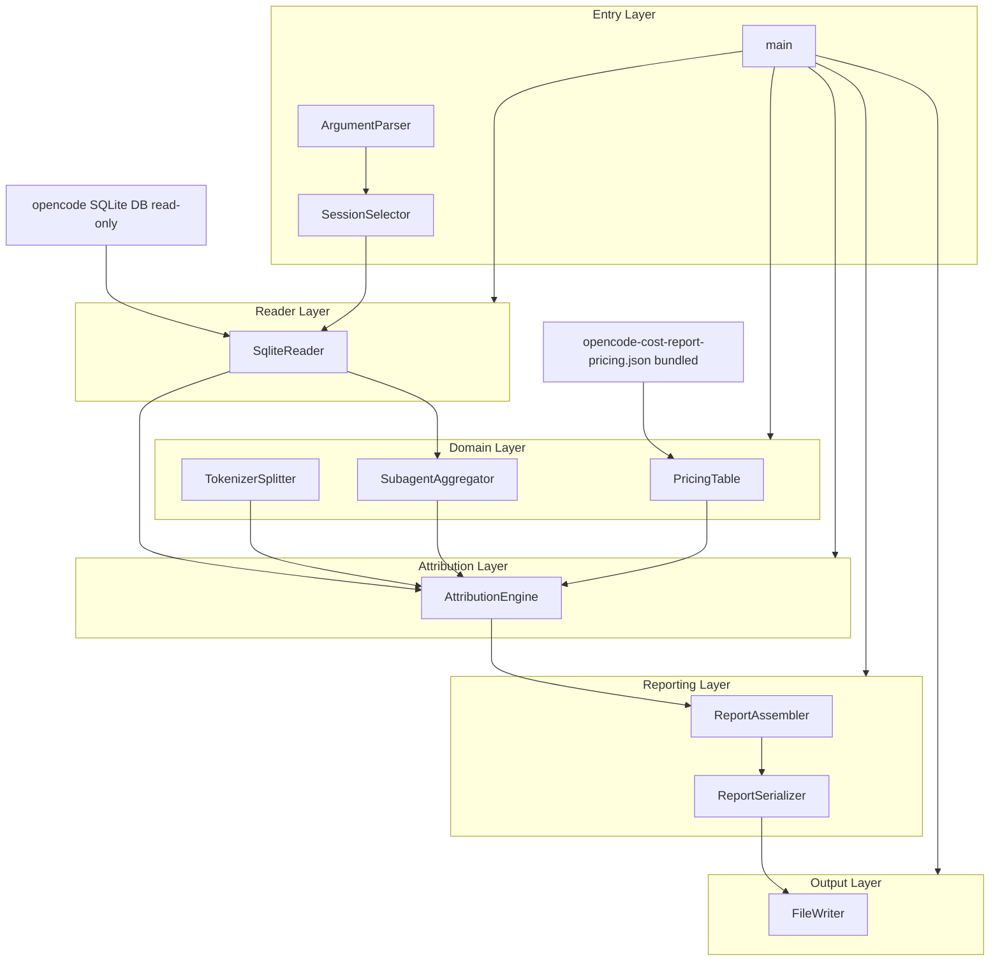
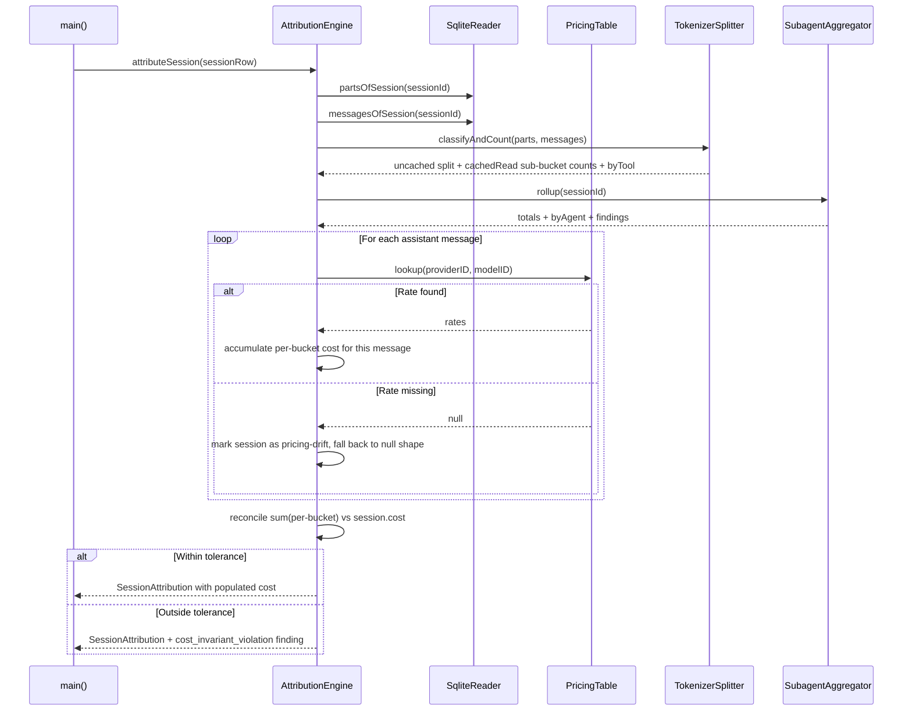
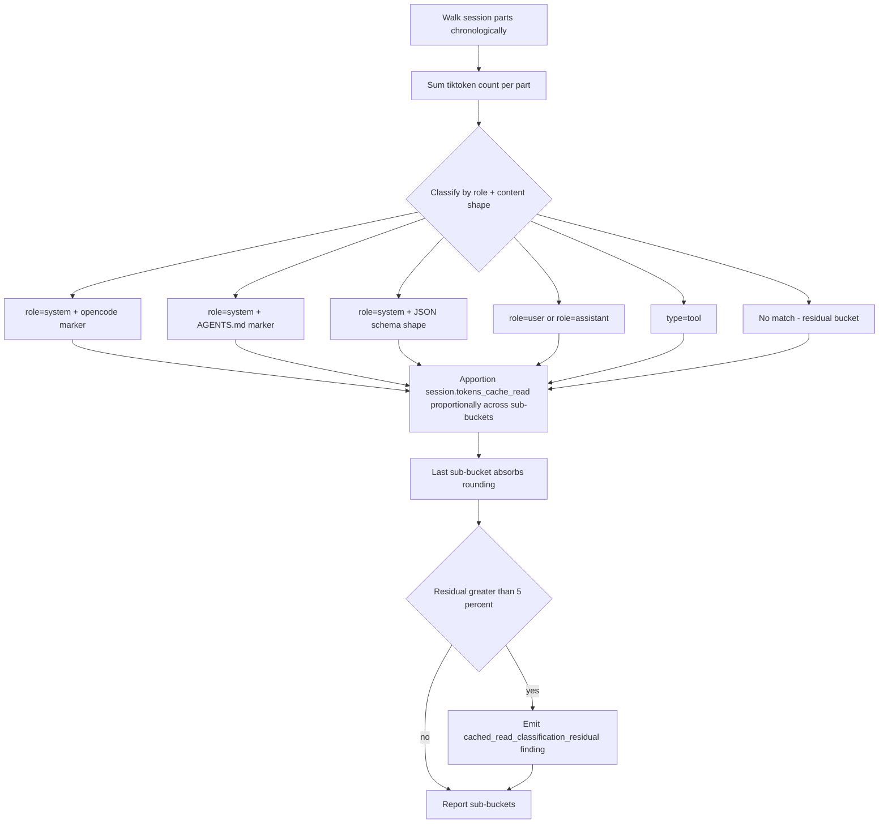

# Technical Design: v2-diagnosis

## Overview

**Purpose**: v2-diagnosis is the next iteration of the `opencode-cost-diagnosis` CLI. It populates per-bucket dollar attribution for every input-token bucket v1 already reports (closing v1's `per_bucket_cost_deferred` deferral), and it decomposes three previously-monolithic buckets — `cachedRead`, `subagentDispatch`, and `toolOutputs` — into named sub-buckets that match the cost-driver categories the deferred specs in `.kiro/steering/roadmap.md` need to evaluate their triggers.

**Users**: The sole operator of this nix-config across two nix-darwin hosts. v2 is a drop-in replacement for v1: same CLI name (`opencode-cost-report`), same flags, same output location (`$XDG_STATE_HOME/opencode-cost-diagnosis/reports/`), same install pattern. No downstream consumer changes habit or code.

**Impact**: Transforms the diagnostic from a token-volume report to a dollar-attribution report. Every deferred spec trigger in `roadmap.md` (`agents-md-modularization`, `mcp-server-allowlist`, `tool-output-compressor`, `rtk-install`, `subagent-context-budget`) becomes evidence-evaluable rather than hypothesis-grade. The information density of each report increases; the operator runs the same command and reads reports in the same place.

### Goals

- Populate the six existing `cost.*` per-bucket fields with non-null dollar values and add three additional uncached cost sub-bucket fields so the cost shape mirrors the token shape.
- Decompose `cachedRead` into five named content sub-buckets (system prompt, AGENTS.md, MCP tool schemas, accumulated history, accumulated tool outputs) plus a named residual.
- Decompose `subagentDispatch` per agent type and `toolOutputs` per tool name, with the per-tool decomposition splitting cached vs uncached portions.
- Ship a pinned pricing dataset bundled with the binary, with operator-visible pin metadata in every report.
- Preserve every v1 invariant verbatim: read-only DB access, byte-identical JSON determinism, default-exclude privacy posture, file-permission posture, schema-drift loud-failure, host parity, declarative install, all v1 finding codes (including `per_bucket_cost_deferred`, whose kind code is preserved verbatim per R7.AC4 with its detail string rewritten to reflect v2's populated state).

### Non-Goals

- Cost-reduction interventions of any kind. v2 remains a diagnostic, not an optimizer.
- Multi-currency, contract pricing, discounts, prepaid-credit accounting (list-price USD only).
- Auto-fetching pricing from any remote source at report-run time (manual operator refresh of the bundled JSON only).
- Coexistence of v1 and v2 on PATH (R1.AC3 forbids it).
- Modifications to opencode itself or to opencode's session DB schema.
- The optional live-logger plugin (deferred from v1, remains deferred).
- Cross-host data merge, real-time dashboards, comparison/diff between report runs, Helicone/Langfuse forwarding, anomaly detection.

## Boundary Commitments

### This Spec Owns

- The `opencode-cost-report` CLI binary on both nix-darwin hosts, replacing v1 in place.
- All extensions to `scripts/opencode-cost-report.js` that populate per-bucket cost, decompose `cachedRead`, `subagentDispatch`, and `toolOutputs`, and emit the new finding codes.
- The bundled pricing JSON asset (`scripts/opencode-cost-report-pricing.json`) and its pin metadata.
- The `PricingTable` class that loads, queries, and surfaces drift on the pricing asset.
- The cost-reconciliation tolerance constant and the `cost_invariant_violation` finding shape.
- The cachedRead content-shape classifier heuristic, its residual handling, and the `cached_read_classification_residual` finding.
- The Markdown and JSON serializer extensions for new sub-bucket sections, the pricing-pin disclaimer block, and the new findings.
- The refresh of integration-test golden files to reflect v2 output and the new unit tests covering v2 logic.
- The rewritten detail message on the preserved `per_bucket_cost_deferred` finding (the finding code is retained per R7.AC4; only the human-readable detail string changes to reflect that v2 has populated per-bucket cost).

### Out of Boundary

- opencode's session database schema and the data it writes (read-only consumer only).
- The opencode session-prompt assembly code (v2 reads the resulting cached content; it does not modify how opencode produces it).
- Anthropic / OpenAI / model-vendor pricing pages directly (v2 vendors a `models.dev` snapshot at pin time; models.dev is the proxy).
- Multi-host data merge (each host produces its own report).
- The optional live-logger plugin (still deferred).
- Anthropic Admin Cost Report API integration (still deferred).
- Helicone, Langfuse, or any SaaS forwarding.
- Comparison/diff between report runs.
- Per-model breakdown beyond what the pricing key naturally provides.
- Evaluating or recommending which deferred specs in `roadmap.md` should ship next; v2 produces the evidence, follow-on specs interpret it.

### Allowed Dependencies

- `${XDG_DATA_HOME}/opencode/opencode-stable.db` — opencode's session DB, read-only access only, schema-pinned via `SUPPORTED_VERSION_RANGE` and `SUPPORTED_MIGRATION_SET`.
- `better-sqlite3@12.10.0` and `tiktoken@^1.0.22` already vendored at `overlays/opencode-cost-diagnosis-deps/` — no new npm dependencies.
- Node's built-in `fs`, `path`, `process` for I/O.
- The bundled pricing JSON asset, snapshotted from `https://models.dev/api.json` at pin time. License: MIT. Justification: models.dev is the catalog opencode itself uses internally for cost computation, so reconciliation tolerance is tight by construction.
- The existing `programs.opencode-cost-diagnosis.package` HM-option for PATH wiring (opaque to v2's internal structure; no change required).
- The existing `tests/opencode-cost-diagnosis/integration/_helpers.js` golden-file machinery and `UPDATE_GOLDEN=1` mechanic.

### Revalidation Triggers

The following changes would force the downstream consumers in `roadmap.md` and any future automation parsing v2's output to re-check their integration:

- Any rename or shape change to existing v1 JSON fields (R7.AC1 violation).
- A break to byte-identical JSON determinism (R7.AC2 violation), including any new wall-clock-tagged field added to JSON output.
- The removal or rename of any v1 finding code. (The rewrite of `per_bucket_cost_deferred`'s detail string is NOT a revalidation trigger because the kind code shape is preserved verbatim — JSON readers see the same key.)
- A change to the cachedRead sub-bucket names, the per-agent rollup map key shape, or the per-tool decomposition shape.
- A change to the pricing JSON's top-level schema (the bundled asset shape).
- A change to the cost-reconciliation tolerance default (`max(0.1%, $0.01)` per session).
- A schema drift on opencode's session DB outside the pinned `SUPPORTED_VERSION_RANGE`.

## Architecture

### Existing Architecture Analysis

v2 extends v1's single-file Node CLI architecture in place. The brief mandates this explicitly; the gap analysis in `research.md` confirms every v2 requirement maps to an extension point already present in v1's class structure with one new class (`PricingTable`) and one new data asset (`opencode-cost-report-pricing.json`).

v1's relevant invariants:

- **Dependency direction (preserved)**: `SqliteReader` → `SubagentAggregator` and `TokenizerSplitter` → `AttributionEngine` → `ReportAssembler` → `ReportSerializer` → `FileWriter`. Each class is constructed with its upstream collaborators injected; no upward imports. v2 preserves this direction and inserts `PricingTable` between the schema-pinned reader layer and the cost-computing AttributionEngine.
- **Single-file class graph**: All 11 v1 classes live in `scripts/opencode-cost-report.js`. v1's design.md explicitly chose single-file for Node ergonomics; v2 keeps that decision (Open Question 6 in `research.md`). New classes are appended; new shared constants slot into the existing constants section near the end of the file.
- **Alphabetical JSON serialization for byte-identical determinism** (`ReportSerializer.formatJson` replacer at `scripts/opencode-cost-report.js:1785-1802`): new fields slot into alphabetical position automatically.
- **Findings shape** `{ kind, detail }` at producer; `ReportAssembler` tags with `sessionId` during global assembly. v2 follows this shape verbatim.
- **Schema pin** (`SUPPORTED_VERSION_RANGE`, `SUPPORTED_MIGRATION_SET` at lines 64, 78): v2 does not change opencode-DB schema dependencies; the pin stays as-is.
- **`generatedAt` only in Markdown output, never in JSON** (lines 1731, 1862): this asymmetry is load-bearing for byte-identical JSON determinism. v2 preserves it; the pricing-pin metadata is added to JSON because `pinDate` is a deterministic constant per-pin, not a wall-clock value.

### Architecture Pattern & Boundary Map



**Architecture integration**:

- **Selected pattern**: Layered architecture with strict downward dependency direction. New `PricingTable` slots into the Domain layer next to `TokenizerSplitter` and `SubagentAggregator`. `AttributionEngine` gains a third collaborator constructor parameter (`pricingTable`) without changing its position in the graph.
- **Domain boundaries**: Reader layer owns SQL access and schema-drift detection. Domain layer owns content classification, subagent rollup, and pricing lookup. Attribution layer owns per-bucket cost compute and reconciliation. Reporting layer owns aggregation and serialization. Output layer owns I/O and pruning. Entry layer owns CLI parsing and orchestration.
- **Existing patterns preserved**: Constructor-injected collaborators; lazy initialization of expensive resources (`TokenizerSplitter._ensureEncoding`); findings as `{ kind, detail }` records flowing upward through `AttributionEngine` and `ReportAssembler`; `Object.freeze` on shared constants; module-level `module.exports` for unit-test access.
- **New components rationale**: `PricingTable` exists because pricing lookup is a distinct responsibility with its own drift-detection semantics that does not belong in either the reader (which is schema-pinned to opencode) or the AttributionEngine (which would otherwise mix two unrelated drift surfaces).
- **Steering compliance**: macOS-first, declarative install (Nix overlay + HM module), no GPL deps, no SaaS dependency, no schema modifications to opencode. All v1 invariants from `.kiro/specs/opencode-cost-diagnosis/` carry forward unchanged.

### Technology Stack

| Layer | Choice / Version | Role in Feature | Notes |
|-------|------------------|-----------------|-------|
| CLI / Entry | Node.js (Nix-provided, host's `nodejs` derivation) | Same Node runtime as v1; no version change | `writeShellApplication` wrapper at `scripts/opencode-cost-report.nix` unchanged |
| Data / Reader | `better-sqlite3@12.10.0` | Read-only access to opencode session DB | Already vendored at `overlays/opencode-cost-diagnosis-deps/`; no new pin |
| Tokenization | `tiktoken@^1.0.22` (encoding `cl100k_base`) | Used for cachedRead content classification and uncached split (unchanged from v1) | "Relative-only" accuracy class disclaimer continues to apply to all tiktoken-derived sub-bucket fields |
| Pricing | Bundled JSON asset (snapshot of `https://models.dev/api.json`) | Per-`(providerID, modelID)` rate lookup | No runtime fetch; operator-initiated refresh |
| Infrastructure / Runtime | Nix overlay + Home Manager module | Declarative install on both nix-darwin hosts | `home-manager/common/opencode-cost-diagnosis.nix` unchanged; HM module surfaces the v2 derivation through the same `programs.opencode-cost-diagnosis.package` read-only option |

No new npm dependencies. No new build tooling. The pricing JSON is a plain data asset added to the Nix derivation alongside the existing JS script.

### Dependency Direction

Imports flow strictly downward through the layers shown above. Specifically:

- Reader → no other v2 components (only `better-sqlite3` and Node built-ins).
- Domain → Reader (only `PricingTable` and `SubagentAggregator` use Reader; `TokenizerSplitter` is stateless w.r.t. SQL).
- Attribution → Reader + Domain.
- Reporting → Attribution.
- Output → Reporting.
- Entry → all of the above (orchestration only).

Violations of this direction (e.g., `TokenizerSplitter` importing `AttributionEngine`) should be treated as design errors during review.

## File Structure Plan

### Directory Structure

```
scripts/
├── opencode-cost-report.js              # Single-file Node CLI (v1 + v2 extensions)
├── opencode-cost-report.nix             # writeShellApplication wrapper (adds pricing JSON to runtime)
└── opencode-cost-report-pricing.json    # NEW: pinned pricing snapshot from models.dev

overlays/
└── opencode-cost-diagnosis-deps/        # No change
    ├── package.json                     # No change (no new npm deps)
    └── package-lock.json                # No change

home-manager/common/
└── opencode-cost-diagnosis.nix          # No change (HM module is opaque to v2's internals)

tests/opencode-cost-diagnosis/
├── unit/
│   ├── aggregator.test.js               # MODIFY: add per-agent rollup tests
│   ├── attribution.test.js              # MODIFY: add per-bucket cost + reconciliation tests
│   ├── tokenizer.test.js                # MODIFY: add per-tool dimension tests
│   ├── report-assembler.test.js         # MODIFY: add aggregation tests for new sub-buckets
│   ├── serializer.test.js               # MODIFY: add pricing-pin disclaimer tests
│   ├── pricing-table.test.js            # NEW: PricingTable lookup, drift, pin metadata
│   └── tokenizer-cached-read.test.js    # NEW: cachedRead content-shape classifier
└── integration/
    ├── cli-integration.test.js          # MODIFY: cover new finding codes, new sections
    ├── cost-invariant.test.js           # NEW: reconciliation tolerance behavior
    ├── pricing-drift.test.js            # NEW: unknown model fallback to v1 null shape
    └── golden/
        ├── fixture-365d-all.{md,json}   # MODIFY: refresh via UPDATE_GOLDEN=1
        └── fixture-365d-all-v1.{md,json} # NEW: retained v1 goldens for migration PR review
```

### Modified Files

| File | Change | Component (see Components section) |
|------|--------|-----------------------------------|
| `scripts/opencode-cost-report.js` | Single-file extension in place. New `PricingTable` class. New module-level helper `makeNullCostShape()` producing the v2 all-null drift fallback (six v1 fields + three new uncached sub-buckets + `cachedReadBreakdown.*` + `subagentDispatchByAgent` + `toolOutputsByTool` all null; `cost.total` preserved). New constants for cost-key extensions, cachedRead sub-bucket key set, tolerance, residual bucket labels, content-shape classifier markers, and the `markersDegraded` provenance flag. Extend `TokenizerSplitter.classifyAndCount` to also emit `byTool`, `cachedReadBreakdown` counts, and the `markersDegraded` signal. Extend `SubagentAggregator.rollup` to emit `byAgent` map and `nullAgentDescendantIds` list. Wire `PricingTable` into `AttributionEngine` constructor. Replace `makeZeroCostBuckets` with per-bucket cost compute path (which delegates to `makeNullCostShape` on drift). Add new finding emit sites in `AttributionEngine`: `cost_invariant_violation`, `pricing_table_drift`, `cached_read_classification_residual`, `cached_read_classifier_degraded`, `subagent_agent_attribution_drift`. The `subagent_agent_attribution_drift` site reads messages of each `nullAgentDescendantIds` entry via `SqliteReader.messagesOfSession` to satisfy R5.4 without violating the SubagentAggregator's no-message-reads architectural constraint. Rewrite the detail string template at the existing `per_bucket_cost_deferred` emit site (lines 1032-1041); do not remove the emit site (R7.AC4). Extend `ReportAssembler` aggregation loops for the new sub-buckets. Extend `ReportSerializer` Markdown + JSON sections. Estimated growth: ~600-1000 LOC; file grows from 2,665 to ~3,500. | All extended components |
| `scripts/opencode-cost-report.nix` | Add `opencode-cost-report-pricing.json` as a build input alongside the existing JS path interpolation; pass its store path into the wrapper script as an environment variable consumed by `PricingTable`. | `PricingTable` runtime wiring |
| `tests/opencode-cost-diagnosis/unit/*.test.js` | Extend existing test files for the classes that gain new behavior. | Test coverage |
| `tests/opencode-cost-diagnosis/integration/cli-integration.test.js` | Add cases that exercise the new finding codes, the new disclaimer block, and the new sub-bucket sections. | Test coverage |
| `tests/opencode-cost-diagnosis/integration/golden/fixture-365d-all.{md,json}` | Refresh via `UPDATE_GOLDEN=1` after v2 implementation is complete. | Golden refresh |

### Created Files

| File | Purpose | Component |
|------|---------|-----------|
| `scripts/opencode-cost-report-pricing.json` | Snapshot of `https://models.dev/api.json` filtered to the models v2 supports. Includes top-level `pinDate`, `pinSource`, and per-model rate fields aligned to v1's bucket shape (`cost.input`, `cost.output`, `cost.reasoning`, `cost.cache_read`, `cost.cache_write`). | `PricingTable` data |
| `tests/opencode-cost-diagnosis/unit/pricing-table.test.js` | Constructor parses JSON, lookup returns rates for known model, lookup returns null + emits drift signal for unknown model, pin metadata accessors. | `PricingTable` unit coverage |
| `tests/opencode-cost-diagnosis/unit/tokenizer-cached-read.test.js` | Content-shape classifier identifies system-prompt vs AGENTS.md vs MCP schema markers in a synthesized fixture, residual bucket absorbs unclassified content. | cachedRead classifier unit coverage |
| `tests/opencode-cost-diagnosis/integration/cost-invariant.test.js` | Synthesize a session whose per-bucket sum is within tolerance vs outside tolerance; assert the finding fires (or does not) and that the report continues to emit either way. | Reconciliation behavior |
| `tests/opencode-cost-diagnosis/integration/pricing-drift.test.js` | Synthesize a session whose `(providerID, modelID)` is not in the pricing table; assert per-bucket cost fields fall back to null for that session, other sessions retain populated cost, `pricing_table_drift` finding surfaces with the unmatched key. | Drift behavior |
| `tests/opencode-cost-diagnosis/integration/golden/fixture-365d-all-v1.{md,json}` | Snapshot of the v1 goldens preserved for the migration PR so reviewers can diff v1→v2 output side-by-side. Removed in a follow-up commit after merge. | Migration review aid |

Each file in the table above has one clear responsibility. Files that change together (the unit tests per class, the integration scenarios per behavior) are grouped under their respective subdirectories.

## System Flows

### Per-bucket cost attribution (per session)



**Key flow decisions**:

- Pricing lookup is per-assistant-message (not per-session) so multi-model sessions reconcile accurately. The session-level `session.cost` is the sum of per-message `message.cost` in opencode's own accounting; v2 matches that pattern.
- Drift handling is per-session, not per-message: any unrecognized model in any message within a session causes the entire session's per-bucket cost fields to fall back to v1's null shape. This preserves R7.AC5's null-to-value contract exactly: a v1 reader sees the same null shape it saw before, just for a different reason.
- The reconciliation check runs after per-message accumulation completes; the finding is informational and never blocks report emission (R2.AC4).

### cachedRead content-shape classification



**Key flow decisions**:

- Classification keys off two attributes: the part's role (extracted from `messages` map, keyed by `message_id`) and a content-shape marker check against the part's text body.
- The content-shape markers are heuristic; the verification of opencode's exact prompt-assembly site is an implementation-time research item (see Open Decisions below). The residual bucket plus the `cached_read_classification_residual` finding form the safety net: an opencode upstream change that breaks marker detection surfaces as a large residual rather than silently misclassifying.
- Proportional allocation mirrors v1's Flow 2 pattern at `scripts/opencode-cost-report.js:929-981` for the uncached split. Same arithmetic; same accuracy class; same last-bucket-absorbs-rounding rule.

## Requirements Traceability

| Req | Summary | Components | Interfaces | Flows |
|-----|---------|------------|------------|-------|
| 1.1 | Same CLI entry-point name on PATH | `ArgumentParser`, `main`, `opencode-cost-report.nix` | `writeShellApplication { name = "opencode-cost-report"; }` unchanged | n/a |
| 1.2 | Same flag interpretation | `ArgumentParser` | `VALUE_FLAGS` and `BOOLEAN_FLAGS` sets unchanged; new flags additive only | n/a |
| 1.3 | Replace v1 on PATH (no coexistence) | `opencode-cost-report.nix`, `opencode-cost-diagnosis.nix` (HM) | `programs.opencode-cost-diagnosis.package` resolves to v2 derivation | n/a |
| 1.4 | Same default output location and per-format pruning | `FileWriter` (unchanged) | `_resolveStateDir`, `_prune` retain v1 behavior | n/a |
| 1.5 | All v1 invariants preserved | `SqliteReader`, `ReportSerializer`, `FileWriter`, schema-pin constants | `SUPPORTED_VERSION_RANGE`, `SUPPORTED_MIGRATION_SET`, alphabetical JSON replacer, 0600 file mode | n/a |
| 2.1 | Non-null dollar value for every bucket | `AttributionEngine`, `PricingTable` | `CostBuckets` extended shape (see Data Models) | Per-bucket cost attribution flow |
| 2.2 | Per-project and global dollar aggregation | `ReportAssembler` | Aggregation loops at `scripts/opencode-cost-report.js:1582-1633` extended to drive on extended `PER_BUCKET_COST_KEYS` | n/a |
| 2.3 | Reconciliation against `session.cost` | `AttributionEngine` | `reconcile(perBucketSum, sessionCost, tolerance)` helper | Per-bucket cost attribution flow |
| 2.4 | `cost_invariant_violation` finding on divergence | `AttributionEngine` | New finding emit site; never blocks emission | Per-bucket cost attribution flow |
| 2.5 | Sub-bucket dollar inheritance from parent | `AttributionEngine` | `subBucket.cost = subBucket.tokens × parentRate` | Per-bucket cost attribution flow |
| 3.1 | Pricing data bundled at install, no remote fetch | `PricingTable`, `opencode-cost-report-pricing.json`, `opencode-cost-report.nix` | Nix derivation includes the JSON; `PricingTable` constructor loads from injected path | n/a |
| 3.2 | Pricing keyed by per-message `(providerID, modelID)` | `PricingTable`, `AttributionEngine` | `PricingTable.lookup(providerID, modelID)` | Per-bucket cost attribution flow |
| 3.3 | Pin date and source visible in MD + JSON | `PricingTable`, `ReportAssembler`, `ReportSerializer` | Pin metadata added to `DiagnosticReport.pricing` and rendered in Markdown disclaimer | n/a |
| 3.4 | `pricing_table_drift` finding + null fallback | `AttributionEngine`, `PricingTable` | New finding emit site; session falls back to v1's null cost shape | Per-bucket cost attribution flow |
| 3.5 | Refresh reflects new rates next run | `opencode-cost-report.nix`, build pipeline | Edit JSON + rebuild derivation; no other reconfiguration | n/a |
| 4.1 | cachedRead decomposed into named sub-buckets | `TokenizerSplitter`, `AttributionEngine` | Extended classifier output `cachedReadBreakdown` field. Strategy A path: all 5 markers fire, sub-buckets populated by content-shape classification. Degraded path (when markers unreliable per Decision 6): all 5 sub-buckets remain present, `agentsMdCached` and `mcpToolSchemasCached` are 0, the other three sub-buckets carry the proportional-from-uncached split, and `cached_read_classifier_degraded` finding fires. Both paths satisfy R4.AC1's "at minimum five named sub-buckets" requirement. | cachedRead classification flow |
| 4.2 | Sum-correctness for cachedRead sub-buckets | `AttributionEngine` | Last sub-bucket absorbs rounding (same pattern as v1 Flow 2) | cachedRead classification flow |
| 4.3 | Aggregation at session / project / global | `ReportAssembler` | Aggregation loops extended to carry `cachedReadBreakdown` | n/a |
| 4.4 | Disclaimer extension naming cachedRead sub-buckets | `ReportAssembler` (disclaimer object), `ReportSerializer` (Markdown rendering) | Extended `TOKENIZER_AFFECTED_BUCKETS` + new disclaimer line | n/a |
| 4.5 | Classification residual + finding | `TokenizerSplitter`, `AttributionEngine` | Residual sub-bucket label + `cached_read_classification_residual` finding | cachedRead classification flow |
| 5.1 | subagentDispatch decomposed per agent type | `SubagentAggregator` | Extended `rollup` return shape with `byAgent` map | n/a |
| 5.2 | Sum-correctness for per-agent sub-buckets | `SubagentAggregator` | Last agent bucket absorbs rounding | n/a |
| 5.3 | Aggregation at session / project / global | `ReportAssembler` | Aggregation loops carry `byAgent` map; merge by agent key with rolling sum | n/a |
| 5.4 | Named residuals for missing agent / low-volume | `SubagentAggregator` (residual labels + `nullAgentDescendantIds`), `AttributionEngine` (drift finding emit) | `SubagentAggregator.rollup` returns two distinct residual keys (`(unattributed-no-agent-column)`, `(below-threshold-fold)`) AND a `nullAgentDescendantIds: ReadonlyArray<string>` list. `AttributionEngine` consumes that list, queries the messages of each null-agent descendant via `SqliteReader.messagesOfSession`, and emits `subagent_agent_attribution_drift` for any descendant whose messages carry a non-null `message.data.agent`. Architectural strictness preserved: `SubagentAggregator` never reads messages. | n/a |
| 6.1 | toolOutputs decomposed per tool name | `TokenizerSplitter` | New `byTool` field on classifier output keyed by `part.data.name` | n/a |
| 6.2 | Cached vs uncached portion split per tool | `TokenizerSplitter`, `AttributionEngine` | Per-tool sub-bucket shape `{ cached: number, uncached: number }` | n/a |
| 6.3 | Sum-correctness for per-tool sub-buckets | `AttributionEngine` | Last tool bucket absorbs rounding within each of cached and uncached partitions | n/a |
| 6.4 | Aggregation at session / project / global | `ReportAssembler` | Aggregation loops carry `byTool` map | n/a |
| 6.5 | Low-volume tool fold residual + threshold disclosure | `TokenizerSplitter`, `ReportSerializer` | `(below-threshold-fold)` residual; threshold value rendered in the disclaimer | n/a |
| 7.1 | Additive JSON schema (no renames, no shape changes) | `ReportAssembler`, `ReportSerializer` | All v1 keys retained at their existing position; new keys slot alphabetically | n/a |
| 7.2 | Byte-identical JSON determinism | `ReportSerializer` | Custom alphabetical-replacer at `scripts/opencode-cost-report.js:1785-1802` unchanged; new fields obey it automatically | n/a |
| 7.3 | v1 sum-correctness invariants preserved verbatim | `AttributionEngine` | Existing uncached split invariant at `scripts/opencode-cost-report.js:1012-1024` unchanged | n/a |
| 7.4 | All v1 finding codes preserved | `AttributionEngine`, `SubagentAggregator`, `ReportAssembler` | All v1 finding codes preserved verbatim: `unclassifiable_input`, `schema_partial_data`, `caching_not_enabled`, AND `per_bucket_cost_deferred`. v2 continues to emit `per_bucket_cost_deferred` per session for R7.AC4 compliance, but rewrites its detail message to reflect that per-bucket cost is now populated. The kind code stays identical; JSON readers see the same key. See "Open Decisions" below for the wording. | n/a |
| 7.5 | Null-to-value transition for v1 cost fields | `AttributionEngine`, `ReportAssembler` | `PER_BUCKET_COST_KEYS` constant's same six v1 keys flip from null to number; field names, types (after the transition), and alphabetical positions unchanged | n/a |

## Components and Interfaces

### Summary

| Component | Domain / Layer | Intent | Req Coverage | Key Dependencies (P0/P1) | Contracts |
|-----------|----------------|--------|--------------|--------------------------|-----------|
| `PricingTable` | Domain (new) | Load bundled pricing JSON, look up rates by `(providerID, modelID)`, expose pin metadata, surface drift on unknown keys | 3.1, 3.2, 3.3, 3.4 | `opencode-cost-report-pricing.json` (P0, External) | Service, State |
| `TokenizerSplitter` (extended) | Domain | Classify parts into existing uncached sub-buckets AND new cachedRead sub-buckets AND new per-tool dimension | 4.1, 4.5, 6.1, 6.5 | `tiktoken` (P0, External), `SqliteReader` part rows (P0, Inbound shape) | Service |
| `SubagentAggregator` (extended) | Domain | Roll up descendant sessions AND emit per-agent-type breakdown with residual labels | 5.1, 5.2, 5.4 | `SqliteReader` (P0, Inbound) | Service |
| `AttributionEngine` (extended) | Attribution | Compute per-message per-bucket cost via `PricingTable`, accumulate into session totals, reconcile against `session.cost`, emit new findings (including `subagent_agent_attribution_drift` for null-agent descendants flagged by `SubagentAggregator`), rewrite the `per_bucket_cost_deferred` detail string (kind code preserved per R7.AC4) | 2.1, 2.3, 2.4, 2.5, 3.4, 4.2, 5.4, 6.2, 6.3, 7.5 | `PricingTable` (P0, Outbound), `TokenizerSplitter` (P0, Outbound), `SubagentAggregator` (P0, Outbound), `SqliteReader` (P0, Outbound) | Service |
| `ReportAssembler` (extended) | Reporting | Aggregate per-session attributions into per-project and global totals for all v1 buckets AND new sub-buckets | 2.2, 4.3, 5.3, 6.4, 7.1, 7.3 | `AttributionEngine` output (P0, Inbound) | Service, State |
| `ReportSerializer` (extended) | Reporting | Render Markdown + JSON with the new sub-bucket sections, new disclaimer blocks (cachedRead + pricing pin), new findings | 3.3, 4.4, 6.5, 7.1, 7.2 | `ReportAssembler` output (P0, Inbound) | Service |
| `SqliteReader` (unchanged) | Reader | Read-only access to opencode session DB; schema-pin enforcement | 1.5 | `better-sqlite3` (P0, External), opencode DB (P0, External) | Service |
| `FileWriter` (unchanged) | Output | Write reports to `$XDG_STATE_HOME/opencode-cost-diagnosis/reports/`; per-format pruning; 0600 mode | 1.4, 1.5 | Node `fs` (P0, External) | Service |
| `ArgumentParser`, `SessionSelector` (unchanged) | Entry | Parse CLI flags, select sessions per flag interpretation | 1.1, 1.2 | argv (P0, External) | Service |

Components introducing new boundaries (`PricingTable`, the extended `TokenizerSplitter`, the extended `AttributionEngine`) get full detail blocks below. Components that gain only mechanical aggregation extensions (`ReportAssembler`, `ReportSerializer`) get summary blocks. Unchanged components (`SqliteReader`, `FileWriter`, `ArgumentParser`, `SessionSelector`, `SchemaDriftError`, `FileWriterError`, `main`, `printHelp`, `printSupportedVersion`, `printOperatorSummary`, `mapErrorToExitCode`, `writeStderrTrailer`, `resolveOpencodeDbPath`) are listed in the summary table and require no further design detail.

### Domain Layer

#### PricingTable

| Field | Detail |
|-------|--------|
| Intent | Load the bundled pricing JSON, expose pin metadata, look up per-million rates by `(providerID, modelID)`, surface drift when a key is unrecognized |
| Requirements | 3.1, 3.2, 3.3, 3.4 |

**Responsibilities & Constraints**

- Constructor accepts a path to the bundled JSON file (resolved from an environment variable set by the Nix wrapper). Reads and parses it once at construction time. Throws if the file is missing or unparseable (loud failure mirrors v1's schema-drift posture).
- Holds the parsed pricing data plus the top-level pin metadata (`pinDate`, `pinSource`) as immutable state for the process lifetime.
- `lookup(providerID, modelID)` returns rates or `null`. No partial matches, no fuzzy matching, no fallback to a default model — drift is loud by design.
- Stateless across calls beyond the load-once cache. Safe for concurrent invocation within a single process (it never is invoked concurrently in this CLI, but the discipline is preserved).

**Dependencies**

- Inbound: `AttributionEngine` (P0) — consumes `lookup` results during per-message cost computation.
- External: `opencode-cost-report-pricing.json` (P0) — the bundled data asset.

The pricing JSON's authoritative schema is the upstream `models.dev` TOML schema (snapshotted at pin time). v2 only consumes the cost-relevant fields (`cost.input`, `cost.output`, `cost.reasoning`, `cost.cache_read`, `cost.cache_write`); any other models.dev fields are ignored. The variant dimension (`default`, `max`, `xhigh`) is intentionally **not** consumed in v2 — variant-blind lookup is the documented v2 simplification (see Open Decisions). See `research.md` Evidence D for the upstream schema reference.

**Contracts**: Service [x] / API [ ] / Event [ ] / Batch [ ] / State [x]

##### Service Interface

```typescript
interface Rates {
  readonly inputPerM: number;
  readonly outputPerM: number;
  readonly reasoningPerM: number;
  readonly cacheReadPerM: number;
  readonly cacheWritePerM: number;
}

interface PinMetadata {
  readonly pinDate: string;        // ISO 8601 date, e.g. "2026-05-18"
  readonly pinSource: string;      // e.g. "https://models.dev/api.json"
  readonly pinVersion?: string;    // optional upstream version tag if present
}

class PricingTable {
  constructor(pricingJsonPath: string);

  lookup(providerID: string, modelID: string): Rates | null;
  readonly pinMetadata: PinMetadata;
  readonly knownModels: ReadonlyArray<{ providerID: string; modelID: string }>;
}
```

- Preconditions: `pricingJsonPath` must be a readable file containing JSON that parses successfully and contains the expected top-level keys (`pinDate`, `pinSource`, `models`).
- Postconditions: `lookup` returns the same `Rates` object reference on repeated calls with the same key (cache by Map).
- Invariants: Once constructed, `pinMetadata` and `knownModels` are immutable.

##### State Management

- State model: load-once at construction; immutable thereafter.
- Persistence & consistency: read-only consumer of the bundled file; never writes.
- Concurrency strategy: single-process CLI, no concurrency concerns.

**Implementation Notes**

- Integration: `AttributionEngine` constructor gains a third parameter `pricingTable: PricingTable`. The Nix wrapper sets `OPENCODE_COST_PRICING_PATH` to the store path of the JSON asset; `main()` reads the env var and passes the path into the `PricingTable` constructor.
- Validation: Constructor validates the top-level shape (`pinDate`, `pinSource`, `models`) and throws a clear error if missing. Per-model entries are validated lazily on `lookup`.
- Risks: Pricing-pin freshness drift is operator-visible via the disclaimer block and the pin date; no automatic staleness check in v2 (deliberate — auto-refresh is out of scope per the requirements).

#### TokenizerSplitter (extended)

| Field | Detail |
|-------|--------|
| Intent | Classify parts for uncached sub-buckets AND cachedRead sub-buckets AND per-tool dimension, all in one pass |
| Requirements | 4.1, 4.5, 6.1, 6.5 |

**Responsibilities & Constraints**

- Existing v1 method `classifyAndCount(parts, messages)` continues to return `{ systemPrompt, history, toolOutput, unclassifiedCount }` for the uncached split.
- New v2 fields added to the same return object: `cachedReadBreakdown` (the five named sub-buckets plus the residual) and `byTool` (per-tool name token counts, with `{ cached, uncached }` partition).
- Sum invariant for cachedRead sub-buckets is enforced at the AttributionEngine layer where the apportioning happens (see below); this class only produces raw tiktoken counts per classification.
- Reuses the lazy `_ensureEncoding` pattern at `scripts/opencode-cost-report.js:672-685` verbatim. No new encoder instances; no new tiktoken dependency.

**Dependencies**

- Inbound: `AttributionEngine` (P0) — consumes the extended classifier output.
- External: `tiktoken@^1.0.22` (P0) — unchanged from v1.

##### Service Interface

```typescript
interface TokenizerProvenance {
  // v1 fields (unchanged)
  systemPrompt: number;
  history: number;
  toolOutput: number;          // singular, per v1 naming
  unclassifiedCount: number;

  // v2 additions
  cachedReadBreakdown: {
    systemPromptCached: number;
    agentsMdCached: number;
    mcpToolSchemasCached: number;
    accumulatedHistoryCached: number;
    accumulatedToolOutputsCached: number;
    unclassifiedCached: number;
  };
  byTool: ReadonlyMap<string, { cached: number; uncached: number }>;
}

class TokenizerSplitter {
  classifyAndCount(
    parts: Iterable<PartRow>,
    messages: ReadonlyMap<string, MessageRow>,
  ): TokenizerProvenance;
}
```

- Preconditions: `parts` is iterable (typically a `StatementIterator` from `SqliteReader.partsOfSession`); `messages` is keyed by `message.id`.
- Postconditions: All v2 sub-bucket fields are non-negative integers. `byTool` keys are the literal tool names extracted from `part.data.name` (no normalization, no grouping by MCP server).
- Invariants: `sum(byTool[*].cached + byTool[*].uncached) === toolOutput` (the v1 plural-spelled total) AT THE AGGREGATION LAYER, not within this class. This class is responsible only for emitting the raw per-tool counts; the AttributionEngine reconciles toolOutput totals against the per-tool sums.

**Implementation Notes**

- Integration: The classifier's main loop walks `parts` once. The new logic adds a per-part secondary classification: as each part is counted into one of the existing uncached buckets, the same part is also evaluated for content-shape markers (system / AGENTS.md / MCP schema) for the cached split, and (for tool parts only) bucketed by `part.data.name` for the per-tool dimension.
- Validation: A defensive check ensures `part.data.name` is a string before bucketing; missing or malformed names fold into `(unknown-tool)` and surface as `unclassifiedCount` increments.
- Risks:
  - Content-shape markers for cachedRead classification are heuristic (see Decision 6). The mitigations are layered: (1) the `unclassifiedCached` residual + the `cached_read_classification_residual` finding when the residual exceeds 5% of cachedRead total, and (2) the **degraded fallback path**: if a marker required by Strategy A fails to fire reliably during implementation-time verification or first-run inspection, the classifier sets `markersDegraded: true` on its provenance output and `AttributionEngine` apportions cachedRead across all five named sub-buckets via the proportional-from-uncached split (`agentsMdCached` and `mcpToolSchemasCached` set to 0; the other three carry the systemPrompt:history:toolOutput ratio from the uncached side). The `cached_read_classifier_degraded` finding announces this state. R4.AC1's "at minimum five named sub-buckets" requirement is satisfied on both paths.
  - `part.data.name` field shape is not explicitly schema-pinned in opencode. If opencode changes the field name in a future version, the per-tool dimension silently degrades to `(unknown-tool)`. Implementation should add a one-time defensive assertion that at least one tool part in a test fixture has a non-null `data.name` and surface a startup finding if every fixture row has null.

#### SubagentAggregator (extended)

| Field | Detail |
|-------|--------|
| Intent | Roll up descendant session totals AND group by agent type AND expose the list of null-agent descendant IDs for downstream drift detection |
| Requirements | 5.1, 5.2, 5.4 (partial — drift finding emitted by AttributionEngine) |

**Responsibilities & Constraints**

- Existing v1 method `rollup(rootSessionId)` continues to return `{ totals: { tokensTotal, cost, childCount }, findings }`.
- New v2 fields on the return object:
  - `byAgent: Map<string, { tokensTotal: number; cost: number; childCount: number }>`
  - `nullAgentDescendantIds: ReadonlyArray<string>` — every descendant session whose `session.agent IS NULL`. This is the data hand-off to `AttributionEngine`, which performs the per-message drift check and emits `subagent_agent_attribution_drift`.
- Uses `session.agent` (already on every descendant row via `SELECT *` at `scripts/opencode-cost-report.js:290`) as the bucket key.
- Two residual labels: `(unattributed-no-agent-column)` when `session.agent IS NULL`; `(below-threshold-fold)` for agent types whose `childCount` falls below a configurable threshold (default: 1% of total descendant count, with a floor of 1 child).
- **Architectural constraint (preserved)**: this class only reads `session.*` rows via `SqliteReader.descendantSessionsOf`. It never reads `message.*` rows. The drift finding that requires message-level inspection is owned by `AttributionEngine` (see its block above).

**Dependencies**

- Inbound: `AttributionEngine` (P0)
- Outbound: `SqliteReader` (P0)

##### Service Interface

```typescript
interface SubagentRollup {
  // v1 fields (unchanged)
  totals: { tokensTotal: number; cost: number; childCount: number };
  findings: ReadonlyArray<{ kind: string; detail: string }>;

  // v2 additions
  byAgent: ReadonlyMap<string, { tokensTotal: number; cost: number; childCount: number }>;
  nullAgentDescendantIds: ReadonlyArray<string>;
}

class SubagentAggregator {
  constructor(reader: SqliteReader);
  rollup(rootSessionId: string): SubagentRollup;
}
```

- Preconditions: `rootSessionId` is the ID of a session whose descendants should be aggregated.
- Postconditions: `byAgent` keys include both real agent types from `session.agent` and the two residual labels. `sum(byAgent[*].tokensTotal) === totals.tokensTotal` and `sum(byAgent[*].cost) === totals.cost`. `nullAgentDescendantIds.length === byAgent.get('(unattributed-no-agent-column)')?.childCount ?? 0`.
- Invariants: Cycle detection (v1 line 552) preserved verbatim. **No message-row access.**

**Implementation Notes**

- Integration: AttributionEngine consumes the extended return shape, including the `nullAgentDescendantIds` list, to drive the drift finding emit logic. The existing forward-of-findings path at `scripts/opencode-cost-report.js:925-927` continues to work without change.
- Validation: `nullAgentDescendantIds` is a list of session ID strings; AttributionEngine performs the per-message inspection.
- Risks: The below-threshold-fold threshold is a v2 default that may need tuning. The threshold value is surfaced in the disclaimer block so the operator can interpret what the residual represents.

### Attribution Layer

#### AttributionEngine (extended)

| Field | Detail |
|-------|--------|
| Intent | Per-message per-bucket cost computation, reconciliation against `session.cost`, emit new findings, rewrite the `per_bucket_cost_deferred` detail string while preserving its kind code per R7.AC4 |
| Requirements | 2.1, 2.3, 2.4, 2.5, 3.4, 4.2, 5.4, 6.2, 6.3, 7.5 |

**Responsibilities & Constraints**

- Constructor gains a third parameter: `pricingTable: PricingTable`.
- The existing Flow 2 proportional split for uncached sub-buckets (`scripts/opencode-cost-report.js:929-981`) is preserved verbatim; the v1 sum-correctness invariant at lines 1012-1024 continues to throw on violation.
- New v2 logic: walk message rows in chronological order, parse `message.data` JSON per assistant message to extract `(providerID, modelID)` and per-message token counts, look up rates via `PricingTable`, compute per-bucket cost contributions, accumulate into session-level totals.
- Reconciliation: after per-message accumulation completes, compare `sum(per-bucket-cost)` against `session.cost`. Tolerance: `max(0.1%, $0.01)` per session. Outside tolerance → emit `cost_invariant_violation` finding with session ID, expected (`session.cost`), and actual (per-bucket sum) values. Within tolerance → no finding.
- Drift handling: if `PricingTable.lookup` returns null for any message in a session, mark the entire session as pricing-drift, fall back to the consistent **all-null v2 cost shape** for that session via `makeNullCostShape()` (see helper below), emit a single `pricing_table_drift` finding with the session ID and the unrecognized `(providerID, modelID)` key. Other sessions retain populated cost.
- **`makeNullCostShape()` helper**: a small module-level function producing the v2 all-null fallback shape used on pricing drift. Every cost-bearing field is `null` — the six v1 fields (`cachedRead`, `cachedWrite`, `uncachedInput`, `output`, `reasoning`, `subagentDispatch`), the three new v2 uncached sub-bucket fields (`uncachedSystemPrompt`, `history`, `toolOutputs`), every key in `cachedReadBreakdown`, and the entire `subagentDispatchByAgent` and `toolOutputsByTool` maps. The sole exception is `cost.total`, which continues to carry `session.cost` because that field's authoritative source is independent of pricing drift. The helper guarantees a single source of truth for the fallback shape so the sum-invariants and the R7.AC5 null-to-value contract stay consistent across drift sessions.
- Cost shape extension: emits the extended `CostBuckets` (see Data Models) with the three new uncached cost sub-buckets (`uncachedSystemPrompt`, `history`, `toolOutputs`) added alongside the v1 `uncachedInput` field. v1's `uncachedInput` remains and equals the sum of the three new sub-buckets within rounding (when pricing is matched; on drift, all four are null and the relationship is vacuously satisfied).
- cachedRead sub-bucket cost: the TokenizerProvenance's `cachedReadBreakdown` token counts are apportioned against `session.tokens_cache_read` with the last sub-bucket (`unclassifiedCached`) absorbing rounding (same Flow 2 pattern). Each sub-bucket's cost is then `subBucketTokens × cache_read_rate_per_token`. Emit `cached_read_classification_residual` finding when `unclassifiedCached / session.tokens_cache_read > 0.05`. If the TokenizerProvenance carries the `markersDegraded: true` signal (see Decision 6 for the trigger), the apportionment falls back to the **proportional-from-uncached degraded path**: distribute `session.tokens_cache_read` across the five named sub-buckets in the same ratio the uncached split produced (`systemPrompt : history : toolOutput`), with `agentsMdCached` and `mcpToolSchemasCached` set to 0 and `unclassifiedCached` absorbing rounding. Emit the new `cached_read_classifier_degraded` finding naming the marker(s) that failed to fire and the proportional ratios used. All five named sub-buckets remain present (R4.AC1 satisfied) but two are explicitly zero.
- Per-tool sub-bucket cost: `byTool[name].cached` × `cache_read_rate_per_token` + `byTool[name].uncached` × `input_rate_per_token`. Last per-tool bucket absorbs rounding within each of cached and uncached partitions.
- Per-agent sub-bucket cost: `byAgent[type].cost` from `SubagentAggregator` already incorporates the descendants' authoritative `session.cost`; no recomputation needed at this layer.
- **Per-agent attribution drift detection**: for each descendant session ID in the `nullAgentDescendantIds` list returned by `SubagentAggregator.rollup` (see SubagentAggregator interface below), `AttributionEngine` calls `SqliteReader.messagesOfSession(descendantId)` and inspects each message's parsed `data.agent` field. If any message in a null-agent descendant carries a non-null `message.data.agent`, emit a `subagent_agent_attribution_drift` finding naming the descendant session ID and the modal observed `message.data.agent` value. This is the layered placement of the finding: `SubagentAggregator` stays pure session-row work; `AttributionEngine` already reads messages per session for pricing lookup and absorbs the bounded extra message reads only for the subset of descendants flagged null.
- **`per_bucket_cost_deferred` finding is preserved (R7.AC4) but its detail string is rewritten** in v2. The kind code stays identical so JSON readers continue to see the same key shape. The rewritten body explains that per-bucket cost is now populated and the finding is retained for v1 forward-compatibility. See Open Decisions for the exact wording.

**Dependencies**

- Inbound: `main` (P0)
- Outbound: `SqliteReader` (P0), `TokenizerSplitter` (P0), `SubagentAggregator` (P0), `PricingTable` (P0)

##### Service Interface

```typescript
interface CostBuckets {
  // v1 fields (preserved verbatim)
  total: number;
  cachedRead: number;        // now non-null when pricing matches; was null in v1
  cachedWrite: number;       // now non-null
  uncachedInput: number;     // now non-null; equals sum of three new sub-buckets
  output: number;            // now non-null
  reasoning: number;         // now non-null
  subagentDispatch: number;  // now non-null

  // v2 additions
  uncachedSystemPrompt: number;
  history: number;
  toolOutputs: number;
  cachedReadBreakdown: {
    systemPromptCached: number;
    agentsMdCached: number;
    mcpToolSchemasCached: number;
    accumulatedHistoryCached: number;
    accumulatedToolOutputsCached: number;
    unclassifiedCached: number;
  };
  subagentDispatchByAgent: Readonly<Record<string, number>>;
  toolOutputsByTool: Readonly<Record<string, { cached: number; uncached: number }>>;
}

interface SessionAttribution {
  sessionId: string;
  directory: string;
  agent: string | null;
  model: string;             // the full session.model JSON string, v1-compatible
  timeCreated: number;
  timeUpdated: number;
  tokens: TokenBuckets;      // existing v1 shape + v2 sub-bucket extensions
  cost: CostBuckets;         // v2 extended shape above (or v1 null shape on pricing drift)
  findings: ReadonlyArray<{ kind: string; detail: string }>;
}

class AttributionEngine {
  constructor(
    reader: SqliteReader,
    aggregator: SubagentAggregator,
    tokenizer: TokenizerSplitter,
    pricingTable: PricingTable,  // v2 addition
  );
  attributeSession(sessionRow: SessionRow): SessionAttribution;
}
```

- Preconditions: `sessionRow` carries the columns documented at v1's `AttributionEngine` constructor; `pricingTable` is constructed and ready to serve lookups.
- Postconditions: `cost.total` always equals `session.cost` (the existing v1 invariant) and remains non-null even on drift. When pricing-drift occurs, every other cost field reverts to `null` via `makeNullCostShape()`: the six v1 fields, the three new v2 uncached sub-bucket fields, every key in `cachedReadBreakdown`, and the entire `subagentDispatchByAgent` and `toolOutputsByTool` maps. The all-null fallback shape preserves R7.AC5's null-to-value contract for v1 fields and applies the same null discipline to v2 fields, so drift sessions never carry partial mixed null/zero shapes that could be misread as "this sub-bucket was empty" rather than "this sub-bucket was unknown."
- Invariants: v1's uncached-sum invariant (`uncachedSystemPrompt + history + toolOutputs === tokens_input` in the token shape) continues to throw on violation. v2 adds three new sum invariants (cachedRead sub-buckets, per-agent, per-tool) which emit findings rather than throw, because the new sub-buckets are decompositions with last-bucket-absorbs-rounding rather than mathematical identities. The cost-shape sum invariant `cost.uncachedInput ≈ cost.uncachedSystemPrompt + cost.history + cost.toolOutputs` holds when pricing is matched; on drift, both sides are `null` and the invariant is vacuously satisfied.

**Implementation Notes**

- Integration: `main()` constructs `PricingTable` first, then passes it into the `AttributionEngine` constructor. The constructor signature change is a breaking change for any external consumer of the v1 class graph, but `module.exports` exposes the classes for tests only; no external production consumer exists.
- Validation: Reconciliation tolerance default `max(0.1%, $0.01)`. This is tighter than the brief's 0.5% because Round 2 of the gap analysis (`research.md` Evidence D) showed `models.dev` is the same pricing catalog opencode uses internally — divergence should reflect only opencode's own rounding. The tolerance is exposed as a module-level constant `COST_INVARIANT_TOLERANCE_PCT` and `COST_INVARIANT_TOLERANCE_FLOOR_USD` so it can be tuned without touching the engine's body.
- Risks:
  - Variant pricing (Open Question 7 in `research.md`): v2 is variant-blind. Sessions on the Max plan (~7% of live sessions per Evidence B) will show systematic cost-invariant tolerance violations and emit `cost_invariant_violation` findings. This is acceptable for v2; a follow-on may introduce variant multipliers if the gap proves systematic.
  - Per-message agent attribution (Open Question 8): v2 uses `session.agent`. Per-message agent identity is not yet consumed; the new `subagent_agent_attribution_drift` finding surfaces the gap without paying the per-message complexity cost.

### Reporting Layer

#### ReportAssembler (extended) — summary

Aggregates `SessionAttribution` arrays into a `DiagnosticReport`. v2 extends the existing aggregation loops at `scripts/opencode-cost-report.js:1582-1605` (global) and `1613-1633` (per-project) so they additionally drive on:

- The expanded `PER_BUCKET_COST_KEYS` set (six v1 keys + three new uncached sub-buckets).
- The `cachedReadBreakdown` nested structure (deep-merge sum per sub-bucket).
- The `subagentDispatchByAgent` map (merge by agent key with rolling sum across sessions).
- The `toolOutputsByTool` map (merge by tool key with rolling sum across sessions, preserving the `{ cached, uncached }` partition).

Also extends the tokenizer disclaimer object to include the new affected buckets (`cachedReadBreakdown.*`, `byTool.*`) and to include a new `pricing` block carrying `pinDate`, `pinSource`, and `pinVersion`. Findings array continues to receive `sessionId`-tagged forwards from per-session findings; new v2 finding codes (`cost_invariant_violation`, `pricing_table_drift`, `cached_read_classification_residual`, `subagent_agent_attribution_drift`) flow through the same path with no special handling.

**Implementation Notes**

- The cost-aggregation pattern at v1 lines 1596-1605 currently only accumulates `cost.total`. v2 changes it to iterate over `PER_BUCKET_COST_KEYS` plus the new sub-bucket structures. Sessions that fall back to v1's null cost shape (pricing-drift) skip the per-key accumulation but still contribute to `cost.total` (the authoritative v1 invariant is preserved).
- Project grouping (by `attribution.directory`) is unchanged; the new aggregation structures slot into the same per-project record.

#### ReportSerializer (extended) — summary

Extends Markdown and JSON sections to render the new sub-bucket data. v2 changes:

- **Markdown**:
  - New disclaimer block for the pricing pin, rendered immediately after the existing tokenizer disclaimer block at `scripts/opencode-cost-report.js:1834-1859`. Wording: "**PRICING PIN**: rates from `${pinSource}` pinned `${pinDate}`. Per-bucket dollar values reflect list-price rates only; contract rates, discounts, prepaid credits, and Max-plan variants are not modeled."
  - Existing tokenizer disclaimer is extended to name the new sub-buckets in `TOKENIZER_AFFECTED_BUCKETS`.
  - New sub-bucket sections within each session detail block (cachedRead breakdown table, per-agent table, per-tool table).
  - New finding rendering at lines 1962-1965 continues to handle the new finding codes without code change (the existing template `- **${f.kind}**${sesTag}: ${f.detail}` handles any code).
  - **Migration disclaimer**: a one-line note added after the pricing pin disclaimer for the first N reports after cutover: "**v1→v2 migration**: per-bucket cost fields now carry populated values; the v1 `per_bucket_cost_deferred` finding is preserved (R7.AC4) with its detail string rewritten to reflect the populated state." The disclaimer surface is a module-level constant; the operator removes the note in a follow-up commit after the cutover is bedded in.
- **JSON**:
  - All new fields slot into alphabetical position via the existing replacer at `scripts/opencode-cost-report.js:1785-1802`. No replacer change.
  - New `pricing: { pinDate, pinSource, pinVersion? }` top-level field added (deterministic; no wall-clock).
  - `generatedAt` continues to NOT appear in JSON (preserves the byte-identical determinism invariant at v1 lines 1731, 1862).

**Implementation Notes**

- The "first line must contain `**TOKENIZER ACCURACY DISCLAIMER (`" binding observable (v1 line 1828-1834) continues to hold; the pricing pin disclaimer is added AFTER this first block, not before it.
- Map types (`subagentDispatchByAgent`, `toolOutputsByTool`) are serialized as plain JSON objects (`Object.fromEntries(map)`) at assembly time so they sort alphabetically via the existing replacer.

## Data Models

### Domain Model

The diagnostic operates on a small, stable set of domain concepts:

- **Session**: An opencode session (row in `session` table). Identified by `id`. Has a `directory` (the cwd of the project), an `agent` type, and a `model` (JSON-encoded `{ providerID, modelID, variant }`). Carries authoritative aggregate counts (`tokens_*`, `cost`) and timestamps.
- **Message**: An assistant or user turn within a session. Identified by `id`. Has a `data` JSON blob containing `providerID`, `modelID`, `variant`, per-message `tokens.{input, output, reasoning, cache.{read, write}}`, and per-message `cost`.
- **Part**: A content fragment within a message. Has a synthesized `type` field (from `data.type` parsing — note: no top-level `type` column in the live schema, per the comment at `scripts/opencode-cost-report.js:295-322`). Tool parts carry `data.name` (the tool name) and `data.state.output` (the tool result text).
- **Attribution**: v2's central derived entity. One per session. Carries the extended `CostBuckets` and `TokenBuckets` shapes (see below) plus findings.
- **Rates**: A `(providerID, modelID)` → `{ input, output, reasoning, cache_read, cache_write }` mapping (each value in USD per million tokens) plus pin metadata.
- **DiagnosticReport**: The top-level output. Carries `globalTotals` (the same shapes as a single Attribution but aggregated), `byProject` (per-`directory` aggregates), `sessions` (per-session detail), `findings` (across all sessions), `tokenizer_disclaimer`, `pricing` (new in v2), and `sessionCount`.

Business rules / invariants:

- v1's invariants survive verbatim: `cost.total === session.cost` per attribution; uncached-sum invariant; alphabetical JSON ordering; schema-pin loud failure.
- v2 adds: cachedRead-sub-bucket-sum-equals-cachedRead (last-bucket absorbs rounding); per-agent-sum-equals-subagentDispatch; per-tool-sum-equals-toolOutputs (within each cached/uncached partition); per-bucket-cost-sum reconciles with `session.cost` within tolerance OR emits a finding.

### Logical Data Model

The pricing JSON's logical model:

```typescript
interface PricingJson {
  pinDate: string;            // ISO 8601 date
  pinSource: string;          // canonical URL or repo reference
  pinVersion?: string;        // upstream version tag if present
  models: {
    [providerID: string]: {
      [modelID: string]: {
        cost: {
          input: number;        // USD per million input tokens
          output: number;       // USD per million output tokens
          reasoning?: number;   // USD per million reasoning tokens; some providers omit
          cache_read: number;   // USD per million cache-read input tokens
          cache_write: number;  // USD per million cache-write input tokens
        };
      };
    };
  };
}
```

- Natural key: `(providerID, modelID)` — required to be unique within `models`. The same models.dev source enforces this.
- Cardinality: <100 models at any reasonable pin (the live opencode history shows 4 distinct `modelID` values, and models.dev catalogs <200 total). The lookup `Map` is O(1) per access.
- Referential integrity: pricing JSON references no other v2 file; consumed read-only by `PricingTable`.

Token / cost data flows entirely in-memory through method returns; nothing is persisted by v2 beyond the report files (handled by the unchanged `FileWriter`).

### Physical Data Model

v2 introduces one new on-disk asset: `scripts/opencode-cost-report-pricing.json`. The asset lives in the Nix store alongside the JS script (path interpolation `${./opencode-cost-report-pricing.json}` in the Nix wrapper). The store path is passed to the runtime via the environment variable `OPENCODE_COST_PRICING_PATH`, set by `writeShellApplication`'s `text` block.

No new database schemas, no new file outputs beyond the existing report directory.

### Data Contracts & Integration

- **API Data Transfer**: n/a (no APIs; CLI tool).
- **Event Schemas**: n/a (no events).
- **Cross-Service Data Management**: n/a (single-process CLI).
- **External data contracts**:
  - opencode session DB schema (read-only). Pinned via `SUPPORTED_VERSION_RANGE = '>=0.18.0 <0.30.0'` (`scripts/opencode-cost-report.js:64`) and `SUPPORTED_MIGRATION_SET = ['session_usage_from_messages']` (line 78). v2 does not change this pin.
  - models.dev JSON shape. The pricing JSON is a snapshot, so the upstream shape is captured at pin time and consumed locally; upstream evolution between pins is irrelevant. When the operator refreshes the pin, they refresh against whatever models.dev shape exists at that moment.

## Error Handling

### Error Strategy

v2 inherits v1's error-handling philosophy verbatim. Errors that block report emission throw and exit non-zero (with `mapErrorToExitCode` mapping at `scripts/opencode-cost-report.js:2471`). Findings are observations that surface in the report but never block emission.

Two new categories of error in v2:

1. **Pricing-table load failures** (file missing, JSON parse error, missing top-level keys): throw at construction time, exit with a new pricing-specific exit code (TBD during implementation; aligns with the v1 exit-code scheme). The smoke test at `scripts/opencode-cost-diagnosis-smoke-test.nix` should be extended to confirm the pricing JSON parses on every flake update.
2. **Per-message data shape failures** (assistant message missing `providerID` or `modelID`): treat as pricing-drift for that session (emit `pricing_table_drift` finding, fall back to v1 null cost shape), do not throw. This is more permissive than the pricing-table-load case because per-message data shape variance is observed in the live history (Round 2 Evidence A noted older messages may lack these fields).

### Findings Catalog

| Code | Source | Trigger | Effect |
|------|--------|---------|--------|
| `per_bucket_cost_deferred` | v1 (kind preserved; detail rewritten in v2) | Per session, always emitted (same trigger as v1) | Per-session; informational. The v2 detail string explains that per-bucket cost is now populated and the finding is retained for v1 forward-compat (R7.AC4) |
| `unclassifiable_input` | v1 (preserved) | Tokenizer P_sum = 0 with non-zero session.tokens_input | Per-session; collapse uncached sub-buckets to 0 |
| `schema_partial_data` | v1 (preserved) | Subagent cycle detected; unclassified part count > 0 | Per-session; aggregation continues with documented gaps |
| `caching_not_enabled` | v1 (preserved) | Global cachedRead = 0 across all sessions | Global; informational |
| `cost_invariant_violation` | v2 new — `AttributionEngine` | `\|sum(per-bucket cost) - session.cost\| > max(0.1%, $0.01)` | Per-session; report continues to emit |
| `pricing_table_drift` | v2 new — `AttributionEngine` | Any message in a session has `(providerID, modelID)` not in pricing table | Per-session; ALL v2 cost fields revert to `null` for that session via `makeNullCostShape()` (six v1 fields, three new uncached sub-buckets, `cachedReadBreakdown.*`, `subagentDispatchByAgent`, `toolOutputsByTool`); `cost.total` is preserved from `session.cost` |
| `cached_read_classification_residual` | v2 new — `AttributionEngine` | `unclassifiedCached / session.tokens_cache_read > 0.05` | Per-session; surfaces the residual size for operator review |
| `cached_read_classifier_degraded` | v2 new — `AttributionEngine` | Content-shape markers required by Strategy A failed to fire reliably (see Decision 6); the classifier falls back to the proportional-from-uncached degraded path | Per-session; all 5 named cachedRead sub-buckets remain present (R4.AC1 satisfied), `agentsMdCached` and `mcpToolSchemasCached` are zero; finding detail names the failed marker(s) and the proportional ratios applied |
| `subagent_agent_attribution_drift` | v2 new — `AttributionEngine` (consumes `nullAgentDescendantIds` from `SubagentAggregator`) | A descendant whose `session.agent IS NULL` has at least one message with `message.data.agent IS NOT NULL` | Per-session; surfaces recoverable attribution gap with the modal observed `message.data.agent` value |

All findings follow the existing v1 shape `{ kind: string, detail: string }` at the producer layer (sessionId is added by `ReportAssembler` during global assembly).

### Monitoring

v2 does not introduce new observability surfaces. The diagnostic is itself the monitoring tool: every report is an audit point. The pricing pin date in the disclaimer is the staleness signal; the operator-visible findings catalog is the structured way to surface drift, classification residuals, and reconciliation gaps.

## Open Decisions

The following design-time decisions are documented here for operator visibility and for future audit. Each resolves an Open Question from `research.md`.

### Decision 1: Preserve `per_bucket_cost_deferred` kind code; rewrite the detail string

- **Issue**: R7.AC4 says v2 must not remove v1 findings. v1's `per_bucket_cost_deferred` detail says "per-bucket cost is deferred to a follow-on spec." v2 is that follow-on spec, so the v1 detail string is no longer accurate.
- **Decision**: Preserve the kind code `per_bucket_cost_deferred` and continue to emit it per session in v2. Rewrite the detail string to reflect the new state. R7.AC4 is satisfied literally (kind code preserved) and JSON readers continue to see the same key.
- **Rewritten detail string** (canonical wording, frozen at design time so the wording is itself part of the spec): `"session ${id}: per-bucket cost is now populated by v2 (was null in v1). This finding kind is retained for R7.AC4 forward-compatibility and now records the v1->v2 migration of the per-bucket cost fields rather than a deferred state."`
- **Alternative considered**: Stop emitting the finding because its premise no longer holds. Rejected because R7.AC4 is approved verbatim and the safer minimum-design move is to preserve the kind code, not to negotiate an exception against an approved requirement.
- **Operator UX trade-off**: The operator sees a finding code whose v1 meaning ("deferred") is no longer accurate but whose v2 meaning is given in the rewritten body. Acceptable for the migration window; if it stays noisy long-term, a follow-on minor spec can introduce a "deprecate finding" workflow.

### Decision 2: Variant-blind pricing (Option 7a)

- **Issue**: `session.model.variant` and `message.data.variant` carry tier information (`default`, `max`, `xhigh`) that affects effective billing. models.dev does not include variant-level pricing.
- **Decision**: v2 ignores variant; use the base `cost.{input, output, cache_read, cache_write}` from models.dev. Sessions with variant-affected billing will show `cost_invariant_violation` findings.
- **Rationale**: Live history shows 18 of 243 sessions on `max` variant (~7%). Surfacing the gap via findings is more honest than papering over it with arbitrary multipliers. A follow-on spec can introduce a variant multiplier table if the gap proves systematic and operator-visible.

### Decision 3: Per-message pricing lookup, not per-session

- **Issue**: Sessions can change models mid-stream (5 such cases in live history). Session-level pricing would miss this.
- **Decision**: `PricingTable.lookup` is invoked per assistant message during `AttributionEngine.attributeSession`. Per-bucket cost is the sum of per-message contributions.
- **Rationale**: opencode's own `session.cost` is computed per-message. Matching that pattern guarantees tight reconciliation (well under the `max(0.1%, $0.01)` tolerance by construction on single-model sessions).

### Decision 4: cachedRead content-shape heuristic (Strategy A)

- **Issue**: The cached prefix's content is opaque to opencode's part rows (no cache marker). Two strategies for sub-bucket attribution: content-shape heuristic (Strategy A, transparent but fragile) vs simple proportional split following uncached ratios (Strategy B, cheaper but loses the categories the deferred specs need).
- **Decision**: Strategy A. The five named cachedRead sub-buckets (system prompt, AGENTS.md, MCP tool schemas, accumulated history, accumulated tool outputs) plus the `unclassifiedCached` residual.
- **Rationale**: The deferred specs (`agents-md-modularization`, `mcp-server-allowlist`) explicitly need AGENTS.md vs MCP schema distinction. Strategy B's "systemPrompt cached" lumped bucket would not answer their trigger questions.
- **Mitigation**: `unclassifiedCached` residual + `cached_read_classification_residual` finding (threshold: >5% of cachedRead total).

### Decision 5: Single source-of-truth for SUPPORTED_VERSION_RANGE remains deferred

- **Issue**: Both `scripts/opencode-cost-report.js` (lines 64, 78) and `scripts/opencode-cost-diagnosis-smoke-test.nix` carry the schema pins. They must stay in sync; the discipline is a manual code review check.
- **Decision**: v2 does NOT refactor this into a single source of truth. It would expand v2's scope unnecessarily; the brief mandates minimum-viable extension.
- **Follow-on**: A small refactor spec could extract these into a generated JSON consumed by both — but it is independent of v2's value proposition and explicitly deferred.

### Decision 6: Implementation-time verification of opencode prompt-assembly markers, with a R4.AC1-compliant degraded fallback

- **Issue**: Round 2 of the gap analysis left one research item unresolved: the exact system-prompt assembly markers in opencode upstream that the cachedRead Strategy A heuristic depends on. R4.AC1 requires at minimum five named sub-buckets — so any fallback that drops AGENTS.md, MCP schemas, or tool-outputs from the named set would itself violate the requirement.
- **Decision**: This verification is an implementation-time task before the cachedRead classifier logic lands. Concrete approach: `nix shell github:anomalyco/opencode --command sh -c 'find $(dirname $(which opencode)) -name "*.js" | xargs grep -l "system.prompt"'` OR clone the repo locally and grep `packages/opencode/src/` for the prompt builder. Operate on whichever marker turns out to be the most reliable signal for each of `agentsMdCached`, `mcpToolSchemasCached`, and `systemPromptCached`.
- **Degraded fallback (R4.AC1-compliant)**: if any required marker fails to fire reliably (verified during fixture-based regression tests OR at startup when a test fixture is exercised), the classifier sets `markersDegraded: true` on its provenance output and tags the failed marker(s). `AttributionEngine` then apportions `session.tokens_cache_read` across all five named sub-buckets via the proportional-from-uncached split: distribute according to the `systemPrompt : history : toolOutput` ratio from the uncached side, mapping `systemPrompt → systemPromptCached`, `history → accumulatedHistoryCached`, `toolOutput → accumulatedToolOutputsCached`. `agentsMdCached` and `mcpToolSchemasCached` remain present in the output but carry `0`. `unclassifiedCached` absorbs rounding. The new `cached_read_classifier_degraded` finding fires per session, naming the failed marker(s) and the ratios used.
- **R4.AC1 compliance on both paths**: full Strategy A populates all 5 sub-buckets via content-shape classification; degraded path populates all 5 sub-buckets via proportional-from-uncached (with 2 of them at 0). In both cases, every named sub-bucket exists in the report at every aggregation level; the operator can interpret the degraded state via the finding.
- **Pre-implementation gate**: tasks generation should include a marker-verification task that lands BEFORE the classifier-logic task, so that if markers turn out to be unstable, the design's fallback wiring is the path that lands rather than a panic redesign mid-implementation.

## Testing Strategy

### Unit Tests

| Item | Purpose | File |
|------|---------|------|
| PricingTable.lookup returns expected rates for a known `(providerID, modelID)` from a synthetic fixture pricing JSON | Confirms the basic happy path of the new component (3.2) | `tests/opencode-cost-diagnosis/unit/pricing-table.test.js` |
| PricingTable.lookup returns null for an unknown `(providerID, modelID)` and pin metadata is correctly exposed | Confirms drift detection signal and observability requirement (3.4, 3.3) | `tests/opencode-cost-diagnosis/unit/pricing-table.test.js` |
| TokenizerSplitter.classifyAndCount, given a fixture with mixed system-prompt, AGENTS.md-marker, MCP-schema-shaped, history, and tool parts, emits the correct cachedReadBreakdown counts plus the residual when an unrecognized content shape is present | Confirms the new content-shape classifier and residual handling (4.1, 4.5) | `tests/opencode-cost-diagnosis/unit/tokenizer-cached-read.test.js` |
| TokenizerSplitter.classifyAndCount emits a `byTool` map with cached/uncached partition reflecting each tool's contribution; missing `part.data.name` folds into `(unknown-tool)` | Confirms per-tool decomposition and defensive missing-name handling (6.1) | `tests/opencode-cost-diagnosis/unit/tokenizer.test.js` |
| SubagentAggregator.rollup, given a synthetic root session with descendants carrying mixed `agent` values (including NULL and below-threshold types), emits a `byAgent` map with both residual labels | Confirms per-agent rollup and named residuals (5.1, 5.4) | `tests/opencode-cost-diagnosis/unit/aggregator.test.js` |
| AttributionEngine.attributeSession with PricingTable matched populates all v2 cost fields and emits no `pricing_table_drift` finding | Confirms the happy-path per-bucket cost compute (2.1, 2.5) | `tests/opencode-cost-diagnosis/unit/attribution.test.js` |
| AttributionEngine.attributeSession with PricingTable unmatched falls back to v1 null cost shape for the affected session and emits `pricing_table_drift` | Confirms drift fallback preserves R7.AC5 (3.4, 7.5) | `tests/opencode-cost-diagnosis/unit/attribution.test.js` |
| AttributionEngine.attributeSession with synthetic perturbed pricing producing per-bucket sum outside tolerance emits `cost_invariant_violation` and continues to emit the report | Confirms the reconciliation finding behavior (2.3, 2.4) | `tests/opencode-cost-diagnosis/unit/attribution.test.js` |
| ReportAssembler aggregates `byAgent` and `byTool` maps correctly across multiple sessions, merging by key with rolling sums | Confirms the aggregation extension (4.3, 5.3, 6.4) | `tests/opencode-cost-diagnosis/unit/report-assembler.test.js` |
| ReportSerializer Markdown output starts with the v1 tokenizer disclaimer block followed by the new pricing pin block; JSON output includes the `pricing` top-level field alphabetized into its position | Confirms the rendering extensions (3.3, 4.4, 7.1, 7.2) | `tests/opencode-cost-diagnosis/unit/serializer.test.js` |

### Integration Tests

| Item | Purpose | File |
|------|---------|------|
| Full-pipeline run against the existing `tests/opencode-cost-diagnosis/fixtures/opencode-stable.db` fixture produces the refreshed golden files byte-identical to commit (after `UPDATE_GOLDEN=1` refresh during implementation) | Confirms forward-compat (7.1, 7.2) and end-to-end correctness | `tests/opencode-cost-diagnosis/integration/cli-integration.test.js` |
| Full-pipeline run with a deliberately perturbed pricing JSON (one model removed) produces a report where the affected sessions show null cost fields, others show populated cost, and the `pricing_table_drift` finding lists the unmatched key | Confirms drift integration end-to-end (3.4) | `tests/opencode-cost-diagnosis/integration/pricing-drift.test.js` |
| Full-pipeline run with a synthetic high-variance pricing JSON producing per-bucket sums outside tolerance emits `cost_invariant_violation` findings without blocking report emission | Confirms reconciliation tolerance integration (2.3, 2.4) | `tests/opencode-cost-diagnosis/integration/cost-invariant.test.js` |

### Forward-compat Tests (existing v1 coverage, preserved)

The existing v1 integration suite at `tests/opencode-cost-diagnosis/integration/cli-integration.test.js` continues to enforce:

- Same default output path and per-format pruning (`FileWriter` behavior, 1.4).
- Same alphabetical JSON ordering and byte-identical determinism (7.2).
- Same exit-code mapping for v1-defined error cases.
- Same Markdown structure (sections, disclaimer-first ordering).

Golden refresh via `UPDATE_GOLDEN=1` is the documented mechanism; the migration PR retains the v1 goldens under `fixture-365d-all-v1.{md,json}` for review diff and removes them in a follow-up commit after merge.

### Performance / Load

| Item | Purpose |
|------|---------|
| Per-message pricing lookup overhead < 10ms per session for sessions with up to 200 assistant messages | Validates that the new per-message attribution does not regress v1's runtime (sub-second per session at p99) |
| Cold-start pricing JSON parse < 50ms for a snapshot containing 200 models | Validates that constructor work is bounded and the warm hot-path is purely Map.get |
| Whole-history report (122 sessions per current live data) completes within the same wall-clock budget as v1 (sub-3-second p99) | Validates that the cumulative per-message walk does not exceed v1's throughput |

These are not strict SLOs (v2 is a one-shot CLI invoked manually); they are sanity bounds for the operator's experience.

## Migration Strategy

```mermaid
flowchart LR
    Start[v1 in production on both hosts]
    Build[Implement v2 in same codebase]
    Goldens[Refresh integration goldens with UPDATE_GOLDEN equals 1; retain v1 goldens side by side]
    PR[Open migration PR with v1 and v2 goldens diffable]
    Review[Reviewer validates golden diff is the expected v2 shape change]
    Merge[Merge to main]
    Switch[darwin-rebuild switch on host 1, then host 2]
    Bedded[Run several reports; confirm operator-visible output looks right]
    Cleanup[Remove v1 goldens in follow-up commit; remove migration disclaimer line]

    Start --> Build
    Build --> Goldens
    Goldens --> PR
    PR --> Review
    Review --> Merge
    Merge --> Switch
    Switch --> Bedded
    Bedded --> Cleanup
```



**Phase breakdown**:

- **Build phase**: Internal to the PR; no operator impact.
- **Cutover**: `darwin-rebuild switch` replaces the v1 derivation with v2 atomically per host. The HM module's `programs.opencode-cost-diagnosis.package` option is read-only and resolves to the v2 derivation automatically; no operator action beyond the standard rebuild.
- **Rollback trigger**: If the first post-cutover report shows obviously broken output (e.g., all sessions falling back to null cost shape due to pricing-key shape mismatch), the operator reverts the `flake.lock` to the pre-cutover commit and runs `darwin-rebuild switch` again.
- **Validation checkpoints**:
  - The smoke test at `scripts/opencode-cost-diagnosis-smoke-test.nix` runs on every flake update; it should be extended to confirm the pricing JSON parses and contains at least one entry for each of the four `modelID` values observed in the live history.
  - The post-merge first report on each host should be inspected manually for the new pricing pin block, the new cost sub-bucket sections, and the rewritten `per_bucket_cost_deferred` detail strings.

## Performance & Scalability

v2 is a one-shot CLI invoked at most a few times per day on operator-scale data (low hundreds of sessions, tens of thousands of parts). The runtime envelope is:

- **Tokenizer encoder lifecycle**: tiktoken `cl100k_base` is lazy-loaded per `TokenizerSplitter` instance and held for the process lifetime (v1 pattern preserved at `scripts/opencode-cost-report.js:672-685`). The per-process leak is intentional and bounded by the CLI's one-shot nature.
- **Pricing lookup hot path**: O(1) `Map.get` per assistant message. With ~50 messages per session × ~250 sessions in the full history, ~12,500 lookups per report — negligible.
- **Per-message data parse**: `JSON.parse(message.data)` adds an incremental cost per assistant message. Already paid by the AttributionEngine for parts; the additional message-level parse is the same order of magnitude.
- **No batching, no streaming**: report assembly is in-memory and synchronous. The operator-scale data fits comfortably; if a future scale issue emerges, streaming becomes a follow-on optimization.

There are no new persistent processes, no new background work, no new resource pools. The performance posture is identical to v1 plus the bounded incremental costs above.

## Supporting References

- `research.md` — Round 1 gap analysis (Requirement-to-Asset map for all seven requirements), Round 2 live-data verification (Evidence A: assistant message shape; Evidence B: session.model JSON; Evidence C: session.agent distribution; Evidence D: models.dev licensing & schema; Evidence E: opencode source markers — unresolved).
- `brief.md` — Original problem statement and approach justification.
- `.kiro/steering/roadmap.md` — Trigger conditions for the four deferred specs whose evidence v2 unblocks.
- `.kiro/specs/opencode-cost-diagnosis/design.md` — v1 design (single-file architecture, sum-correctness invariants, forward-compat seam decisions).
- `scripts/opencode-cost-report.js` — v1 codebase; navigation by class declarations and JSDoc `/* --- */` blocks above each class (no `// =====` banners).
- `https://models.dev/api.json` — Pinned pricing source; MIT-licensed; used internally by opencode for its own cost computation.
