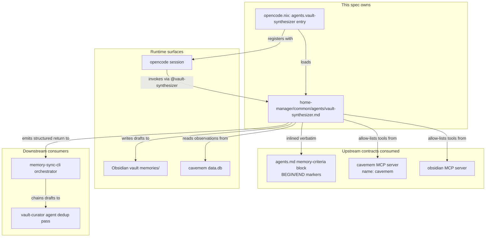
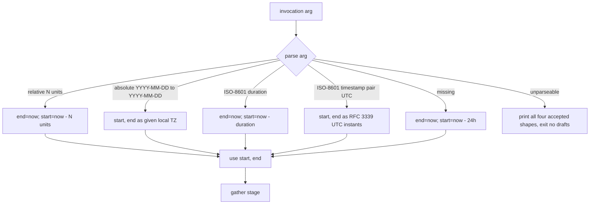

# Design Document: vault-synthesizer-agent

## Overview

**Purpose**: Ship a single opencode subagent that promotes high-signal
cavemem observations into curated Obsidian memory notes. The agent applies
the AGENTS.md memory criteria with selectivity, drafts notes that pass
vault-curator's audit unchanged, and emits a structured summary the
downstream `memory-sync-cli` orchestrator can consume.

**Users**: The two-host nix-darwin operator (Shopify + personal) is the
direct user — invoking `@vault-synthesizer <time-range>` from any opencode
session. The downstream `memory-sync-cli` spec is the only programmatic
consumer of this agent's structured-return contract.

**Impact**: Adds one new file (`home-manager/common/agents/vault-synthesizer.md`)
plus a one-line addition to the existing `agents` attrset in
`home-manager/common/opencode.nix`. No new Nix package, no new MCP tool,
no schema. The agent loads on next rebuild via the established
`programs.opencode.agents` wiring.

### Goals

- A single Markdown agent definition that opencode loads on next rebuild.
- Selectivity: the agent quotes the AGENTS.md memory criteria verbatim and
  applies them with concrete skip-vs-promote examples drawn from this repo's
  tag space.
- A stable structured return so `memory-sync-cli` can pipe its output to
  vault-curator and produce an operator-facing summary.
- Drafted memory notes that conform to the existing memory format
  byte-for-byte (frontmatter shape, body sections, slug convention) so
  vault-curator's audit accepts them unchanged.
- Defense-in-depth: `edit`/`write`/`webfetch` denied at the OS level on top
  of the prompt rule.

### Non-Goals

- Modifying `vault-curator.md` (curator unchanged; dedup remains its job).
- Modifying `home-manager/common/agents.md` (the AGENTS.md restructure is
  owned by `cavemem-integration`).
- Creating or modifying any cavemem MCP tool (`cavemem-integration` owns
  the cavemem MCP server registration).
- Building the `memory-sync` orchestration command (`memory-sync-cli` spec).
- Auto-scheduling synthesis runs (`memory-sync-cli` spec).
- Cross-host synthesis (cavemem is local; synthesized memories cross hosts
  via the existing iCloud/Google Drive vault sync, unchanged).
- New vault directories, MOCs, tag taxonomies, or transcription / summary
  archival logic.

## Boundary Commitments

### This Spec Owns

- The new agent file at `home-manager/common/agents/vault-synthesizer.md`
  and every byte inside it (frontmatter, body, inlined memory criteria,
  selectivity rubric, workflow definition, structured-return contract,
  invocation contract, smoke-test recipe).
- The single new entry in `programs.opencode.agents` inside
  `home-manager/common/opencode.nix` that loads the agent file via the
  existing `withCaveman` helper.

### Out of Boundary

- `home-manager/common/agents/vault-curator.md` (unchanged by this spec).
- `home-manager/common/agents.md` (the AGENTS.md restructure is owned by
  `cavemem-integration`; this spec only consumes the
  `<!-- BEGIN: memory-criteria -->` / `<!-- END: memory-criteria -->`
  anchored block).
- The cavemem package, the cavemem HM module, the cavemem MCP server
  registration, the cavemem opencode plugin, the cavemem importer / smoke
  tests (all owned by `cavemem-integration`).
- The `memory-sync` shell command, the marker file, the curator
  invocation chaining (all owned by `memory-sync-cli`).
- Any `nix flake check` extension or per-host wiring beyond the single
  attrset addition in `opencode.nix`.
- Any cavemem schema, embedding configuration, or worker behavior.

### Allowed Dependencies

- The `programs.opencode.agents` option surface in
  `home-manager/common/opencode.nix` (existing; one entry added).
- The `withCaveman` helper local to that file (existing; reused unchanged).
- The cavemem MCP server registered under the literal name `cavemem` by
  `cavemem-integration` (Requirement 10.AC2 of that spec). The agent
  consumes its tools as `hub_cavemem__list_sessions`,
  `hub_cavemem__timeline`, `hub_cavemem__get_observations`, and
  `hub_cavemem__search`.
- The Obsidian MCP server already registered in mcphub. The agent consumes
  `hub_obsidian__write-note` and `hub_obsidian__read-note`.
- The AGENTS.md memory criteria block wrapped in
  `<!-- BEGIN: memory-criteria -->` / `<!-- END: memory-criteria -->` per
  `cavemem-integration` Requirement 10.AC3. The agent file inlines this
  block verbatim, including the marker comments.
- The Obsidian vault paths already declared in `home.mcp.obsidianVaultPath`
  (read-only at runtime via the Obsidian MCP).

### Revalidation Triggers

- Cavemem MCP server name change (anything other than the literal
  `cavemem`) → invalidates this agent's tool allow-list. Mitigation:
  `cavemem-integration` Requirement 10.AC2 locks the name; if it ever
  changes, re-cherry-pick the agent's tool allow-list in lock-step.
- AGENTS.md memory criteria block heading or anchor marker change →
  invalidates the verbatim quote in the agent body. Mitigation: re-copy
  the block from `agents.md` into `vault-synthesizer.md` and verify the
  anchor markers are still present in the inlined copy.
- Cavemem MCP tool surface change (`list_sessions` / `timeline` /
  `get_observations` / `search` renamed or signature-changed by an
  upstream cavemem version bump) → invalidates the workflow stages and
  the structured-return contract. Mitigation: read
  `memories/<date>-cavemem-integration-overview.md` (shipped by
  `cavemem-integration` Requirement 11), re-validate against the new
  cavemem version, update the agent body and re-run the manual smoke
  test.
- Memory note format change in AGENTS.md (any change to the frontmatter
  keys, body sections, or slug convention) → invalidates Requirement 9
  conformance. Mitigation: align the agent body's worked example with the
  new format and re-run the smoke test against vault-curator.
- `withCaveman` helper signature change in `opencode.nix` → invalidates
  the agents-attrset entry. Mitigation: mirror the surrounding agent
  entries.

## Architecture

### Existing Architecture Analysis

**Agent definition pattern** (the closest precedents are vault-curator,
nix-pkg, nvim-tailor, security-auditor): a single Markdown file under
`home-manager/common/agents/` with a YAML frontmatter block (`description`,
`mode: all`, `model`, `temperature`, `permission`) and a Markdown body
defining mission, invariants, workflow, tool usage notes, and success
criteria. The agent body inlines whatever rules / examples / case studies
make the agent specific to this repo so it works without loading the global
AGENTS.md. `mode: all` is required because the agent is both delegated through
the Task tool and selected directly by `memory-sync` through
`opencode run --agent`.

**Wiring pattern** (the entire opencode agents attrset lives at lines
142-157 of `home-manager/common/opencode.nix`): the `agents` block reads
each `.md` file via `builtins.readFile` (wrapped in `withCaveman` to
optionally append the caveman-lite snippet on personal hosts). Adding a new
agent is one new line in that attrset; no glob, no auto-discovery.

**Permission pattern** (vault-curator is the closest precedent): vault-only
agents deny `edit`/`write`/`webfetch` and allow a tight bash inspection
allow-list (`ls`, `find`, `rg`, `grep`, `wc`, `head`, `tail`). Vault writes
go through `hub_obsidian__*` MCP tools, which bypass the OS-level deny
rules by design.

**MCP tool naming** (mcphub convention): tools registered under server name
`<server>` are exposed to the agent as `hub_<server>__<tool>`. Cavemem
registered under literal `cavemem` (per `cavemem-integration` Requirement
10.AC2) → tools are `hub_cavemem__list_sessions`, `hub_cavemem__timeline`,
`hub_cavemem__get_observations`, `hub_cavemem__search`.

### Architecture Pattern & Boundary Map



**Architecture Integration**:

- Selected pattern: single subagent definition file plus the standard
  one-line wiring in `programs.opencode.agents`. No new abstractions.
- Domain/feature boundaries: the agent file owns content (mission, rubric,
  workflow, examples, smoke-test recipe). The `opencode.nix` entry owns
  loading. There is no third surface.
- Existing patterns preserved: vault-curator's frontmatter/body shape,
  `withCaveman` helper invocation, vault-only permission posture, inlined
  Obsidian MCP quirk notes.
- New components rationale: only one — the agent file itself. The wiring
  addition is a configuration change to an existing attrset, not a new
  component.
- Steering compliance: declarative-first invariant maintained (the
  attrset addition is HM-managed); macOS-only target reflected (no
  platform-specific carve-outs needed); no GPL contamination (Markdown
  prose only).

### Technology Stack

| Layer | Choice / Version | Role in Feature | Notes |
|-------|------------------|-----------------|-------|
| Agent definition format | Markdown + YAML frontmatter | Subagent system prompt + permission/model declaration | Mirrors vault-curator's format byte-for-byte |
| Model | `anthropic/claude-sonnet-4-5` at `temperature: 0.2` | Synthesis judgment for selectivity rubric | Heavier than curator's haiku because the value-add is judgment, not bookkeeping |
| Wiring | `programs.opencode.agents` attrset entry in `home-manager/common/opencode.nix` | Loads the agent file via the existing `withCaveman` helper | One-line addition mirroring the four pre-existing entries |
| Vault write surface | `hub_obsidian__write-note` (Obsidian MCP) | Drafts memory notes into `memories/<date>-<slug>.md` | Bypasses OS-level write deny by design |
| Cavemem read surface | `hub_cavemem__list_sessions`, `hub_cavemem__timeline`, `hub_cavemem__get_observations`, `hub_cavemem__search` | Enumerate sessions, observations, fetch bodies, disambiguate clusters | Server name registered as literal `cavemem` per `cavemem-integration` Req 10.AC2 |
| Memory format reference | The AGENTS.md `<!-- BEGIN: memory-criteria -->` / `<!-- END: memory-criteria -->` block | Verbatim quote inside the agent body | Anchor markers introduced by `cavemem-integration` Req 10.AC3 |

## File Structure Plan

### Directory Structure

```
home-manager/
└── common/
    ├── agents/
    │   ├── nix-pkg.md            # existing
    │   ├── nvim-tailor.md        # existing
    │   ├── security-auditor.md   # existing
    │   ├── vault-curator.md      # existing
    │   └── vault-synthesizer.md  # NEW (this spec)
    └── opencode.nix              # MODIFIED (one-line addition)
```

### Modified Files

- `home-manager/common/opencode.nix` — add a single line to the `agents`
  attrset (currently lines 142-157):
  `vault-synthesizer = withCaveman ./agents/vault-synthesizer.md;`
  Position alphabetically (after `vault-curator`).

### New Files

- `home-manager/common/agents/vault-synthesizer.md` — the agent definition.
  Single responsibility: define the synthesizer subagent's prompt,
  permissions, model, workflow, rubric, structured-return contract, and
  smoke-test recipe.

## System Flows

### Synthesizer invocation flow

```mermaid
sequenceDiagram
    actor Op as Operator
    participant OC as opencode session
    participant VS as vault-synthesizer agent
    participant CM as cavemem MCP
    participant OBS as obsidian MCP
    participant Curator as vault-curator (downstream, future)

    Op->>OC: @vault-synthesizer 7 days
    OC->>VS: invoke with time-range arg
    VS->>VS: parse time range (default: last 24h)

    Note over VS: Stage 1 — gather
    VS->>CM: hub_cavemem__list_sessions(start, end)
    CM-->>VS: session IDs in window
    loop per session
        VS->>CM: hub_cavemem__timeline(session_id)
        CM-->>VS: observation IDs
    end

    Note over VS: Stage 2 — group
    VS->>VS: cluster by session + topic + cavemem.kind
    opt cluster keyword overlap is ambiguous
        VS->>CM: hub_cavemem__search(query)
        CM-->>VS: disambiguation hits
    end

    Note over VS: Stage 3 — score
    VS->>VS: apply AGENTS.md memory criteria; skip low-signal silently

    Note over VS: Stage 4 — draft
    loop per high-signal cluster
        VS->>CM: hub_cavemem__get_observations(ids)
        CM-->>VS: full observation bodies
        VS->>VS: compose memory note (frontmatter + body)
        VS->>OBS: hub_obsidian__write-note(memories/<date>-<slug>.md)
        OBS-->>VS: write ok
        opt format spot-check
            VS->>OBS: hub_obsidian__read-note(<same-path>)
            OBS-->>VS: content for read-back
        end
    end

    Note over VS: Stage 5 — report
    VS-->>OC: structured summary (counts + paths + window)
    OC-->>Op: rendered summary

    Note over Curator: Future memory-sync-cli reads VS's<br/>structured summary and pipes draft<br/>paths to @vault-curator for dedup.
```

### Time-range resolution flow



## Requirements Traceability

| Requirement | Summary | Components | Interfaces | Flows |
|-------------|---------|------------|------------|-------|
| 1.1 | Agent file at canonical path | AgentDefinitionFile | (file existence) | n/a |
| 1.2 | Frontmatter has required keys | AgentDefinitionFile | YAML frontmatter | n/a |
| 1.3 | `mode: all` | AgentDefinitionFile | YAML frontmatter | n/a |
| 1.4 | description names cavemem + time-range + alias | AgentDefinitionFile | YAML frontmatter | n/a |
| 1.5 | opencode.nix wires the agent in | OpencodeAgentsWiring | `programs.opencode.agents.vault-synthesizer` | n/a |
| 1.6 | `@vault-synthesizer` recognized after rebuild | OpencodeAgentsWiring | (runtime via opencode) | Synthesizer invocation |
| 1.7 | Loadable independent of `home.cavemem.enable` | OpencodeAgentsWiring | (negative assertion) | n/a |
| 2.1, 2.2, 2.3 | Model + temperature + no other sampling | AgentDefinitionFile | YAML frontmatter | n/a |
| 3.1, 3.2, 3.3 | edit/write/webfetch denied | AgentDefinitionFile | YAML frontmatter `permission` | n/a |
| 3.4 | bash allow-list mirrors curator's | AgentDefinitionFile | YAML frontmatter `permission.bash` | n/a |
| 3.5 | Body restates write-surface and defense-in-depth posture | AgentDefinitionFile | body "Operating rules" section | n/a |
| 4.1, 4.2 | Obsidian MCP tool surface documented | AgentDefinitionFile | body "Tool usage notes" section | Synthesizer invocation |
| 4.3 | Cavemem MCP tool surface documented | AgentDefinitionFile | body "Tool usage notes" section | Synthesizer invocation |
| 4.4 | Negative assertion: no other MCP tools | AgentDefinitionFile | body "Operating rules" section | n/a |
| 4.5 | Reuse vault-curator's Obsidian MCP quirk notes | AgentDefinitionFile | body "Tool usage notes" section | n/a |
| 5.1, 5.2, 5.3, 5.4 | Verbatim AGENTS.md memory criteria with anchor markers preserved | AgentDefinitionFile | body "Memory criteria (inlined verbatim)" section | (selectivity scoring at runtime) |
| 6.1, 6.2, 6.3, 6.4 | Selectivity rubric with concrete promote / skip examples | AgentDefinitionFile | body "Selectivity rubric" section | (scoring stage) |
| 7.1–7.7 | Five-stage workflow definition | AgentDefinitionFile | body "Workflow" section | Synthesizer invocation |
| 8.1–8.7 | Structured-return contract | AgentDefinitionFile | body "Report" section | Synthesizer invocation (final stage) |
| 9.1–9.7 | Drafted memory note format conformance | AgentDefinitionFile | body "Drafted memory note format" section + worked example | (draft stage at runtime) |
| 10.1–10.7 | Time-range invocation contract (incl. ISO 8601 UTC timestamp pair from memory-sync-cli) | AgentDefinitionFile | body "Invocation" section | Time-range resolution |
| 11.1–11.4 | Manual smoke-test recipe | AgentDefinitionFile | body "Success criteria" section | n/a |

## Components and Interfaces

| Component | Domain/Layer | Intent | Req Coverage | Key Dependencies | Contracts |
|-----------|--------------|--------|--------------|------------------|-----------|
| AgentDefinitionFile | Documentation / agent definition | Single-file subagent prompt + permission + model declaration | 1.1–1.4, 2.1–2.3, 3.1–3.5, 4.1–4.5, 5.1–5.4, 6.1–6.4, 7.1–7.7, 8.1–8.7, 9.1–9.7, 10.1–10.7, 11.1–11.4 | AGENTS.md memory-criteria anchored block (P0); cavemem MCP tools `hub_cavemem__*` (P0); Obsidian MCP tools `hub_obsidian__*` (P0); vault-curator.md as pattern (P1) | Service (operator-facing prompt + structured return) |
| OpencodeAgentsWiring | Home-manager / opencode wiring | One-line addition that loads the agent file into `programs.opencode.agents` | 1.5, 1.6, 1.7 | Existing `withCaveman` helper in `home-manager/common/opencode.nix` (P0); the new `AgentDefinitionFile` (P0) | State (rendered into opencode's agents settings) |

### Documentation / agent definition

#### AgentDefinitionFile

| Field | Detail |
|-------|--------|
| Intent | Define the `vault-synthesizer` subagent: model, temperature, permission posture, mission, invariants, inlined memory criteria, selectivity rubric, workflow, structured-return contract, time-range invocation contract, drafted-note format, smoke-test recipe |
| Requirements | 1.1, 1.2, 1.3, 1.4, 2.1, 2.2, 2.3, 3.1, 3.2, 3.3, 3.4, 3.5, 4.1, 4.2, 4.3, 4.4, 4.5, 5.1, 5.2, 5.3, 5.4, 6.1, 6.2, 6.3, 6.4, 7.1, 7.2, 7.3, 7.4, 7.5, 7.6, 7.7, 8.1, 8.2, 8.3, 8.4, 8.5, 8.6, 8.7, 9.1, 9.2, 9.3, 9.4, 9.5, 9.6, 9.7, 10.1, 10.2, 10.3, 10.4, 10.5, 10.6, 10.7, 11.1, 11.2, 11.3, 11.4 |

**Responsibilities & Constraints**

- Single Markdown file at `home-manager/common/agents/vault-synthesizer.md`.
- Frontmatter shape mirrors vault-curator's frontmatter exactly: top-level
  keys `description`, `mode`, `model`, `temperature`, `permission` (in that
  order). No additional top-level keys (no `options.thinking`).
- Body section order (matches the established subagent body shape):
  `# vault-synthesizer` H1, `## Mission`, `## Operating rules (INVARIANTS)`,
  `## Memory criteria (inlined verbatim from agents.md)`,
  `## Selectivity rubric`, `## Workflow`, `## Drafted memory note format`,
  `## Invocation`, `## Report`, `## Tool usage notes`, `## Success criteria`,
  `## Vault references` (optional), `## Public inspirations` (optional).
- Inlined memory-criteria block must include both anchor-marker comments
  (`<!-- BEGIN: memory-criteria -->` and `<!-- END: memory-criteria -->`)
  so a future maintainer can grep for them and confirm provenance.
- The agent body must NOT call any MCP tool outside the documented
  allow-list (Requirement 4.4).
- The agent body must NOT use `hub_obsidian__search-vault` /
  `hub_obsidian__search-by-tags` for dedup (Requirement 7.7).

**Dependencies**

- Inbound: `OpencodeAgentsWiring` reads this file via `builtins.readFile`
  inside `withCaveman` (P0).
- Outbound: at runtime, the agent calls `hub_obsidian__write-note`,
  `hub_obsidian__read-note`, `hub_cavemem__list_sessions`,
  `hub_cavemem__timeline`, `hub_cavemem__get_observations`,
  `hub_cavemem__search` (P0).
- External: the AGENTS.md `<!-- BEGIN: memory-criteria -->` /
  `<!-- END: memory-criteria -->` block — the verbatim source of the
  inlined memory-criteria section. Provenance check: the inlined copy
  must match the source byte-for-byte at the time the agent ships
  (P0).

**Contracts**: Service [x] / API [ ] / Event [ ] / Batch [ ] / State [ ]

##### Service Interface

The agent's invocation contract (consumed by the operator and by the
downstream `memory-sync-cli` orchestrator) is:

- **Input**: a single positional argument naming the time range. Four
  accepted shapes:
  - Relative: `"last 7 days"`, `"last 24 hours"`, `"7 days"`, `"24 hours"`
  - Absolute date pair: `"2026-05-01 to 2026-05-13"` (local TZ; inclusive bounds)
  - ISO-8601 duration: `"P7D"`, `"PT24H"`
  - ISO-8601 timestamp pair: `"2026-05-01T00:00:00Z to 2026-05-13T22:30:00Z"`
    (RFC 3339 UTC; trailing `Z` mandatory). This is the shape
    `memory-sync-cli` emits when it composes the synthesizer prompt from
    its marker file (per `memory-sync-cli` Decision 4 / Req 6.AC1).
  - Missing argument defaults to last 24 hours.
- **Preconditions**: cavemem MCP is reachable under the literal name
  `cavemem` (otherwise the cavemem tool calls fail and the agent reports
  the failure in its structured return). Obsidian MCP is reachable
  (otherwise drafts fail to write).
- **Output (structured return)**: a final-message summary block containing:
  - `time_range`: resolved start and end timestamps (ISO-8601, local TZ).
  - `observations_scanned`: integer count.
  - `clusters_identified`: integer count.
  - `clusters_promoted`: integer count of clusters that became drafts.
  - `clusters_skipped`: integer count of clusters skipped per the
    selectivity rubric.
  - `drafts_written`: integer count of memory notes written.
  - `draft_paths`: list of vault-relative paths (`memories/<date>-<slug>.md`),
    one per draft.
- **Postconditions**: zero or more memory notes written under `memories/`;
  no other side effects.
- **Invariants**: no writes outside the Obsidian vault; no network access;
  no calls to MCP tools outside the documented allow-list.

**Implementation Notes**

- Integration: the agent loads via the existing `programs.opencode.agents`
  surface; no new abstraction is introduced.
- Validation: the agent body's worked example (per Requirement 9.7) is the
  canonical reference for drafted-note format conformance. The manual
  smoke-test recipe (Requirement 11) is the runtime regression detector.
- Risks: agent prompts can drift from the AGENTS.md memory-criteria source
  if the verbatim copy is not refreshed when the source changes — the
  Revalidation Triggers section names this and points at the recovery
  procedure.

### Home-manager / opencode wiring

#### OpencodeAgentsWiring

| Field | Detail |
|-------|--------|
| Intent | Load the new agent file into opencode's `agents` attrset so `@vault-synthesizer` is recognized after rebuild |
| Requirements | 1.5, 1.6, 1.7 |

**Responsibilities & Constraints**

- Single one-line addition to the existing `agents = { ... }` block in
  `home-manager/common/opencode.nix`.
- Uses the existing `withCaveman` helper to optionally append the
  caveman-lite snippet on personal hosts (matches the four pre-existing
  agent entries).
- Position the new entry alphabetically (after `vault-curator`).
- Does NOT change the surrounding file structure, the `withCaveman` helper,
  or any other agent entry.
- Is NOT gated by `home.cavemem.enable`. The agent loads regardless of
  whether cavemem is enabled on the host; if cavemem is disabled, the
  agent's runtime tool calls will fail and surface the failure in its
  structured return — no Nix-level coupling needed.

**Dependencies**

- Inbound: per-host HM activation already imports `home-manager/common/opencode.nix`.
- Outbound: `programs.opencode.agents` (P0); `withCaveman` helper (P0);
  `./agents/vault-synthesizer.md` source file (P0).

**Contracts**: Service [ ] / API [ ] / Event [ ] / Batch [ ] / State [x]

##### State Management

- State model: pure-functional — the attrset entry is evaluated once at
  HM build time and serialized into opencode's settings.
- Persistence & consistency: HM-managed file write at activation; rebuild
  is idempotent.
- Concurrency strategy: not applicable (single-writer activation).

**Implementation Notes**

- Integration: trivial one-line addition; no new abstraction.
- Validation: a rebuild that succeeds and a subsequent `opencode` session
  that recognizes `@vault-synthesizer` is sufficient runtime proof.
- Risks: misalignment of the helper invocation with the surrounding
  pattern (e.g., omitting `withCaveman` or pointing at a wrong path) —
  mitigated by following the pattern of the four pre-existing entries
  byte-for-byte.

## Data Models

### Domain Model

This spec has no persistent data model of its own. The agent operates on
existing cavemem entities (Session, Observation, Summary — owned by
`cavemem-integration`) and produces existing Obsidian entities (Memory note
— format defined by AGENTS.md). The following tables document only the
fields the agent reads / writes, not the full schemas.

### Cavemem entities consumed (read-only)

| Entity | Field | Used by stage | Use |
|--------|-------|---------------|-----|
| Session | `id`, `started_at`, `ended_at`, `cwd`, `metadata` | gather, draft | Enumerate sessions in time window; populate `sessions:` frontmatter list of drafts |
| Observation | `id`, `session_id`, `kind`, `ts`, `metadata` | gather, group | Cluster signal (kind + content keywords + ts); ID list to fetch full bodies |
| Observation (body) | `content`, `intensity` | draft | Source material for the memory body |

### Memory note entities produced (write-only)

A drafted memory note follows the established format (defined in AGENTS.md;
mirrored byte-for-byte by vault-curator):

```markdown
---
tags:
  - memory
  - {project-name}
  - {1-5 specific topic tags}
date: YYYY-MM-DD
project: {project-name}
sessions:
  - cavemem-session-<session-id>
  - cavemem-session-<session-id>  # multi-session clusters union the IDs
---

# {Concise statement of the fact, decision, or pattern}

## Context
{Where and why this was discovered, derived from cavemem session cwd + observation context}

## Details
{The actual knowledge being preserved, distilled from the observation cluster}

## Related files
- {file paths surfaced in observations, if any}
```

Path: `memories/<YYYY-MM-DD>-<slug>.md` where `<YYYY-MM-DD>` is the date
of the earliest observation in the cluster and `<slug>` is 3-5 words in
kebab-case derived from the H1 statement.

### Time-range domain types

The time range is a (start, end) pair of timestamps in the host's local
timezone. The agent resolves the operator's argument into this pair before
calling `hub_cavemem__list_sessions(start, end)`.

## Error Handling

### Error Strategy

This spec ships only an agent definition file and a one-line wiring
addition. Errors fall into three categories:

- **Build-time errors** (HM activation): a malformed YAML frontmatter or
  a path typo in the `opencode.nix` entry will fail the rebuild. HM's
  standard error output is sufficient; no custom handling needed.
- **Runtime errors (agent prompt logic)**: errors are reported by the
  agent itself in its structured return.
- **Runtime errors (MCP layer)**: cavemem or Obsidian MCP tool failures
  surface as MCP error responses; the agent reports them in its
  structured return.

### Error Categories and Responses

- **Unparseable time-range argument**: the agent refuses the run, prints
  an actionable error message naming the accepted shapes (Requirement
  10.4), and produces no drafts. The structured return is omitted (the
  refusal message replaces it).
- **Empty time window** (cavemem reports zero sessions): the agent emits
  a structured return with zero counts (Requirement 10.6). No drafts.
- **Cavemem MCP unreachable**: the first `hub_cavemem__list_sessions`
  call fails. The agent reports the MCP error in its final message and
  recommends running `cavemem-smoke-test` (per Requirement 11.4).
- **Obsidian MCP unreachable** during the draft stage: individual
  `hub_obsidian__write-note` calls fail; the agent records the failure
  in the structured return (the failed draft path is omitted from
  `draft_paths`) and continues with remaining clusters.
- **Cluster fetch partially fails** (`hub_cavemem__get_observations`
  returns fewer rows than requested): the agent skips that cluster and
  records the skip in `clusters_skipped` with a brief reason in the
  structured return.

### Monitoring

Cavemem and Obsidian MCP failures surface in the operator's opencode
session output. Persistent failures should be diagnosed via the
`cavemem-smoke-test` script (`cavemem-integration` Requirement 9) and
the obsidian-MCP-MCP precedent (`mcphub launchctl kickstart` recovery
hint, already documented in vault-curator.md).

## Testing Strategy

### Build-Level Tests

- HM activation succeeds with the new agent entry: `darwin-rebuild switch`
  (or the host's equivalent) returns 0 on each host. Failure indicates a
  YAML frontmatter typo or a wrong path in the `opencode.nix` entry.
- The agent file is syntactically valid Markdown + YAML frontmatter:
  parse the frontmatter (e.g., via `yq` or a `nix eval` of `builtins.fromTOML`
  / equivalent) to confirm the four expected top-level keys are present
  with the expected types.

### Integration Tests

- After rebuild, `@vault-synthesizer` is a recognized agent name in an
  opencode session (Requirement 1.6 acceptance check). Validation
  technique: open an opencode session, type `@vault-synthesizer` and
  confirm the agent is discoverable / completes (the exact recognition
  surface depends on opencode's UX at the implementation time).
- The agent body's verbatim memory-criteria block matches the source in
  `home-manager/common/agents.md` byte-for-byte at ship time. Validation
  technique: extract the block from each file (between the
  `<!-- BEGIN: memory-criteria -->` and `<!-- END: memory-criteria -->`
  markers) and `diff -u` them; expect zero output.

### Manual Smoke Test (the canonical regression detector)

Documented inside the agent body's "Success criteria" section
(Requirement 11). The implementer runs:

```
@vault-synthesizer 24 hours
```

against today's cavemem session and verifies:

1. At least one memory draft is produced.
2. Each drafted memory matches the format in Requirement 9 (worked
   example in the agent body is the reference template).
3. No observation from a cavemem session whose `cwd` differs from the
   synthesis time-range's project context leaks into a draft (the
   privacy check; depends on the bug #39 patch shipped by
   `cavemem-integration`).

If any of (1)/(2)/(3) fails, the recovery is to run `cavemem-smoke-test`
(shipped by `cavemem-integration`) before re-attempting.

## Security Considerations

- The agent denies `edit`, `write`, and `webfetch` at the OS level
  (`permission.edit: deny`, `permission.write: deny`,
  `permission.webfetch: deny`). The bash allow-list contains only
  inspection commands (no `cat`, no `git`, no `nix`). The only mutating
  surface is `hub_obsidian__write-note`, which writes only inside the
  Obsidian vault (a path already trusted by the broader memory system).
- The agent never reads outside the cavemem MCP read surface and the
  Obsidian MCP. There is no code-execution path that touches anything
  else on the host.
- The agent never writes outside the Obsidian vault. Defense-in-depth:
  if a future MCP tool is registered that could write elsewhere, the
  documented allow-list still excludes it; the operator must explicitly
  edit the agent file to opt in.
- Privacy: the bug #39 patch (cross-project session-start context leak,
  shipped by `cavemem-integration`) is what keeps observations from
  cavemem sessions in OTHER projects from leaking into a synthesis run
  scoped to one project. The smoke-test recipe (Requirement 11.3.c)
  asserts this at runtime. If the patch regresses, the synthesizer will
  surface the leak in the next manual smoke run.

## Performance & Scalability

- Synthesis is operator-invoked, not on a schedule. Wall-clock budget
  is operator patience (typical ranges: a few seconds for "last 24
  hours", up to a minute for "last 30 days"). No SLO needed.
- The dominant cost is the model's context budget when the agent calls
  `hub_cavemem__get_observations` with many cluster IDs at once. The
  agent should batch by cluster (one `get_observations` per cluster) so
  the model sees one cluster's content at a time and produces one
  draft. The workflow definition encodes this batching.
- The agent uses `anthropic/claude-sonnet-4-5` (heavier than curator's
  haiku) because the value-add is selectivity judgment, not bookkeeping.
  This is acceptable because runs are operator-invoked and infrequent.

## Migration Strategy

This spec ships net-new functionality. There is no migration:

- No existing agent's behavior changes.
- No existing memory note is touched.
- No existing cavemem schema is touched.
- The first run of `@vault-synthesizer` after the agent ships is the
  first synthesis; subsequent runs may overlap time windows and
  deduplication is curator's job in the next pipeline stage.

## Supporting References

- `home-manager/common/agents/vault-curator.md` — the canonical
  subagent precedent for vault-only, deny-edit/write/webfetch agents
  with an inspection-only bash allow-list. Mirror its frontmatter
  byte-for-byte.
- `home-manager/common/agents.md` — the source of the verbatim
  memory-criteria block (will be wrapped in
  `<!-- BEGIN: memory-criteria -->` / `<!-- END: memory-criteria -->`
  by `cavemem-integration`).
- `home-manager/common/opencode.nix` lines 142-157 — the existing
  `agents` attrset and the `withCaveman` helper that the new wiring
  reuses.
- `.kiro/specs/cavemem-integration/design.md` — the upstream contracts
  this agent consumes (cavemem MCP server name, MCP tool surface,
  AGENTS.md anchor markers).
- `.kiro/specs/cavemem-integration/requirements.md` Requirement 10 —
  the locked downstream contracts for vault-synthesizer-agent.
- `.kiro/steering/roadmap.md` — the three-spec decomposition that
  positions this spec as Wave 2.
